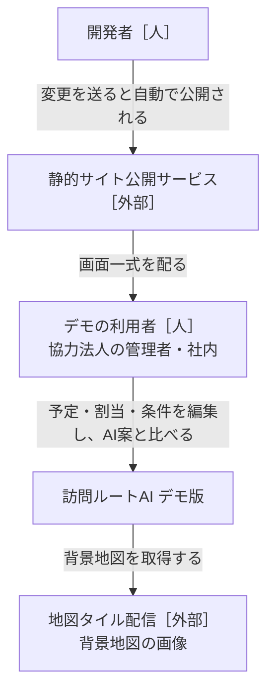
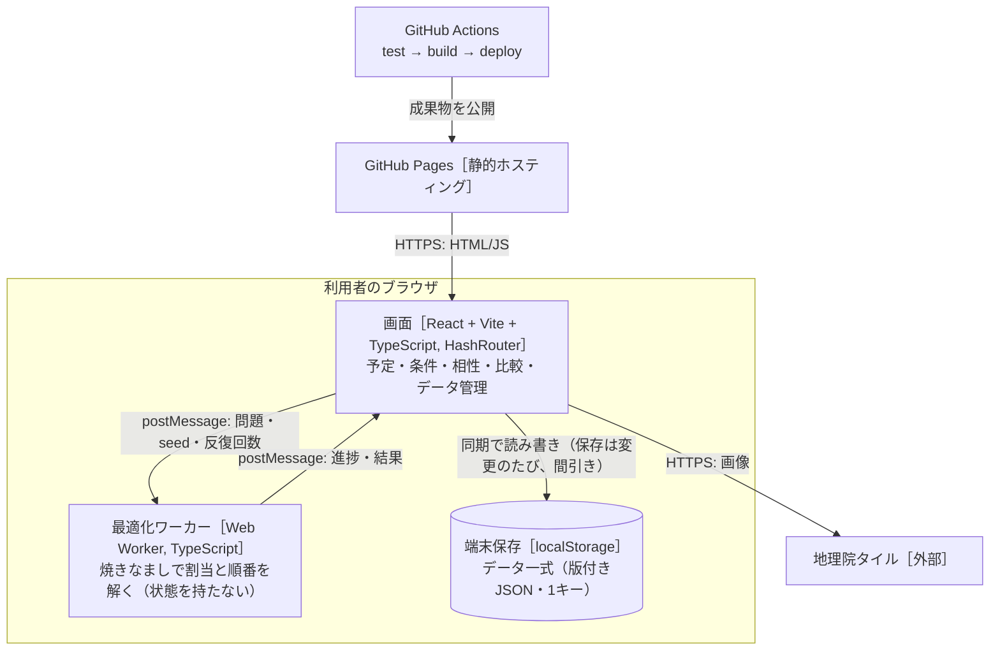
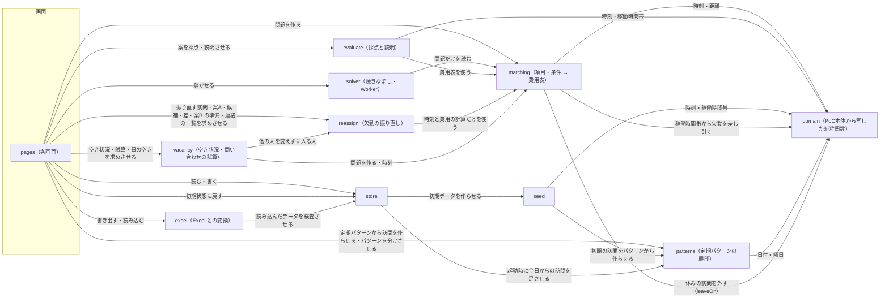

# 設計書：訪問ルートAI デモ版（ブラウザ完結）

- PRD：[docs/prd.md](prd.md)
- 作成者：松浦（草案：Claude）
- 更新日：2026-10-17（数字より視覚で分かる表示（第4弾。PRD D75〜D77）：`lib/staffBar`（〈スタッフ〉1人の30分ごとの状態 `staffSlots`・拘束の内訳 `spanParts`）、3段バーの共通の部品 `components/loadBar` の `SlotBar` と `components/staffBar`。`StaffDay.bar`・`WeekCell.bar`・`WorkStat.parts` を足す。データ・版は変えない）。2026-10-17（ヒアリングを受けた第3弾（PRD D71〜D74。ADR-0015。訪問介護・移動支援の事業所 2026-09-24）：〈スタッフ〉の `lastDay`（最終勤務日。翌日から `availabilityOf` が空＝勤務なし、compile の理由「最終勤務日の後」）と退職・担当替えの一括振り直し（`lib/offboard`）、稼働の見込み（`lib/workload`・`#/workload`。拘束・訪問・移動・待ち・距離・交通費。`org.spanLimitHours` は注意だけ）、〈利用者さん〉の `stage`（段階。段階が正で active・tentative を合わせる）と `referrer`（紹介元）、訪問の `cancelKind`（当日キャンセル）。版は1のまま）。2026-10-17（ヒアリングを受けた第2弾（PRD D68〜D70。ADR-0014）：〈利用者さん〉の `allowedStaffIds`（担当できる人。compile が限った人以外を可否で外す。理由 `ruleId: 'allowedStaff'`。store の repair が休止中・いない人を除く）、希望休のまとめ入力（欠勤の記録をそのまま使い、終日・メモ「希望休」を希望休とみなす。`lib/requestedOff`。月間の「休みを入れる」・「休みの人に N」の印・要対応）、月の予定の印刷 `#/month/print`（`lib/monthPrint`。A4横）。Excel の〈利用者さん〉シートに「担当できる人」）。2026-10-17（ヒアリングを受けた第1弾（PRD D64〜D67。ADR-0013）：定期パターンの `repeat`・`monthWeeks`・`dayTimes`（毎月の第N曜日・曜日ごとの時刻）、〈利用者さん〉の休み `clientLeaves`（domain の `leaveOn`。compile が休みの訪問を入れない＝派生で外す）、〈利用者さん〉の決まりごと（`entryNote`・`keyNote`・`parkingNote`・`cautionNote`）、vacancy の `vacancyNotice`（空き枠の案内文）。Excel の列・シート）。2026-10-17（日の画面の整理（PRD D63）：見出し・1行のまとめ・案を変えるメニュー・右の欄（詳しく／条件を調整する）・表示の切り替えに一覧・地図を横に。機能は減らさず置き場所を変える）。2026-10-17（混み具合バーの3段・〈利用者さん〉の「よみ」と検索・週間の利用者さんの上限（PRD D60〜D62）。`clientSchema.kana`、`components/ClientPicker.tsx`、`lib/search` の `normalizeKana`・`matchClient`）。2026-10-17（動線の整理（PRD D59）：メニューの組み直し、予定の共通の切り替え `components/ViewSwitch.tsx`［月｜週｜日］、月の「今月の準備」（`lib/month` の `monthProgress`）。予定の画面の時間軸（PRD D58）：`components/routeTimeline.tsx`。月間・週間の改定（PRD D53〜D57。ADR-0012 追記）：月間の点数をやめ状態を色に、vacancy に時刻つきの混み具合 `dayLoad`（`dayFreeness` を置き換え）、月間のスタッフ・利用者さんの選択と右の欄、週間の利用者さん表示・複数選択・資格のバッジとチップ・ドラッグ中の「入れる人 N人」・利用者さん×曜日の表）。2026-10-16（月単位の予定の段階3・段階2の設計（ADR-0012 追記。利用者が全機能の実装を依頼）：新しいコンポーネント vacancy（`src/vacancy/`。空き状況の表・問い合わせの試算・日の空きの割合）、reassign に `fitsOf`（他の人の開始を変えずに入る人だけ）、〈利用者さん〉の `tentative`（仮押さえ）、画面 `#/vacancy`・`#/week`（時間軸・ドラッグ・スタッフ×曜日の表）、`lib/week`、D21 の見直し（開いた日は基準のプリセットだけ自動））。2026-10-16（月単位の予定の段階1（ADR-0012。PRD D36〜D44）：訪問の種類 `visitTypes`（利用者が足す。担当に必要な条件は常に必須＝matching が可否で外す。理由 `ruleId: 'visitType'`）、定期パターン `patterns` と新しいコンポーネント patterns（`src/patterns/`。展開・「以降すべて」でパターンを分ける）、訪問の `typeId`・`pattern`（元のパターン・元の日・この回だけの変更）、seed をパターンから展開（いまの訪問と同じ ID・時刻）、月間カレンダー `#/month` と月まとめ作成（基準のプリセットで1日ずつ。`lib/month`）、「条件が変わった」の印、Excel の「種類」「定期パターン」シート。段階3（空き状況・問い合わせの試算）・段階2（週間の時間軸・ドラッグ・スタッフ×曜日の表）は §8 に置き、着手前にこの設計書に書く）。2026-10-14（欠勤の振り直しの3回目のレビューの反映：`leftOf` は欠勤のせいの訪問（absence・unreachable）だけで、元からの違反（notAllowed）を含めない。案B は案A の列が使えない人（可でない組・strict で回れない・件数の上限を超える）を列ごと案A のまま外して残りの人で作る（`AnnealPrep.held`。1列のせいで案B が作れなくならない）。左下の帯は1行に収め（入らなければボタンをアイコンだけに）、幅 1100px 以下では上ではなく右下の地図の上に積む。知らせ（トースト）は帯・地図より上に出す（浮かせた部品の位置を CSS の変数 `--map-dock-*`・`--reassign-dock-*` に出す）。欠勤の欄を閉じたときの戻り先を差の欄に差し替える（`SidePanel.returnFocus`。列の見出しへいったんスクロールしない）。差の欄へ移る予約は日付を変える・1.5秒で消す。連絡の一覧は差を出せなくても欠勤の人に残る訪問があれば開く。列の見出しの近道は「振り直し済み・入らない（全体）N件」）。2026-10-14（「いまの時刻」をやめる（利用者が決定。ADR-0011 追記）：reassign の `ReassignOptions`・`ReassignInfo.now`・案B の始まった訪問の固定（`AnnealPrep.held`）・候補の `startsBeforeNow` を消し、振り直しは欠勤と重なる・間に合わなくなる訪問をすべて対象に。古いデータの now は repair で捨てる。欠勤の人に残る訪問を出す `leftOf`。差の欄を担当ごとの順番のすぐ上へ移し、登録後に差の欄へ移る・左下の帯 `ReassignDock`・欠勤の人の列の見出しの近道。入らない訪問・残る訪問の理由を差の欄・カード・連絡の一覧に）。2026-10-14（欠勤の振り直しの2回目のレビューの反映（利用者が決定。ADR-0011 追記）：案B は案A に入っていた訪問を落として振り直す訪問を入れる「入れ替え」をしない（`ProblemStay.keep`・`KEEP_DROP_POINTS`＝落とした点の10倍。solver の差分と全体・`annealCost` に入れる）。保険の `settleAnneal`（案A に入っていた訪問を落とした・案A が回れず候補にできなかった・案A より高い → 案A のまま、理由を出す）。「入らない訪問は増えない」を訪問ID の集合（案B ⊆ 案A）で言い直す。案B は作り終えたら記録に足し（同じ結果なら足さない）、差の表は記録から出す（再読込でも残り、選び直せる）。案B の「止める」は順に作るのを止めた印を立てない。日付を変えたら「案B も作る」の予約を消す。連絡の一覧のボタンの件数は連絡が要る訪問の数）。2026-10-14（欠勤の振り直しの2回目（PRD D34・D35。ADR-0011 追記。推奨どおりに決定）：案B「少し動かしてよい」＝`Problem.stay`（元の案の担当・開始と減点）を solver の費用（`routeCost`）にだけ足し、`SolveOptions.initial` に案A を渡して案A より悪くならない。reassign に `prepareAnneal`・`finishAnneal`・`annealCost`・`contactsOf`・`stayPointsOf`、`ReassignInfo` に `method: 'anneal'`・`stayWeight`・`insertRoutes`。差の欄に案A と案B の比較と選択、連絡の一覧（コピー・印刷。`lib/contacts`）。evaluate の採点・点数の物差しは変えない）。2026-10-14（欠勤の振り直しのレビューの反映（ADR-0011。利用者が決定）：欠勤の時間と重なる訪問は時間に幅があってもすべて振り直す（`targetsOf` は欠勤を除いた問題の元の案の時刻で判定）、候補から入れてあとの訪問が遅れる・いまの時刻より前に入るときは確認を出し、いまの時刻より前の位置には入れない、列に元から違反がある人は候補に理由を出す、「元の案に戻す」で generated・runId も戻す、続けて振り直すと元の案は最初のものを引き継ぎ欠勤は累積）。2026-10-13（当日の急な欠勤の振り直し（ADR-0011。PRD D26〜D35）：欠勤を別の記録 `DemoData.absences` に持ち、domain の `withoutAbsences` で稼働時間帯から差し引く（compile・画面）。新しいコンポーネント reassign（`src/reassign/`）で、他の人の担当・順番・開始時刻を変えずに空き時間へ入れる案A・入らない訪問の候補・差を出す。結果は今の案（`AiPlan.reassign`）にして全部固定し、記録（`AiRun.reassign`）に残す。Excel に「欠勤」シート。1回目は案A、2回目は案B（変更の減点つき焼きなまし）・連絡の一覧）。2026-10-13（レビューの指摘：記録に計算に使った問題のキー `AiRun.inputKey` を残し、`reusableRun` はキーが一致する記録だけ使う（スタッフ・稼働時間・相性を変えたら計算する）。カードは使える記録を優先し、無ければ重みが一致する最新の記録に「データが変わったので押すと作り直します」。Worker の `bestRoutes` は最良が変わったときだけ。`useDayModel` の compile は compile が読むフィールドだけに依存。ADR-0010 追記）。2026-10-13（点数の物差しを点数の基準のプリセット（`DemoData.scorePresetId`。初期は標準）で固定。`useDayModel` に `scoreProblem`・`scoreScale`、Worker の進み具合に `bestRoutes`、Excel の「プリセット」シートに「点数の基準」の列。プリセットは予定の画面のカード全体を押して切り替え、同じ条件・同じデータの記録があれば計算しない（`reusableRun`）。右の欄のプリセットのボタンをやめる。ADR-0010）。2026-10-13（予定と AI案を1画面「予定」（`#/plan`）に統合し、手作業専用の列（開始時刻順・下書き・保存）をやめ「この割当で確定」に。担当ごとの順番・地図の部品を予定と比較で共通化し、列の最後に「自宅まで N分」。ADR-0009）。2026-10-13（点数を「100 −（費用 − 下限）÷ 訪問の件数」に（案A。1.6倍・上限160をやめ100点満点に戻す。素朴な案は点数の基準に使わない。ADR-0007 追記）。2026-10-13（レビューの指摘：素朴な案を「最も安い位置に挟む」に、solver の初期解に素朴な案、必須の違反がある案の点は「参考」、自動作成のあとは一番点の高い案を今の案に）。2026-10-13（点数を1.6倍に（100点を超えてよい。ADR-0007 追記）。プリセットをデータ `presets` に持たせ利用者が編集・追加・削除（最大6つ）、開いた日に全プリセットで自動作成、プリセットごとの案のカード、条件ごとの達成の件数、Excel の「プリセット」シート。ADR-0008）。2026-10-13（合計点を100点満点・高いほど良いで見せる。表示だけで探し方は変えない。ADR-0007）。2026-10-13（Excel の書き出し・読み込み、コンポーネント excel。ADR-0006）。2026-10-12（比較を「AI案の条件を変えた記録どうし」に変更、条件のプリセット3種、手作業の割当は seed に入れない。ADR-0005）。2026-10-11：負担の均等を2乗に・必須で上限、AI案の手直しと固定、比較は別画面（ADR-0004）
- 状態：合意済み（2026-10-11）

## 1. 背景と目的

PoC本体（`katahimo-dev/visit-route-poc`）の管理者画面（予定・手作業の割当・AI案との比較）を、サーバーなしでブラウザだけで動く静的サイトに移し、GitHub Pages で公開する。
データは localStorage に残し、JSON で書き出し・読み込みする。
最適化は Python（OR-Tools）の代わりに Web Worker 上の焼きなましで解き、ClassClassify のように**項目・条件・重み（0〜5）・必須**で、相性・スタッフの特性・顧客の希望を柔軟に足せるようにする。
目的は、協力法人に触ってもらって割当の考え方を集めるサイクルを速く回すこと（PRD §1）。

## 2. やらないこと

- ログイン・サーバー保存・事業所の分離・同時編集。外部送信は地図タイルの取得だけ
- Firebase・Cloud Functions・Python 最適化・Google Maps Platform。移動時間は直線距離からの概算（PoC本体 `estimateLeg`）だけ
- スタッフの記録・位置・ジオフェンス・勤怠・CSV・通知・PWA のオフライン対応
- 相性の学習。相性・特性・希望は人が入れる
- 勤務シフトの自動作成。月まとめ作成（ADR-0012）は、決まった勤務の中で AI案を**1日ずつ**作るだけで、日をまたいだ最適化（月の件数の均等・同じ人が続けて担当する並べ方）はしない
- 定期パターンの「毎月15日」（日付指定）・祝日の扱い（繰り返しは1〜4週ごとと毎月の第N曜日だけ。ADR-0012・ADR-0013）
- 〈利用者さん〉の休みでの自動の振り替え・確定した割当の自動の作り直し、決まりごとを割当の条件に使うこと、案内文の送信（ADR-0013）
- 実績・打刻・サイン・請求様式・LINE 連携・集金（PoC本体の範囲）。稼働の見込みは予定からの見込みで、勤怠・実働の記録ではない。拘束の上限を AI案の条件にすること、退職者の訪問の自動の作り直し、段階ごとの期日・やることの管理、紹介元とのやりとりの記録、当日キャンセルの請求（ADR-0015）
- 希望休の申請・承認・月の休みの日数の確認、希望休を考えた勤務シフトの自動作成、希望休を入れたときの自動の振り直し、担当を限る決まりの期間・「なるべく」の重み、印刷の書式の設定・PDF の直接の書き出し（ADR-0014）
- 欠勤まわり（ADR-0011）：本人からの欠勤連絡の受付、通知の自動送信（連絡文はコピーだけ。2回目）、複数日の欠勤の一括入力、勤怠・有給の管理、欠勤を入れただけで勝手に振り直すこと、訪問の中止・日時変更の自動提案
- PoC本体へのコードの書き戻し。共通の純粋関数は**写して**使い、同期しない（ADR-0001）

## 3. 全体図

### L1 システムコンテキスト



### L2 コンテナ



### L3 コンポーネント



矢印は「読む・呼ぶ」。データを書き換えるのは store だけ（§4）。solver と evaluate は同じ費用表（matching の出力）を使い、AI案と手作業案を**同じ物差し**で採点する。

## 4. コンポーネントと責務

### store（データ一式の保存）
- 責務：データ一式（`DemoData`）の読み込み・保存・検査・版の移行、JSON の書き出し・読み込み、初期状態に戻す。画面へは React のフック（`useDemoData()`・`update(fn)`）で渡す。
- 持つデータ（持ち主）：`DemoData`＝`{ version, org, staff[], clients[], visits[], availability[], absences[]（欠勤。ADR-0011）, manualPlans{date→routes}, items[], rules[], compat{clientId→{staffId→-2..2}}, aiPlans{date→AiPlan（routes＝手直し後、generated＝AIが出したまま、pins＝固定、runId＝元の記録）}, aiRuns{date→AiRun[]（記録。§5）}, presets[]（条件のプリセット。最大6つ。§5。ADR-0008）, scorePresetId?（点数の基準のプリセットの id。ADR-0010）, seed }`。`prevAiPlans`（前回のAI案）は廃止し、記録に置き換えた。localStorage のキー `vrdemo:data:v1` に1つの JSON で置く。
- 提供するAPI：`repair(data)`（契約は通るが中身が食い違うデータを直す：いない人・訪問を指す割当・相性・上書き・固定を除く、ID の重複は最初の1件。記録 `aiRuns` も同じに直し、いない人・訪問を指す記録の割当を除き、1日20件を超える分は古いものから捨てる。プリセット `presets` は id の重複を最初の1件に、6つを超える分は後ろを捨て、0件なら初期の3種、重みは 0〜5 に収めて 0.5 刻みに丸め、必須にできない型の必須は外す。点数の基準 `scorePresetId` は、無い・どのプリセットでもない id なら先頭のプリセットにする（ADR-0010）。`migrate` のあとに必ず通す）、`load(): DemoData`、`save(data)`（300ms 間引き）、`reset(): DemoData`、`exportJson(data): Blob`、`importJson(text): DemoData | ImportError`、`migrate(raw): DemoData`。版は1のまま。読み込み時、`prevAiPlans` は捨て、`aiRuns` が無い古いデータは `{}` で、`presets` が無い古いデータは初期の3種（seed の `INITIAL_PRESETS`）で補う（`migrate` の既定値。版は1のまま）。
- 欠勤（ADR-0011）：`DemoData.absences`（欠勤の記録。§5「欠勤と振り直し」）も持つ。無い（null も）古いデータは `[]` で補う（`migrate`。`aiRuns` と同じく版は1のまま）。`repair` は、いない人の欠勤を除き、ID の重複は最初の1件、同じ人・同じ日の欠勤は最後の1件にする（稼働時間の上書きと同じ）。今の案・記録の `reassign`（振り直しの元の案）の `baseRoutes`・`basePins`・`baseGenerated` は `routes`・`pins`・`generated` と同じ規則で直す（`absenceIds` は消された欠勤を指していてもそのまま。取り消しの表示に使う）
- 月単位の予定（ADR-0012）：`DemoData.visitTypes`（訪問の種類。最大20）・`DemoData.patterns`（定期パターン）も持つ。訪問に `typeId`・`pattern` が付く（§5「訪問の種類と定期パターン」）。どれも無い古いデータは zod の既定値（`[]`・null）で読む（版は1のまま）。`repair` は、種類の ID の重複は最初の1件・20を超える分は後ろを捨てる、いない利用者さんのパターンを除く、パターン・訪問のいない種類（`typeId`）は null、パターンのいない人の `usualStaffId` は null、パターンの曜日は重なりを除いて小さい順、訪問の `pattern.id` がどのパターンでもなければ `pattern` を null（訪問は残す）。起動時の `extendDays`（今日以降の訪問が無ければ足す）は、パターンがあれば patterns の `applyPatterns` で今日から14日分を展開し、パターンが無い古いデータは今までどおり seed の `daysFrom`
- 依存するもの：seed（初期データ）、patterns（`applyPatterns`）、zod（検査）。
- 〈利用者さん〉の休み（ADR-0013）：`DemoData.clientLeaves`（§5）も持つ。無い古いデータは `[]`（版は1のまま）
- 担当できる人（ADR-0014）：〈利用者さん〉の `allowedStaffIds`。無い古いデータは `[]`（版は1のまま）。`repair` は、いない・休止中の〈スタッフ〉の ID と重なりを除く（全員いなくなれば `[]`＝限らない）。希望休は欠勤（`absences`）の形のままなので、store の扱いは変えない
- 第3弾（ADR-0015）：〈スタッフ〉の `lastDay`（既定 null）、〈利用者さん〉の `stage`（無い古いデータは active・tentative から読み替え）・`referrer`（既定は空）、訪問の `cancelKind`（既定 null）、`org.spanLimitHours`（既定 10）。どれも版は1のまま。`repair` は active・tentative を段階に合わせ（`lib/clientStage` の `stageFlags`。段階が正）、取り消していない訪問の `cancelKind` を null にする
- 配置：`src/store/`
- 完了の条件：
  - [ ] 壊れた・古い版の JSON を読むと、移行するか、元のデータを残したまま利用者向けの日本語のエラーを返す（画面が真っ白にならない）
  - [ ] 書き出し → 読み込み で同じデータに戻る（テスト）
  - [ ] localStorage の容量超過で保存に失敗したら、書き出しを促す表示を出す
  - [ ] （ADR-0011）`absences` の無い（null の）古いデータは `[]` で読める。いない人の欠勤は消え、同じ人・同じ日の欠勤は最後の1件になる。欠勤・`AiPlan.reassign`・`AiRun.reassign` を含むデータが 書き出し → 読み込み で同じに戻る（テスト）
  - [ ] （ADR-0012）`visitTypes`・`patterns`・訪問の `typeId`・`pattern` の無い古いデータが読める（`[]`・null）。repair の直し方（上）が効く。種類・パターン・展開した訪問を含むデータが 書き出し → 読み込み で同じに戻る（テスト）
  - [ ] （ADR-0012 追記。段階3）〈利用者さん〉の `tentative`（仮押さえ。既定値 false）の無い古いデータが読める
  - [ ] （ADR-0012）パターンのあるデータで今日以降の訪問が無いとき、起動するとパターンから今日から14日分の訪問が足される（テスト）
  - [ ] （ADR-0014）`allowedStaffIds` の無い古いデータが `[]` で読める。repair でいない・休止中の人と重なりが消え、全員いなくなれば `[]`。直す所の無い〈利用者さん〉は同じ物（テスト）
  - [ ] （ADR-0015）`lastDay`・`stage`・`referrer`・`cancelKind`・`spanLimitHours` の無い古いデータが既定値で読める（active=false は終了、仮押さえは相談受付）。repair で段階と active・tentative の食い違いが直り、往復で同じに戻る（テスト）
  - [ ] （ADR-0013）`clientLeaves`・パターンの `repeat`・`monthWeeks`・`dayTimes`・〈利用者さん〉の決まりごとの無い古いデータが読める（`[]`・`'weekly'`・`[]`・`[]`・`''`）。repair：いない〈利用者さん〉の休みを除き ID の重複は最初の1件、パターンの `monthWeeks` は重なりを除いて小さい順（毎週系なら `[]`）、`dayTimes` はパターンの曜日にあるものだけ・同じ曜日は最初の1件・曜日の順。書き出し → 読み込みで同じに戻る（テスト）

### seed（デモの初期データ）
- 責務：PoC本体 `scripts/seedDemo.ts` の生成ロジック（仙台・スタッフ8人・訪問先20か所・日ごとの予定・稼働時間帯の上書き）を写し、本デモの項目・条件・相性の初期セットと、条件のプリセットの初期値3種（`src/seed/presets.ts` の `INITIAL_PRESETS`。データの `presets` に入る）を足す。手作業らしい割当は内部でだけ作り、データには入れない（`visits[].staffId` はすべて null、`manualPlans` は空 `{}`）。PoC本体の seed からのデモ独自の差分：スタッフの呼び方は「スタッフ」（業種 care の既定「ヘルパー」は `domain/terms.ts` に写したまま変えない。呼び方はデータの画面で変えられる）、項目「得意」に「料理」を足す。訪問の時間はすべて希望の時刻ちょうど（PoC本体の「幅」の訪問は、幅の始まりの時刻ちょうどに変えた。ただし c4 は日曜に担当が足りなくなるので幅の終わりの 10:30 にした。実際の業務では利用者さんごとの希望の時刻に訪問するため。2026-10-13）。画面・Excel で「幅」の訪問を入れることはできる。ただし訪問先の「いつもの担当」（`usualStaffId`）は、その割当で最も多く担当した人にする（継続の条件を試せるように）。日付だけで同じ結果が決まる。
- 持つデータ（持ち主）：なし
- 提供するAPI：`createDemoData(today: string): DemoData`（今日から14日分）
- 依存するもの：domain、patterns（初期の訪問の展開。ADR-0012）
- 配置：`src/seed/`
- 完了の条件：
  - [ ] PoC本体の性別希望（c6・c18 女性、c11 男性）は「性別」項目＋訪問先の必要条件に、NG（c2→s2、c12→s7）は相性「×」になる
  - [ ] 初期の項目は スタッフ側：性別・資格（介護福祉士/看護師/保育士/初任者研修 の複数）・経験年数（数値）・得意（高齢/子ども/障害/家事/話し相手 の複数）・喫煙者・ペット可。訪問先側：ペットあり・喫煙環境・対象（高齢/子ども/障害）。初期の条件は §5 の表の既定値
  - [ ] 同じ日付を渡すと同じデータになる（テスト）
  - [ ] 手作業の割当が入らない（全訪問の `staffId` が null、`manualPlans` が `{}`）。`usualStaffId` は入る（テスト）
  - [ ] 初期データに欠勤は入らない（`absences` が `[]`。ADR-0011）
  - [ ] （ADR-0012）初期の種類は「介護」（担当に必要な条件：資格に介護福祉士・初任者研修・看護師のどれか）と「リハビリ」（資格に理学療法士・作業療法士・言語聴覚士のどれか）。項目「資格」の選択肢に理学療法士・作業療法士・言語聴覚士を足し、スタッフ2人に理学療法士を持たせる
  - [ ] （ADR-0012）利用者さんごとに定期パターン1つ（ID は利用者さんの ID と同じ。曜日はいまの規則＝平日のうち1つの曜日だけ休み・`weekend` の印があれば土日も。時刻・所要は `slot`。対象が子どもの利用者さんは種類なし、ほかは介護。開始日は基準日、終了日なし、いつもの担当なし）。訪問は patterns の `applyPatterns` で基準日から14日分を展開し、**いまの seed と同じ訪問**（ID `${日付}_${利用者さんID}`・日付・時刻・所要。テスト）に `typeId`・`pattern` が付いたものになる。加えて高齢の利用者さん2人に、週1回・40分のリハビリのパターン（既存の訪問と時間が重ならない曜日・時刻）を足す
  - [ ] （ADR-0013）〈利用者さん〉の数人（c2・c4・c9・c13）に決まりごと（入り方・鍵・駐車場・注意）の架空の例が入る。初期データに休み（`clientLeaves`）は入らない。パターンは毎週（`repeat: 'weekly'`・`monthWeeks: []`・`dayTimes: []`）で、訪問は今までと同じ（テスト）
  - [ ] プリセットの初期値は3種（標準・移動を短く・人の組み合わせ重視。id は `standard`・`travel`・`people`）。型ごとに重み・必須を決め、条件（rules）の型ごとに上書きする（§5 の表）。`applyPreset(rules, preset)`・`presetOf(rules, presets)`、点数の基準の `scorePresetOf(presets, id)`（無ければ先頭）・`scoreRulesOf(data)`（条件に基準のプリセットの重み・必須を当てたもの。プリセットが0件なら条件そのもの。ADR-0010）を持つ。初期データの `scorePresetId` は `standard`

### domain（PoC本体から写した純粋関数）
- 責務：時刻（`hhmmToMinutes` など）、距離と移動の概算（`distanceMeters`・`estimateLeg`）、稼働時間帯（`availabilityOf`・`shiftOf`・`withinSlots`）、ルート評価（`evaluateRoute`）、手作業の割当の補助（PoC本体 `web/src/features/admin/schedule/model.ts` の `reconcile`・`assign`・`timesOf`・`warningsOf`）。
- 持つデータ（持ち主）：なし
- 提供するAPI：PoC本体と同じ名前・同じ引数（写したときのコミットをファイル先頭のコメントに書く）。デモ独自に、稼働時間帯から欠勤を差し引く `withoutAbsences(slots, absences)`（`domain/availability.ts`。「その日に働ける時間帯」を決めるのはこのファイルだけ、の規則を保つ。デモ独自である旨をコメントに書く。ADR-0011）
- 〈利用者さん〉の休み（ADR-0013。デモ独自）：`domain/leaves.ts` の `leaveOn(leaves, clientId, date)`（その日を含む休み。無ければ null）・`isOnLeave(leaves, visit)`。「訪問が休みのため無しか」を決めるのはこの関数だけ（compile・画面で同じ判定）
- 依存するもの：なし（zod のみ）
- 配置：`src/domain/`
- 完了の条件：
  - [ ] PoC本体の該当テストを一緒に写して通る
  - [ ] （ADR-0013）`leaveOn`：開始日・終了日の当日は休み、前日・翌日・別の〈利用者さん〉は休みでない（テスト）
  - [ ] `withoutAbsences`：終日（開始・終了とも無し）で空、9:00〜18:00 から 9:00〜12:00 を引くと 12:00〜18:00、15:00〜（早退）で 9:00〜15:00、〜11:00（遅刻）で 11:00〜18:00、12:00〜13:00 で 9:00〜12:00・13:00〜18:00、時間帯の外の欠勤では変わらない、複数の時間帯・複数の欠勤でも開始の順・重なりなしで返す（テスト）

### matching（項目・条件 → 費用表）
- 責務：項目（`Item`）・スタッフの特性値・訪問先の必要条件と希望・相性・条件（`Rule`）を、solver が読む**問題（`Problem`）**に変換する。①訪問×スタッフの**可否**（必須の条件・相性×・稼働時間帯の外）②訪問×スタッフの**割当費用**（重み付きの条件の合計、分換算）③スタッフごとの負担の目標（均等の条件）④移動・待ちの行列と係数。同じ関数で、訪問×スタッフごとの**理由**（どの条件で何分ぶん）も返す。
- 持つデータ（持ち主）：なし
- 提供するAPI：`compile(data: DemoData, date: string, pins?: 訪問ID→担当ID): Problem`（pins の訪問はその担当だけを可にする）、`matches`、`conditionText`、`scheduleRoute`、`bestInsertion(problem, routes, visitId, staffId)`（手直しで移した訪問を入れる位置：strict で最も費用が少ない位置、入らなければ開始時刻の順に lenient で入れ、違反として見せる）
- 欠勤（ADR-0011）：`CompileInput` に `absences` を足し、`compile` はその日のその人の欠勤を `withoutAbsences` で稼働時間帯から差し引く（`Problem` の形は変えない。`problemKey` は稼働時間帯を含むので欠勤で変わる）。欠勤で可にならない組の理由は `ruleId: 'slot'`、文は終日なら「欠勤（終日）」、途中の欠勤で稼働時間帯が全部なくなったら「欠勤で稼働時間がない」、欠勤が無ければ収まるなら「欠勤の時間と重なる」
- 案B の変更の減点（ADR-0011 追記。2回目）：`routeCost` は `problem.stay` があれば、元の担当（`stay.staff[v]`）と違う担当の訪問1件に `movePoints`、元の開始（`stay.start[v]`）からのずれ1分に `minutePoints` を足す。`scheduleRoute`（evaluate の採点）には足さない。`stay` は reassign の `prepareAnneal` だけが作り、compile は作らない。`stay.keep[v]`（案A に入っている、振り直す訪問でない訪問）は `dropPointsOf(problem, v)` で落とした点を `KEEP_DROP_POINTS`（`DROP_POINTS`×10）にする（solver・`annealCost` が使う。採点の `totalPoints` は常に `DROP_POINTS`）
- 訪問の種類（ADR-0012）：`CompileInput` に `visitTypes`・`patterns` を足す。訪問に `typeId` があり、その種類があれば、種類の必要条件（`requirements`）をスタッフの特性で判定し、満たさない条件ごとに `{ ruleId: 'visitType', label: '種類（〈名前〉）：〈条件の文〉 ✗', points: Infinity }`（可否で外す）、満たす条件は `✓`・0点を理由に足す（利用者さんの必要条件と同じ書き方。`conditionText`）。条件の重み・必須（`rules`）・プリセットには関係しない（常に必須）。いない種類の `typeId` は無視する。いつもの担当（`continuity`）は、訪問の `pattern` のパターンに `usualStaffId` があればその人、無ければ利用者さんの `usualStaffId`
- 担当できる人（ADR-0014）：〈利用者さん〉の `allowedStaffIds` のうち、その日の問題にいる（利用中の）人が1人以上いれば、その人たちだけを可にする。外れる組は `{ ruleId: 'allowedStaff', label: '担当を限る：山田、佐藤 ✗', points: Infinity }`、限った人は `✓`・0点（`ALLOWED_STAFF_RULE_ID`。種類の必要条件と同じく常に必須で、条件の重み・必須・プリセットに関係しない。evaluate の条件ごとの達成には数えない）。限っていない〈利用者さん〉の問題は今までと同じ。振り直し・`fitsOf`・空き状況・週のドロップは compile の可否を使うので、そのまま効く
- 〈利用者さん〉の休み（ADR-0013）：`CompileInput` に `clientLeaves` を足し、`compile` はその日に休み（`leaveOn`）の〈利用者さん〉の訪問を問題に入れない（取り消しと同じ扱い）。AI案・月まとめ作成・空き状況・混み具合・欠勤の振り直しは compile を通るので、どれからも外れる。休みの無い日の問題は今までと同じ
- 依存するもの：domain
- 配置：`src/matching/`
- 完了の条件：
  - [ ] 重み0の条件は費用にも理由にも出ない。必須の条件を満たさない組は可否で外れる（テスト）
  - [ ] 項目を消すと、それを参照する条件は「無効（項目がない）」になり、計算は止まらない
  - [ ] どの訪問にも担当の候補がいないとき、`Problem.infeasible` に訪問と原因の条件を入れる
  - [ ] （ADR-0012）種類の必要条件を満たさない人は、条件の重み・必須にかかわらず可にならず、理由が「種類（リハビリ）：資格に理学療法士… ✗」。種類の無い訪問・いない種類の訪問は今までと同じ問題になる（`problemKey` も同じ）。パターンのいつもの担当が継続の条件に使われる（テスト）
  - [ ] （ADR-0014）限った人だけが可で、外れる人の理由が「担当を限る：… ✗」。休止中・いない人は数えず、全員いなければ限らない。限った人が休みの日は infeasible に原因が出る。空（限らない）なら問題（`problemKey`）は今までと同じ。`fitsOf`・欠勤の振り直し（案A）も限った人だけに入れる（テスト）
  - [ ] （ADR-0013）休みの期間の〈利用者さん〉の訪問は問題に無く、休みを消すと戻る。休みの無い日の問題（`problemKey`）は変わらない（テスト）
  - [ ] （ADR-0011）欠勤のある人の `slots` は欠勤を差し引いたもの。欠勤の時間と重なる訪問はその人に可にならず、理由が「欠勤の時間と重なる」（終日は「欠勤（終日）」、途中の欠勤で稼働時間帯が全部なくなったら「欠勤で稼働時間がない」）。欠勤の無い日・人の問題は今までと同じ（テスト）

### solver（最適化・Web Worker）
- 責務：`Problem` を受け取り、時間の約束・稼働時間帯・可否を破らずに、`移動分 + 待ち分×係数 + 割当費用 + 均等の費用 + 落とした訪問×10000` を最小にする割当と順番を返す。焼きなまし（ADR-0003）。決定的な乱数（seed）と**反復回数**で止める（時刻で止めない。D10）。
- 持つデータ（持ち主）：なし
- 提供するAPI：Worker メッセージ（§5）。純粋関数 `solve(problem, {seed, iterations}, onProgress?)` も公開し、テストは Worker なしで呼ぶ。初期解は、貪欲な初期解と素朴な案（matching の `naiveSeqs`）の費用の低い方（AI案の費用 ≤ 素朴な案。ADR-0007）
- 案B（ADR-0011 追記。2回目）：`SolveOptions.initial`（staffId → 訪問ID）があれば初期解の候補にする。どの列も可・strict・件数の上限を守るときだけ使い、貪欲な初期解・素朴な案より費用（`stay` の減点を含む内部の費用）が高くなければそこから始める（同じならこちら）。最良は初期解より悪くならないので、結果の内部の費用 ≤ 候補の費用。落とした訪問の点は訪問ごと（`dropPointsOf`。`stay.keep` の訪問は `KEEP_DROP_POINTS`）で、未割当を入れる・外す・入れ替える（eject）の差分と全体の費用の両方に入れる（探索の途中で一時的に落とすのは許す）。`SolveResult.score` は今までどおり evaluate.score と同じ式（`stay` を含まない）。Worker のメッセージの形は変えない（`options` に乗るだけ）。進み具合の `bestScore` は内部の費用（`stay` を含む）
- 依存するもの：matching の `Problem` 型のみ
- 配置：`src/solver/`
- 完了の条件：
  - [ ] 同じ問題・seed・反復回数で同じ結果（テスト）
  - [ ] 出た案は可否・時間の約束・稼働時間帯を必ず守る（evaluate で違反0。性質テスト）
  - [ ] 8人・20件で 3秒以内、30人・150件で 30秒以内（中位のノートPC）。計算中に「止める」を押すとそれまでの最良案を返す
  - [ ] 全条件の重み0・移動だけのとき、PoC本体の手作業案（seed）より総移動が短い
  - [ ] （ADR-0011 追記）`initial` を渡すと結果の費用 ≤ 候補の費用。可でない組を含む候補は使わない（落ちない）。同じ入力で同じ結果（テスト）

### evaluate（採点と説明）
- 責務：AI案（記録・今の案・手作業案のどれも）を同じ `Problem` で採点する。合計点、移動・待ち・距離、条件ごとの達成/違反の数、訪問ごとの理由（`相性◎` `希望○ 女性` `資格✓` `継続` `移動+12分`）、守れなかった必須の条件（手作業案は保存を止めず警告だけ）、記録どうしの差（担当が変わった訪問数・移動の増減。比較画面では A・B ともいまの条件で採点し直す）。
- 持つデータ（持ち主）：なし
- 提供するAPI：`score(problem, routes): PlanScore`、`explain(problem, routes): VisitExplain[]`、`diff(a, b): PlanDiff`、点数の物差し `normalize(problem): ScoreScale`・`toHundred(cost, scale)`（100 −（費用 − 下限）÷ 訪問の件数）・`hundredBreakdown(score, scale, problem): HundredPart[]`・`naivePlan(problem)`（solver の初期解の候補。§5「点数」。ADR-0007）、条件ごとの達成の件数 `achievements(problem, routes): RuleAchievement[]`（§5。ADR-0008）
- 案B（ADR-0011 追記）：変更の減点（`Problem.stay`）は採点に入れない。`score` は `scheduleRoute` と割当費用・均等・落とした訪問だけ（点数の物差し ADR-0007・ADR-0010 は変えない）。案B の結果も点数の基準の物差しで採点し、変更の数は reassign の差（`reassignDiff`）で別に見せる
- 依存するもの：matching、domain
- 配置：`src/evaluate/`
- 完了の条件：
  - [ ] solver の内部の費用と `score` の合計点が一致する（テスト）
  - [ ] 理由は分換算の大きい順に3つまで出す
  - [ ] AI案の費用 ≤ 素朴な案・AI案の点 > 0（seed の14日・各プリセット）、素朴な案は件数の上限・必須の条件を守る（テスト）
  - [ ] 点数：費用が低いほど点が高い（単調）、0〜100 に収まる、下限は100点、1件あたり10分余計なら90点、訪問0件なら100点、同じ入力で同じ物差し、内訳の合計＝100−点数、下限 ≤ どの案（必須を守る案）の費用（テスト）
  - [ ] 達成の件数：分母はその条件の判定がある割当済みの訪問、分子はその条件の判定をすべて満たした訪問。相性は ◎・○・△・× の件数、負担の均等は目安の帯に収まった人数（テスト）

### reassign（欠勤の振り直し。ADR-0011）
- 責務：欠勤を差し引いた問題（`Problem`）と元の案（担当ごとの列）から、①振り直す訪問を決める（`targetsOf`）②他の人の担当・順番・開始時刻を変えずに、振り直す訪問を空き時間へ1件ずつ入れる（案A「空き時間に入れるだけ」。`reassign`）③入らない訪問の受けられる人の候補を出す（`candidatesFor`）・候補の人に入れる（`placeVisit`）④元の案と振り直した案の差を出す（`reassignDiff`）⑤欠勤の人に残る、振り直すべき訪問を出す（`leftOf`。手直しで戻した等）。どれも純粋関数で決定的（乱数・`Date.now` を使わない）。いまの時刻は扱わない（時刻で動かさない訪問は無い。過去の欠勤は登録しない前提。2026-10-14 利用者が決定）。`DemoData` は読まない・書かない（問題と列だけを受け取り、新しい列を返す）。
- 振り直しの規則（1回目＝案A。受け入れ基準として守る）：
  - いまの時刻は扱わない（2026-10-14 利用者が決定。以前は「いまの時刻より前に始まる訪問は動かさない」としていたが、当日 11:20 に終日の欠勤を登録すると初期値の現在時刻のせいで 9:00・10:30 の訪問が欠勤の人のまま残り、時間帯の欠勤でも同じ不整合が起きるためやめた。実際の運用でも過去の欠勤は登録しない）
  - 振り直す訪問：欠勤のある人（引数）の元の案の訪問のうち、(a) **欠勤の時間と重なる訪問はすべて**（元の案の時刻＝欠勤を除いた問題 `base.problem` での lenient の開始〜終了が、欠勤を差し引く前の稼働時間帯に収まり、差し引いたあとには収まらない訪問。時間に幅があって後ろへずらせば入る訪問も、欠勤の人のまま残さない。2026-10-14 利用者が決定）と、欠勤のせいでその人に可にならない訪問（`absence`）、欠勤と関係なくその人に可にならない訪問（`base.problem` でも可にならない元からの違反＝`notAllowed`）、(b) 残りを列の順に足していき、足すと strict で回れなくなる訪問（`unreachable`。欠勤明けに自宅から間に合わない等）。それ以外はその人のまま残す（欠勤明けの移動で開始が遅れることはある）
  - 入れられる位置：可・件数の上限（必須の負担の均等）を超えない・その列にすでにある訪問の開始時刻を変えずに strict で回れる、のすべてを満たす位置。欠勤の人も欠勤でない時間なら入れられる人に含む
  - 入れる順：残りの振り直す訪問ごとに入れられる人（位置のある人）を数え、少ない訪問から。同じ数なら regret（最良と次善の増える費用の差。次善が無ければ最大）の大きい訪問、それも同じなら開始（earliest）の早い順・問題の訪問の順。1件入れるたびに数え直す
  - 位置の選び方：増える費用（その列の 移動＋待ち×係数＋割当費用 の増分 ＋ 負担の均等の点の増分）が最も少ない位置。同じなら問題の staff の順で先の人・前の位置
  - 入れられる人がいない訪問は `unplaced` に残す（欠勤の人の列には残さない）。元の案で入らなかった訪問は振り直さない
  - 問題にいない人の列・問題に無い訪問は触らずにそのまま返す
- 持つデータ（持ち主）：なし
- 提供するAPI：§5「欠勤と振り直し」の `targetsOf`・`reassign`・`candidatesFor`・`placeVisit`・`reassignDiff`。空き状況（ADR-0012 追記）のために `fitsOf(problem, routes, visitId)`：`candidatesFor` の `fits` が true になる人だけを、同じ並び（増える費用の小さい順）で、「ずらせば入る」の探索をせずに返す（`{ staffId, addedCost, addedTravel }[]`）
- 補足（実装で決めたこと。作業指示書に無く推測した箇所。2026-10-13）：
  - 元の案の予定の開始時刻は、欠勤と重なるかの判定にだけ使う（`targetsOf` の `base.problem`＝その日の欠勤を除いたデータで compile した問題で出す。2026-10-14）
  - 「登録して振り直す」の欠勤の人（`targetsOf` の `absentStaffIds`）は、その日に欠勤のある**全員**（元の案が確定した割当のとき、先に欠勤を入れた人の訪問も振り直す）。`absenceIds` もその日の欠勤すべて
  - 続けて振り直す（今の案がすでに振り直しの案で、確定した割当が無い状態で別の欠勤を登録して振り直す）とき、振り直しは今の案から行うが、`reassign` の元の案の情報（`from`・`baseRoutes`・`basePins`・`baseGenerated`・`baseRunId`）は最初のものを引き継ぎ、`absenceIds` は累積する。差（`rDiff`）も「元の案に戻す」も最初の元の案に対して。確定した割当があれば今までどおりそれを元の案に新しく作る（2026-10-14 利用者が決定）
  - 確定した割当を元の案にするとき、今の案のその人の列に無い訪問は、開始（earliest）がより遅い最初の訪問の前に挟む
  - 候補の「ずらせば入る」は、時刻に関わらない必須の原因（`slot`・`time` 以外）が無く、件数の上限を超えない人だけ探す。前後同じ分なら遅らせる方を先に試す
  - `placeVisit` が空き時間に入らない人に入れるとき（他の訪問の開始を変えないと入らない）、同じ列のあとの訪問の時刻がずれて「+N分」・必須の違反（赤い枠）になることがある（入れた訪問の時刻は変えない）。そのときは候補の `delayedCount`・`maxDelayMinutes` で、押したときに「〈名前〉さんの訪問 N件の開始が最大 +M分 遅れます。入れますか？」の確認を出す（遅れが無ければ確認なし。2026-10-14 利用者が決定）
  - その人のいまの列が strict で回れない（元から必須の違反がある）ときは、空き時間に入る位置を探せない。候補に `routeBroken` で「いまの予定に必須の違反があるため、空き時間に入れられません」を出す（「この人に入れる」は押せる）
  - 候補の「この人に入れる」は件数の上限を超える人・必須の条件に合わない人にも押せる（手直しのドラッグと同じ。違反として見せる）
  - 欠勤の印で開始・終了が空のときは、その日の始業・終業の時刻で出す（「欠勤 8:30〜12:00」）。稼働時間の画面のセルは短く「欠勤」「欠 8:30-12」
- 依存するもの：contracts、matching（`scheduleRoute`・`routeCost`・`balancePoints` など時刻と費用の計算だけ）。solver・evaluate・store・画面には依存しない
- 配置：`src/reassign/`
- 2回目（案B「少し動かしてよい」・連絡の一覧。PRD D34・D35。ADR-0011 追記）の規則（受け入れ基準として守る。契約は §5「欠勤の振り直し：2回目（案B・連絡の一覧）」）：
  - 案B の準備（`prepareAnneal`）：いまの問題に `stay` を足す。`stay.staff`＝元の案の担当（振り直す訪問・元の案に無い訪問は null＝問わない）、`stay.start`＝元の案の開始（`base.problem` での lenient。元の案に無い訪問は null）、減点は `stayPointsOf(重み)`（重み w で担当が変わる1件 w×10・ずれ1分 w×0.2）
  - 欠勤の人の欠勤の時間帯は稼働時間帯から差し引いてあるので入らない
  - 元の案で入っていない訪問（振り直す訪問でもない）は、案A と同じく入れない（どの担当も可にしない）
  - 落とさない訪問（`stay.keep`）：初期解（案A の列）に入っていて、振り直す訪問でない訪問。落とした点が `KEEP_DROP_POINTS`（10倍）なので、案A に入っていた訪問を落として振り直す訪問を入れる「入れ替え」をしない
  - 保険（`settleAnneal(prep, solved)`）：案B の列に `stay.keep` の訪問が1件でも無い（`keepDropped`）、または案A の `annealCost` が有限でない（計算中にデータが変わり案A が strict で回れない等で solver が候補を捨てた）か案B の `annealCost` が案A より高い（`notBetter`）なら、案B として出さず案A（`finishAnneal(prep, prep.initial)`）を返して理由を付ける。画面は「案A を超えられませんでした」などを出す
  - 初期解：案A の列を `SolveOptions.initial` に渡す。案B の結果の `annealCost`（費用＋変更の減点）≤ 案A の `annealCost`（案A の列が strict・可・件数の上限を守るとき）
  - 結果（`finishAnneal`）：solver の列に、問題にいない人の列・問題に無い訪問は案A のまま。pins は担当のいるすべての訪問、`placed` は担当のいる振り直す訪問（`addedCost`・`addedTravel` は 0）、`unplaced` は担当のいない振り直す訪問
  - 連絡の一覧（`contactsOf`）：元の案（`base.problem` で lenient）と今の案（いまの問題で lenient）の差。担当が変わる訪問（入らない訪問も。`staffChanged`）、担当が同じで開始が四捨五入で1分以上変わる訪問（`timeChanged`）、スタッフごとの増える・外れる・開始が変わる訪問（`staff`。問題の staff の順、訪問は開始の順）。`reassignDiff` と同じ規則
- 完了の条件：
  - [ ] 欠勤の時間と重なる訪問（時間に幅があり後ろへずらせば入る訪問も）がすべて `absence` で、欠勤明けの最初の訪問に自宅から間に合わない訪問が `unreachable` で振り直す訪問になる。欠勤と重ならず間に合う訪問はならない。seed の 10/14 の s4 の終日の欠勤で s4 の訪問がすべて振り直され、午前だけの欠勤で午前の訪問が振り直される（2026-10-14 の報告の再現）。欠勤と関係のない元からの違反は `notAllowed`（テスト）
  - [ ] 他の人の訪問の担当・順番・開始時刻は変わらない：結果の各列から振り直した訪問を除くと元の案の列（欠勤の人は振り直す訪問を除いた列）と同じで、その訪問の開始時刻も同じ（性質テスト：seed の14日・各スタッフの終日・午前・午後の欠勤）
  - [ ] 振り直した訪問は可・strict・件数の上限を守る（`scheduleRoute` の strict が null でない。テスト）
  - [ ] 入れる順：入れられる人の少ない順、同じなら regret の大きい順（小さな問題でテスト）。同じ入力で同じ結果（テスト）
  - [ ] `pins` は結果で担当のいるすべての訪問（元の案のままの訪問と振り直した訪問）。`unplaced` の訪問はどの列にも無い（テスト）
  - [ ] 候補：可で strict に入る人が先で増える費用の小さい順、入らない人は「ずらせば入る」最小の分（5分刻み・前後120分まで）、必須で外れる理由・重みの違反の理由を返す。`placeVisit` は候補の「入る」と同じ位置に入れ、入らない人には strict の最良、無ければ開始の順の位置に入れる。そのとき遅れる既存の訪問の件数・最大の分、列に元から違反があるかを候補に返す（テスト）
  - [ ] 差：担当が変わった訪問・開始が変わった訪問（分）・入らない訪問・変わる人・移動の増減が出る（テスト）
  - [ ] 8人・20件で100ms以内、30人・150件で1秒以内（中位のノートPC）
  - [ ] （2回目）案B は案A より悪くならない（`annealCost`）。入らない訪問は増えない＝案B の `reassignDiff().unplaced`（訪問ID の集合）⊆ 案A の `unplaced`（テスト：seed の14日×全スタッフの終日の欠勤、重み0と既定）。結果はいまの問題で可・strict（テスト：seed の案A に入らない訪問が出る日・人）
  - [ ] （2回目）`settleAnneal`：案A に入っていた訪問を落とした案・案A より高い案・案A が回れず候補にできなかった案は案A を返す（テスト）
  - [ ] （2回目）重みを大きくすると元の案から変わる訪問（担当＋開始）が減る（重み0と5で比べる）。同じ入力・種で同じ結果。`SolveResult.score` は stay の無い問題の `score` と一致する（テスト）
  - [ ] （2回目）`routeCost` に stay の減点が入る（担当が違う1件・ずれ1分）。stay の無い問題は今までと同じ（テスト）
  - [ ] （2回目）連絡の一覧：担当が変わる訪問・入らない訪問・開始が変わる訪問・スタッフごとの増える/外れる/開始が変わる訪問。変わらなければ空（テスト）

### patterns（定期パターンの展開。ADR-0012）
- 責務：定期パターン（`Pattern`）から、決まった期間の訪問を**展開**する。パターンを「いつから」で分けて直し（「以降すべて」）、その日以降のこの回だけの変更が無い訪問を作り直す。パターンを消したときに今日以降の訪問を除く。どれも純粋関数で決定的（乱数・`Date.now` を使わない。今日は引数）。`DemoData` を書き換えない（新しいパターン・訪問の配列を返し、画面が `update` で入れる）
- 展開の規則（受け入れ基準として守る）：
  - その日に訪問がある＝曜日が `weekdays` にあり、`from` ≤ 日 ≤ `to`（null は無限）、かつ `repeat` が `'weekly'` なら `from` を含む週（日曜はじまり）を1週目として (週の番号 − 1) が `everyWeeks` で割り切れる。`'monthly'` なら、その日が月の中のその曜日の第N回目（N＝(日 − 1)÷7 の切り捨て＋1）で、N が `monthWeeks` にある（第5の無い月は作らない。ADR-0013）
  - 利用中でない利用者さん（`active` が false）のパターンは展開しない
  - 訪問の ID は `${元の日}_${パターンID}`。中身は パターンの `clientId`・`typeId`・時間の決め方・開始（早）・開始（遅）（その曜日の `dayTimes` があればそれ。ADR-0013）・所要、`staffId: null`・`cancelled: false`・`note: ''`、`pattern: { id, date: 元の日, edited: false }`
  - すでに同じ ID の訪問があれば作らない（この回だけの変更・取り消し・日付をずらした訪問がそのまま残る）。今日（引数）より前の日には作らない
  - 並びは日付・開始（早）の順に足す（既存の訪問の順は変えない）
- パターンを直す（`splitPattern`）：
  - 「いつから」（`since`）が元のパターンの `from` 以前なら、同じ ID のまま中身を置き換える。そうでなければ元のパターンの `to` を min(元の `to`, `since` の前日)（元の `to` が null なら `since` の前日）にし、新しい ID（引数）で `from` = `since` のパターンを足す
  - 作り直す期間は max(`since`, 今日) から、元のパターンの訪問の最後の日（展開済みの範囲）まで。その期間の、元のパターンの `edited` でない訪問を除き、直したパターンから展開し直す（`edited` の訪問・取り消した訪問は残す。取り消しは `edited` として扱う）
  - 除いた訪問・足した訪問の ID と、それが入る日（確定した割当がある日の確認に使う）を返す
- パターンを消す（`removePattern`）：パターンを除き、今日以降の `edited` でない訪問を除く。今日より前の訪問・`edited` の訪問は残し、`pattern` を null にする
- 持つデータ（持ち主）：なし
- 提供するAPI：§5「訪問の種類と定期パターン」の `occursOn`・`expandPattern`・`applyPatterns`・`splitPattern`・`removePattern`
- 依存するもの：contracts、domain（`addDays`・`weekday`）。matching・solver・store・画面には依存しない
- 配置：`src/patterns/`
- 完了の条件：
  - [ ] 毎週・隔週（`from` の週が1週目）・4週ごと、`from`・`to` の端、複数の曜日、利用中でない利用者さんで、展開される日が正しい（テスト）
  - [ ] 同じ入力から同じ訪問（ID・順）。2回続けて `applyPatterns` しても訪問は増えない。この回だけ直した訪問・取り消した訪問・日付をずらした訪問は上書きされない（テスト）
  - [ ] 今日より前の日には作らない（テスト）
  - [ ] `splitPattern`：`since` が `from` 以前なら置き換え、後なら元の `to` が前日・新しいパターンが `since` から。`since` より前の訪問と `edited` の訪問は変わらず、それ以外の展開済みの範囲の訪問が新しい中身になる。返す除いた・足した訪問の日が正しい（テスト）
  - [ ] `removePattern`：今日以降の `edited` でない訪問が消え、残した訪問の `pattern` は null（テスト）
  - [ ] （ADR-0013）毎月の第3・第4木曜：第3・第4の木曜だけ、第5の木曜は作らない。第5を選ぶと第5のある月だけ。毎週系の既定（`repeat` 無し）は今までと同じ。曜日ごとの時刻：月曜の回は月曜の時刻、上書きの無い曜日は共通の時刻。`splitPattern` で繰り返し方・曜日ごとの時刻を変えると、以降の回が新しい規則で作り直される（テスト）
  - [ ] seed の20人・14日を展開して1秒以内（中位のノートPC）

### vacancy（空き状況・問い合わせの試算。ADR-0012 追記。段階3）
- 責務：先の数週（初期値4週）の各日の**元の案**（確定した割当があればそれ、無ければ今の案。欠勤の `baseOf` と同じ選び方）に、仮の訪問を「他の人の担当・順番・開始時刻を変えずに」入れられるかを、曜日×開始時刻（30分刻み）ごとに数える。①空き状況の表（場所なし＝目安）②問い合わせの試算（場所あり＝移動も含めて正確）③日の午前・午後の空きの割合（月間カレンダーの帯）。どれも純粋関数で決定的。`DemoData` は読むだけ（書かない）
- 数え方（受け入れ基準として守る）：
  - 対象の日：`range.from` から `range.weeks`×7日。元の案が無い日（訪問があって案も確定も無い）は数えず `noPlanDates` に入れる。訪問が1件も無い日は空の案として数える
  - 開始時刻：`query.dayStart`〜`query.dayEnd`（初期値 07:00〜20:00）を `stepMinutes`（30）刻み。終わり（開始＋所要）が `dayEnd` を超える時刻は出さない
  - 担当できる人：その日に稼働時間帯がある（欠勤を差し引く）、種類の必要条件（`query.typeId` の種類）と `query.requirements`（スタッフの特性に対して）をすべて満たす、件数の上限（必須の負担の均等）を超えない
  - 正確（`query.place` あり）：仮の〈利用者さん〉（`INQUIRY_CLIENT_ID`、場所＝`query.place`、必要条件＝`query.requirements`）と仮の訪問（`INQUIRY_VISIT_ID`、種類＝`query.typeId`、所要＝`query.durationMinutes`、時間の決め方は幅で `dayStart`〜`dayEnd`）を足したデータで日ごとに1回 compile し、開始時刻ごとに仮の訪問の earliest・latest をその時刻にした問題で、reassign の `fitsOf` が返す人を数える（担当できる人の判定も compile の可否に入る）
  - 目安（`query.place` が null）：元の案の各列を lenient で時刻にし、[開始 − `marginMinutes`, 開始＋所要＋`marginMinutes`)（初期値 前後15分＝移動の見込み）が、その人の稼働時間帯に収まり、どの訪問の [開始, 終了) とも重ならない人を数える
  - 曜日×開始時刻のマス：その曜日の対象の日ごとの人（`byDate`）、`min`（数えた日のうち最も少ない人数＝どの週でも受けられる人数）、`weeksOk`（1人以上いた日の数）・`weeksTotal`（数えた日の数）。判定（`verdictOf`）は `weeksTotal` が0なら `'unknown'`、`weeksOk === weeksTotal` なら `'ok'`（○）、`weeksOk > 0` なら `'partial'`（△）、それ以外 `'ng'`（×）
  - 試算の要約（`inquirySummary`）：希望の曜日（無ければ全曜日）・時間帯の中で ○ の開始時刻を曜日ごとに連続した範囲にまとめ（「火 10:00〜11:30」）、○ の時刻のある曜日が週の回数以上あれば「火・木の 10:00〜11:30 なら、〈開始日〉から週2回で対応できます」、足りなければ ○ の曜日と △ の曜日（入らない日付）を並べ、どちらも無ければ「ご希望の曜日・時間帯では、いまは空きがありません」。呼び方は `org.terms`
  - 日の空きの割合（`dayFreeness`）：その日の元の案で、稼働中の人ごとの稼働時間帯のうち、訪問の [開始 − 移動, 終了) に使っていない分の合計 ÷ 稼働時間帯の合計 を、午前（12:00 まで）・午後で返す（0〜1。稼働時間帯が無ければ null）。案が無い日は null
- 持つデータ（持ち主）：なし
- 空き枠の案内文（ADR-0013。PRD D67）：`vacancyNotice(result, input)`。input は事業所名・呼び方・種類の名前・所要・期間（from〜to）・形（`'dates'`＝日付ごと／`'weekly'`＝曜日ごと）。日付ごと：期間の中の数えた日（案の無い日を除く）について、1人以上が受けられる開始時刻を連続した範囲にまとめ「・10/20（火） 14:00〜15:00、16:30」。曜日ごと：月〜日の順に ○（どの週も受けられる）の開始時刻の範囲「・火 14:00〜15:00」。どちらも1行目に「〈事業所名〉です。」と何の案内か、最後に目安である旨。範囲が1つも無ければ「いまはご案内できる空きがありません」。純粋関数
- 提供するAPI：§5「空き状況と問い合わせの試算」の `vacancyOf`・`verdictOf`・`inquirySummary`・`dayFreeness`、§5「空き枠の案内文」の `vacancyNotice`
- 依存するもの：contracts、matching（`compile`・`scheduleRoute`・`matches`）、reassign（`fitsOf`）、domain（日付・時刻・`withoutAbsences` は compile 経由）、lib/absences（元の案を選ぶ `baseOf`。欠勤の振り直しと同じ選び方にそろえるため）
- 配置：`src/vacancy/`
- 完了の条件：
  - [ ] 空いている人がいる時刻で正確の判定が ○、全員の予定が詰まっている時刻・稼働時間外は ×、ある週だけ詰まっていれば △ と入らない日付（テスト：小さな問題）
  - [ ] 正確の判定で入るとされた人に、reassign の `placeVisit` で仮の訪問を入れると、他の人の担当・順番・開始時刻が変わらず strict で回れる（性質テスト：seed の日）
  - [ ] 種類の必要条件・`query.requirements` を満たさない人は数えない。欠勤の時間は空きにならない（テスト）
  - [ ] 案の無い日は数えず `noPlanDates` に出る（テスト）
  - [ ] 要約の文：○ の連続した範囲のまとめ・週の回数が足りるとき／足りないとき／空きが無いとき（テスト）
  - [ ] 8人・約17件／日・4週・07:00〜20:00 で、正確の試算が 2秒以内、目安の表が 500ms 以内（中位のノートPC）
  - [ ] 同じ入力で同じ結果。今の案・データを書き換えない（テスト）
  - [ ] （ADR-0013）休みの〈利用者さん〉の訪問は空き状況・混み具合で数えない（その時間が空く）（テスト）
  - [ ] （ADR-0013）案内文：日付ごと・曜日ごとの範囲のまとめ、案の無い日を入れない、空きが無いとき、事業所名と呼び方（テスト）

### excel（Excel との変換。ADR-0006）
- 責務：`DemoData` ⇔ Excel のブック（シートごとの一覧。プリセットも入る）の変換。書き出しは見出し・列幅・プルダウン付きのテンプレートにする。読み込みは名前の参照を ID に直し、読めない値・同じ名前・いない人の参照を「シート名・行・列」付きの日本語のエラーで返す。データは書き換えない（変換した `DemoData` を返すだけ。画面が store の `migrate`→`replace` で入れる）。
- 持つデータ（持ち主）：なし
- 提供するAPI：`exportWorkbook(data) → Blob`、`importWorkbook(file: ArrayBuffer, base: DemoData) → DemoData | ImportError`（どちらも非同期）。`base` からは版・基準日など Excel に無いものだけを引き継ぎ、案（`manualPlans`・`aiPlans`・`aiRuns`）は空にする。「プリセット」シートが無い古いブックは、`base` のプリセット・点数の基準をそのまま使う。「欠勤」シート（ADR-0011。§5 の表）が無い古いブックは欠勤なし（`[]`。欠勤はその日の予定に付くもので、名前の参照が変わりうるため `base` から引き継がない）。「種類」「定期パターン」シート（ADR-0012）が無い古いブックは種類・パターンなし（`[]`。訪問の `typeId`・`pattern` は null）。
- 依存するもの：ExcelJS（画面から動的 import）、contracts、store（`migrate` で最後に検査）、matching（条件の表示文）
- 配置：`src/excel/`
- 完了の条件：
  - [ ] 書き出し → 読み込み で、案を除いて同じデータに戻る（テスト。ID・並び順も保つ）
  - [ ] ID 列が空の行は新しい人・訪問・項目・条件として足される。行を消すとその人・訪問は消える
  - [ ] 同じ名前・いない人の参照・読めない値・必須の列の欠けは、シート名と行番号付きのエラーで止め、いまのデータはそのまま
  - [ ] 外部への送信はしない
  - [ ] （ADR-0012）種類・定期パターン・訪問の種類・定期パターン・元の日・この回だけ変更 が書き出し → 読み込みで同じに戻る。「種類」「定期パターン」シートが無いブックは種類・パターンなし（訪問の種類・パターンは空）。同じ名前の種類、いない種類・利用者さん・〈スタッフ〉・パターンの参照、読めない曜日・間隔、終了日が開始日より前、開始（早）が開始（遅）より後は、シート名と行番号付きで止める（テスト）
  - [ ] （ADR-0013）パターンの毎月の第N週・曜日ごとの時刻、〈利用者さん〉の決まりごと、〈利用者さん〉の休みが書き出し → 読み込みで同じに戻る。列・シートが無い古いブックは毎週系・上書きなし・空・休みなし。間隔「毎月」で第N週が空・読めない第N週（1〜5 以外）・読めない曜日ごとの時刻・パターンの曜日に無い曜日の時刻・休みの終了日が開始日より前・いない〈利用者さん〉の休みは、シート名と行番号付きで止める（テスト）
  - [ ] （ADR-0014）〈利用者さん〉の「担当できる人」（「いつもの担当」の次の列。名前を「、」で区切る）が書き出し → 読み込みで同じに戻る。列が無い古いブックは限らない。いない名前はシート名と行番号付きで止め、同じ名前の重なりは1人（テスト）
  - [ ] （ADR-0011）欠勤が書き出し → 読み込みで同じに戻る。「欠勤」シートが無いブックは欠勤なし。同じ人・同じ日の2行、30分単位でない時刻、終了 ≤ 開始、いない人の名前は、シート名と行番号付きで止める（テスト）

### pages（画面）
- 第4弾（PRD D75〜D77。数字より視覚で分かる表示。2026-10-17 利用者の要望）：
  - `lib/staffBar.ts`（純粋関数）：`busyParts(stops)`（訪問と来る移動。移動は訪問の直前 [開始 − 来る移動, 開始) に置く＝vacancy の `dayLoad` と同じ）、`staffSlots({ shift, base, busy, planned })`（07:00〜20:00 の30分ごと。決め方は 訪問＞移動＞空き（稼働時間帯に重なる。planned が false＝訪問があるのに案が無い日は「案なし」）＞休み（その日の稼働時間帯が無い、または欠勤の時間）＞勤務外。重なりは30分に少しでも重なれば数える＝`dayLoad` と同じ。訪問の無い日は空の案（planned）＝`dayLoad` の planOf と同じ。だから今の案と確定した割当が同じ日（未確定の変更が無い日）は、混み具合の「空き N人」とその30分が「空き」の人の数が一致する。今の案と確定が違う日はそろえない：混み具合は問い合わせへの答えなので確定を先に（`baseOf`）、〈スタッフ〉の表示は手直し中の今の案を先に（`dayPlanOf`）数える。月の凡例に一言出す）、`spanParts(stops)`（拘束の内訳：訪問のあいだを 待ち→移動 に分ける）、`staffSlotText`・`staffSlotSummary`（title・読み上げ）
  - `components/loadBar.tsx`：3段の描画を `SlotBar({ slots: { start, level, title }[] | null, label, emptyText, testId })` に一般化し、`LoadBar` はその上に作る（見た目・読み上げは今のまま）。`components/staffBar.tsx`：`StaffBar`（level は `st-〈状態〉`）・`StaffLegend`。色と模様（`loadBar.css`）：訪問＝青の斜線、移動＝橙の点々（混み具合の「空き1人」と同じ模様）、空き＝緑（「空き2人以上」と同じ）、休み＝灰に白の横線、勤務外＝薄い灰（「働く人なし」と同じ）
  - 月間：`StaffDay.bar`（`staffDay` が数える案＝`dayPlanOf`（今の案、無ければ確定した割当）の lenient の時刻から作る。案の無い日は勤務内を「案なし」）。〈スタッフ〉を選んだときの日のマスは 短い文字（休・欠勤・欠勤あり・希望休・最終勤務日の後のときだけ）＋3段バー。件数・目安・移動・勤務時間は `aria-label`・title に残す。件数と目安の横棒（`LoadMeter`）はやめる。見出しの凡例は〈スタッフ〉のときその人の状態の凡例。memo（CompileInput のキーで比べる日の計算）は変えない
  - 週間：`WeekCell.bar`（`staffWeekTable` が作る。数える案は今のまま＝今の案、無ければ確定した割当。案の無い日は勤務内を「案なし」）。マスは3段バー＋件数（小さく）。稼働・移動・種類の内訳は title と読み上げ。表の上に凡例。この表にドラッグは無い
  - 稼働の見込み：`WorkStat.parts`（`spanParts`）。日ごとの横棒 `SpanBar` を訪問・移動・待ちで塗り分け、上限を超える日は太い橙の枠（行の注意の印と文字も今のまま）。3段にはしない（1日の時間軸の上の位置と拘束の長さを見るため）。〈スタッフ〉×日の表の `SpanMini`（長さと上限の線）は今のまま
- 第3弾（ADR-0015。ヒアリングを受けた第3弾）：
  - 〈スタッフ〉（`pages/StaffPage`・`pages/OffboardPanel`）：編集の欄に「最終勤務日」。保存して振り直すものがあれば「担当の振り直し」の欄（`lib/offboard` の `offboardScope`・`applyOffboard`）を開く。上に「最終勤務日のある〈スタッフ〉」のカード（振り直しが残っているか）、一覧の状態に「最終 M/D」。欄の主ボタンは「まとめて適用」（1つ）。訪問の案は作り直さず、日ごとの件数と日の画面へのボタンだけ
  - 稼働の見込み（`pages/WorkloadPage`・`#/workload?ym=&staff=`。左のメニューの「予定」と月間の見出しから）：`lib/workload` の `workMonth`・`workTotals`・`workloadTsv`。月の合計の表、〈スタッフ〉×日の表（拘束の時間と横棒 `components/workBars` の `SpanMini`）、選んだ人の日ごとの表（時間軸の横棒 `SpanBar`）。日ごとの横棒は拘束の中を訪問・移動・待ちに塗り分ける（PRD D77。下の第4弾）。交通費の単価・拘束の上限は事業所の設定（`org`）をこの画面で直す。主ボタンは無し
  - 月間（`pages/MonthPage`）：日の計算の覚え（CompileInput のキーで比べる memo）の中で、拘束が上限を超える人（`DayView.overSpan`）を数える。日のマスに「拘束超 N」・「最終 名前」、要対応に「拘束が N時間を超える 名前」。最終勤務日の後の人に残る訪問は「休みの人に N」（`absentLeftIds` に「最終勤務日の後」を足した）。〈スタッフ〉を選ぶと後の日は「最終勤務日の後」。見出しに「当日キャンセル N件」、〈利用者さん〉を選ぶと右の欄に「うち当日キャンセル」
  - 日（`pages/PlanPage`）：拘束が上限を超える人の帯（今の案、無ければ確定した割当）。訪問の取り消しは欄（ふつう／当日キャンセル）で選ぶ
  - 〈利用者さん〉（`pages/ClientsPage`）：段階で絞り込むボタン（件数つき・押したものは太字・下線・枠）、一覧の状態に段階、欄に「段階と紹介元」（段階・枠を仮押さえする・紹介元・連絡先・メモ）。「本登録にする」は段階を利用中にする。空き状況の仮押さえは「相談受付」で入る
- 責務：PoC本体の管理者画面（予定・AI案の比較・稼働時間帯・スタッフ・訪問先）を Firebase なしで動かす。最初に開く画面は `#/plan`。追加の画面：項目、条件（重みのスライダー 0〜5・必須の切り替え。ClassClassify の Setup にならう）、相性の表（訪問先×スタッフ、クリックで ◎→○→空→△→× を回す）、データ（書き出し・読み込み・初期状態に戻す・実データを入れないでの注意書き）。スタッフの今日の順番を見る画面（D16、表示だけ）。
- 特性と条件の入力（`components/conditions.tsx`）：特性のあり/なしは「未確認・あり・なし」。条件は相手の項目ごとの1行のチェック表で、何も選ばない項目は問わない。あり/なしの条件の「なし」は `is false`（未確認の相手は満たさない＝安全側）で、`not` は画面からは作らない（前からある `not` は「そのほかの条件」に出して消せる）。保存の形は `Condition[]` のまま
- 持つデータ（持ち主）：画面の一時状態のみ
- 提供するAPI：なし（ルートは `#/plan`（「予定」。ADR-0009：その日の訪問の一覧（初期は畳む。時間・訪問先・所要・今の案での担当・注意・編集/取消。訪問を追加・前の同じ曜日からコピー（訪問が無い日だけ））と、AI案を作る・手直し（ドラッグ）・固定・組み直す・「この割当で確定」（`manualPlans[date]` と各訪問の `staffId` に写す。計算に入れた訪問の担当が `manualPlans[date]` と一致すれば「確定済み」、違えば「未確定の変更あり」）。開いた日にAI案がなければ、基準のプリセット（`scorePresetId`）の案だけを Worker で自動で作り記録に残す（D52。他のプリセットはカードか「他の条件でも作る」で `data.presets` の順に1つずつ作り、どれも記録に残す。2つ目以降も最新のデータで問題を作る。進み具合「10/13 の案：プリセット 2/3」を出し、「止める」で今の1つを途中の最良で残して残りはやめる。計算中は重み・プリセット・いまの重みを保存を押せない。途中は最初に作れた案を見せ、終わったら一番点の高い（王冠の。同点なら先のプリセット）案を今の案にする。その間に手直し・別の案にしていれば変えない）。その日の条件 `data.rules` は書き換えず、作った案の `rules` にプリセットの重みが残る。上部にプリセットごとの案のカード（下記。押すとそのプリセットに切り替える）。今の案の欄に条件ごとの達成の件数（D25）。右の重みの欄には「いまの重み：〈プリセット名〉」・「いまの重みをプリセットとして保存」・プリセットの編集へのリンク・重みのスライダー・「AI案を作り直す」（プリセットのボタンは置かない。ADR-0010）。作る・組み直すたびに記録へ1件足す。担当ごとの列の最後に「自宅まで N分」（最後の訪問先 → 自宅。帰りの移動は `problem.travel[訪問先の点][自宅の点]`）。古いリンクの `#/schedule` は `#/plan` へ移す） `#/compare`（AI案の記録どうしの比較、D19・D22。下記） `#/rules` `#/items` `#/compat` `#/staff` `#/clients` `#/availability` `#/data` `#/staff-view/:staffId`）
- `#/plan` のプリセットのカード（ADR-0008・ADR-0010）：プリセットごとに、その日の記録のうち計算し直さずに使える記録（`reusableRun`。いまのデータでそのプリセットを当てた問題のキーと一致）を優先し、無ければ固定なしで重み・必須がそのプリセットと一致する最新の記録を1枚のカードにする（名前・一言・点数・移動・入らない訪問・必須の違反・条件の達成の要約）。後者（記録のあとにデータが変わった）のカードには「データが変わったので、押すと作り直します」の小さな注記を出し、押すと計算する（押したあとの点はカードの点と違いうる）。各プリセットの問題のキーは compile が読むデータとプリセットだけに依存して作る（ドラッグ・固定では作り直さない）。カードの読み上げの名前は短く（「標準の案を今の案にする（72点）」・今の案なら「標準の案（今の案・72点）」）、内訳・達成・注記は `aria-describedby`。点数・必須の違反・達成はどれも点数の基準の物差し（見出しに「物差し：標準」）。一番点の高いカードに王冠（0点のカードには付けない）。カードの「今の案」は、今の案の元になった記録の id（`AiPlan.runId`。無い古いデータは経路の一致）で決める。**カード全体が1つのボタン**（中にボタンを入れ子にしない。hover・focus の見た目、今の案のカードはオレンジの枠・`aria-pressed`、計算中は押せない）。押すと（`runPreset`）：その日の条件をプリセットの重みにし、計算し直さずに使える記録（`lib/runs` の `reusableRun`。§5）があれば計算せずにその記録を今の案にする（トースト「保存してある〈プリセット名〉の案を今の案にしました（再計算なし）」）、無ければその条件で計算して今の案にする。今の案（手直しなし）のカードは押しても何もしない。手直し・固定がある今の案を捨てるときは確認する。記録の無いプリセットは「まだ作っていません・押して作る」で、「他の条件でも作る」（通常のボタン。D52）で順にも作れる
- `#/rules` のプリセットの節（ADR-0008）：プリセットごとに名前・一言・型ごとの重み（0〜5、0.5刻み）・必須を編集（変えるとすぐ保存）、消す（最後の1つは消せない）、「いまの重みをプリセットとして保存」（名前を入れて足す。6つまで）、「初期値に戻す」（初期の3種に戻す。点数の基準も標準に。確認を出す）。「点数の基準」のラジオでプリセットを1つ選ぶ（ADR-0010。基準のプリセットの見出しに「点数の基準」の印。基準のプリセットを消すと残りの先頭に移り、確認の文に出す）
- 担当ごとの順番と地図の共通部品（予定・比較。ADR-0009）：`lib/routeView.ts` に `buildRouteMap`（ルートの集まり（予定は1つ、比較は A 点線・B 実線）から地図の点・線を作る。線は担当の色。担当の絞り込み・選んだ訪問先・区間（来る移動と「自宅まで」の帰り）の強調）、`homeTravel`（最後の訪問先 → 自宅の分）、`useRouteSelection`（地図で見る担当・強調する区間・選んだ訪問。担当を変える・訪問や区間を押すとその人のものでない選択を外し、担当を移した訪問を選んでいたら絞り込みを新しい担当に合わせ、案が入れ替わったとき・比べる案を変えたとき・日付が変わったら外す）。`components/routeView.tsx` に `LegLine`（自宅から・移動・自宅まで N分と待ち。押すと区間を強調）、`VisitCard`（来る区間・時間・訪問先・押すと理由。ドラッグ・固定・違反・「→ Bでは（担当の名前）」は差し込む）、`StaffLegend`（地図の凡例から担当を選ぶ）。画面の外の地図は `components/MapDock.tsx` で右下に浮かせる
- `#/compare` の中身：その日の記録と「今の案（予定の画面の手直し後）」から任意の2つを A・B に選んで比べる。条件の差（重み・必須が違う条件の一覧）、合計点・移動・待ち・距離・入らなかった訪問・必須の違反、条件ごとの達成/違反（採点は A・B とも、点数の基準のプリセットの同じ物差し。見出しに「物差し：標準」。ADR-0010）、担当ごとの順番の左右比較、地図（A：点線、B：実線。線は担当の色。訪問・区間・担当を押すと予定の画面と同じに強調・絞り込み、画面の外なら MapDock）。記録の一覧から「予定の画面で開く」（その記録を今の案にする）・「この条件にする」（その日の条件の重み・必須を記録と同じにする）・「消す」ができる。A と B に同じ案を選ぶと入れ替える。確定した割当との比較はしない。
- `#/plan` の急な欠勤（ADR-0011。1回目＝PRD D26〜D32）：
  - 欠勤の欄：担当ごとの列の見出しに小さな「急な欠勤」ボタン（その日に欠勤があれば、見出しの下の稼働時間帯の横に「欠勤 9:00〜12:00」「欠勤（終日）」の印、メモは title。ボタンは「欠勤を直す」）。押すと右から欄（`components/ui.tsx` の `SidePanel`）：終日／時間帯のラジオ、時間帯は開始・終了（30分刻みの選択。空＝始業から・終業まで）と早道のボタン（午前だけ＝始業〜12:00、午後だけ＝12:00〜終業、〇時から（早退）＝開始だけ、〇時まで（遅刻）＝終了だけ）、メモ（100字まで）、見込み（入力のたびに `targetsOf` を呼び「振り直す訪問 N件（欠勤と重なる a件・間に合わない b件）」と訪問の一覧、「ほかの人の担当・順番・時刻は変えず、空き時間に入れます（〈名前〉さんの残りの訪問は、欠勤明けの移動で開始が遅れることがあります）」。メモの入力では計算し直さない。読み上げは `aria-live="polite"`）。下の操作：主ボタン「登録して振り直す」・「欠勤だけ登録」・既存なら「欠勤を取り消す」・閉じる。その日の稼働時間帯がもともと無い人の列には出さない。時間帯が正しくない（終了 ≤ 開始）ときは欄に理由を出して押せない
  - 「登録して振り直す」：欠勤を足したデータで compile した問題、元の案（`lib/absences` の `baseOf`：`manualPlans[date]` があれば、各担当の訪問を今の案の列の順（無い訪問は earliest の順）に並べたもの。無ければ `aiPlans[date].routes`）、`targetsOf`（`base.problem` はその日の欠勤を除いたデータで compile した問題）→ `reassign` で、結果を今の案にする（`applyReassign`：routes・generated＝結果、pins＝結果の pins、`reassign`＝元の案の情報（§5。振り直す前の今の案の generated・runId も。続けて振り直すときは最初のものを引き継ぐ）、記録に `reassign` 付き・名前「欠勤の振り直し（〈名前〉さん）」で1件。欠勤の保存と合わせて1回の `update` で書く）。元の案が無ければ押せず「先にAI案を作ってください」（欠勤だけは登録できる）。元の案が確定した割当で今の案が「未確定の変更あり」なら、今の案の変更を捨てる確認を出す。計算中（Worker）は押せない
  - 差の欄（今の案に `reassign` があるとき、担当ごとの順番の欄のすぐ上。2026-10-14 に今の案の欄の上から移した）：まとめ「変わる人 N人・振り直し N件・入らない N件・（あれば）欠勤の人のまま N件・移動 +N分」、「元の案：確定した割当／今の案」、入らない訪問の理由（「入らない訪問（N件）：ほかの人の空き時間に入らない」と一覧・案B か「受けられる人」へ）、欠勤の人に残る訪問（`leftOf`。今の案に targetsOf を当てたもの。手直しで戻した等）の理由と「対応が必要」・「もう一度振り直す」、「元の案に戻す」（確認を出し、routes・pins を元の案（`baseRoutes`・`basePins`）に、generated・runId を振り直す前のもの（`baseGenerated`・`baseRunId`。無い古いデータは generated＝元の案・runId なし）に戻し、`reassign` を外す。続けて振り直したあとも最初の元の案へ。`revertReassign`）、「比較の画面で見る」（A＝欠勤前、B＝今の案）。差は `reassignDiff`（before＝元の案を、振り直しに使った欠勤を除いたデータで compile した問題で、after＝今の案をいまの問題で）。振り直しに使った欠勤が取り消されていたら「欠勤は取り消されています。元の案に戻せます」と出す。今の案を手直し・組み直ししても差の欄は残る（元の案との差を出し直す）。「AI案を作る」・プリセットのカードで別の案にすると消える
  - 欠勤の後の動線（2026-10-14。報告：案B への動線が画面の上にあって気づきにくい）：①「登録して振り直す」のあと、欠勤の欄が閉じて今の案が出たら差の欄へスクロールし、差の欄（`tabIndex=-1`・見出しで名前づけ）にフォーカスする ②差の欄を担当ごとの順番のすぐ上に置く（欠勤の人の列の近く） ③欠勤の人の列の見出しの下に近道「振り直し済み・入らない（全体） N件」（差の欄へ）・「欠勤の人のまま N件」（あれば）・「案B を作る」（案A で入らない訪問があり案B をまだ作っていないとき。作り始めて差の欄へ） ④差の欄が画面の外にあるあいだ、画面の左下に小さな帯（`ReassignDock`）：「欠勤の振り直し（案A／案B）」・入らない N件・欠勤の人のまま N件・「少し動かしてよい案（案B）を作る」（勧めるとき）・「連絡の一覧」・「差の欄へ」。左のメニューの右から出し、地図の `MapDock`（右下）と重ならない幅にする（地図の位置は `--map-dock-left`）。1行に収め、入らなければボタンの文言を隠してアイコンだけにする（aria-label・title で読める。見出しは省略記号）。幅 1100px 以下では右下の地図（開いた地図・地図のボタン）の上に積む（`--map-dock-top`。列の見出しを覆わないよう上には出さない）。初めに出すかは差の欄の実際の位置で決める。知らせ（トースト）は帯・地図より上に出す（`--reassign-dock-top`・`--map-dock-top`。`components/floating.ts`）。印刷では出さない。欠勤の欄を閉じたときは、戻り先を差の欄に差し替える（`SidePanel.returnFocus`。preventScroll でフォーカスし、差の欄へのスクロールだけにする）。差の欄へ移る予約は、日付を変えたとき・1.5秒経っても今の案が出ないときに消す
  - 列のカード：欠勤の人に残る訪問に「欠勤と重なる：振り直していない（対応が必要）」などの赤い印（理由は `leftOf` の reason。`leftOf` は欠勤のせいの訪問（absence・unreachable）だけで、欠勤と関係ない元からの違反（notAllowed）は含めない＝必須の違反の赤い枠で出る）。連絡の一覧のいちばん上にも「欠勤の人に残っている訪問（N件）：対応が必要」（時刻・訪問先・担当・理由。連絡文には入れない）を出し、「連絡の一覧」の件数に足す（差を出せないときも、残る訪問があれば連絡の一覧を開ける）
  - 列とカード：差の欄があるとき、変わらない人の列は薄く（押せる。文字のコントラストは保ち、背景・枠線・見出しの印だけを薄くする。透明度は使わない）、振り直した訪問のカードに「代行」の印（元の担当の名前を title・読み上げに）、開始が変わった訪問に「+N分」（早まったら「−N分」）。地図は振り直した訪問へ来る区間を太くする（`lib/routeView` の `buildRouteMap` に強調する訪問の集まりを渡せるようにする）
  - 入らなかった訪問（振り直しで入らない訪問）：カードの「受けられる人」で候補（`candidatesFor`。先頭5人＋「すべて見る」）を開く。行ごとに 名前・移動 +N分・「時間の約束を守れる」／「N分ずらせば入る」／「空き時間に入らない」・「いまの予定に必須の違反があるため、空き時間に入れられません」・「入れると後ろの N件が最大 +M分 遅れる」・条件の違反（理由の文）・「件数の上限を超える」と「この人に入れる」（`placeVisit` で入れて固定。後ろの訪問が遅れるときは確認を出す。守れないときは今までの必須の違反の赤い枠）。欄の注記は「入れる訪問の時間の約束は変えません。空き時間に入らない人に入れると、その人の後ろの訪問の開始が遅れることがあり（押すと確認します）…」
  - 比較の画面：記録に `reassign` があれば、選べる案に「欠勤前（記録の名前）」を足す（記録の `reassign.baseRoutes`。いまの問題で採点するので、欠勤の人の訪問は必須の違反として出る）。記録の一覧に「欠勤の振り直し」の印。「予定の画面で開く」は `planOfRun`（記録の `reassign` も今の案に写す）
  - 稼働時間の画面：欠勤のある日のセルに「欠勤」の印（「欠勤（終日）」「欠勤 9:00〜12:00」。メモは title）。稼働時間の欄に同じ文と「欠勤の登録・取り消しは予定の画面で」を出す（セルの時間帯の文は上書き・基本のまま）
  - `useDayModel`：`compileInput` に `absences`、`slotsOf` は欠勤を差し引いた時間帯と、その日の欠勤（`absence`。無ければ null）を返す（スタッフの画面の時刻も欠勤を差し引く）
  - `lib/runs`：`addRun` に optional の `label`・`reassign` を足す（`reassign` 付きの記録は名前を `label` にする）。`findRun` は `reassign` の有無も比べる。`reusableRun` は `reassign` 付きの記録を使わない。`planOfRun` は記録の `reassign` を今の案に写す
  - 2回目（PRD D34・D35。ADR-0011 追記）：
    - 欠勤の欄の見込み：`targetsOf` に続けて案A（`reassign`）も出し、入らない見込みがあれば「空き時間に入れるだけ（案A）では N件 が入らない見込みです…」と通常のボタン「登録して、少し動かしてよい（案B）も作る」（押すと「登録して振り直す」と同じに案A を今の案にし、続けて案B を作り始める）
    - 差の欄の中の「少し動かしてよい（案B）」の欄（`pages/reassignParts.tsx` の `AnnealBox`）：今の案が案A で、入らない訪問があれば「おすすめ」。「変更を減らす」のスライダー（0〜5・0.5刻み・既定3。今の案が案B ならその重み）と「担当が変わる1件＝移動N分ぶん・時刻のずれ10分＝移動M分ぶん」。「案B を作る」で Worker（`runSolve`。問題は `prepareAnneal` の問題、`initial` は案A、種はデータの種、反復は `defaultIterations`）で計算し、進み具合（回数）と「止める」（それまでの最良）を出す。終わったら元の案との差の表を案A と並べる：点数（点数の基準の物差し）・入らない・担当が変わる訪問（うち欠勤の人以外）・時刻がずれる訪問・変わる人・移動。列ごとに「〈案〉を今の案にする」（今の案の列は「今の案です」）。欠勤が取り消されている・案A が無い・ほかの計算中は押せない（理由を出す）。スライダーの近くに「重みが大きいと案A のままになることがあります（変更の減点が、得より大きいとき）」。進み具合の progress 要素は `aria-label="案B の進み具合"`。「止める」は案B の計算だけを止める（プリセットを順に作るのを止めた印は立てない）。日付を変えたら「案B も作る」の予約を消す。終わったら `settleAnneal` で確かめ、案A のままにしたときは理由を欄に出す（記録に足さない）。案B として出せるときは作り終えた時点で記録に1件足す（`lib/absences` の `addAnnealRun`。今の案は変えない。同じ結果・同じ重みなら足さない。作り始めたときと振り直しが違えば足さない）。差の表の案B は、今の振り直し（元の案・欠勤・案A が同じ）のいちばん新しい案B の記録（`annealRunOf`）から出すので、選ばなくても再読込で消えず、比較の画面で見られ、今の案が案B のとき「案A を今の案にする」を押しても案B を選び直せる
    - 選ぶ（`lib/absences` の `chooseReassign`）：今の案を選んだ案にし全部固定、`reassign` は元の案の情報を引き継ぎ `method`（案B なら `stayWeight`）だけ変える。記録に1件（名前「欠勤の振り直し・案B（〈名前〉さん）」。同じ結果・同じ方法の記録があればそれを指す）。今の案に案A・案B のどちらとも違う手直しがあれば確認を出す
    - 差の欄の見出しに「（案A：空き時間に入れた案）／（案B：少し動かした案）」、案B なら注記を「ほかの人の訪問も少し動かしています」に
    - 連絡の一覧（`ContactPanel`。差の欄の「連絡の一覧（訪問N件）」で右から出る欄。N は連絡が要る訪問の数＝担当が変わる訪問＋時刻だけ変わる訪問、同じ訪問は1件（`lib/contacts` の `contactCount`））：`contactsOf`（before＝元の案、after＝今の案。確定前でも見られる）から (1) 担当が変わる〈利用者さん〉（時刻・前の担当 → 新しい担当、入らないは「入らない（調整中）」）(2) 時刻だけ変わる〈利用者さん〉（件数。この訪問は〈利用者さん〉あての連絡文にも「開始が〜に変わります（担当は〜さんのままです）」として入る）(3) 仕事が増える・減る〈スタッフ〉（増える・外れる・時刻が変わるの件数と、時刻・行き先（住所））、連絡文（〈スタッフ〉あて・N人／〈利用者さん〉あて・N件。1件ずつ「コピー」、主ボタン「すべての連絡文をコピー」、「印刷」）。呼び方は `org.terms`（連絡文の敬称「様」「さん」は固定、呼び方が出る箇所は `org.terms`）。コピーは `lib/clipboard` の `copyText`：`navigator.clipboard`（使えなければ textarea を選んで `execCommand('copy')`）、結果をトースト。印刷（`@media print`）はこの欄だけを出す
    - `lib/contacts.ts`（純粋関数。テストあり）：`dayWordOf(date, today)`（当日は「本日」、ほかは「10月15日（木）」）、`staffMessage`（「〈名前〉さん／本日の予定の変更です。／・本日 14:00 天文台ほしみ様（住所）の訪問を追加でお願いします。／・本日 10:00 青葉様の訪問は、ほかの〈スタッフ〉が伺います（伺わなくて大丈夫です）。／・本日 11:00 青葉様の訪問の開始が 11:20 に変わります。」。行は元の時刻の順）、`clientMessages`（訪問先ごと：「〈表示名〉様／・本日 14:00 の訪問は、担当が 山田さんから 佐藤さんに代わります（、開始が 14:20 になります）。」「・本日 15:00 の訪問の開始が 15:20 に変わります（担当は 佐藤さんのままです）。」「・本日 16:00 の訪問は、担当の調整がつかず、あらためてご連絡します。」）、`allContactsText`
    - 比較の画面：同じ元の案の「欠勤前」は1つだけ出す（案A・案B の記録が同じ元の案を持つ）。記録の印は「欠勤の振り直し（案A）／（案B）」。よって 欠勤前／案A／案B を選んで比べられる
    - `lib/runs` の `findRun` は `reassign.method`・`stayWeight` も比べる（案A と案B は結果が同じでも別の記録）
- 月単位の予定（ADR-0012。段階1＝PRD D36〜D44）：
  - 種類の画面（`#/types`。左のメニューの「項目」の近く）：種類の一覧（色の丸・名前・標準の所要・担当に必要な条件の文・使っている訪問とパターンの数）。足す・直す（名前 1〜20字・色 0〜7・標準の所要 5〜720分・担当に必要な条件はスタッフの項目ごとの1行のチェック表＝`components/conditions.tsx` をそのまま使う・メモ）・消す（「〈名前〉を使っている訪問 N件・定期パターン M件は種類なしになります」の確認。消すと `typeId` を null にする）。20を超えては足せない
  - 定期パターン（〈利用者さん〉の画面の各利用者さんの欄の中に「定期パターン」の節）：パターンの一覧（種類の色・曜日・間隔・時刻・所要・期間・いつもの担当）と足す・直す・消す。欄：種類（選ぶと所要の初期値が種類の標準の所要）・曜日（日〜土のトグル。1つ以上）・間隔（毎週／隔週／3週ごと／4週ごと）・時間の決め方（ちょうど／幅）と開始（早・遅）・所要・開始日（初期値：今日）・終了日（空＝続く）・いつもの担当（空＝〈利用者さん〉のいつもの担当）・メモ。足すと、展開済みの範囲（今日から、いまある訪問の最後の日まで）に `applyPatterns` で展開する。直すときは「いつから変えますか」（初期値：今日）を出し、`splitPattern` の結果（作り直す訪問 N件、そのうち確定した日 M日の訪問）を確認してから入れる。消すときも `removePattern` の結果の件数を確認する
  - 訪問の欄（`VisitForm`）：種類の選択を足す（新しい訪問は種類を選ぶと所要の初期値が変わる）。パターンから展開した訪問には「定期パターン（月・木 10:00）の〈元の日〉の回」と出し、日付・時刻・所要・種類・取り消しを変えて保存すると `pattern.edited` を true にする（「この回だけの変更」と出す）。日付を変えられる（パターンの訪問も単発の訪問も）
  - 予定の画面：訪問のカード・一覧に種類の色の印と名前（`title`・読み上げにも）。種類の必要条件で外れる理由は今までの理由の欄に出る（matching）。（D43）今の案の元の記録の `inputKey` が、いまのデータでその記録の条件を当てた問題のキーと違えば、今の案の欄の上に「この案を作ったあとに、訪問・〈スタッフ〉・稼働時間・条件が変わりました」と「作り直す」（プリセットのカードを押したのと同じ。手直し・固定があれば確認）を出す
  - 月間カレンダー（`#/month`。左のメニューに「月間」。`?ym=2026-11` で月を指す。無ければ選んでいる日の月）：日曜はじまりの6週×7日の表。日のマス（ボタン）に 日付・訪問の件数（取り消しを除く）・状態（案なし／案あり／確定済み／未確定の変更あり。確定は今までの「確定済み」と同じ判定）・入らない N件・点数（点数の基準の物差し。案のある日だけ）・欠勤の印（その日に欠勤があれば）・（D43）「条件が変わった」。手当てが必要な日（訪問があって案なし・入らない訪問がある・必須の違反がある）は枠を強調する（色だけに頼らず印の文字も出す）。今日より前の日は薄く。マスを押すとその日を選んで `#/plan` へ。見出しに月の前後の送り・「今月」、月の集計（訪問 N件・案のある日 N/M日・入らない N件）。表示の計算（日ごとの compile と採点）は日付・`compileInput`・案で memo し、8人・約17件／日の一月で 500ms 以内
  - 月まとめ作成（D41。月間カレンダーの主ボタン「〈月〉の案をまとめて作る」）：押すと欄（`SidePanel`）に、使うプリセット（基準のプリセットの名前。「物差し：標準」と同じもの）、対象（ラジオ：「まだ案の無い日だけ」（初期値）／「確定していない日をすべて作り直す」）、対象の日数と見込みの時間（1日 約3〜5秒）、注記「先に定期パターンからこの月の訪問を作ります。今日より前の日・確定した日は作りません」。主ボタン「作り始める」で、①その月の今日以降に `applyPatterns` で展開（1回の `update`）②`lib/month` の `batchTargets` で対象の日を出し ③1日ずつ、その日のデータに基準のプリセットの重みを当てた条件（`applyPreset`）で compile し、Worker（`runSolve`。種はデータの種、反復は `defaultIterations`）で解き、その日の今の案（routes・generated＝結果、pins＝{}、rules＝使った条件、runId）と記録（`addRun`。名前はプリセットの名前、`inputKey` 付き）を1回の `update` で書く。書くときに「まだ案の無い日だけ」なのにその日の案ができていれば今の案は変えず記録だけ足す。進み具合「11/14 の案：5/22日」（日付と日数、`progress` 要素）と「止める」（今の日はそれまでの最良で残し `stopped`、残りはやめる）。計算中は他の計算（予定の画面の自動作成・プリセットのカード）を始めない（Worker は1つ）。画面を離れると止まる（作れた日は残る。離れる前の確認は出さない）。終わったら知らせ「N日分の案を作りました（入らない訪問がある日 M日）」。「確定していない日をすべて作り直す」を選んで、手直し・固定のある日があれば「手直しのある N日の手直しを捨てます」と確認する。その月の訪問が0件なら「定期パターンが無いか、この月の訪問がありません」で押せない
  - 月間カレンダーの通常のボタン「定期パターンから訪問だけ作る」（①だけ）と、（D43）「条件が変わった日を作り直す」（条件が変わった日のうち確定していない日を対象に、③と同じ流れ）
  - `lib/month.ts`（画面の純粋関数。テストあり）：`monthDates(ym)`（その月の日付）・`calendarWeeks(ym)`（日曜はじまりの6週の日付。前後の月を含む）・`batchTargets(data, ym, today, mode)`（対象の日：その月・今日以降・取り消しでない訪問がある・確定した割当が無い、かつ mode が `'empty'` なら今の案が無い日、`'all'` なら全部、`'stale'` なら条件が変わった日）・`dayStatus(data, date, view)`（件数・状態・入らない・欠勤の有無。点数・条件が変わったかは画面が compile して渡す）・`applyDayRun(d, date, run)`（今の案と記録を書く。既存の `lib/runs` の `addRun` を使う）
- 空き状況と問い合わせの試算（ADR-0012 追記。段階3＝PRD D45〜D48）：
  - 画面 `#/vacancy`（左のメニューに「空き状況」）：上に条件の欄（種類（選ぶと所要の初期値）・所要・〈スタッフ〉の条件（`components/conditions.tsx` の1行のチェック表。例：性別）・場所（住所の文字と地図で点を置く。空＝目安）・見る週の数（1〜8、初期値4）・開始日（初期値：今日））。条件を変えると（300ms 間引き）`vacancyOf` を計算し直す
  - 表：行＝曜日（月〜日）、列＝開始時刻（30分刻み）。マスに人数（`min`。目安なら「約」）と判定の印（○・△・×・？。色だけに頼らない）。マスを押すと右の欄に日付ごとの人（名前）と入らない日付。見出しに「目安（移動を前後15分で見込む）」か「〈場所〉への移動を含む」、案の無い日があれば「案の無い日（N日）は数えていません。月間カレンダーで案を作ってください」とリンク
  - 問い合わせの試算（同じ画面の下の節）：希望の曜日（複数）・希望の時間帯（開始〜終了）・週の回数。場所が無いと「場所を入れると、移動を含めて試算します」。結果の要約（`inquirySummary`）と「要約をコピー」（`lib/clipboard` の `copyText`）
  - 仮押さえ（D47）：要約が ○ のとき「仮の〈利用者さん〉として押さえる」：表示名（必須）を入れ、選んだ曜日ごとの最初の ○ の開始時刻で定期パターン（種類・所要・開始日・週1）を作り、〈利用者さん〉（`tentative: true`、場所、必要条件＝条件の欄）と一緒に1回の `update` で入れ、展開済みの範囲に `applyPatterns`。〈利用者さん〉の画面と予定の画面のカードに「仮」の印。〈利用者さん〉の画面で「本登録にする」（`tentative: false`）・「仮押さえを取り消す」（確認のうえ、その人のパターンを `removePattern` で消し〈利用者さん〉を消す）
  - 月間カレンダーの日のマス（D48）：案のある日に `dayFreeness` の午前・午後の空きを2本の細い帯で出す（`title` と読み上げに「午前の空き 40%」）
- 週間（ADR-0012 追記。段階2＝PRD D49〜D52）：
  - 画面 `#/week`（左のメニューに「週間」。`?d=YYYY-MM-DD` を含む週。月曜はじまり。無ければ選んでいる日の週）。見出しに週の前後の送り・「今週」・月間へのリンク。タブで「時間軸」と「〈スタッフ〉×曜日」を切り替える
  - 時間軸（D49）：列＝月〜日、縦＝07:00〜20:00（1時間ごとの目盛り）。訪問の帯は、その日の今の案（無ければ確定した割当、どちらも無ければ訪問の開始（早））の lenient の開始〜終了の位置に、種類の色で（文字：時刻・〈利用者さん〉・担当の名前）。〈スタッフ〉の絞り込み（全員／1人）。全員のとき、同じ時刻に重なる帯は列の中で横に並べる。未割当・入らない訪問は破線の枠。帯を押すとその日の予定の画面へ（その訪問を選ぶ）。日の見出しを押すとその日の予定の画面へ
  - ドラッグ（D50）：帯を別の日の列・時刻へドラッグ（15分刻みに丸める。範囲外は戻す）。離すと欄（`SidePanel`）に「〈利用者さん〉 〈元の日 時刻〉 → 〈新しい日 時刻〉」と、パターンの訪問なら「この回だけ」（初期値）／「以降すべて（〈元の日〉以降の〈曜日〉の回を〈新しい曜日 時刻〉に）」、単発なら説明だけ。主ボタン「動かす」。この回だけ＝訪問の日付・開始（早・遅。幅は保つ）を変え `pattern.edited` を true（`lib/week` の `moveOnce`）。以降すべて＝`splitPattern`（since＝元の日、曜日は元の曜日を新しい曜日に入れ替え、時刻を新しい時刻に。`lib/week` の `moveFollowing`。確定した日が含まれれば確認）。動かしたあと、新しい日に今の案があれば知らせに「〈日〉の案に空き時間で入れる」（`lib/week` の `insertIntoPlan`：その日の問題で reassign の `fitsOf` の先頭の人に `placeVisit` で入れ、固定。入らなければ「空き時間に入りません。その日を作り直すか、予定の画面で手で入れてください」）と「その日を作り直す」（予定の画面へ）。キーボードでは帯にフォーカスして Enter で同じ欄を開き、日付・時刻を選んで動かせる
  - 〈スタッフ〉×曜日（D51）：行＝稼働中の〈スタッフ〉、列＝月〜日。マスに 件数・稼働時間（時間）・移動（分）・種類ごとの件数（色の印と数）。休み（稼働時間帯が無い日）は灰色。行の端に週の合計（件数・稼働時間・移動）と、件数の全員の平均との差（±N件。差が平均の30%を超えると強調）。下の行に日ごとの合計。数えるのは、その日の今の案（無ければ確定した割当）で、案の無い日は「案なし」
  - `lib/week.ts`（画面の純粋関数。テストあり）：`weekDates(date)`（月曜はじまりの7日）・`laneLayout(blocks)`（重なる帯の横の並び）・`moveOnce(d, visitId, date, start)`・`moveFollowing(d, visitId, date, start, today, newId)`（`splitPattern` を使う。パターンの訪問でなければ `moveOnce`）・`insertIntoPlan(d, date, visitId, problem)`・`staffWeekTable(data, dates, problems)`（行・列・合計・平均との差）
- 予定の画面の自動作成の見直し（D52）：開いた日に AI案が無ければ、基準のプリセット（`scorePresetId`）の案だけを自動で作る（進み具合・止めるは今までどおり）。他のプリセットのカードは「まだ作っていません・押して作る」のままにし、通常のボタン「他の条件でも作る」（今の「足りない案を作る」）で残りを順に作る。今までの「終わったら一番点の高い案を今の案にする」は、自動では1つなのでその案が今の案になる
- 月間・週間の改定（ADR-0012 追記。PRD D53〜D57。2026-10-17）：
  - 月間の日のマス（D53）：点数を出さない。状態は背景・枠と印（案なし＝白・点線、案あり＝淡い緑、確定済み＝濃い緑＋鍵、未確定の変更あり＝淡い黄＋鉛筆、手当てが必要＝赤い枠＋赤い点）で、月の見出しの下に凡例。読み上げ（`aria-label`）には状態の文字を入れる。種類ごとの件数の積み上げバー（種類の色。`title` に内訳）、休み・欠勤の人の印（「休 2」「欠 消防」。`title` に名前）、その日に始まる（▶）・終わる（■）定期パターンのある利用者さんの印（`lib/month` の `dayMarks`。始まるは基準日（`baseDate`＝データの最初の日）より後に始まり、前日にその利用者さんのどのパターンの期間でもないもの。終わるは翌日にその利用者さんのどのパターンの期間でもないもの。初期データの全パターンが基準日に始まるのと、「以降すべて」で分けたパターンの継ぎ目を印にしないため）
  - 混み具合バー（D54）：vacancy の `dayLoad(data, date, filter)` が、07:00〜20:00 の30分ごとに `{ start, working, free }`（working＝その30分に稼働時間帯がある人、free＝そのうち元の案の訪問 [開始 − 来る移動, 終了) と重ならない人）を返す。`filter.typeId` があれば、その種類の必要条件を満たす人だけを数える。案の無い日は null。色は free 0＝赤＋斜線、1＝橙＋点々（0人の斜線とは別の模様。色だけで区別しない。凡例も同じ）、2以上＝緑、working 0＝灰。月の見出しに目盛りと凡例、上に「数える人：すべて／〈種類〉」の切り替え。`dayFreeness`・午前午後の帯はやめる（vacancy の公開から外してよい）
  - 選択（D55）：月の見出しに「表示：全体／〈スタッフ〉／〈利用者さん〉」の選択（1人）。`?staff=`・`?client=` で URL に残す。スタッフ・利用者さんの日のマスの中身と右の欄は PRD D55 のとおり。数えるのはその日の今の案（無ければ確定した割当）。純粋関数 `lib/month` の `staffDay`・`clientDay`・`staffMonth`・`clientMonth`・`attentionList`（テストあり）
  - 週間の時間軸（D56・D57）：上に「スタッフで見る／利用者さんで見る」。選ぶのはチップ（複数。全員・全解除）、`?staff=s1,s2`・`?client=` で URL に残す。スタッフで見るときは資格のチップ（項目「資格」の選択肢。押すとその資格を持つ人を選ぶ）とスタッフの名前の資格バッジ（選択肢の頭文字を2字まで。`title` に正式名）。帯の縁は担当の色、利用者さんで見るときは利用者さんの色。ドラッグ中は、その訪問を担当できる人（可否。compile の allowed）の名前のチップを強調し、落とす先の列に「入れる人 N人」（落とす日・時刻にした問題で reassign の `fitsOf` の人数。15分刻みのマスごとに memo）。担当が `visitType` の理由で可でない帯は赤い枠と「資格✗」
  - 利用者さん×曜日の表（D56）：行＝選んだ利用者さん（選ばなければ空で「選んでいません」。D62）、列＝月〜日、マスに訪問ごとの時刻・種類の色・担当の名前。訪問を別の日のマスへドラッグすると時間軸と同じ欄（この回だけ／以降すべて。時刻はそのまま）。過去の日には動かせない
  - `lib/week` に `qualificationBadges(items, staff)`・`staffWithQualification`・`clientWeekTable`（テストあり）
  - 予定の画面の時間軸（D58）：新しい部品 `components/routeTimeline.tsx`（担当ごとの列を時刻の位置で描く。予定の画面の「時間軸／順番」の切り替えで、順番は今の `VisitCard`・`LegLine` の列）。時刻は今の案の lenient の `scheduleRoute`（今と同じ）。1分＝一定の高さ（初期 1.1px）、07:00〜20:00（稼働時間帯・訪問がはみ出せば広げる）。列の背景は稼働時間帯（`slotsOf`。欠勤を差し引いたもの）の外を灰、欠勤の時間を斜線と「欠勤」。帯は押すと理由（今の `VisitCard` と同じ選択・地図の強調）、印（固定・代行・+N分・違反の赤い枠・仮・資格✗）は小さなアイコンと `title`。移動は前の帯の終わりから細い線と「移動 N分」（押すと区間を地図で強調）、待ちは点線の枠。ドラッグは今の予定の画面の担当の移し方（`bestInsertion`・固定）をそのまま使い、ドラッグ中は落とす列の、その訪問の earliest〜latest の位置に影（その人に入れたときの strict の可否で緑／赤。可否で外れる人は今と同じく予告）。「自宅まで N分」は列の最後の帯の下。切り替えの選択は localStorage でなく画面の状態（初期値：時間軸）。印刷・狭い幅（900px 以下）では順番に切り替える
  - 動線の整理（D59）：
    - メニュー（`src/app/App.tsx`）：見出し「予定」に「月」（`#/month`）「週」（`#/week`）「日」（`#/plan`）、「問い合わせ」に「空き状況」、「登録」に〈利用者さん〉・〈スタッフ〉・稼働時間、「決まり」に条件・項目・種類・相性、「その他」に比較・データ。ルートの URL は変えない（古いリンクを壊さない）
    - 予定の切り替え（`components/ViewSwitch.tsx`）：3つの画面の見出しの左に［月｜週｜日］（今の画面を `aria-current`）。押すと選んでいる日付（`useDay`）で移る：月は `?ym=` にその日の月、週は `?d=` にその日、日はその日。月・週で日付を変えたら（マス・帯・日の見出しを押す、週・月を送る）選んでいる日付も合わせる（月を送ったときはその月の1日、ただし今月なら今日）。それぞれの見出しの下に「この画面でやること」（月：「定期パターンから訪問を作り、一月分の案をまとめて作ります」、週：「日時をドラッグでずらし、〈スタッフ〉の偏りを見ます」、日：「その日の欠勤・手直しをして、割当を確定します」）
    - 月の「今月の準備」（`lib/month` の `monthProgress(data, ym, today, staleOf?, statusOf?)`（statusOf は画面が作った日の状態。要対応の数を右の欄とそろえる）：その月の今日以降について 訪問の件数・案のある日/訪問のある日・確定した日/訪問のある日・要対応の件数。テストあり）：見出しの下に①②③と要対応を横に並べ、済んだものに✓。①が0件なら「定期パターンから訪問だけ作る」、②が足りなければ主ボタンへ、③は「確定していない日」を要対応の欄に出す、要対応は右の欄へスクロール
    - 比較：日（予定の画面）の上部の「比較（記録 N件）」を「案を比べる（N件）」にする（`#/compare` はそのまま）
    - 最初に開く画面：日（`#/plan`）の今日（今のまま）
  - 混み具合バーの3段・〈利用者さん〉の検索・週間の上限（D60〜D62）：
    - `components/loadBar.tsx`：バーを3段（07:00〜12:00・12:00〜15:00・15:00〜20:00）に。段ごとに左右の端に時刻（「7」「12」）を小さく。色・title・読み上げは今のまま
    - `clientSchema` に `kana: z.string().max(50).default('')`（よみ。ひらがな）。store は古いデータを '' で読む。Excel の〈利用者さん〉シートに「よみ」（任意の列）。seed の20人によみを入れる。〈利用者さん〉の欄に「よみ」の入力
    - `lib/search.ts`：`normalizeKana(text)`（カタカナ→ひらがな、全角半角・大文字小文字・空白の違いと、ハイフン・各種マイナス・ダッシュを長音「ー」にそろえる）・`matchClient(client, query)`（表示名・よみの部分一致）（テスト）
    - `components/ClientPicker.tsx`：検索欄（`role="combobox"`・候補は `listbox`、上下キーと Enter で選ぶ）、候補は最大10件、選んだ人のチップ（外すボタン付き）、近道のボタン（この週・月に訪問がある人／〈スタッフ〉が担当する人（〈スタッフ〉を選ぶ）／最近選んだ人（画面の状態に最大10人）／仮押さえの人）。`max` を渡すと超えたときに理由を出して選ばない（まとめて選ぶボタン「あと N人を選ぶ」（N＝足す人数）は消さず、上限を超えるときは `aria-disabled` で押せなくして理由の小さい文を近くに出す）。変換中（IME）の Enter・↑↓ は何もしない。週間（複数）・月間（1人）で使う。〈利用者さん〉の画面の一覧の上にも同じ絞り込みの検索欄
    - 週間：時間軸の〈利用者さん〉で見るは `max=8`。表は上限なし。選択が空なら時間軸も表も「選んでいません」
    - `lib/search.ts` の `staffClientMap`（案の担当といつもの担当から〈スタッフ〉→〈利用者さん〉の表）・`defaultStaffOf`（近道で最初に選んでおく〈スタッフ〉＝担当する人が1人以上いる最初の人）・`countAmong`（テスト）
  - 日の画面の整理（D63）：
    - 並び：見出し（［月｜週｜日］・日付・状態の印・主ボタン「この割当で確定」）→ 1行のまとめ（訪問 N件・入らない N・必須の違反 N・移動 N分・N点（物差しの名前は title）・「詳しく」）→ あるときだけの帯（入らない訪問・欠勤の振り直しの差の欄への近道と左下の帯（今のまま）・条件が変わった）→ 操作の行（「訪問を追加」「案を変える ▾」・表示［時間軸｜順番｜一覧］・計算中の進み具合と止める）→ 本体（時間軸か順番か一覧）と地図（1280px 以上で横に並べ、見出しの「地図を畳む」で畳む。狭い画面は MapDock）→ 欠勤の差の欄（今のまま、本体のすぐ上）
    - 「案を変える ▾」（メニュー。キーボードで操作できる `menu`）：プリセットごとの案（名前・点数・作っていなければ「作る」。押すと今の runPreset）・他の条件でも作る・AI案を作り直す（今の「AI案を作る」）・固定を残して組み直す・AI案に戻す・前の同じ曜日からコピー（訪問が無い日だけ）・案を比べる（`#/compare`）・条件を調整する
    - 右の欄（`SidePanel`）：「詳しく」＝今の案の点数の内訳・条件ごとの達成・件数の偏り・AIが出したまま との差。「条件を調整する」＝プリセットのカード（今と同じ部品）・いまの重み・条件の重みのスライダー・いまの重みをプリセットとして保存・プリセットを編集するへのリンク・「この重みで作り直す」
    - 一覧：今の「訪問の一覧」の表（時刻・訪問先・所要・担当・注意・編集/取消）を表示の3つ目に
    - 今ある機能（D18 の手直し・固定・D20〜D25・D26〜D35 の欠勤・D43）はどれも残す。置き場所が変わるだけ。既存の Playwright の確認（欠勤の動線・ドラッグ）が通ること
  - `lib/absences.ts`（画面の純粋関数。テストあり）：`absencesOn(data, date)`・`saveAbsence(d, absence)`（同じ人・同じ日の欠勤はその1件を置き換える）・`removeAbsence(d, id)`（今の案は変えない）・`baseOf(data, date, problem)`（元の案と、その種類。無ければ null）・`applyReassign(d, date, x)`・`revertReassign(d, date, problem)`
- ヒアリングを受けた第1弾（ADR-0013。PRD D64〜D67。2026-10-17）：
  - 定期パターンの欄（`PatternsSection`。D64）：「繰り返し」の選択に「毎月（第N週）」を足す（毎週／隔週／3週ごと／4週ごと／毎月）。毎月を選ぶと「第1〜第5」のトグル（1つ以上。第5は「第5（ある月だけ）」）。「曜日ごとに時刻を変える」を入れると、選んだ曜日ごとに開始（早・遅）の行（空の行は共通の時刻）。一覧の文は `lib/patternText` の `patternWhenText`（「毎月 第3・第4 木 10:00」「月 9:30・木 15:00」）。展開・いつから・確認は今のまま
  - 〈利用者さん〉の休み（D65）：部品 `pages/ClientLeavesSection.tsx`（〈利用者さん〉の欄の「定期パターン」の下と、月間で〈利用者さん〉を選んだときの右の欄）。休みの一覧（期間・理由・その期間の訪問 N件）と 足す・直す・消す（開始日・終了日（初期値：今日〜今日）・理由（100字まで））。足す・直す前に、休みと重なる確定した日（`lib/leaves` の `leaveConfirmedDates`）があれば「確定した日（10/20・10/27）に〈名前〉の訪問があります。その日の予定の画面で案を作り直してください」とその日へのリンクを欄に出す（確認ではなく注意。保存はできる）。消すときは確認しない（元に戻るだけ）
  - 休みの見せ方（D65）：日（予定の画面）は、あるときだけの帯に「休みのため無し：〈名前〉（理由）」と件数、一覧の表の後ろに休みの訪問を薄い行と「休み」の印で出す（編集はできる・計算には入らない）。週の時間軸と〈利用者さん〉×曜日の表は、休みの訪問を薄い破線の帯で出し、担当の所に「休みのため無し」（表は「休み」）と書く（ドラッグしない。押すとその日の予定の画面）。月の日のマスは休みの〈利用者さん〉の印（ベッドのアイコンと、1人なら名前の頭・2人以上なら人数。`title`・読み上げに名前。`lib/month` の `dayMarks` の `leaves`）、〈利用者さん〉を選んだときは休みの訪問を薄く「休み」、右の欄の集計に「休みのため無し N回」。件数（訪問・種類ごと）・状態・まとめて作る対象は、休みの訪問を数えない（`lib/month` の `activeVisitsOn` が休みを除く）
  - 訪問先の決まりごと（D66）：〈利用者さん〉の欄に「訪問先の決まりごと」の節（入り方・鍵・駐車場・注意の4つの入力。各200字。注意書き「実在の人の名前・住所などの個人情報は入れないでください。」はデータの画面と同じ文）。表示は部品 `components/VisitRules.tsx`（空の項目は出さない。どれも空なら何も出さない）を、スタッフ画面の各訪問の下、日の画面の時間軸の帯・順番のカードを押したときの詳細に置く
  - 空き枠の案内文（D67）：空き状況の画面の「問い合わせの試算」の下に節「空き枠の案内文」。期間（今週／来週／先4週。押して切り替えるボタンの組）・種類（選択。所要はその種類の標準、種類なしは上の条件の所要）、〈スタッフ〉の条件・場所は上の条件のまま。文（`vacancyNotice`）を読みやすく出し、通常のボタン「案内文をコピー」（`copyText`。主ボタンは今の「要約をコピー」のまま）。期間に案の無い日があれば「案の無い日（N日）は載せていません」と月間へのリンク
  - スタッフ画面（D66）：その日の訪問の下に決まりごと。休みの訪問は今の案・確定した割当にあっても出さない
  - `lib/leaves.ts`（画面の純粋関数。テストあり）：`leavesOf(data, clientId)`（開始の順）・`saveLeave(d, leave)`（同じ ID は置き換え）・`removeLeave(d, id)`・`leaveVisitsOn(data, date)`（その日の休みの訪問と休み）・`leaveConfirmedDates(data, leave)`（休みの期間で、確定した割当にその〈利用者さん〉の訪問がある日）・`leaveVisits(data, leave)`（休みの期間のその〈利用者さん〉の取り消しでない訪問）・`keepLeaveVisits(cols, leaveVisitIds, before)`（確定するとき、休みの訪問を前の確定した担当のまま残す）
- ヒアリングを受けた第2弾（ADR-0014。PRD D68〜D70。2026-10-17）：
  - 担当できる人（D68）：〈利用者さん〉の欄に「担当できる人（社内の決まり）」の節。「担当できる人を限る」のチェックと、利用中の〈スタッフ〉のチップ（`components/PickChips`。`bulk={false}` で「全員・全解除」を出さない）。入れたときに誰も選んでいなければいつもの担当を選んでおく。限るのに1人も選ばなければ保存しない（理由を出す）。保存のとき休止中の人は外す。一覧の「いつもの担当」の列に「限 山田、佐藤」の印（title に全員の名前）。〈スタッフ〉の画面で休止にして保存するとき、その人を限った〈利用者さん〉があれば確認（名前と、全員いなくなる人は「だれでも担当できるようになります」）を出し、同じ `update` で外す
  - 希望休（D69）：月間で〈スタッフ〉を選ぶと、見出しの選択の横に通常のボタン「休みを入れる」（`aria-pressed`。押すと「休みの入力を終わる」）。入れているあいだ、上に説明の帯（「〈名前〉さんの休みを入れる：勤務日のマスを押すと…」・この月の希望休 N日・最後の操作の結果（`aria-live`。訪問のある日に入れたら注意と「〈日〉の予定を開く」））。日のマスは押すと日の画面へ移らず `lib/requestedOff` の `toggleRequestedOff`（1回の `update`）。マスの扱いは `offDayState`：入れられる日は紫の点線の枠、希望休の日は紫の斜線（`aria-pressed`）、今日より前・勤務なし・ほかの欠勤は `disabled`（灰の枠。title と読み上げに理由）。〈スタッフ〉の選びを外すと終わる。計算中（月まとめ作成）は押せない
  - 月の印（D69）：全体の表示の「休 N」は勤務の無い人＋希望休の人（`dayMarks.requested`。希望休がいれば紫。title に内訳）、「欠 名前」は希望休でない欠勤だけ。どの表示でも、数える案（今の案、無ければ確定した割当）で欠勤（希望休も）の人に残る訪問があれば「休みの人に N」（赤）と手当てが必要の枠（`DayView.absentLeft`。画面が `absentLeftOf` で数えて渡す。memo は今までどおり CompileInput のキーから比べる）。要対応に「休みの人に訪問 N件」（`attentionList` の `absentLeft`）、「欠勤」は希望休でない欠勤だけ。〈スタッフ〉を選んだときのマスは「希望休」（紫）、右の欄に「希望休 N日」「欠勤 N日」
  - 印刷（D70）：月間の見出しの月の送りの横に通常のボタン「印刷」（選んでいる〈スタッフ〉があれば `&staff=`）。画面 `#/month/print?ym=&staff=`（`pages/MonthPrintPage.tsx`。`AdminShell` の外。ルートの例外は `Guarded`）：上の操作の帯（月間に戻る・前後の月・〈スタッフ〉の選択（全員／1人）・主ボタン「印刷する」＝`window.print()`。`.no-print` で印刷しない）、見出し（「2026年11月の予定（〈名前〉さん）」・事業所名・凡例・印刷日）、日曜はじまりの週の表（その月の日が無い週は出さない）。マスは 日付・「確」／「案」・件数、行ごとに 種類の色の点・時刻・〈利用者さん〉・担当の名字（絞ったときは出さない。担当なしは「未定」）、下に「休：山田(希)・佐藤(欠)・鈴木」と「〈利用者さん〉休：…」。CSS（`pages/monthPrint.css`）は `@page monthprint { size: A4 landscape; margin: 7mm }`・`.mprint { page: monthprint }`、週の行は `break-inside: avoid`、文字は 7.5pt
  - `lib/requestedOff.ts`（純粋関数。テストあり）：`REQUESTED_OFF_NOTE`・`isRequestedOff`・`offDayState(data, staffId, date, today)`・`toggleRequestedOff(d, staffId, date, today, newId)`・`requestedOffDates(data, staffId, ym)`・`absentLeftIds(problem, routes, staffId?)`・`absentLeftOf`（件数）
  - `lib/monthPrint.ts`（純粋関数。テストあり）：`printDay(data, date, staffId, inMonth?)`（`PrintDay.pending`＝担当の決まっていない訪問の件数、`PrintEntry.staffLabel`・`PrintOff.label`）・`monthPrint(data, ym, staffId)`・`staffLabels(staff)`（名字。重なる人はフルネーム）
  - `lib/month.ts` の追加：`DayView.absentLeft`・`DayStatus.absentLeft`（手当てが必要に入る）・`DayMarks.requested`・`StaffDay.requested`・`StaffMonth.requestedDays`（`absenceDays` は希望休を除く）・`AttentionKind` に `'absentLeft'`
- 依存するもの：store・matching・solver（Worker）・evaluate・reassign・patterns・vacancy、Leaflet（PoC本体 `RouteMap.tsx` を写す）
- 配置：`src/pages/`、`src/components/`
- 完了の条件：
  - [ ] 条件の重みを変えて「AI案を作る」→ 10秒以内に点数と理由が出て、記録に1件増える。比較画面で任意の2つの記録を左右に比べられる
  - [ ] AI案がない日に `#/plan` を開くと、基準のプリセットの案が自動で作られ（D52）、「他の条件でも作る」で残りのプリセットも順に作られてカードが並ぶ。同じ条件・種・固定・結果の記録は増えない
  - [ ] プリセットのカードを押しても、カードの点数は変わらない（点数の基準の物差し）。記録があるカードは進み具合を出さずにすぐ切り替わり、今の案の合計はそのカードの点と一致する。種・データを変えたあとは計算する。条件の画面で基準を替えると点が変わる（ADR-0010）
  - [ ] 予定の画面（`#/plan`）で、訪問の一覧は表示の切り替えの「一覧」で出る（D63。以前は畳んだ表）。訪問を押すと理由だけが出る（担当の select は無い）。担当の列の最後に「自宅まで N分」があり、押すと地図でその区間が強調される。`#/schedule` は `#/plan` へ移る
  - [ ] 訪問を取り消すと今の案の列・点からその訪問が消え、足すと「入らなかった訪問」に出る。すべて取り消すと今の案の欄・列は出ず「この割当で確定」も押せない（`alignPlan` のテスト）
  - [ ] 担当の列の見出しの下にその日の稼働時間帯と「この日だけ変更」が出る。訪問を「入らなかった訪問」（ドラッグ中は0件でも出る）へドラッグすると未割当になり固定が外れる
  - [ ] 休み・休止中の人の列は出さない（今の案で訪問がある人を除く。ADR-0009 で落とした）。時間の約束・稼働時間帯の違反は、移したあとに必須の違反として赤い枠で出る（ドラッグ中の予告は必須の条件に合わないことだけ）
  - [ ] 「この割当で確定」で `manualPlans[date]` と各訪問の担当が今の案になり、「確定済み」が出る。手直しすると「未確定の変更あり」になる
  - [ ] 手直しで必須の条件に合わない担当にすると赤い枠と違反の印が出る
  - [ ] 比較の画面で、訪問・区間（A は点線、B は実線の側）・「自宅まで」・担当を押すと、予定の画面と同じに地図で強調・絞り込みされる
  - [ ] 呼び方は `org.terms` から引き、「お客様」「シッター」を直書きしない。主ボタンはオレンジ1色・1画面1〜2個
  - [ ] （ADR-0011）列の見出しの「急な欠勤」→ 午前だけ → 「登録して振り直す」で、その人の午前の訪問が他の人へ移り「代行」の印が付き、他の人の訪問の担当・順番・時刻は変わらず、まとめの件数が出る。変わらない人の列は薄い。地図で振り直した訪問へ来る区間が太い
  - [ ] 振り直したあとの今の案は全訪問が固定で、「固定を残して組み直す」をしても担当が変わらない。記録に「欠勤の振り直し」が1件増え、比較の画面で「欠勤前」と比べられる
  - [ ] 入らない訪問の「受けられる人」から「この人に入れる」を押すとその人の列に入り固定になる。その人の後ろの訪問が遅れるときは「〈名前〉さんの訪問 N件の開始が最大 +M分 遅れます。入れますか？」の確認が出る（遅れなければ出ない）
  - [ ] 2人を順に欠勤にして振り直すと、差の欄は最初の元の案との差で、「元の案に戻す」で最初の元の案（generated・記録も）に戻る
  - [ ] 欠勤の欄を閉じたとき、フォーカスの戻り先が消えていたら、その人の列の見出しにフォーカスが移る
  - [ ] 欠勤を取り消すと列の稼働時間帯は戻るが今の案はそのまま。差の欄の「元の案に戻す」で元の担当・固定に戻る
  - [ ] 欠勤の欄に「いまの時刻」は無い。当日に終日の欠勤を登録しても、その日の訪問はすべて振り直す（2026-10-14 の報告の再現。playwright）
  - [ ] 登録すると差の欄へ移りフォーカスする（列の見出しへいったんスクロールしない）。差の欄が画面の外なら左下の帯が出て1行に収まり、地図の浮かせた表示・知らせ（トースト）と重ならない（1280px・1100px・390px。地図を開いた状態でも）。欠勤の人の列の見出しから差の欄・案B へ行ける
  - [ ] 稼働時間の画面の欠勤のある日のセルに「欠勤」の印が出る
  - [ ] `lib/absences`・`lib/runs` の追加分のテストが通る（同じ人・同じ日の置き換え、元の案の並べ方、戻す）
  - [ ] （2回目）終日の欠勤で案A に入らない訪問が出る日に、欠勤の欄に案B の勧めが出る。「登録して、少し動かしてよい（案B）も作る」→ 差の欄に進み具合 → 案A と案B の差の表 →「案B を今の案にする」で今の案が案B（全部固定・記録に1件）。「案A を今の案にする」で戻せる
  - [ ] （2回目）「変更を減らす」を強めて作り直すと、担当が変わる訪問が減る（または同じ）
  - [ ] （2回目）差の欄の「連絡の一覧」で (1)〜(3) と連絡文が出て、コピー（1件・すべて）でクリップボードに入る。印刷の見た目は一覧だけ
  - [ ] （2回目）比較の画面で 欠勤前／案A／案B を選んで比べられる（欠勤前は1つ）
  - [ ] （2回目）案B を作ると記録に1件足り、再読込しても差の表に案B が出る。表で 案A／案B を行き来できる（記録は増えない）
  - [ ] （2回目）`lib/contacts`・`lib/clipboard`（失敗の経路）・`chooseReassign`・`addAnnealRun`・`annealRunOf` のテストが通る
  - [ ] （ADR-0012）種類を足し、利用者さんのパターンをリハビリにすると、その訪問は理学療法士のいない人に入らず、理由に「種類（リハビリ）：… ✗」が出る。種類を消すと確認が出て、その訪問は種類なしになる
  - [ ] （ADR-0012）定期パターンを足すと展開済みの範囲に訪問が出る。訪問を1件だけ時刻を変えると「この回だけの変更」になり、パターンを「いつから」で直しても変わらない。それ以外の、いつから以降の訪問は新しい時刻になり、それより前は変わらない
  - [ ] （ADR-0012）`#/month` で翌月を開き「案をまとめて作る」→ 進み具合が出て、終わると日のマスに件数・点数・状態が出る。止めるとそこまでの日は残る。確定した日・今日より前の日は作られない。もう一度押しても「まだ案の無い日だけ」なら記録は増えない
  - [ ] （ADR-0012）日のマスを押すとその日の予定の画面が開き、まとめて作った案が今の案（基準のプリセットのカードが今の案）になっている
  - [ ] （D43）案を作ったあとにその日の訪問を直すと、月間カレンダーと予定の画面に「条件が変わった」が出て、作り直すと消える
  - [ ] （ADR-0012）`lib/month` のテストが通る（月の日付・6週・対象の日の3つの mode・状態）
  - [ ] （段階3）`#/vacancy` で種類・所要を選ぶと曜日×時刻の表が出て、場所を入れると「移動を含む」になる。マスを押すと日付ごとの人が出る。試算の要約が出てコピーできる
  - [ ] （段階3）仮押さえで〈利用者さん〉（仮）と定期パターンができ、展開された訪問が予定の画面に「仮」の印で出る。取り消すと消える
  - [ ] （段階3）月間カレンダーの案のある日に午前・午後の空きの帯が出る
  - [ ] （段階2）`#/week` の時間軸に、その週の訪問が種類の色の帯で出て、〈スタッフ〉で絞れる。帯をドラッグして別の日へ動かし「この回だけ」を選ぶと、その訪問だけが動き、パターンの他の回は変わらない。「以降すべて」を選ぶと、元の日以降の回が新しい曜日・時刻になる
  - [ ] （段階2）動かしたあと「〈日〉の案に空き時間で入れる」で、その日の今の案に入り、他の人の訪問の開始は変わらない
  - [ ] （段階2）〈スタッフ〉×曜日の表に件数・稼働時間・移動・種類ごとの件数・週の合計・平均との差が出る
  - [ ] （D52）AI案の無い日を開くと、基準のプリセットの案だけが作られ、他のカードは「押して作る」。「他の条件でも作る」で残りが作られる
  - [ ] （段階3・2）`lib/week` のテストが通る（週の日付・重なりの並び・この回だけ・以降すべて・空き時間に入れる・表の合計と平均との差）
  - [ ] （ADR-0013）パターンを「毎月・第3・第4・木」にすると、月間・週間で第3・第4木曜だけに訪問が出る。曜日ごとに時刻を変えると、その曜日の訪問がその時刻になる
  - [ ] （ADR-0013）〈利用者さん〉に休みを入れると、その期間の訪問が日・週・月で薄く「休み」になり、AI案・まとめて作る・空き状況から外れる。確定した日と重なれば注意が出る。休みを消すと元に戻り、訪問は増えない
  - [ ] （ADR-0013）決まりごとを入れると、スタッフ画面と日の画面の訪問の詳細に出る
  - [ ] （ADR-0013）空き状況で期間・種類を選ぶと案内文が出てコピーできる
  - [ ] （ADR-0013）`lib/leaves`・`lib/patternText` の追加分のテストが通る
  - [ ] （ADR-0014）〈利用者さん〉の担当できる人を2人に限ると、AI案・振り直しでその2人以外に入らず、理由に「担当を限る：… ✗」が出る。週のドラッグの「入れる人」も2人のうちの人だけ。〈スタッフ〉を休止にすると確認が出て外れる
  - [ ] （ADR-0014）月間で〈スタッフ〉を選び「休みを入れる」で勤務日のマスを続けて押すと希望休が付き、もう一度押すと外れる。勤務の無い日・今日より前の日は押せない。訪問のある日に入れると注意とリンクが出て、日のマスに「休みの人に N」、要対応に出る（案は変わらない）。全体の表示の「休 N」に数が入る
  - [ ] （ADR-0014）「印刷」で `#/month/print` が開き、A4横の1か月の表（〈スタッフ〉で絞れる）が出る。印刷（PDF）にナビ・操作の帯は出ず、週の途中で改ページしない
  - [ ] （ADR-0014）`lib/requestedOff`・`lib/monthPrint`・`lib/month` の追加分のテストが通る

  - [ ] （ADR-0015）〈スタッフ〉に最終勤務日を入れて保存すると「担当の振り直し」の欄が開き、〈利用者さん〉ごとの代わりの候補（入れる回・受け持ち）と、翌日以降にその人が担当している訪問（日ごと・日の画面へ）が出る。「まとめて適用」でいつもの担当・パターンの担当・担当できる人が置き換わり、案は変わらない。月間で最終勤務日に「最終」、後の日のその人の訪問は「休みの人に N」、案のある日は「条件が変わった」
  - [ ] （ADR-0015）`#/workload` で月の合計・〈スタッフ〉×日の拘束の横棒・選んだ人の日ごとの時間軸の横棒が出る。単価を 0 にすると交通費の列が消え、上限を下げると超える日に斜線と「!」・月間に「拘束超」・要対応・日の画面の帯が出る。「表をコピー」でタブ区切りの表
  - [ ] （ADR-0015）〈利用者さん〉の画面で段階で絞り込め、段階ごとの件数が出る。段階を「終了」にすると予定・AI案に入らない。利用中の前の段階は「枠を仮押さえする」のときだけ予定に入る。問い合わせの試算からの仮押さえは「相談受付」で入り、「本登録にする」で利用中になる
  - [ ] （ADR-0015）日の画面の訪問の取り消しで「当日キャンセル」を選べ、月間の見出しと〈利用者さん〉を選んだ右の欄に回数が出る
  - [ ] （ADR-0015）`lib/workload`・`lib/offboard`・`lib/clientStage`・`lib/month` の追加分・Excel の往復のテストが通る
  - [ ] （PRD D75〜D77）`lib/staffBar` のテスト（30分の状態の決め方・`dayLoad` の空きの人数と一致・週と月のバーが同じ・拘束の内訳の合計が訪問・移動・待ちと一致）が通る

### deploy（公開）
- 責務：main への push で `npm ci → npm test → npm run build → GitHub Pages へ公開`。
- 持つデータ（持ち主）：なし
- 提供するAPI：なし
- 依存するもの：GitHub Actions（`actions/upload-pages-artifact`・`actions/deploy-pages`）
- 配置：`.github/workflows/deploy.yml`、`vite.config.ts`（`base: './'`）
- 完了の条件：
  - [ ] push から5分以内に Pages の公開URL に反映される
  - [ ] サブパスで再読込しても 404 にならない（HashRouter）

## 5. API契約

サーバーの API はない。境界の契約は **TypeScript の型（`src/contracts/`）と Worker のメッセージ**。型の正は `src/contracts/`、ここには一覧と意味を書く。

| コンポーネント | メソッド | エンドポイント | 概要 |
|---|---|---|---|
| store | 関数 | `load / save / reset / exportJson / importJson` | データ一式の保存・入出力 |
| domain | 関数 | `withoutAbsences(slots, absences) → Slot[]` | 稼働時間帯から欠勤を差し引く（デモ独自。ADR-0011） |
| matching | 関数 | `compile(data, date) → Problem` | 項目・条件 → 可否・費用表（`data.absences` の欠勤を稼働時間帯から差し引く。ADR-0011） |
| solver | Worker | `{type:'solve', problem, options: {seed, iterations, initial?}}`（`initial`：初期解の候補。案B。ADR-0011 追記） → `{type:'progress', iteration, total, bestScore, bestRoutes?}` … `{type:'done', result}`（`bestRoutes` は画面が点数の基準の物差しで「いまの最良 N点」を付け直すため。`bestScore` が前の進捗と同じなら送らず、画面は前の点のまま。ADR-0010） | AI案を作る。`{type:'stop'}` で最良案を返して終わる |
| evaluate | 関数 | `score / explain / diff / normalize / toHundred / hundredBreakdown / achievements` | 採点・理由・記録どうしの差・点数（100点満点）・条件ごとの達成の件数 |
| excel | 関数 | `exportWorkbook / importWorkbook` | Excel のブックとの変換（ADR-0006。「欠勤」シート：ADR-0011） |
| reassign | 関数 | `targetsOf / reassign / candidatesFor / placeVisit / reassignDiff` | 欠勤の振り直し：振り直す訪問・案A・入らない訪問の候補・元の案との差（ADR-0011） |
| patterns | 関数 | `occursOn / expandPattern / applyPatterns / splitPattern / removePattern` | 定期パターンから訪問を展開する・パターンを分けて直す・消す（ADR-0012。毎月の第N曜日・曜日ごとの時刻：ADR-0013） |
| domain | 関数 | `leaveOn(leaves, clientId, date) → ClientLeave \| null`・`isOnLeave(leaves, visit)` | 〈利用者さん〉の休みの判定（デモ独自。ADR-0013） |
| vacancy | 関数 | `vacancyNotice(result, input) → string` | 空き枠の案内文（ADR-0013） |
| matching | 関数 | `compile`（〈利用者さん〉の `allowedStaffIds` で可否を外す。理由 `ruleId: 'allowedStaff'`） | 担当を限る（ADR-0014） |
| vacancy | 関数 | `vacancyOf / verdictOf / inquirySummary / dayLoad` | 空き状況の表・問い合わせの試算・日の空きの割合（ADR-0012 追記。段階3） |
| reassign | 関数 | `fitsOf` | 他の人の担当・順番・開始時刻を変えずに入れられる人（空き状況。ADR-0012 追記） |
| reassign | 関数 | `prepareAnneal / finishAnneal / settleAnneal / annealCost / stayPointsOf / contactsOf` | 2回目：案B の問題と初期解・結果のまとめ・保険（案A のままにするか）・案B の目的の値・減点・連絡の一覧（ADR-0011 追記） |

### 項目と条件のデータ（`src/contracts/rules.ts`）

```ts
type ItemKind = 'flag' | 'choice' | 'multi' | 'number'      // あり/なし・1つ・複数・数値
interface Item { id: string; name: string; kind: ItemKind; options: string[] }
type TraitValue = boolean | string | string[] | number | null
// staff[].traits: Record<itemId, TraitValue>

type Op = 'is' | 'in' | 'hasAny' | 'hasAll' | 'gte' | 'lte'
interface Condition { itemId: string; op: Op; value: TraitValue | string[] }
// clients[].requirements: Condition[]   … 必要条件（満たさないと違反）
// clients[].preferences:  Condition[]   … 希望（満たさないと違反、満たしても加点なし）
// clients[].usualStaffId: string | null … いつもの担当
// compat[clientId][staffId]: -2(×) | -1(△) | 1(○) | 2(◎)  未入力は0

type RuleType =
  | 'requirement'   // 訪問先の必要条件
  | 'preference'    // 訪問先の希望
  | 'compatibility' // 相性（×は weight にかかわらず必須で外す）
  | 'continuity'    // いつもの担当
  | 'balance'       // 負担の均等（稼働時間に比例した件数の目安の帯から外れた件数の2乗。hard で上限＝帯の上＋1）
  | 'wait'          // 待ち時間
interface Rule { id: string; type: RuleType; label: string; weight: number /*0..5, 0.5刻み*/; hard: boolean }
```

### AI案の記録と条件のプリセット（`src/contracts/data.ts`・`src/contracts/rules.ts`、初期値は `src/seed/presets.ts`）

```ts
interface AiRun {
  id: string                 // `${date}#${no}@${createdAt}`（最新を消すと番号は使い回すため、時刻で別の記録と分ける）
  no: number                 // その日の通し番号
  date: string
  createdAt: number          // ミリ秒
  label: string              // プリセットと一致すればその名前、違えば「条件を変えた案」。組み直しは「…・固定n件で組み直し」
  presetId: string | null    // 一致したプリセット、無ければ null
  seed: number
  iterations: number
  rules: Rule[]              // 作ったときの条件
  pins: Record<visitId, staffId>
  routes: ...                // 結果（AiPlan.generated と同じ形）
  unassigned: ...
  score: ...
  stopped: boolean
  inputKey?: string          // 計算に使った Problem の中身のキー（lib/runs の problemKey。ADR-0010 追記）。無い古い記録は再計算を省くのに使わない
}
// DemoData.aiRuns: Record<date, AiRun[]>

interface Preset {            // src/contracts/rules.ts の presetSchema（ADR-0008）
  id: string                  // 初期の3種は 'standard'・'travel'・'people'。足したものは新しい ID
  name: string                // 1〜20字
  note: string                // 0〜60字（画面に出す一言）
  weights: Record<RuleType, { weight: number /*0..5, 0.5刻み*/; hard: boolean }>
}
// DemoData.presets: Preset[]（1〜6つ。MAX_PRESETS）。無い古いデータは migrate で INITIAL_PRESETS
// DemoData.scorePresetId?: string … 点数の基準のプリセット（ADR-0010）。無い・存在しない id は repair が先頭に。初期データは 'standard'

interface RuleAchievement {   // src/contracts/problem.ts（evaluate.achievements。ADR-0008）
  ruleId: string              // Rule.id。負担の均等は 'balance'
  unit: 'visit' | 'staff'     // 分母の単位（負担の均等だけ人）
  total: number               // その条件の判定がある割当済みの訪問（均等は人数）
  met: number                 // その条件の判定をすべて満たした（点が0以下の）訪問
  compat: { great: number; good: number; poor: number; ng: number } | null  // 相性だけ ◎・○・△・× の件数
}
// Reason.level?: 2 | 1 | -1 | -2 … 相性の理由にだけ付ける（◎・○・△・×）
```

- 記録は、AI案を作る・固定を残して組み直すたびに、その日の `aiRuns` に1件足す。同じ条件（rules）・seed・pins・結果の記録がすでにあれば足さない。1日20件まで、古いものから消す（localStorage の容量のため。ADR-0005）
- 比較画面は、記録の結果を**点数の基準の物差し**（`scoreRulesOf(data)` で作った `Problem`。ADR-0010）で採点し直して比べる。記録の `score` は作ったときの条件での費用で、比較には使わない
- 計算し直さずに使える記録（`lib/runs` の `reusableRun(runs, target, rules, seed, key?)`。ADR-0010）：その日の記録のうち、固定なし・途中で止めていない・`rules` が同じ（名前・ID・重み・必須まで）・乱数の種が同じ・`inputKey` がいまの条件で作った問題 `target` のキー（`problemKey(target)`）と同じ、の最新のもの。`inputKey` が無い古い記録は使わない。solver は決定的（反復の回数も問題から決まる）なので、作り直しても同じ案になる
- 問題のキー（`lib/runs` の `problemKey(problem)`）：日付・スタッフ（自宅の地点・稼働時間帯）・訪問（地点・時間の約束・作業時間）・移動と距離の行列・可否・割当費用・待ちの点・均等を決定的に JSON にし、FNV-1a（32bit、basis を変えて2回）と長さで短くしたもの（依存を増やさない）。理由（reasons・infeasible）は可否と費用から決まるので入れない。AI案を作る・組み直すとき（組み直しは固定を入れた問題）に `addRun` で記録へ入れる。同じ結果の記録がすでにあれば足さずに、その記録の `inputKey` を今回のものにする
- プリセットはデータ（`data.presets`）。初期値は `src/seed/presets.ts` の3種。型ごとに重み・必須を決め、条件（rules）の型ごとに上書きする。最大6つ、最後の1つは消せない。「いまの重みを保存」は型ごとの最初の条件の重み・必須を写す（その型の条件が無ければ重み0）
- 記録の `presetId`・名前は、作ったときの重みと一致したプリセット（同じ重みのプリセットが2つあれば先の方）

| 初期のプリセット | 訪問先の必要条件・スタッフの条件 | 訪問先の希望 | スタッフの希望 | 相性 | いつもの担当 | 負担の均等 | 待ち |
|---|---|---|---|---|---|---|---|
| standard「標準」（既定。初期の重み） | 必須 | 3 | 2 | 3 | 2 | 3 | 3 |
| travel「移動を短く」（移動・待ちを優先） | 必須 | 1 | 1 | 1 | 0.5 | 1 | 3 |
| people「人の組み合わせ重視」 | 必須 | 5 | 4 | 5 | 4 | 3 | 2 |

（列は条件の型：`clientRequirement`・`staffRequirement`・`clientPreference`・`staffPreference`・`compatibility`・`continuity`・`balance`・`wait`。型の正は `src/contracts/rules.ts`）

### 欠勤と振り直し（`src/contracts/documents.ts`・`src/contracts/data.ts`・`src/contracts/reassign.ts`。ADR-0011）

```ts
// documents.ts：欠勤（稼働時間の上書きとは別の記録）
const absenceSchema = z.object({
  id: idSchema,
  staffId: idSchema,
  date: dateSchema,
  from: hhmm30Schema.nullable(),   // 欠勤の始まり（30分単位）。null＝始業から
  to: hhmm30Schema.nullable(),     // 欠勤の終わり（30分単位）。null＝終業まで。両方 null＝終日
  note: z.string().max(100),       // メモ（例：病院の付き添い）
}) // superRefine：from・to が両方あれば from < to（「終了は開始より後にしてください」）
type Absence = z.infer<typeof absenceSchema>
// DemoData.absences: Absence[]（.max(2000).default([])。無い古いデータは []。DATA_VERSION は1のまま）
// 同じ人・同じ日は1件（画面は置き換え、store の repair は最後の1件、Excel は止める）

// data.ts：振り直しの情報（AiPlan・AiRun に optional で足す。無い＝ふつうの AI案）
const reassignInfoSchema = z.object({
  method: z.enum(['insert', 'anneal']), // 案A「空き時間に入れるだけ」／案B「少し動かしてよい」（2回目）
  stayWeight: z.number().min(0).max(5).optional(),  // 案B の「変更を減らす」の重み（案A には無い）
  insertRoutes: routesSchema.optional(),  // 案A の結果（振り直した直後）。案B の初期解・比較の「案A」・「案A を今の案にする」（無い古いデータは、案A なら今の案）
  from: z.enum(['confirmed', 'plan']),  // 元の案：確定した割当（manualPlans[date]）か今の案（aiPlans[date].routes）
  baseRoutes: routesSchema,             // 元の案（staffId → 訪問IDの列）。差の基準・「元の案に戻す」・比較の「欠勤前」
  basePins: z.record(z.string(), z.string()), // 元の案の固定（元が確定した割当なら {}）
  baseGenerated: z.object({ routes: routesSchema, unassigned: z.array(z.string()), score: z.number() }).optional(), // 振り直す前の今の案の generated（「元の案に戻す」で戻す。無い古いデータは generated＝元の案）
  baseRunId: z.string().max(100).optional(),  // 振り直す前の今の案の runId（「元の案に戻す」で戻す）
  absenceIds: z.array(idSchema),        // 振り直しに使った欠勤（取り消されても残す。続けて振り直したら最初からの累積）
  // now（いまの時刻）は持たない（2026-10-14 にやめた）。古いデータの now は store の repair・読み込みで捨てる
})
// AiPlan.reassign?: ReassignInfo   … 今の案が振り直しの結果なら付く（差の欄を出す）
// AiRun.reassign?: ReassignInfo    … 記録が振り直しなら付く（比較の「欠勤前」、reusableRun の対象外）

// reassign.ts：reassign の入出力（時刻は0時からの分。Routes＝Record<staffId, visitId[]>）
type ReassignPlan = { problem: Problem; routes: Routes } // 列と、その時刻を出す問題
type ReassignTarget = {
  visitId: string
  fromStaffId: string                                   // 元の案での担当（欠勤の人）
  reason: 'absence' | 'unreachable' | 'notAllowed'      // 欠勤と重なる（欠勤のせいで可にならない）・間に合わない・欠勤と関係なく可にならない（元からの違反）
}
type ReassignResult = {
  routes: Routes                                        // 振り直したあとの案
  placed: { visitId: string; staffId: string; addedCost: number; addedTravel: number }[] // 入れた順
  unplaced: string[]                                    // 入らなかった振り直す訪問
  unassigned: string[]                                  // 問題の訪問のうちどの列にも無いもの（unplaced と元から入らない訪問）
  pins: Record<string, string>                          // 担当のいるすべての訪問（訪問ID → 担当ID）
}
type ReassignCandidate = {
  staffId: string
  fits: boolean                    // 可で、他の訪問の開始時刻を変えずに strict で入り、件数の上限を超えない
  addedTravel: number | null       // fits のときの増える移動（分）
  addedCost: number | null         // fits のときの増える費用
  shiftMinutes: number | null      // fits でないとき、時間の約束を何分ずらせば strict で入るか（正＝遅く。5分刻み・前後120分まで。無ければ null）
  overCap: boolean                 // 件数の上限（必須の負担の均等）を超える
  violations: Reason[]             // 必須で外れる理由（points=Infinity）と重みの違反（points>0）
  routeBroken: boolean             // その人のいまの列が strict で回れない（元から必須の違反がある）ので空き時間に入れられない
  delayedCount: number             // 「この人に入れる」で開始が遅れる、その人の既存の訪問の件数（lenient。fits なら 0）
  maxDelayMinutes: number          // そのときの最大の遅れ（分。四捨五入）
}
type ReassignDiff = {
  moved: { visitId: string; from: string | null; to: string | null }[] // 担当が変わった訪問（null＝未割当）
  shifted: { visitId: string; minutes: number }[]   // 担当が同じで開始が1分以上変わった訪問（正＝遅く。四捨五入）
  unplaced: string[]                                // 元は担当がいて、いまは入らない訪問
  changedStaff: string[]                            // 訪問の出入りか開始の変化がある人
  travelDelta: number                               // 全体の移動の増減（分）
}

function targetsOf(problem: Problem, base: ReassignPlan, absentStaffIds: string[]): ReassignTarget[]
  // base.problem：その日の欠勤を除いたデータで compile した問題（元の案の時刻を出し、欠勤と重なるかを決める）
function reassign(problem: Problem, baseRoutes: Routes, targets: ReassignTarget[]): ReassignResult
function candidatesFor(problem: Problem, routes: Routes, visitId: string): ReassignCandidate[]
function placeVisit(problem: Problem, routes: Routes, visitId: string, staffId: string): Routes
function reassignDiff(before: ReassignPlan, after: ReassignPlan): ReassignDiff
type ReassignLeft = { visitId: string; staffId: string; reason: 'absence' | 'unreachable' } // 欠勤の人に残る、振り直すべき訪問（notAllowed は含めない）
function leftOf(problem: Problem, plan: ReassignPlan, absentStaffIds: string[]): ReassignLeft[]
  // plan＝{欠勤を除いた問題, 今の案の列}。今の案に targetsOf を当てたもののうち absence・unreachable（振り直した直後は空。手直しで戻した等で残る）
// 実装（src/reassign/）は、この関数の型（TargetsOf・Reassign・CandidatesFor・PlaceVisit・ReassignDiffFn・LeftOf）で注釈する
```

- `problem` は欠勤を差し引いたデータで、いまの条件（`data.rules`）で compile したもの（solver と同じ。点数は今までどおり点数の基準の物差しで画面が付ける）
- 例外を投げない：問題に無い訪問・担当、元の案に無い振り直す訪問は無視する。`candidatesFor` は問題に無い訪問なら `[]`、問題のすべての人を返す（並び：fits の人が先で addedCost の小さい順、次に shiftMinutes の絶対値の小さい順（同じなら遅らせる方）、最後に入らない人。同じなら staff の順）
- `placeVisit`：候補の「入る」と同じ位置（他の訪問の開始を変えない strict の最良）に入れる。無ければ strict の最良、無ければ開始の順の位置（lenient）。どれでも訪問を元の列から抜き、訪問の時刻は変えない。問題に無い訪問・担当なら `bestInsertion` と同じ
- `reassignDiff` の時刻は lenient の `scheduleRoute`（before と after で問題が違ってよい）

### 欠勤の振り直し：2回目（案B・連絡の一覧。`src/contracts/problem.ts`・`src/contracts/reassign.ts`。PRD D34・D35。ADR-0011 追記）

```ts
// problem.ts：変更の減点（案B だけ。無ければ今までと同じ）
type ProblemStay = {
  staff: (number | null)[]   // [visit] 元の案の担当（staff の添字）。null＝問わない（振り直す訪問・元の案に無い訪問）
  start: (number | null)[]   // [visit] 元の案の開始（分）。null＝問わない
  keep: boolean[]            // [visit] 落とさない訪問（案A に入っていて振り直す訪問でない）。落とした点は KEEP_DROP_POINTS
  movePoints: number         // 担当が変わった訪問1件の点
  minutePoints: number       // 開始のずれ1分の点（ずれの絶対値）
}
// Problem.stay?: ProblemStay … matching.routeCost（solver の費用）にだけ足す。evaluate の score・点数には入れない
// SolveOptions.initial?: Record<staffId, visitId[]> … 初期解の候補（案A）。可・strict・件数の上限を守るときだけ使う
// rules.ts：KEEP_DROP_POINTS = DROP_POINTS * 10 … stay.keep の訪問を落とした1件の点（solver・annealCost だけ）

// reassign.ts
const STAY_WEIGHT_MIN = 0, STAY_WEIGHT_MAX = 5, STAY_WEIGHT_STEP = 0.5, STAY_WEIGHT_DEFAULT = 3
const STAY_MOVE_POINTS_PER_WEIGHT = 10      // 重み1あたり：担当が変わる1件＝移動10分ぶん
const STAY_MINUTE_POINTS_PER_WEIGHT = 0.2   // 重み1あたり：ずれ1分＝移動0.2分ぶん（ずれ10分＝2分ぶん）
type AnnealOptions = { weight: number }
type AnnealPrep = {
  problem: Problem       // stay と、元の案で入っていない訪問を入れない可否を入れた問題（Worker に渡す。採点には使わない）
  initial: Routes        // 初期解の候補（案A の列）
  source: Problem        // いまの問題（欠勤を差し引いた、いまの条件）
  planA: Routes          // 案A の列
  held: string[]         // 案A の列が使えない人（可でない組・strict で回れない・件数の上限を超える）。列ごと案A のまま（problem ではその人・その列の訪問を可にしない。initial は空の列。finishAnneal が戻す）
  targets: string[]      // 振り直す訪問
}
type ContactVisit = { visitId: string; clientId: string; fromStaffId: string | null; toStaffId: string | null; fromStart: number | null; toStart: number | null }
type StaffContact = { staffId: string; added: ContactVisit[]; removed: ContactVisit[]; shifted: ContactVisit[] }
type ContactList = { staffChanged: ContactVisit[]; timeChanged: ContactVisit[]; staff: StaffContact[] }

function stayPointsOf(weight: number): { movePoints: number; minutePoints: number } // 重みは 0〜5 に収める
function prepareAnneal(problem: Problem, base: ReassignPlan, planA: Routes, targets: ReassignTarget[], options: AnnealOptions): AnnealPrep
function finishAnneal(prep: AnnealPrep, solved: Routes): ReassignResult   // placed の addedCost・addedTravel は 0
function annealCost(problem: Problem, routes: Routes): number              // Σ routeCost（stay 込み）＋均等＋入らない訪問の点（1件 10000、stay.keep は 100000）。strict で回れない列があれば Infinity
type AnnealSettled =
  | { ok: true; reason: null; visitIds: string[]; result: ReassignResult }                          // result＝finishAnneal(prep, solved)
  | { ok: false; reason: 'keepDropped' | 'notBetter'; visitIds: string[]; result: ReassignResult } // result＝案A（finishAnneal(prep, prep.initial)）
function settleAnneal(prep: AnnealPrep, solved: Routes): AnnealSettled     // 保険：keep を落とした・案A が有限でない・案A より高い → 案A
function contactsOf(before: ReassignPlan, after: ReassignPlan): ContactList
// 実装（src/reassign/）は、型 PrepareAnneal・FinishAnneal・AnnealCost・ContactsOf で注釈する
```

- 画面の流れ：`prepareAnneal(problem, {problem: 欠勤を除いた問題, routes: reassign.baseRoutes}, 案A, targetsOf(...), {weight})` → `runSolve(prep.problem, {seed: data.seed, iterations: defaultIterations(prep.problem), initial: prep.initial})` → `settleAnneal(prep, result.routes)`（ok でなければ案A のまま、理由を出す）→ 記録に足す（`addAnnealRun`）→ 差の表（案B は `annealRunOf` の記録から）（`reassignDiff`・点数の基準の物差しの `score`）→ 選ぶと `chooseReassign`
- 例外を投げない：問題に無い人・訪問は無視して残す（1回目と同じ）。案B を作れない（欠勤が取り消された・案A が無い・ほかの計算中）ときは画面がボタンを押せなくして理由を出す。Worker のエラーは今までどおり「AI案を作れませんでした」
- 決定的：同じ問題・案A・振り直す訪問・重み・種・反復回数から同じ案B（`Math.random`・時刻を使わない）
- 連絡文は `lib/contacts.ts`（画面の純粋関数。§4 pages）。送信はしない（PRD §4）

### 訪問の種類と定期パターン（`src/contracts/documents.ts`・`src/contracts/data.ts`・`src/contracts/patterns.ts`。ADR-0012）

```ts
// documents.ts：訪問の種類（利用者が足す。最大20）
const visitTypeSchema = z.object({
  id: idSchema,
  name: z.string().min(1).max(20),
  color: z.number().int().min(0).max(7),            // 色の丸の番号（〈利用者さん〉と同じ8色）
  durationMinutes: z.number().int().min(5).max(720), // 標準の所要（新しい訪問・パターンの初期値だけ）
  requirements: z.array(conditionSchema).max(20),    // 担当に必要な条件（スタッフの特性に対して）。常に必須
  note: z.string().max(200),
})
type VisitType = z.infer<typeof visitTypeSchema>

// documents.ts：定期パターン（利用者さんごと。複数持てる）
const patternSchema = z.object({
  id: idSchema,
  clientId: idSchema,
  typeId: idSchema.nullable(),                       // null＝種類を問わない
  weekdays: z.array(z.number().int().min(0).max(6)).min(1).max(7), // 0=日〜6=土
  everyWeeks: z.number().int().min(1).max(4),        // 1＝毎週、2＝隔週…。from を含む週（日曜はじまり）を1週目
  windowKind: z.enum(WINDOW_KINDS),
  earliestStart: hhmmSchema,
  latestStart: hhmmSchema,
  durationMinutes: z.number().int().min(5).max(720),
  from: dateSchema,
  to: dateSchema.nullable(),                         // null＝続く
  usualStaffId: idSchema.nullable(),                 // いつもの担当。null＝利用者さんのいつもの担当
  note: z.string().max(200),
}) // superRefine：to があれば from ≤ to（「終了日は開始日以降にしてください」）、earliestStart ≤ latestStart
type Pattern = z.infer<typeof patternSchema>

// documents.ts：訪問に足す（どちらも既定値 null。古いデータはそのまま読める）
//   typeId: idSchema.nullable().default(null)
//   pattern: z.object({ id: idSchema, date: dateSchema /* 元の日 */, edited: z.boolean() /* この回だけ変えた */ }).nullable().default(null)

// data.ts
// DemoData.visitTypes: VisitType[]（.max(20).default([])）
// DemoData.patterns: Pattern[]（.max(2000).default([])）
// DATA_VERSION は1のまま

// patterns.ts：patterns の入出力
type PatternInput = Pick<DemoData, 'patterns' | 'visits' | 'clients'>
type DateRange = { from: string; to: string }      // 両端を含む（YYYY-MM-DD）
type PatternChange = {
  patterns: Pattern[]                               // 新しいパターンの一覧
  visits: Visit[]                                   // 新しい訪問の一覧
  added: { visitId: string; date: string }[]
  removed: { visitId: string; date: string }[]
}

function occursOn(pattern: Pattern, date: string): boolean
function expandPattern(pattern: Pattern, range: DateRange): Visit[]          // 利用中かどうか・既存の訪問は見ない
function applyPatterns(data: PatternInput, range: DateRange, today: string): PatternChange
  // 全パターン（利用中の利用者さんだけ）を range ∩ [today, ∞) に展開し、無い ID だけ足す（removed は空）
function splitPattern(data: PatternInput, patternId: string, next: Omit<Pattern, 'id' | 'from'>, since: string, today: string, newId: string): PatternChange
  // §4 patterns の「パターンを直す」。patternId が無ければ何もしない（同じデータを返す）
function removePattern(data: PatternInput, patternId: string, today: string): PatternChange
// 実装（src/patterns/）は、この関数の型（OccursOn・ExpandPattern・ApplyPatterns・SplitPattern・RemovePattern）で注釈する
```

- 例外を投げない：いない利用者さん・パターンは無視する。`applyPatterns` は同じ入力なら同じ結果（訪問の順も）
- 訪問を直して `edited` を立てるのは画面（`VisitForm`）。patterns は `edited` の訪問・取り消した訪問を消さない
- matching の種類の判定：`Problem` の形は変えない（可否・割当費用・理由に入るだけ）。理由の `ruleId: 'visitType'` は条件（`rules`）の ID ではないので、条件ごとの達成（`achievements`）には数えない
- 月まとめ作成の書き込みは今までの今の案・記録の形（`AiPlan`・`AiRun`）のまま。新しい型は無い

### 空き状況と問い合わせの試算（`src/contracts/vacancy.ts`・`src/contracts/documents.ts`。ADR-0012 追記。段階3）

```ts
// documents.ts：〈利用者さん〉に足す
//   tentative: z.boolean().default(false)   // 仮押さえ（D47）。古いデータは false

// vacancy.ts
const INQUIRY_CLIENT_ID = '__inquiry_client'   // 試算の仮の〈利用者さん〉（データには入れない）
const INQUIRY_VISIT_ID = '__inquiry_visit'     // 試算の仮の訪問
type VacancyQuery = {
  typeId: string | null
  durationMinutes: number              // 5〜720
  requirements: Condition[]            // 〈スタッフ〉の特性に対する条件（例：性別）
  place: Place | null                  // null＝目安（移動を前後 marginMinutes で見込む）
  marginMinutes: number                // 既定 15
  dayStart: string                     // 既定 '07:00'
  dayEnd: string                       // 既定 '20:00'
  stepMinutes: number                  // 既定 30
}
type VacancyRange = { from: string; weeks: number } // from から weeks×7日（weeks 1〜8）
type VacancyCell = {
  weekday: number                      // 0=日〜6=土
  start: number                        // 0時からの分
  byDate: { date: string; staffIds: string[] }[] // 数えた日ごと（日付の順）
  min: number                          // byDate の人数の最小（byDate が空なら 0）
  weeksOk: number                      // 人数が1以上の日の数
  weeksTotal: number                   // 数えた日の数
}
type VacancyResult = {
  exact: boolean                       // place あり
  dates: string[]                      // 対象の日
  noPlanDates: string[]                // 案が無く数えなかった日
  times: number[]                      // 開始時刻の列（分）
  cells: VacancyCell[]                 // 曜日（日〜土）× times の順
}
type Verdict = 'ok' | 'partial' | 'ng' | 'unknown'
type InquiryWish = { weekdays: number[]; from: string; to: string; perWeek: number; startDate: string } // from〜to は開始時刻の範囲
type DayFreeness = { am: number | null; pm: number | null } // 0〜1

function vacancyOf(data: DemoData, query: VacancyQuery, range: VacancyRange): VacancyResult
function verdictOf(cell: VacancyCell): Verdict
function inquirySummary(result: VacancyResult, wish: InquiryWish, terms: Terms): string
function dayLoad(data: DemoData, date: string, filter: { typeId: string | null }): { start: number; working: number; free: number }[] | null  // 07:00〜20:00 の30分ごと（D54。dayFreeness を置き換え）
// reassign：function fitsOf(problem: Problem, routes: Routes, visitId: string): { staffId: string; addedCost: number; addedTravel: number }[]
// 実装（src/vacancy/）は型 VacancyOf・VerdictOf・InquirySummary・DayFreenessFn で注釈する
```

- 例外を投げない：いない種類は種類なし、時刻の範囲が空なら `times` が空。データ・今の案は書き換えない
- 正確の判定で使う問題は、仮の〈利用者さん〉・訪問を足したデータで compile したもの（欠勤・稼働時間の上書き・条件はいまのデータのまま。点数の物差しには関係しない）

### 定期パターンの第N曜日・曜日ごとの時刻と〈利用者さん〉の休み・決まりごと（`src/contracts/documents.ts`・`src/contracts/data.ts`。ADR-0013）

```ts
// documents.ts：定期パターンに足す（どれも既定値。古いデータはそのまま読める）
//   repeat: z.enum(['weekly', 'monthly']).default('weekly')     // 'weekly'＝everyWeeks 週ごと、'monthly'＝毎月の第N週
//   monthWeeks: z.array(z.number().int().min(1).max(5)).max(5).default([])  // 'monthly' のとき1つ以上（superRefine）
//   dayTimes: z.array(z.object({ weekday: 0..6, earliestStart: hhmm, latestStart: hhmm })).max(7).default([])
//     // 曜日ごとの開始（早）〜（遅）の上書き。無い曜日は共通の時刻。superRefine：同じ曜日は1つ・earliestStart ≤ latestStart
type PatternDayTime = { weekday: number; earliestStart: string; latestStart: string }

// documents.ts：〈利用者さん〉に足す（各 max 200、既定 ''）
//   entryNote（入り方：インターホン等）・keyNote（鍵）・parkingNote（駐車場）・cautionNote（注意）

// documents.ts：〈利用者さん〉の休み
const clientLeaveSchema = z.object({
  id: idSchema,
  clientId: idSchema,
  from: dateSchema,                 // 両端を含む
  to: dateSchema,
  note: z.string().max(100),        // 理由のメモ（例：入院）
}) // superRefine：from ≤ to（「終了日は開始日以降にしてください」）
type ClientLeave = z.infer<typeof clientLeaveSchema>

// data.ts
// DemoData.clientLeaves: ClientLeave[]（.max(2000).default([])）。DATA_VERSION は1のまま

// domain/leaves.ts
function leaveOn(leaves: readonly ClientLeave[], clientId: string, date: string): ClientLeave | null
function isOnLeave(leaves: readonly ClientLeave[], visit: Pick<Visit, 'clientId' | 'date'>): boolean
```

- 休みの訪問は**データから消さない**。取り消し（`cancelled`）とも別で、`edited` も立てない。compile・画面の数え方が `isOnLeave` で外す（派生）
- `patternSchema` の `everyWeeks` は `'monthly'` のときも 1〜4 の値を持つ（使わない。画面は1にする）。`dayTimes` に `weekdays` に無い曜日があっても展開では使わない（store の repair が除く）
- 展開した訪問の `windowKind` はパターン共通。`'fixed'` のときの `dayTimes` の `latestStart` は `earliestStart` と同じにする（画面・Excel）

### 空き枠の案内文（`src/contracts/vacancy.ts`。ADR-0013）

```ts
type VacancyNoticeInput = {
  orgName: string
  terms: Terms
  typeName: string | null           // 種類の名前（null＝種類を問わない）
  durationMinutes: number
  period: { from: string; to: string } // 文に載せる日（両端を含む）
  mode: 'dates' | 'weekly'          // 'dates'＝日付ごと（1人以上の時刻）、'weekly'＝曜日ごと（○ の時刻）
  exact: boolean                    // 移動を含む（場所あり）か目安か
  notBefore?: { date: string; minutes: number } // この日（今日）はこの時刻より前の開始を載せない（'dates' のみ。画面が渡す）
}
function vacancyNotice(result: VacancyResult, input: VacancyNoticeInput): string
// 実装（src/vacancy/）は型 VacancyNoticeFn で注釈する
```

### 担当を限る・希望休・月の予定の印刷（`src/contracts/documents.ts`。ADR-0014）

```ts
// documents.ts：〈利用者さん〉に足す
//   allowedStaffIds: z.array(idSchema).max(50).default([])   // 担当できる〈スタッフ〉の ID。空＝限らない。無い古いデータは []

// matching：限った人以外との組の理由（常に必須。条件 rules の ID ではない）
const ALLOWED_STAFF_RULE_ID = 'allowedStaff'
// { ruleId: 'allowedStaff', label: '担当を限る：山田、佐藤 ✗', points: Infinity } ／ 限った人は '… ✓'・0点

// 希望休：absenceSchema は変えない。終日（from・to とも null）かつ note が '希望休' の欠勤を希望休とみなす（lib/requestedOff の isRequestedOff）
```

- 限るのは、その日の問題にいる（利用中の）人だけで数える。1人もいなければ限らない（store の repair が休止中・いない人を除くのと同じ扱い）
- 希望休を入れても今の案・確定した割当は変えない（ADR-0011 の「振り直しは利用者が押す」のまま）。欠勤の人に残る訪問は `absentLeftIds`・`absentLeftOf`（compile の 'slot' の欠勤の理由（`ABSENT_ALL_DAY`・`ABSENT_NO_HOURS`・`ABSENCE_OVERLAP`）で可でない組）で数える
- 印刷の担当は、確定した割当（今ある訪問＝取り消し・休み・休止の〈利用者さん〉の訪問を除いた訪問に、担当が1件以上）があればそれ、無ければ今の案（`PrintDay.source`。`lib/absences` の `baseOf` と同じ判定）

### 最終勤務日・稼働の見込み・段階・当日キャンセル（`src/contracts/documents.ts`。ADR-0015）

```ts
// documents.ts
//   staffSchema.lastDay: dateSchema.nullable().default(null)          // 最終勤務日。翌日から勤務なし
//   orgSchema.spanLimitHours: z.number().min(0).max(24).multipleOf(0.5).default(10)  // 拘束の上限（注意だけ。0＝出さない）
//   CLIENT_STAGES = ['inquiry', 'meeting', 'contract', 'active', 'ended']   // 相談受付・顔合わせ・契約・利用中・終了
//   clientSchema.stage: z.enum(CLIENT_STAGES)   // 無い古いデータは preprocess で stageOfLegacy（active=false→ended、tentative→inquiry、ほか active）
//   clientSchema.referrer: { name ≤50, contact ≤100, note ≤200 }.default(空)   // 紹介元
//   visitSchema.cancelKind: z.enum(['sameDay']).nullable().default(null)   // 取り消しの種類。'sameDay'＝当日キャンセル

// domain/availability：afterLastDay(base, date)。availabilityOf は最終勤務日の後なら（上書きがあっても）空
// matching：AFTER_LAST_DAY = '最終勤務日の後'（ruleId 'slot'）

// lib/clientStage
function stageFlags(stage, tentative): { active: boolean; tentative: boolean }
//   利用中＝{true,false}、終了＝{false,false}、利用中の前＝{tentative, tentative}（仮押さえしているときだけ予定の対象）
function withStage(client, stage, tentative?): Client

// lib/workload（予定からの見込み。実績ではない）
type WorkStat = { staffId; count; start; end; span; visit; travel; wait; home; meters; fareYen; over }
//   span＝最後の訪問の終わり − 最初の訪問の開始＝visit＋travel（訪問のあいだ）＋wait。home（自宅との行き帰り）は span に入れず、meters・fareYen に入れる
function workRoutesOf(data, date, problem): { source: 'confirmed' | 'plan'; routes } | null   // 確定した割当に担当があればそれ、無ければ今の案
function workStats(problem, routes, { fareYenPerKm, spanLimitHours }, sortByStart?): WorkStat[]
function workMonth(data, ym, problemOf?): WorkDay[];  function workTotals(days): Map<staffId, WorkTotal>;  function workloadTsv(days, staff, opts): string

// lib/offboard
function offboardScope(data, staffId, today, withCandidates = true): OffboardScope | null   // false なら候補を数えない（件数だけ）
//   { staffId, lastDay, from（翌日。今日より前なら今日）, visits: { date, visitId, clientId, confirmed, plan }[],
//     clients: { clientId, roles: ('usual'|'pattern'|'allowed')[], patternIds, sample, candidates: { staffId, fits, load }[] }[] }
function applyOffboardWith(data, staffId, choices: Record<clientId, staffId | null>, from, today, newId: () => string): { data: DemoData; renamed: number }
function applyOffboard(data, staffId, choices, from, today, newId): DemoData   // applyOffboardWith の data
function unlimitedBy(data, staffId, choices): clientId[]   // 「だれにもしない」で担当を限らなくなる〈利用者さん〉（確認に出す）
```

- 最終勤務日の後の人は compile の問題に残る（稼働時間帯が空。理由「最終勤務日の後」）。案のその人の列の訪問は必須の違反になり、月間は「休みの人に N」、記録のある案は `problemKey` が変わるので「条件が変わった」。担当できる人（ADR-0014）の数え方は変えない（利用中の人を数える）ので、その人だけに限った〈利用者さん〉は最終勤務日の後に入らなくなる（黙って「限らない」にしない）
- 候補（`offboardScope`）：見本の期間（`from` から28日。`applyPatterns` で未展開の回も入れる。データは書き換えない）のその〈利用者さん〉の訪問ごとに、担当できる人の決まりを外した問題と、その日の案（`workRoutesOf`。その人の列は除く）に reassign の `fitsOf` で入れられる人を数える。並びは 入れる回の多い順 → 受け持ち（見本の期間にいつもの担当になっている訪問の数）の少ない順 → 名前。候補はその人を除き、`from` に勤めている利用中の人
- 適用（`applyOffboard(data, staffId, choices, from, today, newId)`）：`from` から受け持ちを移す。実際のいつもの担当（パターンに無ければ〈利用者さん〉の）がその人のパターンは、`from` より前に始まって続くなら `splitPattern` で分け（前はその人と書く・後ろは代わりの人。パターンに無かったなら無いまま）、`from` 以降に始まるならその場で、`from` より前に終わるならその人と書く。〈利用者さん〉のいつもの担当は代わりの人。担当できる人は代わりの人を足す（その人は残す。null ならその人を外す）。`from` より前の日の「いつもの担当」は変わらない。案・確定した割当は変えない（分けたパターンの `from` からの訪問は作り直す）
- 分けたパターンの回（元の日 `pattern.date` が `from` 以降。この回だけの変更・取り消しの回も）は作り直さず、中身（担当・時刻・メモ）のまま、パターンを新しいパターンに・ID を「元の日_新しいパターンID」に付け替え、確定した割当・今の案（routes・unassigned・generated・pins・reassign の元の案）・記録の古い ID も同じに置き換える（PR #22 のレビュー。ほかの人に確定していた日が repair で崩れない。ID の付け替えは Excel の「パターンの訪問の ID は元の日_パターンID」の決まりを保つため）。元の日が `from` より前で後へずらした回は元のパターンに残し、付け替えで ID が重なる回は付け替えずに残す（ADR-0015 追記。数は `renamed` で確認に出す）
- 候補の「その日の案」は lib/absences の `baseOf`（確定した割当は今の案の順・開始の順に並べる）。並べないと strict で回れず数えられない
- 範囲の担当できる人：その人のほかに `from` に勤める人がいる〈利用者さん〉は数えない（適用で代わりの人を足したあとも）
- 稼働の見込み：稼働の見込みの画面・Excel は確定した割当を先に（印刷と同じ）、月間の日のマスと日の画面は今の案を先に数える（月のマスはほかの印と同じ `dayPlanOf`。日の画面は手直し中の案に注意を出す。PR #22 のレビュー）。拘束は分に丸めてから上限と比べる（表示と判定をそろえる）。確定した割当は開始（早）の順に並べ直す。時刻は `scheduleRoute` の lenient
- 段階：段階が正。`repair`・`withStage` が active・tentative を合わせる。予定・AI案の対象は今までどおり active だけを見る（matching・patterns・画面は変えない）

### Excel のブックの形（`src/excel/`。ADR-0006）
1行目が見出し、2行目からデータ。参照は名前で書く（〈スタッフ〉の名前・〈利用者さん〉の表示名は各シートで一意。項目の名前は対象ごとに一意で、対象が違えば同じ名前でよい。条件の名前はどこからも参照しないので重なってよい）。○＝はい、空＝いいえ。複数の値は「、」か改行で区切る（「・」「,」「，」は区切らない＝選択肢の名前に使える）。見出しは全角半角・コロンの揺れを許して比べる。呼び方（スタッフ・利用者さん）はシート名・見出しにも `org.terms` を使う。

| シート | 列 |
|---|---|
| 使い方 | 書き方の説明だけ（読み込みでは見ない） |
| 事業所 | 「項目」「値」の2列：事業所名・業種・呼び方（訪問する人）・呼び方（訪問先）・1kmあたりの運賃（円）・乱数の種・拘束の上限（時間）（ADR-0015。0.5刻み。行が無ければ 10） |
| 項目 | ID・対象（〈スタッフ〉／〈利用者さん〉）・名前・種類（あり/なし／選択肢から1つ／選択肢から複数／数値）・選択肢 |
| 条件 | ID・名前・種類（条件の型の名前）・重み（0〜5、0.5刻み）・必須（○） |
| プリセット | ID・名前・一言・重み：〈条件の型の名前〉…（型ごと。0〜5、0.5刻み。空は0）・必須（必須にする条件の型の名前を「、」区切り）・点数の基準（○ を1行だけ。列が無い・無印なら先頭、2行以上は止める。ADR-0010）。1〜6行。シートが無い古いブックは、いまのプリセット・点数の基準のまま |
| 〈スタッフ〉 | ID・名前・移動手段・勤務する曜日（例：月火水木金）・勤務開始・勤務終了・利用中・住所・緯度・経度・最終勤務日（ADR-0015。空＝なし。列が無ければなし）・〈特性：項目名〉…・〈必要条件：項目名〉…・〈希望：項目名〉… |
| 〈利用者さん〉 | ID・表示名・色（1〜8）・利用中・仮押さえ（○。ADR-0012 追記。列が無ければ空）・住所・緯度・経度・いつもの担当・担当できる人（ADR-0014。〈スタッフ〉の名前を「、」で区切る。列が無ければ限らない）・メモ・入り方・鍵・駐車場・注意（ADR-0013。列が無ければ空）・段階（相談受付／顔合わせ／契約／利用中／終了。ADR-0015。列が無い・空なら利用中・仮押さえから読み替え）・紹介元・紹介元の連絡先・紹介元のメモ（列が無ければ空）・〈特性：項目名〉…・〈必要条件：項目名〉…・〈希望：項目名〉… |
| 相性 | 行＝〈利用者さん〉の表示名、列＝〈スタッフ〉の名前。セルは ◎・○・△・×・空 |
| 稼働時間 | 〈スタッフ〉・日付・時間帯（例：9:00-12:00、13:00-18:00。「休み」で休み）。その日だけの上書き |
| 欠勤 | ID・〈スタッフ〉・日付・開始・終了・メモ（開始の空＝始業から、終了の空＝終業まで、両方空＝終日。30分単位。同じ人・同じ日は1行。ADR-0011）。シートが無い古いブックは欠勤なし |
| 種類 | ID・名前・色（1〜8）・標準の所要（分）・〈必要条件：項目名〉…（〈スタッフ〉の項目ごと。〈利用者さん〉の必要条件と同じ書き方）・メモ（ADR-0012）。シートが無い古いブックは種類なし |
| 定期パターン | ID・〈利用者さん〉・種類（名前。空＝なし）・曜日（例：月木）・間隔（毎週／隔週／3週ごと／4週ごと／毎月）・時間の決め方（ちょうど／幅）・開始（早）・開始（遅）・所要（分）・開始日・終了日（空＝続く）・いつもの担当（〈スタッフ〉の名前。空＝なし）・メモ（ADR-0012）・第N週（例：3、4。間隔が毎月のとき。ADR-0013）・曜日ごとの時刻（例：月 9:30、木 15:00〜15:30。ADR-0013）。後ろ2列は任意（無い古いブックは毎週系・上書きなし）。シートが無い古いブックはパターンなし |
| 訪問先の休み | ID・〈利用者さん〉・開始日・終了日・理由（ADR-0013）。シートが無い古いブックは休みなし |
| 訪問 | ID・日付・〈利用者さん〉・種類（名前。空＝なし。ADR-0012）・時間の決め方（ちょうど／幅）・開始（早）・開始（遅）・所要（分）・担当・取り消し・定期パターン（ID。空＝単発）・元の日・この回だけ変更（○）・メモ・当日キャンセル（○。ADR-0015。取り消していない訪問に付いていれば止める。列が無ければふつうの取り消し） |
| 稼働の見込み | 日付・名前・案の元・訪問の件数・最初の訪問の開始・最後の訪問の終わり・拘束・訪問・移動・待ち・自宅との行き帰り（分）・距離（km）・交通費（円。単価 0 なら空）・拘束の上限を超える（ADR-0015。書き出すだけで読み込みでは見ない） |

- 特性のセル：あり/なし＝「あり」「なし」、空＝未確認。選択肢から1つ＝選択肢そのもの。選択肢から複数＝「、」区切り（「（なし）」と書くと確認済みで1つもない）。数値＝数
- 選択肢の名前に「、」・改行・「（なし）」は使えない（項目の画面で弾く。書き出し時にあれば、場所を示して書き出しを止める）。セル（条件は1行）全体が1つの選択肢の名前と同じなら、印（「以外」「すべて：」など）より先にその選択肢として読む
- 条件のセル（相手の項目ごと。空＝問わない）：あり/なし＝「あり」「なし」「なし（未確認も可）」「あり（未確認も可）」（後ろ2つは `not`）。選択肢から1つ＝「A、B」（どれか）／「A以外」（`not`）。選択肢から複数＝「A、B」（どれかを含む）／「すべて：A、B」。数値＝「3以上」「5以下」「3〜5」「3」（等しい）／「3以外」
- 補足（実装で決めたこと）：業種は「ベビーシッター・介護・訪問看護・その他」で書く。同じ項目の条件が2つ以上でセルに書けないときは、セルの中で改行して1行に1つ（数値の以上と以下の2つは「3〜5」）。選択肢から1つの条件で値が1つだけなら `is` で読む（`in` の1つと意味は同じ）。読み込むと条件は項目の列の順に並ぶ
- 読み込みで止めるもの：必須の列が無い、項目のシートにある項目の「特性：」「必要条件：」「希望：」の列が無い・項目のシートにない項目の列がある、同じ名前（〈スタッフ〉・〈利用者さん〉・同じ対象の項目）、同じ ID、ID が `__proto__`・`constructor`・`prototype`、いない名前の参照、読めない値（時刻・日付・数・選択肢にない値。時刻の列の 1 以上の数・数式のエラー・結果の無い数式も）、20件を超える条件、contracts の長さの上限（ID・名前・メモ・住所・選択肢の数と長さ）を超える値、稼働時間で同じ人・同じ日の行が2つ、2つの呼び方が同じ。ファイルは 10MB・1シート 1万行まで。止めたときは、いまのデータを変えない
- 書き出す数は指数表記にしない。画面は先に読み込んで検査し、通ったら件数を見せて確かめてから置き換える

### 費用の物差し（分換算）

| 条件 | 既定 | 1件あたりの費用 |
|---|---|---|
| 移動時間 | 常に有効 | 移動1分＝1点（基準） |
| requirement | **必須** | 必須なら可否で外す。重みなら 違反1件＝重み×10点 |
| preference | 重み3 | 満たさない希望1つ＝重み×10点 |
| compatibility | 重み3 | ◎＝−重み×10、○＝−重み×5、空＝0、△＝＋重み×10、×＝必須で外す |
| continuity | 重み2 | いつもの担当でない＝重み×10点 |
| balance | 重み3 | スタッフごとに、目安の帯 [floor, ceil] から外れた件数 e について 重み×10×e² 点（1件外れ＝30点、2件＝120点、3件＝270点）。必須なら 件数 ≤ ceil＋1 |
| wait | 重み3 | 待ち1分＝重み×0.1点（PoC本体の waitSeconds 0.3 と同じ） |
| 時間の約束・稼働時間帯 | 必須（固定） | 破らない |
| 落とした訪問 | 固定 | 1件＝10000点 |
| 手直しの固定 | 必須（固定） | 固定した訪問は固定した担当だけを可にする（`compile` の `pins`） |
| 変更の減点（案B だけ。ADR-0011 追記） | 重み3（「変更を減らす」0〜5） | 元の案と担当が違う訪問1件＝重み×10点、元の開始からのずれ1分＝重み×0.2点。solver の費用にだけ入れ、採点・点数には入れない |

（重み1＝移動10分ぶん。2026-10-11 決定）

#### 点数（表示だけ。ADR-0007）
上の費用（低いほど良い。solver が最小化）はそのまま。画面の合計点だけを、費用の単調な変換で「高いほど良い」100点満点の点数にする。案の順位は（同じ日なら）点数の基準の物差しの費用と必ず一致する。物差しは、その日の条件に**点数の基準のプリセット**（`DemoData.scorePresetId`。初期は標準）の重み・必須を当てた条件（`scoreRulesOf`）で作った `Problem` から決まる（ADR-0010）。プリセットのカード・重みの欄で条件の重みを変えても物差しは変わらない（solver が最小にする費用・探索だけが変わる）。

- 物差しの問題・物差しは `useDayModel` の `scoreProblem`・`scoreScale`・`scoreRulerName`（基準のプリセットの名前。プリセットが無ければ「いまの条件」）。いまの条件と同じ重み・必須なら `problem` をそのまま使い、compile を二重にしない。`useDayModel` の compile は、compile が読むフィールド（`compileInput`＝org・items・rules・staff・clients・compat・visits・availability。matching の `CompileInput`）だけに依存し、案のドラッグ・固定・記録の更新では作り直さない。いまの条件の物差し（以前の `scale`）は使う画面が無いので公開しない。点数・内訳・必須の違反・条件ごとの達成・件数の偏りはこれで出す。訪問ごとの理由・入らなかった理由・ドラッグの可否の予告はいまの条件の `problem`（作り方の説明）

- 点数＝round(100 −（費用 − LB）÷ 訪問の件数)、0〜100 に収める。「1件あたり、理想より余計にかかった費用（分に換算）だけ減点」（1件あたり10分余計なら90点）。表示は「70点」（2026-10-13 案A。それまでの「素朴な案＝0点・1.6倍」は、素朴な案が最適に近い土日に幅が潰れたためやめた）
  - 訪問の件数＝その日の `Problem` の訪問の数（計算に入れた訪問。`ScoreScale.visits`）。0件なら100点
- 100点＝下限 LB（どの案の費用も LB 以上。現実にはまず届かない）＝割当の下限＋移動の下限（待ち0・負担の均等0）。担当の候補がいない訪問は落とした訪問の点（どの案でも避けられない）
  - 割当の下限：各訪問を、可否を満たす担当のうち割当費用が最小の人にした合計
  - 移動の下限：ルートの移動は「各訪問に来る移動の和＋帰り」＝「各訪問から出る移動の和＋行き」なので、max(Σ 来る移動の最小, Σ 出る移動の最小)。来る元＝その訪問を担当できる人の自宅か、前に置けうる訪問（u の earliest＋作業＋移動 ≤ v の latest で、両方を担当できる人がいる）。出る先＝担当できる人の自宅か、後に置けうる訪問。移動は分＝点（solver と同じ）
  - 1件ごとに割当＋移動の下限が落とした訪問の点（10000）を超えるなら 10000 にする（落とす案もあるので）
- 内訳：成分ごとの超過（移動−移動の下限・待ち×係数・担当の条件−下限の割当費用・負担の均等・(入らない訪問−候補のいない訪問)×10000）÷ 訪問の件数 を「−x点」で示す。合計は 100−点数（丸め・0〜100 に収めた分を除く）。0 未満の成分は画面に出さない
- 素朴な案（`matching/naive.ts` の `naiveSeqs`、evaluate の `naivePlan`）は solver の初期解の候補で、点数の基準には使わない：訪問を、担当できる人の少ない順・開始（earliest）の早い順に、可否・件数の上限を満たす担当それぞれの順番の中で、時間の約束・稼働時間帯（strict）を守って入る位置のうち増える移動（前→この訪問→次。空の列は行きと帰り）が最も少ない位置を探し、増える移動が最も少ない担当のその位置に挟む（同じなら staff の順で先の人・前の位置）。条件の点は見ない。それでも入らない訪問だけ落とす。乱数・時刻は使わない
- solver は初期解の候補に素朴な案を入れ、貪欲な初期解と費用の低い方から始める。よって AI案の費用 ≤ 素朴な案。決定的なまま
- 必須の違反がある案（手作業案・手直しで必須の条件に合わない担当にした案）の点には「参考」の印を付け、説明に「必須を守っていない案の点は比べられません」と出す（予定・比較の画面）
- 内部の費用は説明に「費用 543（内部の値）」として残す。`SolveResult.score`・`PlanScore.total` は費用のまま

### エラー方針
| コード | HTTP | 意味 | 呼び出し側の対応 |
|---|---|---|---|
| INVALID_ARGUMENT | — | 読み込んだ JSON が契約に合わない | 画面に日本語で原因（項目名）を出し、元のデータを残す |
| FAILED_PRECONDITION | — | その日の訪問・稼働中のスタッフがいない、どの担当も可にならない訪問がある | 原因の訪問と条件を出す。解ける訪問だけで解く |
| RESOURCE_EXHAUSTED | — | localStorage の容量超過 | 書き出しを促す |
| ABORTED | — | 利用者が計算を止めた | それまでの最良案を出す |
| INVALID_ARGUMENT | — | 欠勤の時間帯が正しくない（終了 ≤ 開始・30分単位でない）（ADR-0011） | 欠勤の欄に日本語で理由を出し、登録しない |
| FAILED_PRECONDITION | — | 振り直しの元の案が無い（確定した割当も今の案も無い）（ADR-0011） | 「先にAI案を作ってください」を出す。欠勤だけは登録できる |
| FAILED_PRECONDITION | — | 月まとめ作成の対象の日が無い（その月の今日以降に訪問が無い・すべて確定済み）（ADR-0012） | 理由を出してボタンを押せなくする |
| ABORTED | — | 月まとめ作成を止めた・画面を離れた（ADR-0012） | 作れた日は残す。知らせに「N日分で止めました」 |
| INVALID_ARGUMENT | — | 定期パターンの期間・時刻が正しくない（終了日が開始日より前、開始（早）が開始（遅）より後、曜日が0個）（ADR-0012） | 欄に理由を出して保存しない |

Worker 内の例外は `{type:'error', message}` で返し、内部の文言をそのまま画面に出さない。

### 冪等性・タイムアウト
- 同じ `Problem`・`seed`・`iterations` からは同じ結果（反復回数で止め、時刻・`Math.random` を使わない）
- 反復回数の既定は問題の大きさから決める（目安 3秒）。上限 30秒で `stop` を送り、最良案を採る
- 保存は上書きのみ（1キー）。読み込みは「置き換える前に確認」を出す
- 展開（patterns）は同じパターン・訪問・今日から同じ結果。2回続けても訪問は増えない（ID が決定的で、既存の ID は作らない。ADR-0012）
- 月まとめ作成は1日ずつ書くので、途中で止めても作れた日は壊れない。「まだ案の無い日だけ」でもう一度押すと、作れなかった日だけを作る（ADR-0012）
- 振り直し（reassign）は同じ問題・元の案・振り直す訪問から同じ結果。「登録して振り直す」を2回押す（確定した割当が無い）と、2回目は1回目の結果（今の案）から振り直す（振り直す訪問が無ければ案は変わらない。記録は同じ結果なら足さない）。`reassign` の元の案の情報は最初のものを引き継ぎ、`absenceIds` は累積する（§4 reassign の補足）

## 6. デプロイ構成
| コンテナ | 実行環境 | 台数・複製 | 理由 |
|---|---|---|---|
| 画面・最適化ワーカー | GitHub Pages（静的配信） | 1 | 無料・push で即公開・サーバーなし |
| ビルド | GitHub Actions（ubuntu-latest, Node 22） | push ごと | テストを通ったものだけ公開 |

- 秘密情報の置き場所：なし（キー不要の地理院タイルのみ。ビルド時の環境変数も使わない）
- バックアップ・停止の許容：データは利用者のブラウザだけ。消えても「初期状態に戻す」で再開できる。大事な設定は JSON に書き出す
- 費用の目安：0円

## 7. 代替案とトレードオフ
| 論点 | 採用 | 不採用の案 | 理由 |
|---|---|---|---|
| デモの置き場所 | 新リポジトリ・GitHub Pages（ADR-0001） | PoC本体の Firebase デモ環境（`katahimo-visit-route-demo.web.app`） | ログイン・関数・費用・デプロイ手順が不要で、push だけで回せる。代わりに記録・勤怠は見せられない |
| PoC本体のコード | 純粋関数・画面を**写す** | モノレポに `apps/demo` として同居、npm パッケージ化 | PoC本体の α版（10月末）を止めない。同期の手間は受け入れる（写した元のコミットを記録） |
| 保存 | localStorage（1キー JSON） | IndexedDB | 14日分×20件で数百KB。同期APIで単純。足りなくなったら移す |
| 最適化 | 焼きなまし（TS・Web Worker、ADR-0003） | OR-Tools の WebAssembly 版、Python を Pyodide で | 依存が軽い、ClassClassify で実績、任意の費用関数（相性・希望・均等）をそのまま入れられる。最適性の保証は失う |
| 条件の表し方 | 項目＋条件の型＋重み0〜5＋必須（ADR-0002） | 自由な式・スクリプト、固定の項目だけ | 管理者が自分で組める範囲に絞る。ClassClassify と同じ操作感 |
| 点数の見せ方 | 100 −（費用 − 届かない下限）÷ 訪問の件数（1件あたりの余計な分だけ減点。100点満点。ADR-0007 案A への変更） | 下限と素朴な案のあいだの一次変換（1.6倍。以前の方式）、記録の最良を100点 | 順位が費用と一致し、「1件あたり何分余計か」で説明できる。素朴な案が最適に近い日（土日）でも幅が潰れない。下限には届かないので満点は出ないこと、条件の重みが大きいと点が低く出やすいことは受け入れる |
| プリセット | データに持たせ利用者が編集・追加・削除（最大6つ）。開いた日に全プリセットで作り、カードで点数の基準のプリセットの同じ物差しで並べ、カードを押して切り替える（ADR-0008・ADR-0010） | 定数のまま、標準だけ自動、プリセットごとの物差し、いまの条件の物差し（押すたびに点が変わった） | 開いただけで選べる。事業所ごとの考え方を残せる。押しても点が変わらない。開いたときの計算は長くなる（止められる）。作った条件では良い案でも基準の物差しでは低く見えることは受け入れる |
| Excel の入出力 | マスタと予定だけ・名前で参照・ExcelJS（ADR-0006） | 案も入れる、ID で参照、SheetJS | テンプレートとして手で書き足しやすく、古い案との食い違いを避ける。ファイルの重さは動的 import で抑える |
| 予定と AI案の画面 | 1画面「予定」に統合（ADR-0009） | タブで切り替え、別の画面のまま | 訪問の編集と割当の手直しが重なっていた。地図の絞り込み・区間の強調を1か所で使う |
| 欠勤の持ち方 | 別の記録 `absences`（稼働時間帯から差し引く。ADR-0011） | 稼働時間の上書き（availability）に書く | 取り消せば元の稼働時間に戻る・メモと連絡に使える・稼働時間と予定の画面で「欠勤」と見せられる。差し引く処理が compile と画面に入る |
| 振り直し方（1回目） | 案A：空き時間に入れるだけ（決定的な挿入。ADR-0011） | 変更の減点つき焼きなまし（2回目の案B）、全部組み直し（いまの「AI案を作る」） | 他の人の予定が変わらないことを保証でき、理由が説明しやすく一瞬で出る。入らない訪問が残りやすい → 候補を出して手で入れる |
| 振り直しの置き場所 | 新しいコンポーネント reassign（`src/reassign/`） | matching に足す、solver に足す | matching は「条件 → 問題」、solver は焼きなましで、欠勤の運用の規則は別の理由で変わる。時刻・費用の計算は matching のものを呼ぶだけ |
| 振り直した案の扱い | 今の案（AiPlan）にして全部固定、記録に `reassign` を付ける | 別の「欠勤の案」を持つ | 手直し・組み直し・確定・比較をそのまま使える |
| 振り直し方（2回目） | 案B：変更の減点（`Problem.stay`）を solver の費用に足し、案A を初期解に焼きなまし。採点には減点を入れない（ADR-0011 追記） | 減点を evaluate の採点（点数）にも入れる、reassign に専用の局所探索を書く、全部組み直しに固定だけ足す | solver をそのまま使え（Worker・進み具合・止める）、ほかの用途の費用は変わらない。点数の物差し（ADR-0007・ADR-0010）を保ち、変更の数は差の表で別に見せる。代わりに、内部の費用（進み具合の bestScore）と `SolveResult.score` が案B では食い違うこと、重みが大きいと探索が局所解に留まりやすいことは受け入れる |
| 連絡の一覧 | 差（`contactsOf`）から作り、連絡文はコピーだけ（`lib/contacts`）。印刷はその欄だけ | メール・LINE への送信、記録に連絡済みを残す | 外部送信をしない（PRD §4・ADR-0001）。確定前でも見られ、ひな形は画面の純粋関数なので直しやすい |
| 一月分の訪問（ADR-0012） | 定期パターンから展開し、訪問として実体化（元のパターン・元の日・この回だけの変更の印） | Excel で一括、前の週をコピー、訪問を持たずパターンと例外から毎回計算 | 実際の業務（決まった曜日・時刻の繰り返し）に合い、いまの予定・AI案・欠勤・Excel が訪問の形のまま動く。パターンを直したときの作り直し（以降すべて）と印の管理、容量は受け入れる |
| 種類の条件（ADR-0012） | 種類のマスタに担当に必要な条件を持たせ、常に必須（matching が可否で外す） | 条件の型 `typeRequirement` を足して重み・必須を選べる、種類の条件を利用者さんの必要条件に写す | 条件の型・プリセット・点数の物差しに波及しない。リハビリの資格は業務上外せない。重みで緩められないことは受け入れる |
| 空き状況・試算（ADR-0012 追記） | 先の数週の元の案に、他の人を変えずに仮の訪問を入れて数える（場所ありは compile して移動も含む、無しは前後の余白で目安）。新しいコンポーネント vacancy | 稼働時間から訪問の時間を引いただけの空き、全部組み直して入るかを見る | 「その時間から入れる人」を移動込みで答えられ、欠勤の案A と同じ判定を使える。今の案の組み方しだいで空きが変わる（組み直せば入る場合も ×）ことは受け入れる |
| 一月分の案（ADR-0012） | 1日ずつ、基準のプリセットの重みで、いまの Worker で順に解く | 全プリセットで解く、月全体を1つの問題にする | いまの solver・記録・カードをそのまま使え、一月でも数分。日をまたいだ均等・継続は最適化しない（表で見て手直し） |
| 第N曜日・曜日ごとの時刻（ADR-0013） | パターンに `repeat`・`monthWeeks`・`dayTimes` を足す | 第N曜日用の別の型、曜日ごとにパターンを分ける | 展開・ID・以降すべてを今のまま使え、1つのパターンで引き継げる。形が少し複雑になる（毎月では `everyWeeks` を使わない） |
| 〈利用者さん〉の休み（ADR-0013） | 別の記録 `clientLeaves`。訪問は消さず compile が派生で外す | 休みの期間の訪問を取り消す、〈利用者さん〉を休止にする | 休みを消せば戻り、展開の重複・復活が起きない。一か所の判定で AI案・まとめて作る・空き状況から外れる。確定した割当は自動で直さない（注意だけ） |
| 訪問先の決まりごと（ADR-0013） | 〈利用者さん〉の固定の4項目 | 自由な項目（特性）、メモに書く | スタッフ画面で決まった場所に出せる。割当の条件には使えない |
| 空き枠の案内文（ADR-0013） | 空き状況の結果から純粋関数で作る（今週・来週は日付ごと、先4週は曜日ごと） | 試算の要約を流用 | 表と食い違わず、文をテストで固定できる。目安の表なら移動は見込み |
| 担当を限る（ADR-0014） | 〈利用者さん〉の `allowedStaffIds`。compile が可否で外す（常に必須） | 相性 × を自動で付ける、条件の型にして重みを選ぶ | 1か所に決まりとして読め、人が増えても直さない。どの計算にも漏れなく効く。「なるべく」は表せない |
| 限った人が全員いなくなったとき（ADR-0014） | 限らないに戻す（休止のときに確認） | だれも担当できない（印を別に持つ） | repair と compile の扱いがそろい、形が単純。読み込みでは黙って限らないになる |
| 希望休（ADR-0014） | 欠勤の記録のまま、終日・メモ「希望休」で見分ける。月間で日のマスを押して付け外し | 欠勤に種類を足す、稼働時間の上書きに書く | 型・版・Excel を変えず、振り直し・印・連絡がそのまま使える。メモを書き換えるとふつうの欠勤になる |
| 月の予定の印刷（ADR-0014） | 印刷専用の経路 `#/month/print`（名前つきのページで A4横） | 月間の画面に `@media print` | ナビを隠す CSS を全画面に足さず、月間の memo を崩さない。画面が1つ増える |
| 時間の約束 | 必須のまま（2026-10-11） | 重み付きの条件にして緩める | PoC本体と同じ前提で比べるため |
| 退職・担当替え（ADR-0015） | 〈スタッフ〉の最終勤務日＋一括振り直し（候補は fitsOf で数え、翌日からいつもの担当・パターンの担当を移し（続くパターンは分ける）、担当できる人に足す。案は作り直さない） | 休止（active=false）にする日を予約する、最終勤務日の後の訪問を自動で振り直す、いつもの担当をその場で書き換える | 最終勤務日までは今までどおり働き、その後は1か所（availabilityOf）で勤務なしになる。前の日の「いつもの担当」を変えないので、その人が勤める日の案は崩れない。案は「条件が変わった」で知らせ、作り直しは利用者が押す（ADR-0011 と同じ考え方）。代わりに、分けたパターンの後ろの訪問は ID が変わる |
| 拘束の上限（ADR-0015） | 事業所の設定 `org.spanLimitHours` で注意だけ（月間・日の画面・稼働の見込み） | 条件の型「拘束」を足して重み・必須で AI案に効かせる | 条件の型は重みと必須だけで「〇時間」の値を持てず、solver・採点・プリセット・記録のキーに広く響く。勤務の時間帯（稼働時間）がすでに拘束を抑えている。見込みの数字で注意できれば当面足りる |
| 〈利用者さん〉の段階（ADR-0015） | `stage` を足し、active・tentative は段階から決める（段階が正） | active・tentative をやめて stage だけにする、stage を active と別に持つ | 予定・AI案の対象を決める active を読む所（matching・patterns・画面）を変えずに済み、古いデータもそのまま読める |

## 8. 未決事項
| 項目 | いつ・何をもとに決めるか |
|---|---|
| 時間の約束を緩める条件を足すか | 初回デモで「少し遅れてもよい」訪問の話が出たら |
| 項目の初期セット | 初回デモ前に、alca様・フォール様のヒアリング内容から |
| 写した純粋関数を PoC本体と揃え直す時期 | PoC本体の α版リリース後（11月） |
| 空き状況の目安の移動の見込み（前後15分）・試算で見る週の数（4週）が業務に合うか | 段階3のデモの反応から |
| 古い月の案・記録の片づけ（localStorage の容量） | 一月分を作って容量の警告が出たら |
| 希望休をメモで見分けるか・欠勤に種類を足すか、限った人が全員いなくなったときに止めるか、印刷の1マスの件数・文字の大きさ（ADR-0014） | 訪問看護事業所でのデモの反応から |
| 段階の名前（紹介元の返事待ちを1段に分けるか）・拘束の上限の既定（10時間）・実働（訪問＋移動）の上限も見るか・候補の見本の期間（28日）（ADR-0015） | 訪問介護の事業所でのデモの反応から |
| 連絡文のひな形（敬語・住所を入れるか・入らない訪問の伝え方）・「変更を減らす」の既定値 | 2回目のデモの反応から（2026-10-14 に推奨の既定で決めた。下の「決めたこと」） |

決めたこと（月単位の予定。2026-10-16 利用者が推奨どおりに決定。ADR-0012）：
- 種類の必要条件は常に必須（条件の型を足さない）
- 月まとめ作成のプリセットは点数の基準のプリセット（初期は標準）
- 定期パターンにいつもの担当を持たせる（無ければ利用者さんのいつもの担当）

補足（月単位の予定の実装で決めたこと。作業指示書に無く実装の担当が推測した箇所。2026-10-16。ADR-0012）：
- patterns：`splitPattern` で `since` ≤ `from` の置き換えは元の `from` を保つ。作り直す期間の終わりは元のパターンを指す訪問の `date` の最大。利用中でない利用者さんは除くだけで展開し直さない。日付・開始が同じ訪問はパターンの並びの順
- seed：リハビリは c7（水 14:00・いつもの担当 s4）と c14（金 15:00・いつもの担当 s7）、40分。理学療法士は s4・s7。種類の色は介護 0・リハビリ 3。パターンの無い古いデータの `daysFrom` は seed のパターンで展開し、`typeId`・`pattern` は null（リハビリは展開しない）
- excel：「種類」「定期パターン」シートがあるのに「訪問」シートに対応する列が無ければ止める。単発の訪問に元の日・この回だけ変更があれば止める。新しい ID の頭は種類 `t-`・パターン `pt-`。〈利用者さん〉の「仮押さえ」列は無ければ false
- 月まとめ作成：「条件が変わった日を作り直す」も基準のプリセットで作る。同じ条件・いまのデータの記録（`reusableRun`）がある日は計算せずにその記録を今の案にする。画面を離れて止まったときは作っている途中の日は残さない（「止める」ボタンのときだけ途中の最良を残す）。確定した割当だけがあって今の案が無い日は月間で「確定済み」。訪問の「この回だけの変更」は日付・時間の決め方・開始・所要・種類・取り消しを変えたときだけ（メモは数えない）。前の同じ曜日からコピーした訪問は単発（コピー先がパターンの回なら下の「レビューの指摘」5）
- vacancy：元の案は `lib/absences` の `baseOf` で選ぶ（vacancy → lib/absences の依存）。`query.requirements` と種類の必要条件は、条件の重み・必須にかかわらず `matches` で外す。場所は地図の点（緯度・経度）があるときだけ正確（住所の文字だけでは目安）。要約は曜日を日〜土の順に、○ の範囲を曜日ごとに並べる
- 仮押さえ：選んだ曜日のうち ○ のある曜日を月→日の順に週の回数まで。○ の曜日が週の回数以上のときだけ押さえられる（場所が無くてもよい）。足した訪問は今の案がある日に空き時間へ入れて固定（入らない日は知らせ）。取り消しはその〈利用者さん〉の訪問をすべて消す
- 週間：「以降すべて」は動かした曜日の回だけを新しい曜日・時刻にする（複数の曜日のパターンは、元の曜日を抜いたパターンと新しい曜日のパターンに分ける）。「この回だけ」で日付を変えたら手作業の担当（`staffId`）を外す。`insertIntoPlan` は入れた案を記録に1件足し（「空き時間に入れた案」）今の案の元にする（「条件が変わった」が消える）。表の稼働時間はその日の稼働時間帯の長さ（欠勤を差し引く）、移動は帰りを含む。1人に絞ったときは未割当の帯を出さない
- レビューの指摘で決めたこと（2026-10-16）：
  1. `splitPattern`：残した edited（取り消し・この回だけの変更）の回の元の日（`pattern.date`。作り直す範囲内。日付をずらした回も元の日）には、直したパターンの回を作らない（取り消しの復活・二重を防ぐ）。週間の「以降すべて」も同じ規則
  2. `splitPattern`：分けたときの元のパターンの `to` は min(元の `to`, `since` の前日)（元の `to` が null のときだけ `since` の前日）。終わったパターンを後の日で直しても期間を延ばさない
  3. 週間：今日より前の訪問・今日より前の日へは動かさない（`canMoveVisit`）。帯のドラッグ・drop・Enter・日付の欄（`min`・動かすボタン）で止め、`moveOnce` はそのまま返し、`moveFollowing` は null
  4. 週間の「以降すべて」：曜日が1つのパターンも、新しいパターンの `from` はドラッグした日（複数の曜日の分岐とそろえる）。動かす回は先に除いてから分ける
  5. 予定の「前の週からコピー」（`lib/copyDay`）：コピー元がパターンの訪問で、そのパターンがコピー先の日に回を持つなら、ID を `${日}_${パターンID}`、`pattern` を `{ id, date, edited: 時間の決め方・開始・所要・種類が展開と違えば true }` で写す。その ID の訪問がすでにあれば写さない（あるものを確定した割当に使う）。それ以外は単発
  6. 訪問の欄（`lib/visitEdit`）：日付を変えたら手作業の担当（`staffId`）を null にする（`moveOnce` と同じ）
  7. 仮押さえの取り消し（`lib/tentative`）：同じ update で store の `repair` を通し、消した訪問の ID を今の案・記録・確定した割当から、〈利用者さん〉を相性から除く。その人の訪問がある確定した日があれば、確認の文にその日数を出す
  8. excel：定期パターンを指す訪問の行の ID が `${元の日}_${パターンID}` でなければ（空の ID も）シート名・行番号付きで止める

補足（動線の整理（PRD D59）の実装で決めたこと。作業指示書に無く実装の担当が推測した箇所。2026-10-17）：
- メニューの「登録」の並びは〈利用者さん〉→〈スタッフ〉→稼働時間、「予定」の項目名は「月」「週」「日」。各画面の見出しの題（「月間」「週間」「予定」）はそのまま
- ［月｜週｜日］は `PageHeader` の `nav` で見出しの左に置く。今の画面は `aria-current="page"` と太字・下線（色だけに頼らない）。週の「月間へ」のボタンは切り替えに置き換えて外した
- 週を送る（前の週・次の週）は選んでいる日付を7日ずらす（曜日はそのまま。URL の ?d= もその日）。「今週」は今日
- 月・週の画面で URL の ?ym= ?d= と選んでいる日付が違えば選んでいる日付を URL に合わせ、上の日付の切り替えで日付を変えたら表示する月・週も合わせる（画面を開いたときは URL が優先。?d= は実在する日付だけ使う（`lib/isDate.ts`）。不正なら無視して選んでいる日付）。予定の画面へ移る操作では合わせない（`?ym=`・`?d=` を書く遷移が予定の画面への遷移を打ち消すため）
- `monthProgress` に5つ目の引数 `statusOf`（画面が compile・採点して作った日の状態）を足した。渡すと要対応の件数が右の欄の要対応と同じ数え方になる。①の件数は今の訪問（展開前）
- 今月の準備：題は表示している月が今月なら「今月の準備」、ほかの月は「N月の準備」。①は作れる訪問が残っている間は「定期パターンから訪問だけ作る（N件）」を出して✓を付けない（ツールの行の同じボタンは①へ移した）。②は「まとめて作る」でまとめて作る欄を開く。③は「確定していない日（N日）」で右の欄を確定していない日の一覧（押すとその日の予定の画面）に替える。要対応は右の欄を要対応に戻してスクロールしフォーカス。済んだものは✓と読み上げの「済」と緑の縁。②③の分母は今日以降の訪問のある日
- 右の欄へ移るときは表示を「全体」に戻す（要対応・確定していない日の一覧は全体のときだけ出る）

補足（混み具合バーの3段・〈利用者さん〉の検索（PRD D60・D61）の実装で決めたこと。作業指示書に無く実装の担当が推測した箇所。2026-10-17）：
- 混み具合バー：3段とも横幅いっぱいにマスを並べる（昼の段は6マスなので1マスが広い）。案の無い日も3段の枠と時刻を出す。月の凡例の目盛り（`LoadScale`）はやめ、3段の見本（`LoadRowsSample`）と「上から 7〜12時・12〜15時・15〜20時」に
- Excel：「よみ」の列は「表示名」の次（`CLIENT_KANA_COL`）。50文字を超えたら止める
- 検索：表示名・よみのどちらかが先頭から一致する人を前に並べ、同じ組の中は渡した順（`lib/search` の `searchClients`）。11人目以降は「ほか N人」とだけ出す
- `ClientPicker`：近道は候補を絞る切り替え（もう一度押すと外れる）で、複数のときは「この N人を選ぶ」でまとめて選べる（上限を超えるなら選ばずに理由）。近道は検索欄の上に置く（候補の欄で隠れない）。複数のときは選んでいる人を候補で Enter すると外す、文字が空の Backspace で最後のチップを外す。2人以上なら「全部外す」。最近選んだ人は部品の状態（画面を離れると消える）
- 〈スタッフ〉が担当する人：月間はその月の数える案（今の案、無ければ確定した割当）の担当といつもの担当、〈利用者さん〉の画面はいつもの担当
- 月間の表示：選択に「〈利用者さん〉（名前・よみで探す）」を1つ置き、選ぶと検索欄を出す（1人。選ぶまでは全体の表示）。チップの × で外すと全体の表示に戻り、検索欄は残す
- 〈利用者さん〉の画面：選んだ人がいれば一覧はその人たちだけ、いなければ検索欄の文字で絞る。件数「N人／M人」。名前の下によみ

補足（週間の〈利用者さん〉の検索・上限（PRD D61・D62）の実装で決めたこと。作業指示書に無く実装の担当が推測した箇所。2026-10-17）：
- 週間の〈利用者さん〉の選択は時間軸（〈利用者さん〉で見る）と表（〈利用者さん〉×曜日）で共通（URL の `?client=c1,c2`。選んだ順）。URL に無いときも空と同じ「選んでいません」（以前の「選ばなければ全員」はやめた。表で全員を見るときは近道「この週に訪問がある人」→「この N人を選ぶ」）。候補にいない ID（休止中でこの週に訪問が無い人）は選択から外して扱う
- 表で9人以上選んでから時間軸へ移ったときは、選択は残したまま、選んだ順の先頭の8人を出し「時間軸は8人まで。…。選んだ N人のうち先頭の8人を出しています」と出す（時間軸で9人目を足すことはできない）
- 検索欄の候補：利用中の人と、休止中でもこの週に訪問がある人。近道「この週に訪問がある人」はこの週の帯（取り消しでない訪問）の〈利用者さん〉、「〈スタッフ〉が担当する人」はこの週の帯の担当といつもの担当
- ドラッグを壊さない：検索欄の候補の欄は浮かせて出し（帯を押すと検索欄からフォーカスが外れて閉じる。閉じても高さは変わらない）、チップ・近道・上限の文はドラッグで変えない。`scripts/e2e-drag.cjs` は候補の欄を開いたまま帯をつかむ
- `ClientPicker`：近道「〈スタッフ〉が担当する人」の select に人数（「名前（N人）」）を出し、最初に選んでおくのは担当する人がいる最初の人（`defaultStaffOf`）。0人の人を選ぶと「〈名前〉さんが担当する人はいません」。近道の人数は候補にいる人だけ数える（`countAmong`。休止中の人を数えない）。「あと N人を選ぶ」（N＝まだ選んでいない人の数）はまだ選んでいない人がいるときだけ出し、押したら候補の欄を閉じる。上限が変わったら（時間軸 ⇄ 表）上限の文を消す。候補の中の指している人を見えるところへ動かすのは、指す人が変わったときだけ
- 月間の「〈スタッフ〉が担当する人」で最初の〈スタッフ〉（名前の順の先頭）の候補が0人になっていた原因：先頭の人（デモの宮城野 はぎお）がだれのいつもの担当でもなく、その月の案にも担当が無かった（案は今日の分しか無いことが多い）。数え方はそのままにして、上の既定の選び方と人数・0人の文で直した

補足（日の画面の整理（PRD D63）の実装で決めたこと。作業指示書に無く実装の担当が推測した箇所。2026-10-17）：
- 見出しの右は状態の印と主ボタン「この割当で確定」だけ（今の案があるときだけ出す）。主ボタンはこれ1つ。今の案が無い日だけ、本体（時間軸・順番・一覧のどの表示でも）の「AI案はまだありません」の欄に「AI案を作る」（オレンジ）を出す（どちらか1つしか出ない）
- 1行のまとめの「訪問 N件」はその日の訪問（取り消しを除く）の件数。点数は点数の基準の物差しで、物差しの名前は title。必須の違反があれば点の横に「参考」。手直しがあれば「今の案（手直し後）」。「詳しく」の右の欄に、今までの今の案の欄（点数のタイル・点数の決め方・AIが出したまま との差・作成時刻と乱数の種・プリセットで作った案の注記・条件ごとの達成・件数の偏り）をそのまま入れた
- あるときだけの帯：計算・採点のエラー、入らない訪問（「見る」で「入らなかった訪問」の列へ。一覧のときは時間軸に切り替えて移る）、欠勤の振り直し（「差の欄へ」）、条件が変わった（D43。「作り直す」）、作ったあとに重み・必須を変えた（D43 の帯が出ていないときだけ）。どれもドラッグでは増減しない（移したあとに変わる）
- 操作の行：「訪問を追加」「案を変える ▾」・表示［時間軸｜順番｜一覧］・使い方。計算中の進み具合と「止める」は操作の行の次の1行（計算中はドラッグできないので、高さが変わってもドラッグを壊さない）。訪問の入力欄は操作の行のすぐ下に出し、開いたら見える所へスクロールする
- 「案を変える ▾」：部品 `components/MenuButton.tsx`（WAI-ARIA の menu button。↑↓・Home・End・Enter・Space・Esc・Tab、外を押すと閉じる。押せない項目もフォーカスは移り、理由は title と `aria-describedby`（読み上げ用の隠した文））。一覧は浮かせて出し（下の高さを変えない）、画面の右からはみ出すときは左へずらす。プリセットの項目は名前と点数（「今の案」「作り直す」「作る」「作っています…」）・一番点の高い案に王冠。今の案の項目は押せない。「他の条件でも作る」は作っていないプリセットがあるときだけ押せる。今の案が無い日は「AI案を作り直す」を「AI案を作る」と出す。「条件を調整する…」で右の欄
- 「条件を調整する」の右の欄：プリセットごとの案のカード（今と同じ部品）・物差しの名前と説明・計算中の進み具合・「他の条件でも作る」・`WeightPanel`（いまの重み・プリセットとして保存・プリセットを編集する・条件の重み・「この重みで作り直す」）。開いたときは欄そのものにフォーカスする（`SidePanel` の `focusPanel`。最初の入力欄が下の方の重みのスライダーなので）。`WeightPanel` は右側の常設の欄（`aside`・sticky）をやめ、欄の中身だけにした
- 表示の切り替え：一覧は今の訪問の一覧の表（畳むのをやめた）。今の案が無い日・計算中でも一覧は出す（案が無い日は一覧の上にも「AI案はまだありません」と「AI案を作る」を出す）。900px 以下・印刷では時間軸のボタンを隠し、時間軸を選んでいれば順番で出す（一覧は一覧のまま）。訪問が無い日は切り替えを出さない
- 地図：1280px 以上で本体の右（幅 32%・320px 以上、上の帯（`--header-h`）の下に貼りつく）。畳む・開くのボタンは `aria-expanded`・`aria-controls` を持ち、切り替えたら反対のボタンへフォーカスを渡す。地図の見出しの「地図を畳む」で畳むと細い「地図」のボタンだけになり、本体が広がる（畳んだ状態は画面の状態。日付を変えてもそのまま）。上の帯（`.app-header`、sticky）の高さは CSS 変数 `--header-h`（72px）で、地図の top・入らなかった訪問の列・訪問の入力欄・振り直しの欄の `scroll-margin-top` が使う。1280px 未満は今どおり本体の下に置き、画面の外なら MapDock（畳むボタンは出さない）。MapDock が見張る要素は、畳んでも消えない地図の欄の外枠
- 欠勤の差の欄は本体の列（地図の左）の先頭。左下の帯・列の見出しの近道・連絡の一覧は今のまま
- 「前の同じ曜日からコピー」はメニューの中だけ（訪問の無い日の空の欄に、どこにあるかの案内を書いた）

補足（ヒアリングを受けた第1弾（PRD D64〜D67。ADR-0013）の実装で決めたこと。依頼に無く実装の担当が推測した箇所。2026-10-17）：
- 第N曜日：第N＝(日 − 1)÷7 の切り捨て＋1（その月のその曜日の何回目か。`patterns` の `nthOfMonth`）。毎月を選んでも `everyWeeks` は 1 にして持つ。パターンの欄の「間隔」は「繰り返し」に名前を変え、選択肢の最後に「毎月（第N週）」
- 曜日ごとの時刻：欄は「曜日ごとに時刻を変える」のチェックで開き、選んだ曜日ごとに開始（早・遅）。空の曜日は共通の時刻（`dayTimes` に入れない）。ちょうどのときは開始（遅）＝開始（早）。一覧の文は上書きがあれば全曜日の時刻を並べる（「月 09:30・木 10:30」）。前の週からコピー（`lib/copyDay`）の「この回だけの変更」の判定は、コピー先の曜日の時刻（`timesOn`）と比べる
- 週間の「以降すべて」：動かした曜日の時刻（上書きがあればそれ）の幅を保って、新しいパターンの共通の時刻にする。新しいパターン・曜日が1つのパターンの `dayTimes` は空、ほかの曜日を残すパターンは動かした曜日の上書きだけ除く。毎月のパターンは第N（`monthWeeks`）を「落とした日の第N − 元の日の第N」だけずらす（第3木曜の 2027-01-21 を 1/22（第4金曜）へ動かすと第4金曜。1〜5 に収まらないものは捨てる）。動かした回が新しい日にできない組み合わせ（ずらすと空になる等）では「以降すべて」を断り「この回だけ」を勧める（データは変えない）
- 休み：ID の頭は `l`。休みは消すときに確認しない（訪問が元に戻るだけ）。休みの欄の注意は、入力中の期間で確定した日（`leaveConfirmedDates`）があるときだけ出し、日付ごとに「〈日〉の予定を開く」。〈利用者さん〉の画面の一覧の状態の列に、今日を含む休みがあれば「休み中」
- 曜日ごとの時刻：幅のパターンで曜日の開始（遅）が空なら、共通の時刻の幅（開始（遅）− 開始（早））を保った時刻にする
- 日の画面：休みの帯の「一覧で見る」で表示を一覧にする。その日の訪問がすべて休みなら、空の欄の代わりに一覧（休みの行だけ）を出す。休みの行は編集だけでき（取り消しのボタンは出さない）、担当は「—」。確定するとき、その日の休みの訪問は前の確定した割当の担当のまま確定した割当に残す（`lib/leaves` の `keepLeaveVisits`。手作業の担当 `staffId` も変えない）。休みを消すと元の確定に戻り、別の人と重ならない。確定した日の休みは帯に「必要なら案を作り直して確定し直してください」と出す（確定の状態は計算に入れる訪問だけで決める）
- 週間：休みの訪問は時間軸・〈利用者さん〉×曜日の表に薄い破線で「休みのため無し」「休み」と出し、ドラッグ・Enter で動かさない（押すとその日の予定の画面）。日の見出しの件数は休みを除く。〈スタッフ〉で絞ったときは未割当と同じく出さない
- 前の同じ曜日からコピー：コピー元の休みの訪問は写さない
- スタッフ画面：今の案・確定した割当にあっても、その日の計算に入れない訪問（取り消し・休み）は出さない
- 決まりごと：〈利用者さん〉の欄の「定期パターン」「休み」の下に4つの入力。表示は決まりごとが1つでもある訪問だけ（注意は赤茶の太字）。日の画面の順番のカード・時間軸の帯を押したときの詳細で、理由の上に出す。初期データの例は c2・c4・c9・c13（`seed/people.ts` の `VISIT_RULE_SEEDS`）
- 案内文：今週の文では、今日のもう過ぎた開始時刻を載せない（今の時刻は画面が `notBefore` で渡す。vacancy は Date.now を使わない）。先4週で、案のある週がその曜日の週の数より少ない曜日は「（4週中2週の予定で確認）」と書き添える。説明文は業種に依らず「紹介元など」。期間の初期値は「来週」。種類の選択は案内文の欄だけのもの（初期値：種類なし＝上の条件の所要）。所要は種類の標準の所要。〈スタッフ〉の条件・場所は上の条件の欄のまま。文の時刻は開始の時刻（「・10/20（火） 14:00〜15:00」は 14:00〜15:00 のどこかで始められる）。コピーは通常のボタン（主ボタンは今の「要約をコピー」の1つのまま）
- Excel：「訪問先の休み」は「訪問」の後ろのシート。〈利用者さん〉の決まりごとの4列は「メモ」の次。「第N週」「曜日ごとの時刻」は「定期パターン」の最後の2列。間隔が毎週系のときの「第N週」は読まない。曜日ごとの時刻は「、」か改行区切りで、「月曜 9:30」「月 9:30〜10:00」「月 9:30-10:00」も読む

決めたこと（欠勤の細部。2026-10-13 利用者が推奨どおりに選んだ。ADR-0011）：
- 欠勤は1人1日1件（複数の時間帯は許さない。午前の付き添い＋早退のような日は時間帯を広げて1件で表す）
- 時刻は30分単位、「午前／午後」の境は 12:00（稼働時間の画面と同じ刻み）
- 30分単位でない時刻（10:15 の早退など）は30分に丸めて入れる（欄の選択肢が30分刻み。Excel の読み込みでは30分単位でない時刻は止める）
- いまの時刻は扱わない（2026-10-14 利用者が決定。以前の「始まっている訪問も動かさない」をやめた。過去の欠勤は登録しない前提で、欠勤と重なる・間に合わなくなる訪問はすべて振り直す）
- 候補の「この人に入れる」では訪問の時刻を変えない（入れるだけ。間に合わなければ時間の約束の違反として赤い枠。時刻は訪問の編集で直す）。その人の後ろの訪問が遅れるときは確認を出す（2026-10-14 利用者が決定）
- 欠勤の時間と重なる訪問は、時間に幅があって後ろへずらせば入る訪問もすべて振り直す（2026-10-14 利用者が決定）
- 続けて振り直すとき（確定した割当なし）、元の案は最初のものを引き継ぎ、欠勤は累積する。「元の案に戻す」は最初の元の案へ（generated・runId も戻す。2026-10-14 利用者が決定）
- 振り直しで件数の上限（必須の負担の均等）は超えない（入らなければ候補から手で入れる）

決めたこと（2回目。2026-10-14 推奨どおりに決めた。ADR-0011 追記）：
- 案B の減点は「変更を減らす」の重み w（0〜5・0.5刻み・既定3）で、担当が変わった訪問1件＝w×10点（移動 w×10分ぶん）、開始のずれ1分＝w×0.2点（ずれ10分＝移動 w×2分ぶん）。振り直す訪問の担当の変化は減点しない（変えるしかないため）。時刻のずれは振り直す訪問も減点する
- 変更の減点は solver の費用にだけ入れ、evaluate の採点・点数（100点満点）には入れない。変更の数は差の表（担当が変わる訪問・時刻がずれる訪問）で別に見せる
- 元の案で入らなかった訪問は、案A と同じく案B でも入れない（いまの時刻による固定は 2026-10-14 にやめた）
- 案A の結果を初期解の候補に入れ、案B は案A より悪くならない（費用＋変更の減点で）
- 案B は案A に入っていた訪問を落とさない（落とした点を10倍。入らない訪問は訪問ID の集合で案B ⊆ 案A）。最後に確かめ、落としていた・案A より良くならない・案A が回れず候補にできなかったときは案A のままにして理由を出す（2026-10-14 レビューを受けて利用者が決定）
- 案B は欠勤の欄の見込み（案A で入らない見込みがあるとき）と差の欄に出す。作った案B は作り終えた時点で記録に残し（同じ結果なら足さない）、案A と並べて比べ、選んだ方を今の案にする（2026-10-14：作り終えた時点で記録に残すよう利用者が決定）
- 連絡の一覧は確定前でも見られ、連絡文はスタッフあて・利用者さんあてを1件ずつとまとめてコピーできる。送信はしない
- 確定した割当を元の案にするとき、今の案に未確定の変更があれば、捨てる確認を出してから振り直す

補足（ヒアリングを受けた第2弾（PRD D68〜D70。ADR-0014）の実装で決めたこと。依頼に無く実装の担当が推測した箇所。2026-10-17）：
- 担当を限る：理由の文は「担当を限る：〈名前〉、〈名前〉 ✓／✗」（名前は限った人のうち、その日の問題にいる人を並べた順）。休止中の人は〈利用者さん〉の欄のチップに出さず、保存のとき外す。一覧の印は「限 名字、名字」
- 限った人が全員いなくなったら限らない（ADR-0014 の 2-A）。〈スタッフ〉の画面には人を消す操作が無いので、確認は休止にして保存するときだけ
- 希望休：ID の頭は欠勤と同じ `a`。押せない日は「今日より前」「勤務なし（基本の曜日・稼働時間の上書きで休み）」「希望休でない欠勤がある」。希望休の日を押すとその日のその人の欠勤（希望休）をすべて外す
- 訪問のある日に希望休を入れたときの注意は、数える案（今の案、無ければ確定した割当）でその人に訪問があるとき。注意は次の操作まで説明の帯に残す（トーストは2.5秒で消えるため）
- 月の「休 N」は勤務なし＋希望休の合計で、希望休がいれば文字を紫にする（印の数を増やさない）。「欠」は希望休でない欠勤だけ
- 印刷：その月の日が1日も無い週（6週目が空の月など）は出さない。開始の時刻は案の lenient の時刻（分は切り上げず四捨五入）。〈スタッフ〉で絞ったときは担当の名前を出さない。勤務なしの人は全体の印刷でも「休：」に名字で出す（印なし）。「印刷する」は印刷の画面の主ボタン（その画面に主ボタンは1つ）

補足（PR #20 のレビューの反映。ADR-0014 追記。2026-10-17）：
- 印刷：`PrintDay.pending`（担当の決まっていない訪問の件数。案も確定も無ければ今ある訪問の全件）を持ち、〈スタッフ〉で絞った印刷でも「案なし（訪問 N件）」「未定 N件（全体）」を出す。確定とみなすのは、今ある訪問（取り消し・休み・休止の〈利用者さん〉の訪問を除く）に担当がある確定した割当だけ。名前は名字で、利用中の人で名字が重なればフルネーム（`staffLabels`）。印刷の CSS（`.no-print`・知らせを隠す）は `.mprint` の中・`body:has(.mprint)` だけに効かせる
- 週間：担当を限る決まりで可でない担当の帯・〈利用者さん〉×曜日の表のマスに「限✗」（`lib/week` の `limitUnfit`・`unfitMarks`。資格✗と並べる。凡例にも）
- 月の「休 N」：希望休がいれば「休 N（希M）」と文字でも出し、読み上げ（`aria-label`）・title に内訳（希望休：名前／勤務なし：名前）
- 月の「違反」は、「休みの人に N」で数えた訪問（`absentLeftIds`）の必須の違反を除いて数える（同じ訪問を2つの印で数えない）。「条件が変わった」は、案を作ったあとに欠勤が入ったことを表すので残す
- 「休みを入れる」の押せない日は `disabled` にせず `aria-disabled`（Tab で届き、理由が読み上がる。押しても何もしない）。結果の文は、直前のデータ（続けて押した分を入れたもの）から `toggleRequestedOff` の結果で出す（連打しても実際と食い違わない）
- Excel の「担当できる人」の区切りは「、」と改行だけ（「・」は名前に使えるので区切らない）。画面の印・理由の文も「、」で並べる
- 〈スタッフ〉を休止にする確認に「あとで利用中に戻しても、担当できる人には戻りません」を書く
- `StaffDay.absentLeft` は使っていなかったので消した（日の印は `DayStatus.absentLeft` だけ）

補足（数字より視覚で分かる表示（第4弾。PRD D75〜D77）の実装で決めたこと。ADR は作らない（データ・境界を変えない表示の判断のため）。2026-10-17）：
- 30分の状態は「少しでも重なれば」で決める（`dayLoad` と同じ。混み具合の空きの人数と食い違わせないため）。そのため短い訪問・移動でも30分のマスが埋まって見える。正確な時刻は title と日の画面で見る
- 移動は訪問の直前に置く（実際の時刻の計算は前の訪問の後に移動して待つが、`dayLoad` に合わせた）。稼働の見込みの内訳も同じ置き方で、待ちは前の訪問の終わりの直後に来る
- 休み：その日の稼働時間帯（欠勤を差し引いた後）が無い日は 7〜20時すべてを休みにする（勤務の無い日・終日の欠勤・希望休・最終勤務日の後を同じ模様で。文字で分ける）。時間の欠勤は欠勤の時間だけ休み。休みの人に残った訪問は訪問で出す（気づけるように）
- 案の無い日（訪問があるのに今の案も確定も無い日。過去の日も）：`staffSlots` の `planned: false` で勤務内を「案なし」（`noplan`。薄い縦線の中立の模様）にし、空き（緑）と誤読させない。訪問の無い勤務日は空の案として空き（`dayLoad` と同じ。PR #23 のレビューで直した）。月のマスは「案なし（訪問 N件）」（勤務の無い日は「休」だけ）。週のマスは「案なし」で、件数は title と日ごとの合計の行（「案なし（訪問 N件）」。`StaffWeekTable.days[].visits`）。週の `WeekCell.noPlan`・日ごとの合計の `noPlan` も「訪問があるのに案が無い」に。今日より前の日は月と同じく薄く（週の表の `is-past`）。`StaffDay.noPlan` で判断し、`bar` は常に出す（null にしない）
- 週の表：終日休みの人に訪問が残った日は「休み（訪問 N件）」（title・読み上げも）。内訳の説明は「パソコンではマウスを乗せると・読み上げではマスごとに」（スマホでは title が出ないため週の合計の列を案内）
- 月のマスの読み上げ：時間帯の要約の頭に「時間帯：」
- 月のカレンダーと右の欄は折り返しの flex に（カレンダーがグリッドの最小幅 640px を取れないときだけ右の欄を下へ）。1280px で土曜の列が横スクロールに隠れていたのを直した
- `.table-scroll`・`.month-card` に `position: relative`（中の `.sr-only`（position: absolute）が横スクロールの箱から抜けて、ページ全体が横にはみ出していた。稼働の見込み 1280px・月 390px）
- 稼働の見込みの待ちの色は空きと同じ緑（「休憩に使える時間」）。凡例の言葉は「待ち」
