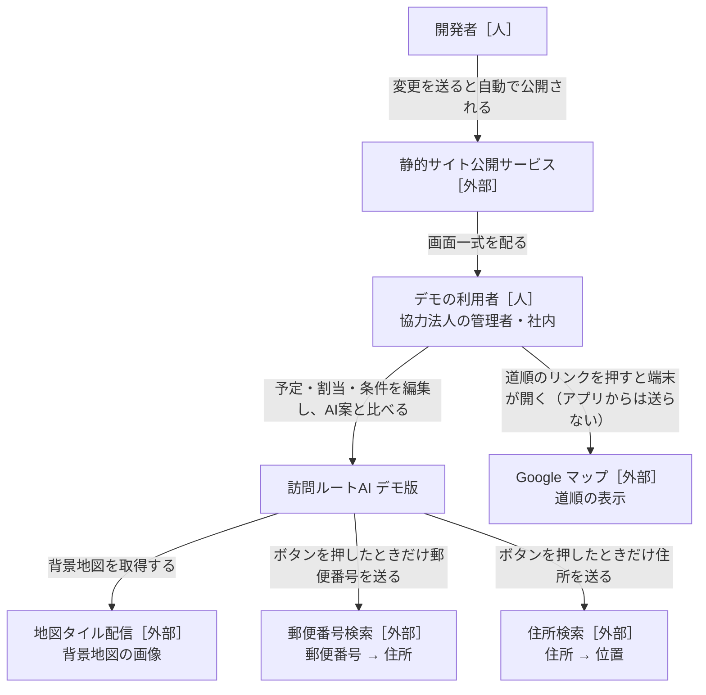
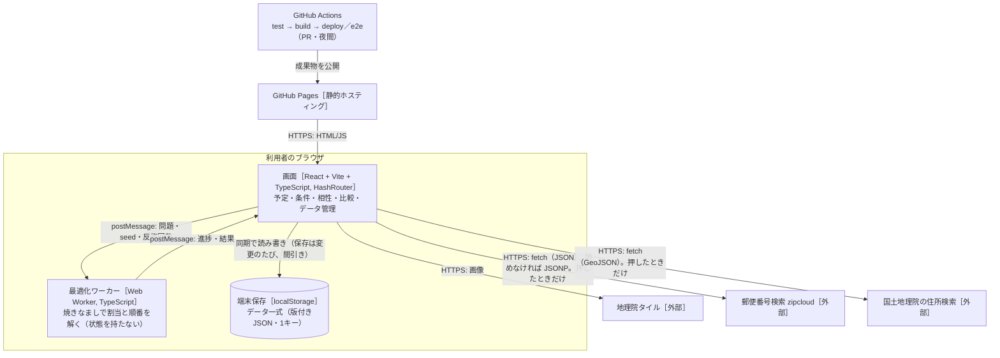
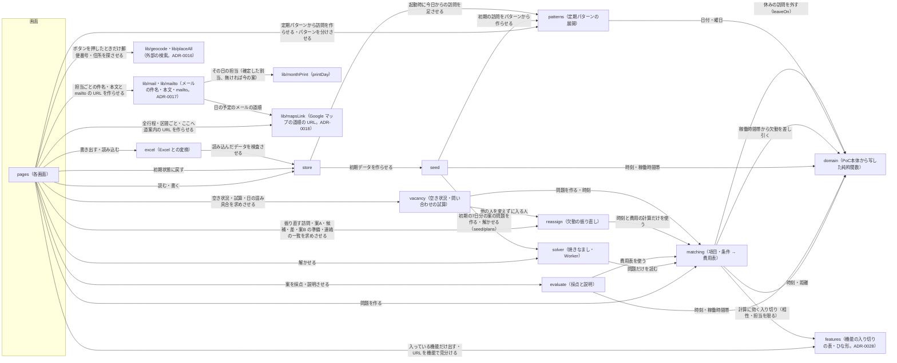

# 設計書：訪問ルートAI デモ版（ブラウザ完結）

- PRD：[docs/prd.md](prd.md)
- 作成者：松浦（草案：Claude）
- 更新日：2026-10-24
- 状態：合意済み（2026-10-11）
- 読み方：今の仕様だけを書く。判断の理由は `docs/adr/`、経緯は git の履歴、型の正は `src/contracts/`

## 1. 背景と目的

PoC本体（`katahimo-dev/visit-route-poc`）の管理者画面（予定・手作業の割当・AI案との比較）を、サーバーなしでブラウザだけで動く静的サイトに移し、GitHub Pages で公開する。
データは localStorage に残し、JSON で書き出し・読み込みする。
最適化は Python（OR-Tools）の代わりに Web Worker 上の焼きなましで解き、ClassClassify のように**項目・条件・重み（0〜5）・必須**で、相性・スタッフの特性・顧客の希望を柔軟に足せるようにする。
目的は、協力法人に触ってもらって割当の考え方を集めるサイクルを速く回すこと（PRD §1）。

## 2. やらないこと

- ログイン・サーバー保存・事業所の分離・同時編集
- 外部送信は地図タイルと、ボタンを押したときの郵便番号・住所の検索だけ（ADR-0016）。メールは `mailto:` で端末のアプリを開くだけ（送信サービス・送った記録・HTML メールなし。ADR-0017）。道順は Maps URLs のリンクだけ（経路・時間を取らず、キーの要る API は使わない。ADR-0018）
- Firebase・Cloud Functions・Python 最適化・Google Maps Platform。移動時間は直線距離からの概算（`estimateLeg`）だけ
- スタッフの記録・位置・ジオフェンス・勤怠・CSV・通知・PWA のオフライン対応、相性の学習
- 勤務シフトの自動作成、日をまたいだ最適化（月まとめ作成は1日ずつ。ADR-0012）、定期パターンの日付指定・祝日（ADR-0013）
- 休みでの自動の振り替え、確定した割当の自動の作り直し、決まりごとを割当の条件に使うこと、案内文の送信（ADR-0013）
- 希望休の申請・承認・日数の確認と、それを考えたシフト作成・自動の振り直し、担当を限る期間・「なるべく」、印刷の書式設定・PDF（ADR-0014）
- 実績・打刻・請求・LINE・集金。勤務の見込みは予定からの見込み。拘束の上限を AI案の条件にすること、退職者の訪問の自動の作り直し、段階ごとの期日管理、紹介元とのやりとりの記録、当日キャンセルの請求（ADR-0015）
- 欠勤の受付・通知の自動送信・複数日の一括入力・有給の管理、欠勤を入れただけで振り直すこと、中止・日時変更の自動提案（ADR-0011）
- 名簿で人を消すこと（総入れ替えも終了・休止まで）、ほかのシートだけの入出力、読み込みの取り消し（ADR-0020）
- PoC本体へのコードの書き戻し。共通の純粋関数は**写して**使い、同期しない（ADR-0001）

## 3. 全体図

### L1 システムコンテキスト



### L2 コンテナ



### L3 コンポーネント



- 矢印は「読む・呼ぶ」。データを書き換えるのは store だけ
- 外部の検索（`lib/geocode`）を呼ぶのは画面だけ（ADR-0016）。`lib/mail`・`lib/mailto`・`lib/mapsLink` は URL の文字を作る純粋関数で通信しない
- solver と evaluate は同じ費用表を使い、AI案と手作業案を**同じ物差し**で採点する

## 4. コンポーネントと責務

型・関数の形は §5。「決定的」＝乱数・`Date.now` を使わず、今日・今の時刻は引数で受ける純粋関数。

データは版2（ADR-0053）：担当は訪問に持ち（`Visit.staffId`・`start`・`pinned`）、AI は提案を出して「反映する」で訪問に書き、確定は〈スタッフ〉に伝えた内容（`snapshots`）。下の節で「今の案」「確定した割当（無ければ今の案）」とあるところは、その日の訪問の担当（`lib/dayPlan` の `dayRoutes`）と読む。

### store（データ一式の保存）
- 責務：`DemoData` の読み込み・保存・検査（zod）・版の確かめ（版1は移さず初期データで始める。ADR-0053）・修復（repair）、JSON の書き出し・読み込み、初期状態に戻す、置き換える前の1世代の控え（ADR-0032）。画面へは `useDemoData()`（`data`・`update(fn, label?)`・`undo()`・`redo()`・`replace(d)`・`reset(features?)`・`saveError`・`keepPrevious(reason)`・`restorePrevious()`・`previous`・`broken`・`brokenKept`・`dismissBroken()`・`startedFresh`・`externalReloads`・`previousDrops`）。書き換えは update・replace・reset・restorePrevious だけ
- 持つデータ（持ち主）：`DemoData`（キー `vrdemo:data:v1` の1つの JSON）、読めなかった元の文字（`vrdemo:data:broken`）、1世代の控え（`vrdemo:data:prev`＝置き換える前の `DemoData` の JSON、`vrdemo:data:prev:info`＝`{ at, reason }`（時刻 ms・操作の名前））、案内ツアーを見たか（キー `vrdemo:tour:seen`）、初めて開いたときの入り切りの印（キー `vrdemo:features:start`。`all` だけ意味を持つ。PRD D276）、最後に書き出した日（`vrdemo:backup:last`＝`{ date: 'YYYY-MM-DD', kind: 'json' | 'excel' }`）と控えの知らせを出した日（`vrdemo:backup:reminded`＝'YYYY-MM-DD'）。`vrdemo:data:v1` 以外はブラウザごとの記録で、DemoData の外（版・書き出し・読み込み・初期状態に戻すの対象外。`src/contracts/` に足さない）
- 提供するAPI：`load()`・`loadWithStatus()`（無ければ seed の `createInitialData(今日, startFeatures())` で作り `fresh: true`（初めて開いた。入り切りは基本のひな形、印 `all` があればすべて入の `{}`。PRD D276）。読めなければ元の文字を `vrdemo:data:broken` に退避して初期データで `broken: true`（退避が容量超過なら1世代の控えを捨ててもう1回。退避できたら初期データを書き、読み直すたびに作り直さない。それでも退避できなければ元の文字を残して `brokenKept: false`）。読めたら `extendDays`）、`brokenText()`（退避した元の文字。退避できていなければ開いたときに覚えた元の文字、それも無ければ本体のキーの読めない文字）、`save(data, onResult)`（300ms 間引き。`flushSave()`。結果は `(message, droppedPrevious)`：容量のために控えを捨てたか）、`reset(features)`（`createInitialData(今日, features)`。features の既定は今のデータの入り切り＝入り切りは残す。今のデータが無い（読み込みの例外から戻す）ときはすべて入の `{}`。PRD D216）、`exportJson`、`backup()`（例外の画面の控え：待っている保存を先に書き、画面の最新のデータ（`rememberCurrent` で Provider が覚える。`load`・`save`・`reset` でも覚える）を、無ければ保存してある文字をそのまま、壊れて退避した文字があればそれも別のファイルとして返し、保存の失敗の文言を添える）、`importJson`（版1の控えは `OUTDATED_MESSAGE` で断る）、`migrate(raw)`（既定値で読み必ず `repair`。§5「版と移行」）、`isOutdated(raw)`（版1か。`loadWithStatus` は版1なら初期データで始め `outdated: true`、画面が「データの形が変わったので初期データで始めます」と知らせる）、`repair`
- 〈スタッフ〉のアイコン `icon`（PRD D299。ADR-0050）も `DemoData` の中で store が持つ。検査は zod では形だけ（前後の空白なし・32コード単位まで。無い古いデータは ''。形の合わない値は読み込みを止める＝メールアドレスと同じ）。見た目で2文字までは入れる所（画面・Excel）で見る（`Intl.Segmenter` の無い環境で保存データ全体が読めなくならないように）。ほかを指さないので repair は触らない。画像は持たない（localStorage を圧迫するため）
- repair（いない物を指す参照を除き、ID の重複は最初の1件）：
  - 相性・上書き・振り直しの情報（`reassigns`）の `base*`（`absenceIds` は残す）・伝えた内容（`snapshots`。日付とキーがそろわない・いない訪問は外す）
  - 条件の重み・必須（`data.rules`）はいつも点数の基準のプリセットにそろえる（重みは1組。ADR-0053）
  - プリセット：6つまで・0件なら初期の3種・重みは 0〜5・0.5刻み（`clampWeight`）・必須にできない型の必須は外す。`scorePresetId` が無効なら先頭
  - 欠勤は同じ人・同じ日の最後の1件。種類は20まで
  - パターン：いない〈利用者さん〉のものを除く、無効な `typeId`・`usualStaffId` は null、`weekdays`・`monthWeeks` は重なりなしの昇順（毎週系の `monthWeeks` は `[]`）、`dayTimes` はパターンの曜日だけ・曜日ごと最初の1件・曜日の順
  - 訪問：無効な `typeId`・`pattern` は null（訪問は残す）。取り消していない訪問の `cancelKind` は null。いない・休止中の担当は null（ピンも外す）。担当の無い訪問のピンは外す
  - `allowedStaffIds`：いない・休止中の人と重なりを除く（空になれば限らない）。active・tentative を段階に合わせる（`stageFlags`）
- 案内ツアー：`store/tour.ts` の `tourMemory`（`seen()`・`markSeen()`。値 `'1'`。`createTourMemory(getStorage)`）。DemoData の外（update・版・書き出し・reset の対象外）。保存できなければ開いている間だけ
- 初めて開いたときの入り切り（PRD D276。ADR-0045）：`store/start.ts` の `startFeatures(getStorage)`：`vrdemo:features:start` が `all` なら `{}`、ほか（無い・読めない）は `applyTemplate('basic')`。読むのは保存データが無いときだけ（`reset` は読まない）。画面からは書かない（e2e の `scripts/lib/startFeatures.cjs` と、全機能を見せるデモの前準備）
- 1世代の控え（PRD D227。ADR-0032）：`keepPrevious(data, reason, at)` は置き換える前のデータを `vrdemo:data:prev` に書く（次に残すと上書き）。書けなければ前の世代を消して1回だけ試し直し、それでもだめなら残さず `{ kept: false, why: '控えを残せません：容量不足' }`（操作は止めない）。`cancel()` で前の世代に戻す（確認を取り消したとき）。画面は確認で OK になってから残す（確認の本文は見込みの `canKeepPrevious()`：保存が使えない・最後の保存が容量超過なら「容量不足」）。`previousInfo()`・`readPrevious()`（`importJson` を通す）・`samePreviousInfo(a, b)`（同じなら react の state を替えない）。`swapPrevious(now)` は控えを読み、いまのデータを「直前の状態に戻す」として控えてから控えのデータを返す（もう一度戻せる）。いまのデータを控えに残せなければ戻さず（控えは元のまま）「いまのデータを控えに残せないため戻せません：容量不足」。react の `restorePrevious()` はこれを使う。本体の保存（`writeNow`）が容量超過なら控えを捨ててもう1回書き（いまのデータが先）、捨てたら `previousDrops` を1つ増やす（画面がトースト「容量が足りないため、直前の状態の控えを消しました」）
- 最後に書き出した日・控えの知らせ：`store/backup.ts` の `backupMemory`（`lastExport()`・`markExported(kind, date)`・`lastReminded()`・`markReminded(date)`。`createBackupMemory(getStorage)`）。ツアーと同じく DemoData の外。知らせるかは `lib/backupReminder` の `shouldRemindBackup`（純粋関数）
- 全体の「元に戻す・やり直す」（PRD D329。ADR-0054）：`update(fn, label?)` の1回を1手として `lib/history` の `appHistory` に積む（更新の関数の中で前後のデータの参照を積む。StrictMode の2回目は同じ update の印で置き換える）。最大50手・画面の状態だけ（保存しない）。`undo()`・`redo()` は履歴から差し替える（積まない）。`replace`・`reset`・`restorePrevious`・別のタブの読み直しで履歴を捨てる
- 別のタブの変更：`storage` イベントで `vrdemo:data:v1` が変われば読み直し（書き戻さない）、`externalReloads` を1つ増やす（画面が知らせを出す）。データを丸ごと差し替えたら（`replace`・`reset`・`restorePrevious`・別のタブの読み直し）`replacedCount` を1つ増やす（組んでいる月の AI で組むを止めるきっかけ。ADR-0042）。控えのキーが変われば `previous` を読み直す
- 依存するもの：seed（`seed/plans` の `createInitialData` も）、presets（重みをそろえる）、zod
- 配置：`src/store/`
- 完了の条件：
  - [ ] 壊れた JSON は元のデータを残して日本語のエラーを返す（画面が真っ白にならない）。版1のデータは移さず初期データで始め、知らせる（テスト）
  - [ ] 書き出し → 読み込みで同じデータに戻る（欠勤・振り直し・種類・パターン・休み・伝えた内容を含む。テスト）
  - [ ] 容量超過で書き出しと「古い訪問を片づける」を促す（`QUOTA_MESSAGE`）
  - [ ] 置き換える前の1世代の控え・取り消しで前の世代・容量超過なら残さず理由（テスト）
  - [ ] 古いデータが §5 の既定値で読め、repair が効き、直す所の無い〈利用者さん〉は同じ物（テスト）

### seed（デモの初期データ）
- 責務：PoC本体 `scripts/seedDemo.ts` の生成（仙台・〈スタッフ〉8人・訪問先20か所・稼働時間帯の上書き）を写し、項目・条件・相性・種類・繰り返し・プリセットの初期値を足す。起動したときの初期データには今日から7日分の担当も入れる（PRD D322。ADR-0053）。日付だけで結果が決まる
- 持つデータ（持ち主）：なし
- 提供するAPI：`createDemoData(today)`（繰り返しと繰り返しの担当。担当を組んだ訪問は入れない）、`seed/plans` の `createInitialData(today, features = {})`（`createDemoData` に機能の入り切りを入れてから `withSeedPlans`。store が起動・初期化で使う）・`withSeedPlans(data, today, days = SEED_PLAN_DAYS)`（7日）・`SEED_ITERATIONS`（100000）、`daysFrom`（`typeId`・`pattern` は null、リハビリは作らない）、`seedPatterns`、`withUsualStaff(patterns, owners, staff)`、`INITIAL_PRESETS`・`applyPreset(rules, preset)`・`presetOf(rules, presets)`・`scorePresetOf(presets, id)`（無ければ先頭）・`scoreRulesOf(data)`（条件に点数の基準のプリセットを当てたもの。0件なら条件そのもの）
- 初期データ：
  - 繰り返しは前の月の1日（`seedPatternStart`）から。前の月の1日〜昨日は伝えた内容を入れる（`withPastTold`：その日の取り消していない訪問の繰り返しの担当を写す。開始は null＝時刻の違いを数えない。確定の時刻はその日の18:00（日本時間））。今日からは伝えていない
  - 繰り返しの担当（`withUsualStaff`）：内部で作った割当でその〈利用者さん〉を多く担当した順に、繰り返しの曜日すべてに勤務があり、同じ人のほかの回と30分（`USUAL_GAP_MINUTES`）より近く重ならない人。いなければ null（担当なし）
  - 担当（`createInitialData`。PRD D322）：今日から7日分、点数の基準のプリセット（`standard`）の重みを当てた条件で compile し、`solve`（種はデータの `seed`、反復は `min(defaultIterations, SEED_ITERATIONS)`。1日 約40ms・7日で 約0.3秒）で解いて、`lib/dayPlan` の `writeRoutes`（ピンなし）で訪問に書く（変わった回だけ保存した回になる）。作れない日は飛ばす
  - 呼び方は「スタッフ」（`domain/terms.ts` の care の既定「ヘルパー」は写したまま）
  - 訪問は希望の時刻ちょうど（PoC本体の幅は始まりの時刻。c4 だけ終わりの 10:30＝日曜に担当が足りなくなるため）
  - 項目：スタッフ側は性別・資格（介護福祉士/看護師/保育士/初任者研修/理学療法士/作業療法士/言語聴覚士）・経験年数・得意（高齢/子ども/障害/家事/話し相手/料理）・喫煙者・ペット可。訪問先側はペットあり・喫煙環境・対象（高齢/子ども/障害）
  - 性別希望（c6・c18 女性、c11 男性）は性別＋必要条件、NG（c2→s2、c12→s7）は相性 ×
  - 種類：介護（色0。資格に介護福祉士・初任者研修・看護師のどれか）、リハビリ（色3。理学療法士・作業療法士・言語聴覚士のどれか）。理学療法士は s4・s7
  - 繰り返し：〈利用者さん〉ごとに1つ（ID＝〈利用者さん〉の ID。平日の1曜日だけ休み・`weekend` の印で土日も。毎週。時刻・所要は `slot`。子どもは種類なし、ほかは介護。開始日＝基準日）。リハビリ40分を c7（水 14:00・s4）・c14（金 15:00・s7）。回は保存せず見るときに計算する（ID `${日付}_${利用者さんID}`）
  - 決まりごとの例は c2・c4・c9・c13（`VISIT_RULE_SEEDS`）。欠勤・休みなし。`scorePresetId` は `standard`
- 依存するもの：domain、patterns。`seed/plans` だけ matching（compile）・solver（solve）・`lib/dayPlan`（`dayProblemOf`・`writeRoutes`）
- 配置：`src/seed/`
- 完了の条件：
  - [ ] 同じ日付で同じデータ。繰り返しの担当は重ならない人（テスト）
  - [ ] `createInitialData`：今日から7日分の訪問に担当が入り、過去（前の月の1日〜昨日）は確定済み・今日からは伝えた内容が無い、同じ日付で同じ担当（テスト）
  - [ ] 性別希望・NG・種類・繰り返し・訪問の ID が上のとおり、プリセットは §5 の3種（テスト）

### domain（PoC本体から写した純粋関数）
- 責務：時刻（`hhmmToMinutes` など）、距離と移動の概算（`distanceMeters`・`estimateLeg`）、稼働時間帯（`availabilityOf`・`shiftOf`・`withinSlots`）、ルート評価（`evaluateRoute`）、手作業の割当の補助（PoC本体 `web/src/features/admin/schedule/model.ts` の `reconcile`・`assign`・`timesOf`・`warningsOf`）
- 持つデータ（持ち主）：なし
- 提供するAPI：PoC本体と同じ名前・引数（写したコミットをファイル先頭に書く）。デモ独自（コメントに明記）：`withoutAbsences(slots, absences)`（`domain/availability.ts`。「その日に働ける時間帯」を決めるのはこのファイルだけ）、`afterLastDay(base, date)`（`availabilityOf` は最終勤務日の後なら上書きがあっても空）、`leaveOn(leaves, clientId, date)`・`isOnLeave(leaves, visit)`（`domain/leaves.ts`。休みの判定はこれだけ）
- 依存するもの：なし（zod のみ）
- 配置：`src/domain/`
- 完了の条件：
  - [ ] PoC本体の該当テストを写して通る
  - [ ] `withoutAbsences`：終日で空、9〜18時から 9〜12時を引くと 12〜18時、15:00〜で 9〜15時、〜11:00 で 11〜18時、12〜13時で 9〜12・13〜18時、時間帯の外は変わらない、複数でも開始の順・重なりなし（テスト）
  - [ ] `leaveOn`：開始日・終了日の当日は休み、前日・翌日・別の人は休みでない（テスト）

### matching（項目・条件 → 費用表）
- 責務：項目・特性・必要条件・希望・相性・条件を、solver が読む**問題（`Problem`）**に変換する。①可否 ②割当費用（§5「費用の物差し」）③負担の均等の目安 ④移動・待ちの行列と係数。訪問×スタッフごとの**理由**も返す
- 持つデータ（持ち主）：なし
- 提供するAPI：`compile(data: CompileInput, date, pins?)`（問題に入る〈スタッフ〉は利用中の人。`pins` の訪問はその担当だけ可＝理由 `pin`「固定（手直し）」）、手直しの記憶（ADR-0043。`matching/manualPrefs.ts`）の `prefKey(visit)`・`requestedPrefPins`・`applyPrefPins(problem, prefPins)`（記憶の担当が可のときだけその担当だけを可に。理由 `manualPref`「手直しの記憶（〈名前〉さんに固定）」／「手直しの記憶：前に手で〈名前〉さんにした」。費用は変えない）・`withManualPrefs(problem, data, pins?)`（固定のある訪問は飛ばす。案を作る問題だけに当て、採点・説明・欠勤の振り直しの問題には反映しない）、`matches`・`conditionText`・`scheduleRoute`（時刻の唯一の実装）・`routeCost`・`balancePoints`・`balanceOff`・`totalPoints`・`dropPointsOf`・`fitStart`・`naiveSeqs`、`bestInsertion(problem, routes, visitId, staffId)`（strict で最も安い位置、無ければ開始の順に lenient で入れて違反として見せる）
- 可否で外す原因（`points` は Infinity）：
  - 必須の条件、相性 ×（重み・必須によらない）
  - 稼働時間帯（`slot`）：欠勤は差し引き、文は `ABSENT_ALL_DAY`「欠勤（終日）」・`ABSENT_NO_HOURS`「欠勤で稼働時間がない」・`ABSENCE_OVERLAP`「欠勤の時間と重なる」。最終勤務日の後は `AFTER_LAST_DAY`「最終勤務日の後」
  - 種類（`visitType`。ADR-0012）：種類の `requirements` を満たさない条件ごとに「種類（〈名前〉）：〈条件の文〉 ✗」。満たせば ✓・0点。いない種類は無視
  - 担当を限る（`allowedStaff`。ADR-0014）：`allowedStaffIds` のうち問題にいる人が1人以上いればその人たちだけ可。理由「担当を限る：山田、佐藤 ✗／✓」（問題にいる限った人を並べた順）
  - 種類と担当を限るは常に必須で、条件の重み・プリセット・達成の件数に関係しない
- 問題に入れない訪問：取り消し、休み（`leaveOn`）の〈利用者さん〉の訪問。AI案・月まとめ作成・空き状況・振り直しはどれも compile を通る
- いつもの担当（`continuity`）：訪問の `pattern` のパターンの `usualStaffId`、無ければ〈利用者さん〉の
- 機能の入り切り（ADR-0028）：`compat` が切なら相性（値・条件・×）を、`allowedStaff` が切なら `allowedStaffIds` を読まない。切ったときの問題はデータが空のときと同じ（`problemKey` も）。休み・欠勤・希望休・最終勤務日・パターンは常に読む
- 案B（ADR-0011）：`problem.stay` があれば `routeCost` に、担当が `stay.staff[v]` と違う1件に `movePoints`、`stay.start[v]` からのずれ1分に `minutePoints`。`scheduleRoute`・採点には足さない。`dropPointsOf` は `stay.keep[v]` なら `KEEP_DROP_POINTS`（採点の `totalPoints` は常に `DROP_POINTS`）
- 依存するもの：domain、features（`calcFeaturesOf`）
- 配置：`src/matching/`
- 完了の条件：
  - [ ] 重み0の条件は費用にも理由にも出ない。必須を満たさない組は可否で外れる（テスト）
  - [ ] 項目を消すと参照する条件は「無効（項目がない）」になり、計算は止まらない
  - [ ] 担当の候補がいない訪問は `infeasible` に訪問と原因が入る
  - [ ] 欠勤・種類・担当を限る・休み・最終勤務日の可否と理由が上のとおり。それが無い問題（`problemKey`）は変わらない。限った人が休みの日は infeasible に原因（テスト）
  - [ ] `compat`・`allowedStaff` を切った問題、stay の減点が上のとおり（テスト）

### solver（最適化・Web Worker）
- 責務：`Problem` を受け、時間の約束・稼働時間帯・可否を破らずに `移動分 + 待ち分×係数 + 割当費用 + 均等の費用 + 落とした訪問の点` を最小にする割当と順番を返す。焼きなまし（ADR-0003）。決定的な乱数（seed）と**反復回数**で止める（時刻で止めない。D10）
- 持つデータ（持ち主）：なし
- 提供するAPI：Worker メッセージ（§5）、純粋関数 `solve(problem, options, onProgress?)`・`createSolver`（テストは Worker なし）、`runSolve(problem, options)`（Worker。30秒で `stop`）、`defaultIterations(problem)`（目安3秒）、`mulberry32`
- 初期解：貪欲な初期解と素朴な案（`naiveSeqs`）の費用の低い方（AI案 ≤ 素朴な案）。`options.initial` は、どの列も可・strict・件数の上限内のときだけ候補にし、費用（stay 込み）が高くなければそこから始める（同じならこちら）
- 落とした点は訪問ごと（`dropPointsOf`）で、入れる・外す・入れ替え（eject）の差分と全体の両方に入れる（途中で一時的に落とすのは許す）。`SolveResult.score` は stay を含まず evaluate と同じ。進み具合の `bestScore` は stay 込み
- 依存するもの：matching
- 配置：`src/solver/`
- 完了の条件：
  - [ ] 同じ問題・seed・反復回数で同じ結果（テスト）
  - [ ] 案は可否・時間の約束・稼働時間帯を必ず守る（性質テスト）
  - [ ] 8人・20件で3秒、30人・150件で30秒以内（中位のノートPC）。「止める」でそれまでの最良案
  - [ ] 重み0・移動だけで PoC本体の手作業案より総移動が短い
  - [ ] `initial` を渡すと結果 ≤ 候補の費用。可でない組を含む候補は使わない（テスト）

### evaluate（採点と説明）
- 責務：AI案・記録・今の案・手作業案を同じ `Problem` で採点する。合計点・移動・待ち・距離、条件ごとの達成/違反、訪問ごとの理由（`相性◎` `希望○ 女性` `資格✓` `継続` `移動+12分`。点の絶対値の大きい順に3つ）、守れなかった必須（手作業案は警告だけ）、記録どうしの差
- 持つデータ（持ち主）：なし
- 提供するAPI：`score`・`explain`・`diff`・`normalize`・`toHundred`・`hundredBreakdown`・`ruleLowerBounds`・`naivePlan`・`achievements`（§5「点数」）
- stay は採点に入れない（案B も点数の基準で採点し、変更の数は `reassignDiff` で見せる）。条件の ID でない理由（`visitType`・`allowedStaff` など）は達成に数えない
- 依存するもの：matching、domain
- 配置：`src/evaluate/`
- 完了の条件：
  - [ ] solver の内部の費用と `score` が一致。AI案 ≤ 素朴な案・点 > 0（seed の14日・各プリセット）、素朴な案は上限・必須を守る（テスト）
  - [ ] 点数：単調、0〜100、下限は100点、1件10分余計で90点、0件は100点、内訳の合計＝100−点数、下限 ≤ 必須を守るどの案（テスト）
  - [ ] 達成：分母は判定のある割当済みの訪問、分子は判定をすべて満たした訪問。相性は ◎○△× の件数、均等は帯に収まった人数（テスト）

### reassign（欠勤の振り直し。ADR-0011）
- 責務：欠勤を差し引いた問題と元の案から、振り直す訪問（`targetsOf`）、案A「空き時間に入れるだけ」（`reassign`）、候補（`candidatesFor`・`placeVisit`）、差（`reassignDiff`）、欠勤の人に残る訪問（`leftOf`）、案B「少し動かしてよい」の準備とまとめ（`prepareAnneal`・`finishAnneal`・`settleAnneal`・`annealCost`）、連絡の一覧（`contactsOf`）、空き状況の判定（`fitsOf`）を出す。決定的。いまの時刻は扱わない（過去の欠勤は登録しない前提）。`DemoData` は読み書きしない
- 持つデータ（持ち主）：なし
- 提供するAPI：§5「`contracts/reassign.ts`」
- 振り直す訪問（欠勤の人＝その日に欠勤のある全員）：
  - `absence`：元の案の時刻（`base.problem`＝その日の欠勤を除いた問題での lenient）が、差し引く前の稼働時間帯に収まり後には収まらない訪問すべて（後ろへずらせば入る訪問も）と、欠勤のせいで可にならない訪問
  - `notAllowed`：`base.problem` でも可でない元からの違反
  - `unreachable`：残りを列の順に足し、strict で回れなくなる訪問（欠勤明けに間に合わない等）
- 案A：
  - 位置は可・件数の上限内・その列の開始時刻を変えずに strict で回れる所（欠勤の人も欠勤でない時間なら可）
  - 入れられる人の少ない訪問から、同じなら regret（最良と次善の差。次善が無ければ最大）の大きい順、開始の早い順、問題の順。1件ごとに数え直す
  - 増える費用（移動＋待ち×係数＋割当＋均等の増分）が最も少ない位置。同じなら staff の順・前の位置
  - 入らない訪問は `unplaced`（欠勤の人に残さない）。元から入らない訪問・問題に無い人と訪問は触らない。`pins` は担当のいるすべての訪問
- 候補：fits の人（増える費用の順）→ ずらせば入る人（`shiftMinutes` の絶対値の順、同じなら遅らせる方。5分刻み・±120分。時刻以外の必須の原因が無く上限内の人だけ探す）→ 入らない人。同じなら staff の順。列が元から回れない人は `routeBroken`。上限・必須に合わない人にも入れられる（違反として見せる）
- `placeVisit`：候補の「入る」と同じ位置、無ければ strict の最良、無ければ開始の順（lenient）。訪問の時刻は変えない（遅れは `delayedCount`・`maxDelayMinutes` で画面が確認を出す）
- `leftOf`：今の案に `targetsOf` を当てた `absence`・`unreachable`（手直しで戻した等）
- 案B：
  - `stay.staff`・`stay.start` は元の案の担当・開始（振り直す訪問・元の案に無い訪問の担当は null）。減点 `stayPointsOf(w)`：担当が変わる1件 w×10・ずれ1分 w×0.2（振り直す訪問の担当の変化は減点しない、時刻のずれは減点する）。元の案で入らなかった訪問は可にしない
  - `stay.keep`＝案A に入っていて振り直す訪問でない訪問（落とした点10倍。入れ替えをしない）。案A の列が使えない人（可でない・回れない・上限超え）は `held` として列ごと案A のまま
  - 初期解は案A。`finishAnneal` は問題に無い人・訪問を案A のまま、pins は担当のいるすべて、`placed`（`addedCost`・`addedTravel` は0）・`unplaced` は振り直す訪問
  - `settleAnneal`：`keep` の訪問を落とした（`keepDropped`）、案A の `annealCost` が有限でない・案B の方が高い（`notBetter`）なら案A と理由を返す
- `contactsOf`：元の案（`base.problem`）と今の案の lenient の差。担当が変わる訪問（入らない訪問も）、開始が四捨五入で1分以上変わる訪問、スタッフごとの増える・外れる・開始が変わる訪問（staff の順・開始の順）。`reassignDiff` と同じ規則
- 依存するもの：contracts、matching（時刻と費用の計算だけ）。solver・evaluate・store・画面には依存しない
- 配置：`src/reassign/`
- 完了の条件：
  - [ ] 3種の振り直す訪問が上のとおり。seed の s4 の終日・午前の欠勤で該当の訪問が振り直される（テスト）
  - [ ] 他の人の担当・順番・開始時刻は変わらず、振り直した訪問は可・strict・上限内（性質テスト：seed の14日・各スタッフの終日・午前・午後）
  - [ ] 入れる順・候補の並び・`placeVisit`・差が上のとおり。同じ入力で同じ結果（テスト）
  - [ ] 8人・20件で100ms、30人・150件で1秒以内
  - [ ] 案B：`annealCost` ≤ 案A、`unplaced` ⊆ 案A の `unplaced`（訪問ID の集合。seed の14日×全スタッフの終日、重み0と既定）、`settleAnneal` の3つの場合、重み5は0より変わる訪問が少ない、`SolveResult.score` は stay の無い問題と一致（テスト）

### patterns（繰り返しの回の計算。ADR-0012・ADR-0013・ADR-0053・ADR-0062）
- 責務：繰り返し（定期パターン）の回を**見るときに計算**し、保存した訪問（単発・変えた回）と合わせてその日・期間の訪問を返す。「いつから」で分けて直す（これ以降）、終わらせる・消す。決定的。新しい配列を返し、画面が `update` で入れる
- 持つデータ（持ち主）：なし
- 提供するAPI：`occursOn`・`expandPattern`・`visitsOn`・`visitsIn`・`findVisit`・`putVisits`・`splitPattern`・`removePattern`（§5）、`nthOfMonth`（(日 − 1)÷7 の切り捨て＋1）、`timesOn`（その曜日の開始）、`patternVisitId`・`parsePatternVisitId`、`visitOf`（その日の計算した回）、`byStart`（開始の順）
- 計算：
  - その日にある＝曜日が `weekdays` にあり `from` ≤ 日 ≤ `to`（null は無限）、かつ `'weekly'` なら `from` を含む週（日曜はじまり）を1週目として (週 − 1) が `everyWeeks` で割り切れる、`'monthly'` なら `nthOfMonth` が `monthWeeks` にある（第5の無い月は作らない）
  - 利用中でない〈利用者さん〉の回は計算しない
  - 計算した回：ID `${元の日}_${パターンID}`。中身はパターンの `clientId`・`typeId`・`windowKind`・開始（その曜日の `dayTimes` 優先）・所要、`staffId`＝パターンの `usualStaffId`、`start`＝その曜日の `usualStarts`（標準の開始。無ければ null）・`pinned: false`・`cancelled: false`・`note: ''`、`pattern: { id, date, edited: false }`
  - `visitsOn`：その日の保存した訪問と、同じ ID の保存した回が無い計算した回。開始（組んだ開始、無ければ開始（早））・ID の順。取り消し・休みの訪問も含む
  - `putVisits(visits, put)`：同じ ID は置き換え、無ければ足す（計算した回を書くと保存した回になる）
- `splitPattern`：`since` ≤ `from` なら同じ ID・元の `from` で置き換え。後なら元の `to` を min(元の `to`, `since` の前日) にし、新しい ID で `from`＝`since` を足す。max(`since`, 今日) 以降の元のパターンの保存した回のうち、この回だけ変えていない（取り消してもいない）回は消し（新しいパターンで計算し直す）、変えた回は新しいパターンの回として ID を付け直す
- `removePattern`：開始が今日より前なら昨日で終わらせて残す（今日より前の回はそのまま）。今日以降の保存した回のうち変えていない回は消し、変えた回は単発にする（`pattern` を null）。開始が今日以降ならパターンごと消す
- 画面側：`edited` は訪問の欄で日付・時間の決め方・開始・所要・種類・メモ・取り消しを変えたとき（担当・組んだ開始・ピンだけの違いは edited にしない）。日付を変えても担当は残す
- 依存するもの：contracts、domain（`addDays`・`weekday`）
- 配置：`src/patterns/`
- 完了の条件：
  - [ ] 毎週・隔週・4週ごと・第N（第5）・`from`/`to` の端・複数の曜日・曜日ごとの時刻・利用中でない人で、回が正しい（テスト）
  - [ ] 保存した回があれば計算した回を出さない、同じ入力で同じ訪問（順も）（テスト）
  - [ ] `splitPattern`・`removePattern` が上のとおり（テスト）。seed の20人・1か月の計算が1秒以内

### vacancy（空き状況・問い合わせの試算。ADR-0012・ADR-0013）
- 責務：先の数週（既定4週）の各日の**元の案**（`lib/absences` の `baseOf`＝確定した割当、無ければ今の案）に、仮の訪問を他の人を変えずに入れられるかを曜日×開始時刻ごとに数える。空き状況の表（目安）・問い合わせの試算（移動込み）・日の混み具合（`dayLoad`）・案内文（`vacancyNotice`）。決定的。データは読むだけ
- 持つデータ（持ち主）：なし
- 提供するAPI：`vacancyOf`・`verdictOf`・`inquirySummary`・`dayLoad`・`vacancyNotice`（§5）
- 数え方：
  - 対象の日は `from` から `weeks`×7日。訪問があって案の無い日は `noPlanDates`、訪問の無い日は空の案
  - 開始時刻は `dayStart`〜`dayEnd` を `stepMinutes` 刻み（終わりが `dayEnd` を超える時刻は出さない）
  - 数える人：稼働時間帯がある（欠勤を除く）、種類の必要条件と `requirements` を満たす（重み・必須によらず `matches`）、件数の上限内
  - 正確（`place` に緯度・経度がある。住所だけなら目安）：仮の〈利用者さん〉・訪問（幅 `dayStart`〜`dayEnd`）を足して日ごとに1回 compile し、開始時刻ごとに earliest・latest をその時刻にして `fitsOf` の人を数える
  - 目安：元の案を lenient で時刻にし、[開始 − `marginMinutes`, 終了＋`marginMinutes`) が稼働時間帯に収まり訪問と重ならない人
  - `verdictOf`：`weeksTotal` 0 は `unknown`、全日1人以上は `ok`（○）、一部は `partial`（△）、ほかは `ng`（×）
- `inquirySummary`：希望の曜日（無ければ全部。月曜はじめで月〜日。表・答えのカードと同じ並び）・時間帯の ○ の開始を曜日ごとに連続した範囲にまとめ、○ の曜日が週の回数以上なら「火・木の 10:00〜11:30 なら、〈開始日〉から週2回で対応できます」、足りなければ ○ と △（入らない日付）の曜日、どちらも無ければ「ご希望の曜日・時間帯では、いまは空きがありません」
- `dayLoad`：0:00〜24:00 の30分ごとに `working`（稼働時間帯が重なる人）と `free`（そのうち訪問の [開始 − 来る移動, 終了) に少しも重ならない人）。`typeId` の必要条件を満たす人だけ。訪問があって案が無い日は null
- `vacancyNotice`：`'dates'` は日ごとに1人以上が受けられる開始の範囲（「・10/20（火） 14:00〜15:00、16:30」。`notBefore` より前は載せない）、`'weekly'` は月〜日の ○ の範囲（「・火 14:00〜15:00」。案のある週が足りなければ「（4週中2週の予定で確認）」）。1行目「〈事業所名〉です。」、最後に目安である旨。空なら「いまはご案内できる空きがありません」
- 依存するもの：contracts、matching、reassign（`fitsOf`）、domain、lib/absences（`baseOf`）
- 配置：`src/vacancy/`
- 完了の条件：
  - [ ] ○・×・△ と入らない日付、案の無い日、条件・欠勤・休みの扱いが上のとおり（テスト）
  - [ ] 正確で入る人に `placeVisit` で入れても他の人が変わらず strict（性質テスト）
  - [ ] 要約・案内文の文（テスト）。同じ入力で同じ結果、データを書き換えない
  - [ ] 8人・約17件/日・4週・07〜20時で、正確が2秒、目安が500ms以内

### excel（Excel との変換。ADR-0006・ADR-0020）
- 責務：`DemoData` ⇔ Excel のブック（§5「Excel のブックの形」）と、〈利用者さん〉・〈スタッフ〉の名簿の変換。書き出しは見出し・列幅・プルダウン付き。読み込みは名前を ID に直し、シート・行・列付きの日本語のエラーを返す。データは書き換えない
- 持つデータ（持ち主）：なし
- 提供するAPI：`exportWorkbook(data)`・`importWorkbook(buf, base)`（`base` からは版・基準日など Excel に無いものだけ。案は空。最後に `migrate`。画面が件数を見せて `replace`）、`exportRosterWorkbook(data, kind)`（1シート。シート名 `personSheetNames`）・`importRoster(buf, base, kind, mode)`・`rosterSummary`・`rosterWarning`（総入れ替えで今の人の半分を超えて外すときの注意。無ければ null）。どれも非同期
- 名簿の読み込み：
  - 全体のブックもそのシートだけ読む。必須の列は名前（表示名）だけ。無い列は今の値（新しい人は既定値）
  - 同じ人は ID（今に無ければその ID で足す。使えない・ブック内で重なる・ほかの ID は止める）、空なら名前（`nameKey`。全角半角・空白を同一視）。2行が同じ人・当てたあとの名前の重なりは止める
  - 特性・条件は列のある項目だけ（並びだけ違う条件は同じ）。知らない項目の列は止める。いつもの担当・担当できる人は今の〈スタッフ〉の名前
  - 段階は「段階」の列が正、空なら利用中・仮押さえ、それも無ければ今の段階。新しい人で全部空なら利用中
  - 総入れ替え：ブックに無い〈利用者さん〉は `withStage(c, 'ended')`、〈スタッフ〉は休止。既に終了・休止の人は数えない。人の行が無いブックは止める
  - 件数は repair 後の人を今の人と比べる。案・記録・確定した割当・訪問・パターン・相性・稼働時間・欠勤・休みはそのまま。画面は確認中にデータが変われば入れず、`lastDaySet` があれば振り直しを促す
- 依存するもの：ExcelJS（動的 import）、contracts、store（`migrate`）、matching、lib/clientStage
- 配置：`src/excel/`（名簿は `importRoster.ts`、読み取りの部品は `importBook.ts`）
- 完了の条件：
  - [ ] 書き出し → 読み込みで案を除いて同じ（ID・並びも。テスト）。ID の空の行は追加、消した行は消える
  - [ ] §5「止めるもの」はシート名・行番号付きで止め、データはそのまま。古いブックは既定で読める（テスト）
  - [ ] 名簿：往復で変更なし、追加・更新・総入れ替え・止める場合が上のとおり、ほかのデータが残る（テスト）
  - [ ] 外部への送信はしない

### features（機能の入り切り。ADR-0028）
- 責務：機能の表（ID・名前・説明・グループ・依存・URL（ルート・`?do=`）・隠れるもの・ひな形）と、入り切りの判定・ひな形・切るときの影響の数え方。純粋関数
- 持つデータ（持ち主）：なし（入り切りは store の `org.features`）
- 提供するAPI：`lib/features.ts` の `FEATURES`・`FEATURE_GROUPS`・`isOn`（依存先が切なら切）・`isSwitchOn`・`featureOfLocation(pathname, search)`・`featureOfHref`・`isHrefOn`（土台は null。パスは小文字・末尾の `/` を落とす）・`TEMPLATES`（`basic` 基本／`laborContract` 労務・契約管理／`monthlyField` 月次予定・現場共有／`all` すべて）・`applyTemplate`・`matchTemplate`（違えば `custom`）・`templateDiff`・`turnOffImpact(data, id, today)`・`calcFeaturesOf`・`sameCalcFeatures`、`useFeature(id)`、部品 `Feature`
- 表の `doParams`：`sudden` は `/plan?do=absence`、`rules` は `/plan?do=recreate` も
- `turnOffImpact`（D215）は計算に効くものだけ：相性は利用中の〈利用者さん〉×休止でない〈スタッフ〉、担当を限るは限った人に休止でない人がいる利用中の〈利用者さん〉、休み・希望休・欠勤は今日以降、空き状況は仮押さえの〈利用者さん〉
- 出し分け：`menuSections(terms, today, features)`、`app/App.tsx` のルート（切った URL は `#/home` へ移し、知らせと `#/settings` へのリンク）、`lib/commandPalette`・`lib/home`・`lib/tour`・`lib/links`（切なら null）、画面の欄・ボタン。`rules` が切なら日の予定は `planRulesOf(data, false)`（点数の基準のプリセットを当てた条件）で作る。事実の表示（休みの人に N・振り直しの差・連絡の一覧）は残し、入力・操作の入口だけ隠す
- 管理者設定 `pages/SettingsPage.tsx`（`#/settings`。だれでも開ける）：ひな形の4つ（適用するときは `templateDiff` の確認）とグループごとのスイッチ（role="switch"、その場で保存。データがあれば `turnOffImpact` の確認）
- 依存するもの：contracts、store（読むだけ）
- 配置：`src/lib/features.ts`・`src/lib/useFeature.ts`・`src/components/Feature.tsx`・`src/pages/SettingsPage.tsx`
- 完了の条件：
  - [ ] `org.features` の無いデータで画面・計算・`problemKey` が変わらない（テスト）
  - [ ] メニュー・パレット・ホーム・ツアー・links の行き先が土台か表の機能に属する。依存（`vacancy`→`vacancyNotice`、`workload`→`fare`）、ひな形と `matchTemplate`（テスト）
  - [ ] 切った URL はホームへ移り知らせ。設定と土台は切れない（e2e `scripts/e2e-features.cjs`：ひな形4通り・390px・印刷）

### pages（画面）
- 責務：管理者の画面（ホーム・日・月・週・空き状況・〈利用者さん〉・相性・〈スタッフ〉・稼働・条件・データ・管理者設定）。データの書き換えは store の `update(fn)` を通す
- 持つデータ（持ち主）：画面の一時状態のみ（空き状況の入力はタブの間だけ sessionStorage の `vrdemo:vacancy:input`。PRD D258）。範囲（日・週・月）の AI で組むの進み具合と提案は画面の外の入れ物 `lib/monthBatch`（ページを開いている間だけ。ADR-0042・ADR-0054。訪問には書かず、提案の帯の「反映する」で1回の update）。日の予定のその場の提案も PlanPage の外の入れ物（画面を移っても残す。PRD D335）。全体の元に戻すの履歴は `lib/history` の `appHistory`（store が積む）
- 提供するAPI：なし（ルートは [design/pages.md](design/pages.md) の表）
- 依存するもの：store・matching・solver（Worker）・evaluate・reassign・patterns・vacancy・features
- 配置：`src/pages/`・`src/components/`・画面用の純粋関数は `src/lib/`
- 予定（日・週・月）の共通の部品（PRD D327〜D330。ADR-0054）：`components/scheduleParts`（操作の行・「AI で組む ▾」の範囲・提案の帯・複数選択の帯 `SelectionBar`。月は「別の日へ」も。書くのは `lib/multiEdit`）と `components/undo`（元に戻す・Ctrl+Z。殻に1つ）。予定のモード［変更｜確認］（PRD D348。ADR-0061・ADR-0062）は `lib/scheduleMode`・`components/useScheduleMode`。本体は3画面に残す
- 組み方の標準（PRD D350〜D354。ADR-0062）：`pages/StandardPage`・`lib/standard`（詳細は下の pages-standard.md）
- スマホ・キーボード（PRD D333〜D338。ADR-0055）：600px 以下の日の予定は `components/dayList` の日ごとのリスト（長押し・「選ぶ」で複数選択・スワイプで日を送る）、訪問の詳細の欄は `SidePanel` の `sheet`（下から出る欄）、帯・札をキーで動かすのは `components/visitKeys`（書くのは `lib/visitKeys` → `lib/visitOps`）
- 訪問の札の共通の部品（PRD D339〜D343。ADR-0056・ADR-0057）：札は3段（大＝時間軸の帯・中＝行 `VisitRow`・小＝表の札 `VisitChip`。`data-size`）、入れ物は時間軸・表（`ChipStack`）・リスト。見た目・選ぶ・キー（入れ物ごとの `KeyLayout`）・落とし先の判定は `lib/visitLook`・`visitSelect`・`visitDrop`・`visitKeys` と `components/visitParts.tsx`（一覧は [design/pages-common.md](design/pages-common.md)）。書くのは `lib/visitOps`・`lib/multiEdit`・訪問の詳細の欄だけ
- 訪問の詳細の欄（PRD D301〜D305。ADR-0051）：1件の訪問を見る・直す欄は `components/VisitPanel` の1つで、App の殻に置き、どの画面・コマンドパレットからも `useOpenVisit` で開く。欄はデータに `lib/visitOps`（純粋関数）越しにだけ触る（データの形を変えるときはここを差し替える）
- 読み込みの分け方（PRD D248。ADR-0039）：重い画面5つ（日の予定・空き状況・案を比べる・相性・月の予定）と地図を `React.lazy` で分け、画面が出たら残りを先に読む。詳細は [design/pages.md](design/pages.md) の「読み込みの分け方」
- よく変わる値（PRD D249）：AI案の計算の進み具合は画面の state に置かず、`src/lib/valueStore.ts` の入れ物（`useSyncExternalStore`）に置き、バーと回数の部品（`PlanProgressText`・`AnnealProgress`）だけが読む
- 詳細（画面ごとに分けた。必要な画面のファイルだけ読む）：
  - 共通事項・ルート一覧・メニュー・確認ダイアログ・機能の入り切り（画面側）：[design/pages.md](design/pages.md)
  - 画面共通の部品（右の欄・訪問の詳細の欄（`components/VisitPanel`・`lib/visitOps`）・名前の詳細・用語・ツアー・作り直しの帯・リンク・メール・道順）：[design/pages-common.md](design/pages-common.md)
  - 3段の時間帯のバー・ひと目で分かる表示：[design/pages-bars.md](design/pages-bars.md)
  - ホーム：[design/pages-home.md](design/pages-home.md)
  - 日の予定：[design/pages-plan.md](design/pages-plan.md)／欠勤・キャンセル・振り直し・連絡：[design/pages-plan-absence.md](design/pages-plan-absence.md)
  - 月（まとめて作る・希望休・印刷）：[design/pages-month.md](design/pages-month.md)
  - 週：[design/pages-week.md](design/pages-week.md)
  - 空き状況：[design/pages-vacancy.md](design/pages-vacancy.md)
  - 〈利用者さん〉の一覧と、〈利用者さん〉・〈スタッフ〉の画面（全画面・タブ・予定のカレンダー `components/PersonCalendar`・節の「直す → 保存」`components/personPage`）・住所・絞り込み：[design/pages-clients.md](design/pages-clients.md)
  - 相性：[design/pages-compat.md](design/pages-compat.md)
  - 〈スタッフ〉の一覧と画面・勤務時間（シフト）・勤務の見込み・スマホ画面：[design/pages-staff.md](design/pages-staff.md)
  - 条件・プリセット・種類・項目・比較：[design/pages-rules.md](design/pages-rules.md)
  - 組み方の標準（標準の週の期間・考え方の比較・登録）：[design/pages-standard.md](design/pages-standard.md)
  - データ・管理者設定：[design/pages-data.md](design/pages-data.md)
- 完了の条件：
  - [ ] 各画面ファイルの「完了の条件」を満たす
  - [ ] `npm test`・`npm run typecheck`・`npm run lint`・`npm run e2e`・`npm run e2e:perf`（AGENTS.md のコマンド。ADR-0029）が通る

### deploy（公開）
- 責務：main への push で `npm ci → npm run lint（biome・競合の印）→ npm test → npm run build → GitHub Pages へ公開`。e2e は別のワークフローで PR・手動・夜間に `npm run e2e → npm run e2e:perf`（夜間は `FAKE_NOW` を月末の日にも替えて3通り。ADR-0029）。公開は e2e を待たない
- 持つデータ（持ち主）：なし
- 提供するAPI：なし
- 依存するもの：GitHub Actions（`actions/upload-pages-artifact`・`actions/deploy-pages`）、e2e は `@playwright/test`（devDependency）と Chromium
- 配置：`.github/workflows/deploy.yml`、`.github/workflows/e2e.yml`、`vite.config.ts`（`base: './'`・vitest の設定）、`playwright.config.ts`・`e2e/`、`scripts/lib/`（e2e の共通の部品・段の型）、`scripts/check-conflict-markers.cjs`
- 完了の条件：
  - [ ] push から5分以内に Pages の公開URL に反映される
  - [ ] サブパスで再読込しても 404 にならない（HashRouter）。分けたチャンクもサブパスから読める（`base: './'`。PRD D248）
  - [ ] PR・夜間に e2e のワークフローが走り、報告（HTML）が残る。落ちたら test-results（trace・動画・スクリーンショット・記録）も残る
  - [ ] e2e の報告で段（test.step）ごと・確かめ（expect.soft）ごとに合否が見える。押したあとの待ちは画面の状態で待つ（`settle`。固定の待ちは速さの計測・外の遅れ・時間そのものを見る所だけ。PRD D253・ADR-0041）
  - [ ] `npm test` は負荷のあるときも終了コード0（PRD D254）。競合の印がコミットされたら lint と PR の CI で落ちる（PRD D253）

## 5. API契約

サーバーの API はない。境界の契約は **TypeScript の型（`src/contracts/`）と Worker のメッセージ**。ここには一覧と意味を書く（関連する PRD の D番号・ADR番号は各節の見出しに）。

| コンポーネント | メソッド | エンドポイント | 概要 |
|---|---|---|---|
| store | 関数 | `load / save / reset / exportJson / importJson / migrate / isOutdated / repair / backup / rememberCurrent / keepPrevious / canKeepPrevious / swapPrevious` | 保存・入出力・版の確かめ・例外の画面の控え |
| domain | 関数 | `withoutAbsences / afterLastDay / leaveOn / isOnLeave` | 欠勤・最終勤務日・休み（デモ独自） |
| matching | 関数 | `compile(data, date, pins?) → Problem` | 項目・条件 → 可否・費用表 |
| solver | Worker | `solve` → `progress`…`done`／`error`、`stop` | AI案を作る。stop で最良案を返す |
| evaluate | 関数 | `score / explain / diff / normalize / toHundred / hundredBreakdown / naivePlan / achievements` | 採点・理由・差・点数・達成 |
| reassign | 関数 | `targetsOf / reassign / candidatesFor / placeVisit / reassignDiff / leftOf / fitsOf` | 欠勤の振り直し（案A）・候補・差 |
| reassign | 関数 | `prepareAnneal / finishAnneal / settleAnneal / annealCost / stayPointsOf / contactsOf` | 案B・連絡の一覧 |
| patterns | 関数 | `occursOn / expandPattern / visitsOn / visitsIn / findVisit / putVisits / splitPattern / removePattern` | 繰り返しの回の計算 |
| lib/dayPlan | 関数 | `dayProblemOf / routesOf / dayRoutes / pinsOf / unassignedOf / writeRoutes / settleDay / visitIssues / tellDay / toldChanges / toldStateOf / contactsBetween` | 日の割当（訪問の担当）・訪問ごとの検査・確定（伝えた内容） |
| vacancy | 関数 | `vacancyOf / verdictOf / inquirySummary / dayLoad / vacancyNotice` | 空き状況・試算・混み具合・案内文 |
| excel | 関数 | `exportWorkbook / importWorkbook / exportRosterWorkbook / importRoster / rosterSummary / rosterWarning` | ブック・名簿 |
| features | 関数 | `isOn / featureOfLocation / applyTemplate / matchTemplate / templateDiff / turnOffImpact / calcFeaturesOf` | 機能の入り切り |

### データの1件ずつ（`src/contracts/documents.ts`。ADR-0002・ADR-0011〜ADR-0017・ADR-0028・ADR-0050）

PoC本体の documents.ts からログイン・事業所の分離（email・uid・orgId）を除き、特性と条件を足した（`requiredGender` は性別＋必要条件、`ngStaffIds` は相性 × に）。共通：`hhmmSchema`・`hhmm30Schema`（30分単位）・`dateSchema`・`idSchema`（1〜100字）・`placeSchema`＝`{ address ≤200, lat, lng（null 可） }`・`termsSchema`＝`{ client ≤10, staff ≤10 }`。（　）の既定は無い古いデータの読み方。

| 型 | フィールド |
|---|---|
| `Org` | `name` 1〜100・`industry`（`sitter`/`care`/`nursing`/`other`）・`terms`・`fareYenPerKm` 0〜1000（0＝交通費なし）・`spanLimitHours` 0〜24・0.5刻み（10。0＝注意しない）・`features`（`{}`） |
| `Staff` | `id`・`name` 1〜50・`home`・`travelMode`（`DRIVE`/`BICYCLE`/`WALK`/`TRANSIT`）・`workDays`（0=日〜6=土）・`shiftStart`・`shiftEnd`・`active`・`traits`・`requirements`・`preferences`（訪問先の特性に対して。各20まで）・`lastDay`（最終勤務日。翌日から勤務なし。null）・`email`（''）・`icon`（印の中の1〜2文字。絵文字も可。''＝未設定で苗字の最初の1文字。無い古いデータは ''。版は上げない。schema は形だけ＝前後の空白なし・32コード単位まで。見た目で2文字まで（書記素）は画面の `staffIconError` と Excel の `readStaffIcon` で見る。ADR-0050） |
| `Client` | `id`・`displayName` 1〜50・`kana` ≤50（''）・`place`（＋`postalCode` 空か7桁。''）・`note` ≤500・`color` 0〜7・`active`・`traits`・`requirements`・`preferences`・`tentative`（仮押さえ。false）・`entryNote`・`keyNote`・`parkingNote`・`cautionNote`（各 ≤200。''）・`allowedStaffIds` ≤50（`[]`＝限らない）・`stage`・`referrer`（`name` ≤50・`contact` ≤100・`note` ≤200・`email`。空＝`EMPTY_REFERRER`） |
| `VisitType` | `id`・`name` 1〜20・`color` 0〜7・`durationMinutes` 5〜720（新しい訪問・パターンの初期値だけ）・`requirements` ≤20（常に必須）・`note` ≤200。20まで（`MAX_VISIT_TYPES`） |
| `Pattern` | `id`・`clientId`・`typeId`（null＝問わない）・`weekdays` 1〜7個・`everyWeeks` 1〜4・`repeat`（`'weekly'`/`'monthly'`。`'weekly'`）・`monthWeeks` 1〜5（`[]`）・`dayTimes`（曜日・開始（早）・開始（遅）。7まで。`[]`）・`windowKind`・`earliestStart`・`latestStart`・`durationMinutes`・`from`・`to`（null＝続く）・`usualStaffId`（繰り返しの担当。null＝担当なし。ADR-0053）・`usualStarts`（曜日ごとの標準の開始 `{ weekday, start: HH:mm }`。7まで・同じ曜日は1つ。`[]`。ADR-0062）・`note` |
| `Visit` | `id`・`date`・`clientId`・`windowKind`（`fixed`/`window`）・`earliestStart`・`latestStart`・`durationMinutes` 5〜720・`staffId`（担当。null＝担当なし）・`start`（組んだ開始。null＝開始（早）で並べる）・`pinned`（AI で組み直しても担当を変えない。false）・`cancelled`・`note` ≤200・`typeId`（null）・`pattern`＝`{ id, date: 元の日, edited }`（null＝単発）・`cancelKind`（`'sameDay'`＝当日キャンセル。null）。保存するのは単発と、繰り返しの変えた回だけ（ADR-0053） |
| `Availability` | `staffId`・`date`・`slots`（30分単位。空＝休み）。その日だけの上書き |
| `Absence` | `id`・`staffId`・`date`・`from`・`to`（30分単位。null＝始業から／終業まで、両方 null＝終日）・`note` ≤100。同じ人・同じ日は1件 |
| `ClientLeave` | `id`・`clientId`・`from`・`to`（両端を含む）・`note` ≤100 |

- 検査の文：「終了日は開始日以降にしてください」（パターン・休み）、「開始（遅）は開始（早）以降にしてください」、「毎月のときは第何週かを1つ以上選んでください」、「同じ曜日の時刻が2つあります」、「終了は開始より後にしてください」（欠勤）、稼働時間帯は `slotsError`
- メール：`EMAIL_PATTERN`（空白・@・「,;」・山かっこ・「"?&=%#/」を含まない「文字@文字」）、`emailSchema` は空かこの形・254字まで（入力は `normalizeEmail` で直してから）
- 段階 `CLIENT_STAGES`：`inquiry` 相談受付・`meeting` 顔合わせ・`contract` 契約・`active` 利用中・`ended` 終了。段階が正で `stageFlags(stage, tentative)` が active・tentative を決める（利用中＝true/false、終了＝false/false、その前＝仮押さえしているときだけ予定の対象）。予定・AI で組むは active だけを見る
- 休みの訪問は消さず、取り消しとも別（`edited` も立てない）。compile・画面が `isOnLeave` で外す
- 希望休：終日かつ `note` が `'希望休'`（`REQUESTED_OFF_NOTE`）の欠勤（`isRequestedOff`）
- `'monthly'` では `everyWeeks` を使わない（1にする）。`'fixed'` の `dayTimes` は `latestStart`＝`earliestStart`

### データ一式・伝えた内容・振り直し（`src/contracts/data.ts`。ADR-0008・ADR-0010・ADR-0011・ADR-0020・ADR-0028・ADR-0053）

`STORAGE_KEY = 'vrdemo:data:v1'`（版2も同じキー）、`DATA_VERSION = 2`、`ImportError = { code: 'INVALID_ARGUMENT'; message }`。

```ts
DemoData = { version: 2, baseDate /* seed の基準日 */, seed /* 乱数の種 */, org, items,
  rules /* 重み・必須はいつも点数の基準のプリセットにそろえる */, staff, clients, compat,
  visits /* 保存した訪問：単発と、繰り返しの変えた回 */, availability, absences /* ≤2000 */, visitTypes /* ≤20 */,
  patterns /* ≤2000 */, clientLeaves /* ≤2000 */,
  snapshots /* date → DaySnapshot＝伝えた内容（確定） */, reassigns /* date → ReassignInfo（反映した振り直しの日だけ） */,
  presets /* 1〜6 */, scorePresetId?, standard? /* 組み方の標準を登録した記録。ADR-0062 */ }
StandardInfo = { at /* 登録した時刻 ms */, presetId /* 登録したときの点数の基準 */, from /* いつから */, weeks /* 周期 1〜4 */ }
DaySnapshot = { date, at /* 確定した時刻 ms */, visits: ToldVisit[] /* ≤500。取り消し・休みは入れない */ }
ToldVisit = { id, clientId, staffId /* null＝担当なし */, start /* HH:mm。null 可 */ }
ReassignInfo = { method: 'insert' | 'anneal', stayWeight? /* 案B 0〜5 */, insertRoutes? /* 案A の結果 */,
  baseRoutes /* 振り直す前の担当の並び */, basePins /* 振り直す前のピン */,
  absenceIds /* 取り消されても残し、続けて振り直すと累積 */ }
RosterKind = 'client' | 'staff'; RosterMode = 'merge' /* 既定 */ | 'replace' /* ブックに無い人を終了・休止 */
RosterImportResult = { data /* migrate 済み */, added /* 行の順。「名前（終了）」など */, updated, unchanged: number,
  retired, allowedRemoved /* 休止で担当できる人から外れる〈利用者さん〉 */, allowedEmptied /* 限らないに戻る */,
  lastDaySet, activeBefore /* 外せる人の数 */ }
```

- その日の割当は訪問から決まる（`lib/dayPlan` の `dayRoutes`：計算に入れる訪問を担当ごとに組んだ開始の順。担当なしは `unassignedOf`）。AI の提案・ドラッグ・担当の変更・振り直し・月や週の AI で組むは `writeRoutes` で担当と開始を訪問に書く
- 日の状態（`toldStateOf`）：`snapshots` に無ければ `'none'`（まだ伝えていない）、伝えた内容と今の差（`toldChanges`。担当が変わる・開始が四捨五入で1分以上変わる訪問）が無ければ `'told'`（確定済み）、あれば `'changed'`（未連絡の変更あり）
- 要対応は訪問ごとの検査（`visitIssues`）：担当なし・担当が休み・条件に合わない・時間に間に合わない（担当が休みの訪問には重ねない）。重みだけを変えても要対応にしない（「条件が変わった」の判定は無い）
- 標準のピン（`lib/dayPlan` の `standardPinsOf`。ADR-0062）：担当のある計算した回は、担当が休み・条件に合わない回を除き、AI で組むときにピンと同じに扱う（組み方の標準の画面の提案では効かせない）
- 提案・比較の提案は保存しない（画面の状態）。比較の画面は提案を点数の基準の物差し（`scoreRulesOf`）で採点する

#### 版と移行

版2（ADR-0053）。版1（`version: 1`）のデータは移さない：`loadWithStatus` は版1を見つけたら初期データで始め（`outdated: true`）、画面が「データの形が変わったので初期データで始めます」（`OUTDATED_MESSAGE`）と知らせる。控えのファイル（JSON）の読み込みも版1なら同じ文で断る。版2の中で無いものは zod の既定値・`migrate` で読む：`absences`・`visitTypes`・`patterns`・`clientLeaves` は `[]`（null も）、`snapshots`・`reassigns` は `{}`、`presets` は `INITIAL_PRESETS`、`scorePresetId` は repair が先頭、`Visit.start` は null・`pinned` は false、`Pattern.usualStarts` は `[]`、`standard` は無し（登録していない）、〈利用者さん〉の `stage` は `stageOfLegacy`、`org.features` は知らない ID・真偽でない値を捨てオブジェクトでなければ `{}`。ほかは上の表の（　）。

### 項目・条件・プリセット（`src/contracts/rules.ts`。ADR-0002・ADR-0008・ADR-0010・ADR-0035）

```ts
Item = { id ≤50, name 1〜30, target: 'staff' | 'client', kind: 'flag' | 'choice' | 'multi' | 'number', options /* 1〜30字・30個 */ }
TraitValue = boolean | string | string[] | number | null   // traits: itemId → 値（null＝未入力）
Condition = { itemId, op: 'is' | 'not' | 'in' | 'hasAny' | 'hasAll' | 'gte' | 'lte', value }
  // not は未入力も満たす。未入力はほかの op を満たさない
RuleType = 'clientRequirement' | 'clientPreference' | 'staffRequirement' | 'staffPreference'
         | 'compatibility' | 'continuity' | 'balance' | 'wait'          // wait 以外は hard にできる（HARDABLE）
Rule = { id ≤50, type, label 1〜40, weight /* 0..5・0.5刻み */, hard }  // 同じ型は複数可（重みは足す）。0 かつ hard でなければ無効
compat[clientId][staffId] = 2 ◎ | 1 ○ | 0 未入力 | -1 △ | -2 ×
Preset = { id ≤50, name 1〜20, note ≤60, weights: RuleType → { weight, hard } }   // 無い型は 0・必須でない
POINTS_PER_WEIGHT = 10; DROP_POINTS = 10000; KEEP_DROP_POINTS = DROP_POINTS * 10; MAX_PRESETS = 6
```

- プリセットはデータ。型ごとの重み・必須を条件の同じ型に上書きする（`applyPreset`）。最後の1つは消せない。「試す重みをプリセットとして保存」は型ごとの最初の条件を写す（無ければ0）。「基準の重みを写して保存」は基準のプリセットの重みを写す（`addPresetFromRules(d, name, note, 'basis')`）
- 点数の基準のプリセット（`scorePresetId`）＝ふだんの考え方（ADR-0035。PRD D233）：点数はいつもこのプリセットを当てた物差し（`scoreRulesOf`）で付ける。日の予定の「AI で組む」・月や週の AI で組む・初期データの担当・訪問ごとの検査もこれで計算する。条件の重みの画面の表はこのプリセットの重み・必須を直す（`setBasisWeight`）
- `data.rules` の重み・必須はいつも点数の基準のプリセットと同じ（この日だけ試す重みは無い。ADR-0053）。基準の重み・必須が変わる（基準のプリセットを直す・基準を替える・基準のプリセットを消して基準が移る・初期値に戻す）と `withBasisRules` で基準にそろえ、store の repair も読み込みのたびにそろえる（`lib/presets` の `patchPreset`・`setScorePreset`・`removePreset`・`resetPresets`）。ほかのプリセットは「試す」（`applyPreset` で提案を出すだけ）

| 初期のプリセット | 必要条件 | 訪問先の希望 | スタッフの希望 | 相性 | いつもの担当 | 負担の均等 | 待ち |
|---|---|---|---|---|---|---|---|
| `standard` 標準（初期の条件と同じ） | 必須 | 3 | 2 | 3 | 2 | 3 | 3 |
| `travel` 移動を短く | 必須 | 1 | 1 | 1 | 0.5 | 1 | 3 |
| `people` 人の組み合わせ重視 | 必須 | 5 | 4 | 5 | 4 | 3 | 2 |

### 問題・結果・Worker（`src/contracts/problem.ts`。ADR-0003・ADR-0007・ADR-0010）

時刻は0時からの分、移動1分＝1点。

```ts
Problem = { date, staff: { id, name, point, slots /* 欠勤・最終勤務日を引いた時間帯。空＝休み */ }[],
  visits: { id, clientId, point, earliest, latest, duration }[], travel, meters /* [from][to] 自宅と訪問先 */,
  allowed, assignCost, reasons /* [visit][staff]。reasons は点の大きい順 */, waitPerMinute,
  balance: { perVisit, lo, hi, cap /* 必須なら hi+1、ほか null */ } | null, infeasible: { visit, reasons }[], stay? }
Reason = { ruleId, label, points /* 可否の原因は Infinity */, level? /* 相性だけ 2|1|-1|-2 */ }
  // ruleId：Rule.id・'travel'・'wait'・'slot'・'time'・'noPlace'・'visitType'・'allowedStaff'・'pin'
ProblemStay = { staff /* [visit] 元の担当の添字 | null */, start /* [visit] 元の開始 | null */, keep: boolean[], movePoints, minutePoints }
SolveOptions = { seed, iterations, initial?: Routes }
SolveResult = { routes, unassigned, score /* evaluate.score と一致 */, seed, iterations, stopped }
WorkerRequest = { type: 'solve', requestId, problem, options } | { type: 'stop', requestId }
WorkerResponse = { type: 'progress', requestId, iteration, total, bestScore, bestRoutes? /* 最良が変わったときだけ */ }
  | { type: 'done', requestId, result } | { type: 'error', requestId, message }
PlanScore = { total, travelMinutes, waitMinutes, meters, assignPoints, balancePoints, dropped,
  perRule: ruleId → { hits, misses, points }, hardViolations: { visitId, staffId, kind: 'time'|'slot'|'notAllowed', label }[] }
VisitExplain = { visitId, staffId, reasons /* 3つまで */, timing }; PlanDiff = { changedVisits, travelDelta, scoreDelta }
ScoreScale = { lowerBound, visits, lowerAssign, lowerTravel, lowerDropped }; SCORE_MAX = 100
HundredPart = { key: 'travel'|'wait'|'assign'|'balance'|'dropped', label, points }
RuleAchievement = { ruleId, unit: 'visit' | 'staff', total, met, compat: { great, good, poor, ng } | null }
```

- `scheduleRoute`：自宅を出る時刻は自由（最初の稼働時間帯の開始以降）、最初の待ちは0。開始＝max(到着, earliest) から作業が時間帯の1つに収まる最も早い時刻。latest 超え・収まらない＝違反（strict は不可、lenient は記録して続ける）。帰りの移動も数える（帰着の超過は違反にしない）
- 画面は `bestRoutes` を点数の基準で採点して「いまの最良 N点」を出す（無ければ前の点）

### 欠勤の振り直し（`src/contracts/reassign.ts`。PRD D26〜D35。ADR-0011）

```ts
Routes = Record<staffId, visitId[]>; ReassignPlan = { problem, routes }
ReassignTarget = { visitId, fromStaffId, reason: 'absence' | 'unreachable' | 'notAllowed' }
ReassignResult = { routes, placed: { visitId, staffId, addedCost, addedTravel }[] /* 入れた順 */,
  unplaced /* 入らない振り直す訪問 */, unassigned /* どの列にも無い訪問 */, pins /* 担当のいる全訪問 */ }
ReassignCandidate = { staffId, fits, addedTravel, addedCost /* fits のとき */, shiftMinutes /* 正＝遅く。無ければ null */,
  overCap, violations /* 必須の原因と重みの違反 */, routeBroken, delayedCount, maxDelayMinutes /* 四捨五入 */ }
ReassignDiff = { moved: { visitId, from, to /* null＝未割当 */ }[], shifted: { visitId, minutes }[],
  unplaced, changedStaff, travelDelta }
ReassignLeft = { visitId, staffId, reason: 'absence' | 'unreachable' }; FitOf = { staffId, addedCost, addedTravel }
targetsOf(problem, base: ReassignPlan, absentStaffIds); reassign(problem, baseRoutes, targets)
candidatesFor(problem, routes, visitId) /* 問題に無ければ [] */; placeVisit(problem, routes, visitId, staffId) /* 無ければ bestInsertion */
reassignDiff(before, after) /* lenient */; leftOf(problem, plan, absentStaffIds); fitsOf(problem, routes, visitId)
STAY_WEIGHT_MIN = 0; STAY_WEIGHT_MAX = 5; STAY_WEIGHT_STEP = 0.5; STAY_WEIGHT_DEFAULT = 3
STAY_MOVE_POINTS_PER_WEIGHT = 10; STAY_MINUTE_POINTS_PER_WEIGHT = 0.2
AnnealPrep = { problem, initial, source, planA, held, targets }
stayPointsOf(weight) /* 0〜5 に収める */; prepareAnneal(problem, base, planA, targets, { weight }); finishAnneal(prep, solved)
annealCost(problem, routes) /* Σ routeCost（stay 込み）＋均等＋入らない訪問（10000、keep は 100000）。回れなければ Infinity */
AnnealSettled = { ok: true, reason: null, visitIds, result } | { ok: false, reason: 'keepDropped' | 'notBetter', visitIds, result /* 案A */ }
settleAnneal(prep, solved)
ContactVisit = { visitId, clientId, fromStaffId, toStaffId, fromStart, toStart }
ContactList = { staffChanged, timeChanged, staff: { staffId, added, removed, shifted }[] }; contactsOf(before, after)
```

- 実装は `TargetsOf` などの関数の型で注釈する。例外を投げない（問題・元の案に無いものは無視）
- `problem` は欠勤を差し引いたデータをいまの条件で compile したもの
- 画面側（`lib/absences`）：元の案は `baseOf`（その日の訪問の担当＝`dayRoutes`）。`applyReassign` で振り直した担当を `writeRoutes` で訪問に書き（振り直した訪問と動かしていない訪問はピン）、`reassigns[date]` に振り直す前の担当（`baseRoutes`・`basePins`）を残す（ADR-0053）。続けて振り直すときは `base*` は最初のもの、`absenceIds` は累積。`revertReassign` は振り直す前の担当・ピンへ戻して `reassigns[date]` を消す
- 案B の流れ：`prepareAnneal` → `runSolve(prep.problem, { seed: data.seed, iterations: defaultIterations(prep.problem), initial: prep.initial })` → `settleAnneal` → `addAnnealRun`（同じ結果なら足さない）→ 差の表（`annealRunOf`）→ `chooseReassign`。作れないとき（欠勤が取り消された・案A が無い・計算中）はボタンを押せなくして理由
- 欠勤は1人1日1件・30分単位（境は 12:00。欄で丸め、Excel では止める）。振り直しで件数の上限は超えない
- 連絡文は `lib/contacts`（`staffMessage`・`clientMessages`・`allContactsText`・欠勤・キャンセルの欄の5段目の `contactRows`。コピー・メール・印刷だけ。ひな形と載せる範囲は ADR-0038・PRD D245・D246）

### 繰り返し（`src/contracts/patterns.ts`。ADR-0012・ADR-0013・ADR-0053）

```ts
PatternInput = Pick<DemoData, 'patterns' | 'visits' | 'clients'>; DateRange = { from, to }  // 両端を含む
PatternChange = { patterns, visits, removed: { visitId, date }[] /* 消した保存した回 */ }
occursOn(pattern, date); expandPattern(pattern, range) /* 計算した回。利用中か・保存した回は見ない。担当はパターンの担当 */
visitsOn(data, date) /* 保存した訪問＋保存した回の無い計算した回。開始・ID の順 */; visitsIn(data, range) /* 日付・開始の順 */
findVisit(data, id) /* 保存した回か計算した回。無ければ null */
splitPattern(data, patternId, next: Omit<Pattern, 'id' | 'from'>, since, today, newId) /* 無い id は同じデータ */
removePattern(data, patternId, today)
```

- 例外を投げない（いない〈利用者さん〉・パターンは無視）。種類は `Problem` の形を変えない。月・週の AI で組むは `writeRoutes` で訪問に書く

### 空き状況・試算・案内文（`src/contracts/vacancy.ts`。PRD D45〜D48・D54・D67・D82。ADR-0012・ADR-0013）

```ts
INQUIRY_CLIENT_ID = '__inquiry_client'; INQUIRY_VISIT_ID = '__inquiry_visit'   // データに入れない
VACANCY_MARGIN_DEFAULT = 15; VACANCY_DAY_START_DEFAULT = '07:00'; VACANCY_DAY_END_DEFAULT = '20:00'; VACANCY_STEP_DEFAULT = 30
VACANCY_WEEKS_DEFAULT = 4 /* 1〜8 */; VACANCY_DURATION_MIN = 5; VACANCY_DURATION_MAX = 720; DAY_LOAD_MINUTES = 1440
VacancyQuery = { typeId, durationMinutes, requirements, place /* null＝目安 */, marginMinutes, dayStart, dayEnd, stepMinutes }
VacancyRange = { from, weeks }; VacancyCell = { weekday, start, byDate: { date, staffIds }[], min, weeksOk, weeksTotal }
VacancyResult = { exact, dates, noPlanDates, times, cells /* 曜日（日〜土）× times */ }
Verdict = 'ok' | 'partial' | 'ng' | 'unknown'
InquiryWish = { weekdays, from, to /* 開始時刻の範囲 */, perWeek, startDate }
DayLoadSlot = { start, working, free }
vacancyOf(data, query, range); verdictOf(cell); inquirySummary(result, wish, terms)
dayLoad(data, date, { typeId }) /* 0:00〜24:00 の30分ごと。案の無い日は null */
VacancyNoticeInput = { orgName, terms, typeName, durationMinutes, period: { from, to }, mode: 'dates' | 'weekly', exact,
  notBefore?: { date, minutes } /* 'dates' だけ。今の時刻は画面が渡す */ }
vacancyNotice(result, input)
```

- 例外を投げない：いない種類は種類なし、範囲が空なら `times` が空。正確の問題は欠勤・上書き・条件をいまのまま使い、点数とは関係しない
- 仮押さえ（`lib/tentative`）：選んだ曜日のうち ○ のある曜日を月→日の順に週の回数まで（足りるときだけ）。足した訪問は案のある日に空き時間へ入れて固定。取り消しはその〈利用者さん〉の訪問をすべて消し、同じ update で repair

### 機能の入り切り（`src/contracts/features.ts`。PRD D210〜D216。ADR-0028）

- `FEATURE_IDS`（20）：`patternMonthly`・`clientLeave`・`requestedOff`・`monthPrint`・`compare`・`sudden`・`vacancy`・`vacancyNotice`・`compat`・`allowedStaff`・`clientStage`・`visitNotes`・`offboard`・`workload`・`fare`・`rules`・`mail`・`mapsLink`・`geocode`・`excel`
- `Features`＝ID → boolean の部分的な表（無い ID は入）。`CALC_FEATURE_IDS = ['compat', 'allowedStaff']`。Excel には入れない
- 切ってもデータの形・検査・repair は変えない。`clientStage` が切なら段階は「利用中／終了」で選ばせ、ほかの段階の人はそのまま
- エラーは無い（検査で落ちない）

### 担当を限る・希望休・印刷・最終勤務日・勤務の見込み（`src/lib/`。PRD D68〜D74。ADR-0014・ADR-0015）

```ts
// lib/requestedOff
isRequestedOff; offDayState; toggleRequestedOff; requestedOffDates; absentLeftIds / absentLeftOf  // 欠勤の 'slot' の理由で可でない組
// lib/monthPrint
printDay(data, date)  // source：確定した割当（取り消し・休み・休止の〈利用者さん〉を除く訪問に担当1件以上）、無ければ今の案。pending＝未定の件数
monthPrint; staffLabels  // 名字。利用中の人で重なればフルネーム
// lib/workload（予定からの見込み）
WorkStat = { staffId, count, start, end, span, visit, travel, wait, home, meters, fareYen, over }
  // span＝最後の終わり − 最初の開始＝visit＋travel＋wait。home（自宅との行き帰り）は span に入れず meters・fareYen に
workRoutesOf(data, date, problem) /* { source: 'confirmed'|'plan', routes } | null */; workStats(problem, routes, { fareYenPerKm, spanLimitHours }, sortByStart?)
workMonth(data, ym, problemOf?); workTotals(days); workloadTsv(days, staff, opts); spanLimitMinutes; isOverSpan; fareOf
// lib/offboard（OFFBOARD_SAMPLE_DAYS = 28）
offboardScope(data, staffId, today, withCandidates = true)
  // { staffId, lastDay, from（翌日。今日より前なら今日）, visits: { date, visitId, clientId, confirmed, plan }[],
  //   clients: { clientId, roles: ('usual'|'pattern'|'allowed')[], patternIds, sample, candidates: { staffId, fits, load }[] }[] }
applyOffboardWith(data, staffId, choices /* clientId → staffId | null */, from, today, newId) /* { data, renamed } */
applyOffboard(...); unlimitedBy(data, staffId, choices); defaultChoice
```

- 担当を限るは問題にいる（利用中の）人だけで数える。希望休を入れても案・確定した割当は変えない
- 最終勤務日の後の人は問題に残る（時間帯が空）。その人の列は必須の違反・「休みの人に N」・`problemKey` が変わり「条件が変わった」。その人だけに限った〈利用者さん〉は入らなくなる（黙って限らないにしない）
- `offboardScope` の候補：見本の期間（`from` から28日。未展開の回も入れる）の訪問ごとに、担当を限るを外した問題とその日の案（`baseOf`。その人の列は除く）に `fitsOf` で入る人を数える。並びは入る回の多い順 → 受け持ちの少ない順 → 名前。候補は `from` に勤める利用中の人（本人を除く）
- `applyOffboard`：`from` から受け持ちを移す。実際のいつもの担当がその人のパターンは、`from` より前から続くなら `splitPattern` で分け（前はその人・後ろは代わり）、`from` 以降に始まるならその場で、前に終わるならその人と書く。〈利用者さん〉のいつもの担当は代わり、担当できる人は代わりを足す（null ならその人を外す）。前の日のいつもの担当・案・確定した割当は変えない
- 分けたパターンの回（元の日が `from` 以降。`edited` も）は中身のまま ID を `元の日_新しいパターンID` に付け替え、確定した割当・今の案（routes・unassigned・generated・pins・reassign）・記録も置き換える。前から後へずらした回・ID が重なる回は残す（`renamed`）
- 勤務の見込み：画面・Excel は確定した割当を先に、月のマスと日の予定は今の案を先に。確定した割当は開始（早）の順、時刻は lenient。拘束は分に丸めてから上限と比べる

### 郵便番号と住所の検索（`src/lib/geocode.ts`・`placeAll.ts`・`postalCode.ts`・`addressLookup.ts`。PRD D86〜D90・D118〜D121。ADR-0016）

```ts
normalizePostalCode(text) /* '' → ''、7桁にできなければ null */; formatPostalCode /* 123-4567 */
GEOCODE_TIMEOUT_MS = 8000
LookupFail = 'invalid' | 'notFound' | 'timeout' | 'network' | 'badResponse' | 'aborted'
LookupResult<T> = { ok: true, hits: T[] } | { ok: false, reason }; PostalHit = { address }; GeoHit = { title, lat, lng }
LookupOptions = { fetch?, jsonp?, timeoutMs?, signal? }
lookupPostalCode(code, opts?); searchAddress(address, opts?); jsonp(url, { timeoutMs, signal?, doc?, win? }); lookupMessage(reason, 'postal' | 'address')
placeAllTargets(clients) /* { targets, skipped } */
placeAll(targets, { search, lookup, wait, intervalMs? /* 400 */, signal?, onResult }) /* { stopped } */
PlaceAllResult = { clientId, ok: true, lat, lng, address, title, from } | { clientId, ok: false, reason, step: 'postal'|'address', foundAddress, from }
withFoundPlace(data, clientId, from, found); keepStorePlace(form, opened, stored)
postalBlockReason; addressBlockReason; applyFoundAddress(current, found, hasPin?); sameQuery(what, sent, now); pinnedAddressAfter; toPlace
```

- 呼ぶのは部品 `AddressField`（〈利用者さん〉・空き状況の場所・〈スタッフ〉の自宅）と「まとめて地図に置く」だけ、押したときだけ。空き状況・自宅の郵便番号は保存しない
- 郵便番号：`https://zipcloud.ibsnet.co.jp/api/search?zipcode=1234567`（fetch が TypeError のときだけ `&callback=` で JSONP）。`results` が null・空→notFound、`status` 400→invalid、ほかの非200・形違い→badResponse
- 住所：`https://msearch.gsi.go.jp/address-search/AddressSearch?q=住所`（fetch だけ）。Feature の `geometry.coordinates`＝[経度, 緯度]・`properties.title` を、範囲内のものから5件。空→notFound、配列でない→badResponse。HTTP エラー→network
- 時間切れは8秒（郵便番号は fetch と JSONP を合わせて。JSONP に切り替えない）。`signal` で aborted。JSONP の名前は `__vrdJsonp_連番_時刻`、終われば script と関数を消し遅れた応答は捨てる。onerror→network、onload で呼ばれていなければ badResponse
- まとめて置く：位置が無く・終了でなく・住所か郵便番号のある人（表示名の順）。住所が空なら先に郵便番号から。呼ぶごとに `intervalMs` あける。1人ずつ `withFoundPlace`（位置が無く住所・郵便番号が from のままの人だけ）。住所だけ見つかれば住所だけ書く
- 文言は `lookupMessage`（「見つかりませんでした。…」「時間内に応答がありませんでした（8秒）。…」「つながりませんでした。…」「応答の形が想定と違います。…」）

### メール（`src/lib/mailto.ts`・`mail.ts`。PRD D91〜D96。ADR-0017）

```ts
MAILTO_LIMIT = 2000; MAILTO_LIMIT_SAFE = 2000; MAILTO_LIMIT_LONG = 8000   // URL（エンコード後）の長さの目安
mailLimitFor(platform, userAgent) /* Windows・不明 2000、iOS・Android・macOS 8000 */; normalizeEmail(raw) /* 合わなければ null */
mailtoHref({ to, bcc?, subject, body }); uniqueRecipients(list)
BuiltMail = { href, mode: 'full' | 'short' | 'none', body, fullBody, length, tooLong }
buildMail({ to, bcc?, subject, full, short? }, limit = MAILTO_LIMIT); buildBccMails({ bcc, subject, full, short? }, limit)
dayByStaff(data, date); dayMailText(org, staff, date, source, visits, includeKeys) /* { subject, full, short[] } */; dayRouteLinks
weekByStaff(data, dates); weekMailText(org, staff, days); contactMailText(org, date, message); vacancySubject; referrerRecipients
mailTo(email, text, limit?) /* 宛先が '' なら null */
```

- URL：`mailto:宛先?bcc=…&subject=…&body=…`、`encodeURIComponent`（宛先の @ はそのまま）、改行は CRLF、空の件名・本文は付けない。担当の決め方は `printDay` と同じ
- 件名：「10/18（日）の訪問予定」「10/19〜10/25 の予定」「10/18（日）の予定の変更」「空き枠のご案内（事業所名）」
- 本文：宛名「（名前）さん」→ 中身 → 事業所名。〈利用者さん〉は「（表示名）様」
  - 日：「…の訪問予定です（確定した割当｜今の案（まだ確定していません）。N件）。」、各訪問「1. 9:00〜10:00 （表示名）様」＋住所・入り方・駐車場・注意＋鍵（`includeKeys` のときだけ。入れないときは「鍵の情報はメールに入れていません」）。要点1は住所まで、要点2は時刻と名前だけ（省いたものを「※…は省きました。」）
  - 週：「■10/19（月）」の下に時刻と名前。今の案の日は「（案。まだ確定していません）」、訪問の無い日は「希望休｜欠勤｜休み｜予定はまだ決まっていません｜訪問なし」。要点は「10/19（月） 9:00・13:00（2件）」
  - 連絡は `staffMessage`＋事業所名、案内は `vacancyNotice` の文
- 長さ：full が `limit` 以内なら full、超えれば short を順に、それでも超えれば本文なし、それでも超えれば `tooLong`（ボタンは aria-disabled）。short・none では「本文をコピー」（fullBody）。案内は `buildBccMails` で分けて「宛先をコピー」も
- 宛先：日・週・連絡は To にその〈スタッフ〉、案内は BCC に紹介元。無ければ aria-disabled＋「メールアドレスが未登録です」（`NO_EMAIL`）

### 道順のリンク（`src/lib/mapsLink.ts`・`mail.ts`。PRD D97〜D101。ADR-0018）

```ts
MAPS_DIR_BASE = 'https://www.google.com/maps/dir/?api=1'; MAPS_URL_LIMIT = 2048
MAPS_TRAVEL_MODE  /* DRIVE→driving・BICYCLE→bicycling・WALK→walking・TRANSIT→transit */
MAPS_MOBILE_WAYPOINTS = 3; MAPS_MAX_WAYPOINTS = 9 /* PC・アプリ用。今は使わない */
RouteStop = { label /* URL に入れない */, place, home? }
placeParam(p) /* 座標（小数6桁）、無ければ住所（「|」は全角に）、無ければ null */
directionsHref({ origin /* null＝今いる場所から */, destination, waypoints?, mode }); dayStops(home, visits) /* [自宅,…,自宅] */
legLinks(stops, mode) /* 場所の無い区間は href null */
tripLinks(stops, mode, maxWaypoints = 3) /* { links: { label: '全行程' | '全行程 k/n', href, from, to, waypoints }[], skipped, homeSkipped } */
BICYCLE_NOTE = '自転車の経路が出ないときは、Google マップで徒歩に切り替えてください。'
```

- 値はすべて `encodeURIComponent`（「,」は %2C、区切りは %7C）。入れるのは場所と移動手段だけ
- 全行程：場所のある地点を前から詰め、経由地は `maxWaypoints` まで（URL が上限を超えれば減らす）。次の1本は前の行き先から。公共交通は全行程なし
- 日の予定のメール：「■Google マップの道順」＋全行程 → 各訪問の下に「道順（自宅から｜…様から）」→「帰りの道順」。short は区間を残す段を先に、そのあと区間を外す段（詳細は ADR-0059）。`notes` に場所の無い地点・公共交通・自転車
- a 要素は `target="_blank" rel="noopener noreferrer"`。区間の分・km は直線距離の概算

### Excel のブックの形（`src/excel/`。ADR-0006・ADR-0011〜ADR-0017・ADR-0020）

1行目が見出し。参照は名前（〈スタッフ〉の名前・〈利用者さん〉の表示名は一意、項目名は対象ごとに一意、条件名は重なってよい）。○＝はい。複数の値は「、」か改行で区切る（「・」「,」は区切らない）。見出しは全角半角・コロンの揺れを許す。呼び方は `org.terms`。（　）は列・シートが無い古いブックの読み方。

| シート | 列 |
|---|---|
| 使い方 | 説明だけ |
| 事業所 | 項目・値：事業所名・業種（ベビーシッター・介護・訪問看護・その他）・呼び方2つ・1kmあたりの運賃・乱数の種・拘束の上限（10） |
| 項目 | ID・対象・名前・種類（あり/なし／選択肢から1つ／複数／数値）・選択肢 |
| 条件 | ID・名前・種類・重み・必須（重み・必須は読み込むとプリセットのシートの点数の基準の行にそろえる。重みは1組。使い方のシートにも書く。ADR-0035・ADR-0053） |
| プリセット | ID・名前・一言・重み：〈型〉…（空は0）・必須（型の名前）・点数の基準（○ は1行。無印なら先頭。ふだんの重み＝条件の重みの画面の重み）。1〜6行（いまのまま） |
| 〈スタッフ〉 | ID・名前・移動手段・勤務する曜日・勤務開始・勤務終了・利用中・住所・緯度・経度・最終勤務日・メールアドレス・アイコン（任意の1〜2文字・文字列の書式。列が無い古いブックは未設定・名簿の読み込みで列が無ければ今の値のまま。2文字・32コード単位を超えれば行付きで止める。ADR-0050）・特性：…・必要条件：…・希望：… |
| 〈利用者さん〉 | ID・表示名・よみ（50字）・色（1〜8）・利用中・仮押さえ・郵便番号（文字列）・住所・緯度・経度・いつもの担当・担当できる人（名前を「、」か改行で。限らない）・メモ・入り方・鍵・駐車場・注意・段階（空なら利用中・仮押さえから）・紹介元・紹介元の連絡先・紹介元のメモ・紹介元のメールアドレス・特性：…・必要条件：…・希望：… |
| 相性 | 行＝〈利用者さん〉、列＝〈スタッフ〉。◎○△×・空 |
| 稼働時間 | 〈スタッフ〉・日付・時間帯（例 9:00-12:00、13:00-18:00。「休み」） |
| 欠勤 | ID・〈スタッフ〉・日付・開始・終了（空＝始業から／終業まで）・メモ（欠勤なし。`base` から引き継がない） |
| 種類 | ID（新しい ID は `t-`）・名前・色・標準の所要・必要条件：…・メモ（なし） |
| 定期パターン | ID（`pt-`）・〈利用者さん〉・種類・曜日（例 月木）・間隔（毎週／隔週／3週ごと／4週ごと／毎月）・時間の決め方・開始（早）・開始（遅）・所要・開始日・終了日・いつもの担当・メモ・第N週（毎月のときだけ読む）・曜日ごとの時刻（例 月 9:30、木 15:00〜15:30。「月曜 9:30」「月 9:30-10:00」も）（なし。後ろ2列は毎週系・上書きなし） |
| 訪問 | ID・日付・〈利用者さん〉・種類・時間の決め方・開始（早）・開始（遅）・所要・担当・取り消し・定期パターン（空＝単発）・元の日・この回だけ変更・メモ・当日キャンセル |
| 訪問先の休み | ID・〈利用者さん〉・開始日・終了日・理由（なし） |
| 稼働の見込み | 日付・名前・案の元・件数・最初の開始・最後の終わり・拘束・訪問・移動・待ち・自宅との行き帰り・距離・交通費（単価0なら空）・上限超え。書き出すだけ |

- 特性のセル：「あり」「なし」、空＝未確認、選択肢そのもの、「、」区切り（「（なし）」＝確認済みで無い）、数
- 条件のセル（空＝問わない）：「あり」「なし」「なし（未確認も可）」「あり（未確認も可）」（後ろ2つは `not`）、「A、B」（どれか。1つなら `is`）・「A以外」、「すべて：A、B」、「3以上」「5以下」「3〜5」「3」「3以外」。同じ項目の条件が2つ以上ならセルの中で改行。セル全体が選択肢の名前と同じならその選択肢。読むと条件は項目の列の順
- 選択肢の名前に「、」・改行・「（なし）」は使えない（書き出しで止める）。数は指数表記にしない
- メールは全角・空白・Excel のリンク（`prim`：文字、リッチテキストの連結、無ければ「mailto:」以降）を直して読む。郵便番号は数値のセルを0で埋め、ハイフン・全角を直す
- 止めるもの：必須の列が無い、項目の列の過不足、同じ名前・同じ ID、ID が `__proto__`・`constructor`・`prototype`、いない名前・種類・パターンの参照、読めない値（時刻・日付・数・選択肢・曜日・間隔・第N週（1〜5以外、毎月で空）・曜日ごとの時刻・パターンの曜日に無い曜日・メール・郵便番号・数式のエラー・結果の無い数式・時刻の列の1以上の数）、1人20件を超える条件、contracts の長さの上限、稼働時間・欠勤の同じ人・同じ日の2行、欠勤の30分単位でない時刻・終了 ≤ 開始、終了日が開始日より前、開始（早）が開始（遅）より後、パターンの訪問の ID が `${元の日}_${パターンID}` でない、単発の訪問の元の日・この回だけ変更、「種類」「定期パターン」があるのに「訪問」に列が無い、取り消していない訪問の当日キャンセル、2つの呼び方が同じ、10MB・1シート1万行を超える

### 費用の物差し（分換算）

| 条件 | 既定 | 費用 |
|---|---|---|
| 移動時間 | 常に有効 | 1分＝1点 |
| 必要条件（`clientRequirement`・`staffRequirement`） | 必須 | 必須なら外す。重みなら満たさない1つ＝重み×10 |
| 希望（`clientPreference`・`staffPreference`） | 3・2 | 満たさない1つ＝重み×10（必須も可） |
| 相性 | 3 | ◎＝−重み×10、○＝−重み×5、△＝＋重み×10、×＝外す（必須なら △ も外す） |
| いつもの担当 | 2 | 違う人＝重み×10（必須なら外す） |
| 負担の均等 | 3 | 稼働時間に比例した目安の帯 [floor, ceil] から外れた件数 e で 重み×10×e²（必須なら件数 ≤ ceil＋1） |
| 待ち | 3 | 1分＝重み×0.1（PoC本体の waitSeconds 0.3 と同じ） |
| 時間の約束・稼働時間帯・固定・種類・担当を限る | 必須（固定） | 破らない／外す |
| 落とした訪問 | 固定 | 1件 10000（案B の keep は 100000） |
| 変更の減点（案B） | 3（0〜5） | 担当が違う1件＝重み×10、ずれ1分＝重み×0.2。solver の費用だけ |

（重み1＝移動10分ぶん）

#### 点数（表示だけ。ADR-0007・ADR-0010）
費用はそのまま。画面の合計点だけを費用の単調な変換で100点満点にする。物差しは条件に点数の基準のプリセットを当てた `Problem`（`scoreRulesOf`）から決まり、カード・重みの欄で条件を変えても変わらない。

- `useDayModel` の `scoreProblem`・`scoreScale`・`scoreRulerName`（無ければ「いまの条件」）。同じ重み・必須なら `problem` を使い回し、compile は compile が読むフィールドだけに依存する。点数・内訳・必須の違反・達成・偏りは物差しで、理由・入らなかった理由・ドラッグの予告はいまの条件で出す
- 点数＝round(100 −（費用 − LB）÷ 訪問の件数)、0〜100（0件は100）。LB＝割当の下限（各訪問の可な担当の最小の割当費用。候補なしは落とした点）＋移動の下限（max(Σ 来る移動の最小, Σ 出る移動の最小)。来る元＝担当できる人の自宅か前に置けうる訪問（u の earliest＋作業＋移動 ≤ v の latest で両方を担当できる人がいる）。出る先も同様）。1件ごとの下限は10000まで
- 内訳：成分ごとの超過（移動・待ち×係数・割当−下限・均等・(入らない−候補なし)×10000）÷ 件数 を「−x点」（0未満は出さない）
- 素朴な案（`naiveSeqs`・`naivePlan`）：担当できる人の少ない順・開始の早い順に、可・上限内で strict に入る位置のうち増える移動が最も少ない所へ挟む（同じなら staff の順・前）。条件の点は見ない。点数の基準には使わない
- 必須の違反がある案の点は「参考」（「必須を守っていない案の点は比べられません」）。内部の費用は「費用 543（内部の値）」と残す

### エラー方針
| コード | HTTP | 意味 | 呼び出し側の対応 |
|---|---|---|---|
| INVALID_ARGUMENT | — | 読み込んだ JSON・Excel が契約に合わない | 原因（シート・行・列、項目名）を出し、元のデータを残す |
| INVALID_ARGUMENT | — | 欠勤の時間帯・パターンの期間と時刻・曜日0個が正しくない | 欄に理由を出して保存しない |
| FAILED_PRECONDITION | — | 訪問・稼働中のスタッフがいない、担当の候補がいない訪問がある | 原因を出し、解ける訪問だけで解く |
| FAILED_PRECONDITION | — | 振り直しの元の案が無い | 「先にAI案を作ってください」。欠勤だけは登録できる |
| FAILED_PRECONDITION | — | 月まとめ作成の対象の日が無い | 理由を出してボタンを押せなくする |
| RESOURCE_EXHAUSTED | — | localStorage の容量超過 | 書き出しと、データの画面の「古い訪問を片づける」を促す（`QUOTA_MESSAGE`）。1世代の控えがあれば先に捨てて書き直し、捨てたことを知らせる。控えが残せない見込みなら確認の本文に出し、置き換えは止めない。いまのデータを控えに残せなければ「直前の状態に戻す」はしない（ADR-0032） |
| INVALID_ARGUMENT | — | 起動したとき、保存していたデータが読めない（壊れた JSON・契約に合わない） | 元の文字を `vrdemo:data:broken` に退避して初期データで開き、閉じられる知らせと「読めなかったデータを書き出す」 |
| ABORTED | — | 計算・月まとめ作成を止めた・画面を離れた（月まとめ作成はページを閉じた・読み直した） | 最良案を出す。月は作れた日を残し「〈M〉月の案をN日分作ったところで止めました」（ADR-0042） |
| NOT_FOUND | — | 郵便番号・住所の候補が無い | 「見つかりませんでした」。地図のクリックで置ける |
| DEADLINE_EXCEEDED | — | 検索が8秒で返らない | 「時間内に応答がありませんでした」。もう一度押せる |
| UNAVAILABLE | — | 検索につながらない・応答の形が違う | 理由を出し、地図のクリックを促す |

Worker 内の例外は `error` で返し、内部の文言は出さない（「AI案を作れませんでした」）。

### 冪等性・タイムアウト
- 同じ `Problem`・`seed`・`iterations` から同じ結果（時刻・`Math.random` を使わない）。案B も同じ入力・重み・種から同じ
- 反復回数の既定は問題の大きさから（目安3秒）。上限30秒で `stop` を送り最良案を採る
- 保存は上書きのみ（1キー）。読み込み・初期状態に戻すは置き換える前に確認し、確認で OK になってから1世代の控えを残す（次に置き換えると上書き。ADR-0032）
- 検索は押すごとに8秒で打ち切り、再試行は利用者が押す。まとめて置くの再実行はまだ位置の無い人だけ
- 展開は2回続けても増えない（ID が決定的）
- 月・週の AI で組むは1日ずつ訪問に書く（ほかの画面へ移っても続く。ページを閉じて止まった日は残さず、「止める」のときだけ途中の最良を残す。ADR-0042）。確定した日・今日より前は組まない。「要対応のある日だけ」の再実行は残りの日だけ。終わった知らせの「元に戻す」は組む前の訪問へ（あとで訪問が変わっていれば戻さない）
- 振り直しは同じ入力で同じ結果。2回押すと2回目は1回目の結果から振り直す

## 6. デプロイ構成
| コンテナ | 実行環境 | 台数・複製 | 理由 |
|---|---|---|---|
| 画面・最適化ワーカー | GitHub Pages（静的配信） | 1 | 無料・push で即公開・サーバーなし |
| ビルド | GitHub Actions（ubuntu-latest, Node 22） | push ごと | テストを通ったものだけ公開 |

- 秘密情報の置き場所：なし（キー不要の地理院タイル・郵便番号検索・国土地理院の住所検索のみ。ビルド時の環境変数も使わない）
- Content-Security-Policy は置いていない（置くときは `connect-src` に `https://zipcloud.ibsnet.co.jp https://msearch.gsi.go.jp`、`script-src` に `https://zipcloud.ibsnet.co.jp`（JSONP）を足す。ADR-0016）
- バックアップ・停止の許容：データは利用者のブラウザだけ。消えても「初期状態に戻す」で再開できる。大事な設定は JSON に書き出す
- 費用の目安：0円

## 7. 代替案とトレードオフ
不採用の案と受け入れたことは各 ADR。

| 論点 | 選んだ案 | 主な理由 | ADR |
|---|---|---|---|
| 置き場所・コード | 新リポジトリ・GitHub Pages。純粋関数は写す | push だけで回せ、PoC本体の α版を止めない | 0001 |
| 保存 | localStorage（1キー JSON） | 数百KB で足り、同期APIで単純 | — |
| データを守る | 置き換える前に1世代だけ別のキーに控え、書き出した日を覚えて知らせ、古い案と記録を月で片づける | 誤操作から1手で戻れ、容量を倍にしない | 0032 |
| 条件の表し方 | 項目＋条件の型＋重み0〜5＋必須 | 管理者が自分で組める範囲 | 0002 |
| 最適化 | 焼きなまし（Web Worker） | 依存が軽く任意の費用を入れられる（最適性の保証は失う） | 0003 |
| 時間の約束 | 必須のまま | PoC本体と同じ前提で比べる | — |
| 手直し・比較 | 担当は訪問に持ち、AI は提案を出して「反映する」で書く。手で替えた訪問はピン。比較はその場で作った提案どうし（保存しない） | どの画面も同じ訪問を読み、状態が少ない。記録の層が無い | 0004・0005・0053 |
| データの形（版2） | 担当・開始・ピンを訪問に、確定は伝えた内容（`snapshots`）、繰り返しの回は見るときに計算、要対応は訪問ごとの検査。版1は移さず初期データで始める | 今の案・確定した割当・記録・手直しの記憶・試す重み・未作成・条件が変わったを無くし、言葉を約10語に | 0053 |
| Excel | マスタと予定だけ・名前で参照・ExcelJS | 手で書き足しやすく古い案と食い違わない | 0006 |
| 点数 | 100 −（費用 − 下限）÷ 件数、基準のプリセットで固定 | 順位が費用と一致し、押しても点が変わらない | 0007・0010 |
| プリセット | データに持たせ編集可、開いた日に全プリセットで作る | 事業所ごとの考え方を残せ、開いただけで選べる | 0008 |
| 条件の重みの画面 | 点数の基準のプリセット（ふだんの考え方）の重みを直す画面。日の重みは「この日だけ試す重み」で、基準が変わったら基準にそろえる | 直した重みがまとめて作る・自動作成・作り直しに効き、データの形を変えない | 0035 |
| 予定と AI案 | 1画面「予定」 | 訪問の編集と手直しが重なっていた | 0009 |
| 欠勤と振り直し | 別の記録 `absences`。案A＝空きに入れるだけ、案B＝減点つき焼きなまし。コンポーネント reassign、結果は今の案＋記録 | 他の人が変わらないことを保証でき、手直し・確定・比較がそのまま使える | 0011 |
| 欠勤・キャンセルの連絡 | 欄の5段目で、確定し直した差と取り消した訪問から1人に1行の連絡文。［連絡した］は欄の中だけ。〈利用者さん〉あては担当の姓と時刻だけ | 確定から連絡まで1つの流れで、契約・データを変えず、個人情報を最小にできる | 0038 |
| 一月分の予定 | 定期パターンから展開して実体化、種類の条件は常に必須、1日ずつ基準のプリセットで解く | 既存の予定・AI案・Excel が訪問の形のまま動く | 0012 |
| 空き状況 | 元の案に他の人を変えずに仮の訪問を入れて数える | 移動込みで答えられ案A と同じ判定 | 0012 |
| 第N曜日・休み・決まりごと・案内文 | パターンに項目を足す、休みは別の記録で派生、固定の4項目、空き状況から純粋関数で文 | 展開・ID をそのまま使え、1か所の判定で外れる | 0013 |
| 担当を限る・希望休・印刷 | compile が可否で外す、欠勤のメモで見分ける、印刷専用の経路 | どの計算にも効き、型・版を変えない | 0014 |
| 退職・拘束・段階 | 最終勤務日＋一括振り直し、上限は注意だけ、段階が正 | 1か所で勤務なしになり、影響が狭い | 0015 |
| 住所から位置 | 押したときだけ外部の検索（郵便番号は fetch、だめなら JSONP） | 同梱は重く、送るのは押したときの値だけ | 0016 |
| メール・道順 | `mailto:` と Maps URLs のリンクだけ | キー・サーバーが要らず、外へ送らない | 0017・0018 |
| メニュー・パレット | 5項目（ホーム・予定・空き状況・人・設定）。予定・人・設定は畳める子の項目を持ち（予定の子は予定のモード、人・設定の子はタブ。開け閉めは端末に覚える）。パレットは画面を1つずつ引ける（案を比べるは日の予定から） | 仕事の順で探せ、量が少なく移り方が1つ、行き先は今ある URL だけ | 0019・0027・0034・0045・0047・0054・0061 |
| 見出し・ボタン | 見出しは `PageHeader` の1つの型（題名・1行の説明・右に主ボタン1つ・予定の3画面はすぐ下のナビの行に［月｜週｜日］。PRD D347）、ボタンは塗り＝主／枠＝副／文字＝ついでの3段 | どの画面でも主の操作が1つに見え、日の予定の本体が初期表示に入る | 0036 |
| 名簿 | 1シートを ID か名前で突き合わせ、総入れ替えは終了・休止 | 案・記録を消さずに人を直せる | 0020 |
| 絞り込み・詳細・人の画面 | 共通の `ClientFilter`、吹き出し、人は全画面（タブ・予定のカレンダー・節ごとの「直す → 保存」） | 画面ごとの作りがそろい、見るだけのときに書き換えず、その人の予定を見ながら直せる | 0021・0022・0052 |
| スマホ・ホーム・確認 | 下のタブ（ホーム・予定・欠勤・探す（パレット）・メニュー（引き出し））、ホームの「今日やること」、`useConfirm` | よく使う画面と欠勤が1手、次の一手が分かる、扱いが1か所 | 0024〜0026・0045 |
| スマホの予定・キーボード | スマホは日ごとのリストと下から出る欄（見る・取り消す・担当替えだけ）、週・月は「まとめて見る」。広い画面は帯を矢印キーで動かし、繰り返しの回は小さな帯で範囲 | 最初の画面に訪問が見え、マウスなしでも全体の元に戻すの1手で動かせる | 0055 |
| 訪問の札の共通の部品 | 見た目・選ぶ・キー・落とし先の判定を共通の部品に。札は3段・入れ物は時間軸・表・リスト。月のマスは押すと右の欄にその日の行 | 判定の元が1つでずれず、帯の形が増えない | 0056・0057 |
| 機能の入り切り | 機能ごと（20）を `org.features`、ひな形は一度書き込む、好み・決まりは計算からも外す。初めて開いたときは「基本」で、案内の1枚目で「すべて」も選べる | 欄まで切れ隠れた条件が残らない。初めての画面が軽い。デモなので鍵なし | 0028・0045 |
| 初期の案・まとめて確定 | 起動で7日分を同期で解く（反復を減らす）、一度も確定していない・要対応に出ない日だけ1度に確定（日の予定と同じ書き方） | 初めから中身が見え決定的。確定の手数が1回になり、要対応の日・確定し直す日は残る | 0031 |
| 読み込みの分け方 | 重い画面5つと地図を `React.lazy` で分け、画面が出たら残りを先に読む。進み具合は外の入れ物で子だけ描き直す | ホームで地図・重い画面を読まず、移るときは待たせない。ルートの形・URL を変えない | 0039 |
| 週の組む・確定・要対応 | 週の主ボタンは確定 → 済み。組むのは操作の行の「AI で組む ▾」の「この週」（月の入れ物で範囲を週に・提案）、確定は月のまとめて確定と同じ決まり。要対応は訪問ごとの検査で、訪問の無い人の欠勤は数えない（「未作成」は版2で無くした） | 週で見ながら1週ぶんだけ組んで確定でき、月へ飛ばない | 0046・0053・0054 |
| 予定の日・週・月 | 1つのコンポーネントにせず、共通の部品（操作の行・AI で組む ▾ の範囲・提案の帯・複数選択・元に戻す）を3画面で使う。範囲の AI も提案を出して「反映する」 | 拡大率を変えても手が同じ。本体（時間軸・表・カレンダー）の作り直しの危うさを避ける | 0054 |
| 元に戻す | store の `update` の1回を1手として50手まで積む（画面の状態だけ）。トースト・操作の行・Ctrl+Z の全部が同じ履歴 | 画面ごとの控えと「戻せない」の理由を無くし、何が戻るかを名前で出せる | 0054 |

| 組み方の標準・予定のモード | 標準＝繰り返しの担当・曜日ごとの開始＋点数の基準。標準の担当は AI で変えない。標準の画面は予定の外、モードは［変更｜確認］ | 担当が週ごとに揺れず、先の月は要対応だけ埋めればよい | 0062 |
| 訪問を直す欄 | 1つの欄 `VisitPanel`（日時・担当・取り消し・範囲）を殻に置き、読み書きは `lib/visitOps` 越し。見直しは5段で、1段目は今のデータの形のまま | どこから開いても同じで、データの形を変える段で画面を書き直さない | 0051 |

## 8. 未決事項
| 項目 | いつ・何をもとに決めるか |
|---|---|
| 時間の約束を緩める条件を足すか | 初回デモで「少し遅れてもよい」訪問の話が出たら |
| 項目の初期セット | 初回デモ前に、alca様・フォール様のヒアリング内容から |
| 写した純粋関数を PoC本体と揃え直す時期 | PoC本体の α版リリース後（11月） |
| 空き状況の余白（前後15分）・週の数（4週） | 空き状況のデモの反応から |
| 連絡文のひな形・「変更を減らす」の既定（3） | 欠勤の振り直しのデモの反応から |
| 希望休の見分け方・欠勤の種類、限った人が全員いなくなったら止めるか、印刷の1マスの件数・文字（ADR-0014） | 訪問看護事業所でのデモから |
| 段階の名前・拘束の上限の既定（10時間）・実働の上限・見本の期間（28日）（ADR-0015） | 訪問介護の事業所でのデモから |
| mailto の長さの目安（実機で未測定）・要点の項目・件名（ADR-0017） | 実際のメールアプリで開いた反応から |
| 経由地の上限（3件）・公共交通・自転車・区間ごとのリンクの置き方（ADR-0018） | 実機の Google マップで開いた反応から |
| ひな形の入・切と名前・機能の分け方（ADR-0028） | ほかの法人でのデモから |
| 控えの世代数（1）・知らせの日数（14日）・片づけの既定（3か月前）（ADR-0032） | 実際に一月分以上を使った容量と、戻したい場面の声から |
| 月のマスの中で訪問を直接選ぶ形（ADR-0056） | 月の一覧の行で動かす声より、マスの中で直接選びたい声が多ければ |
