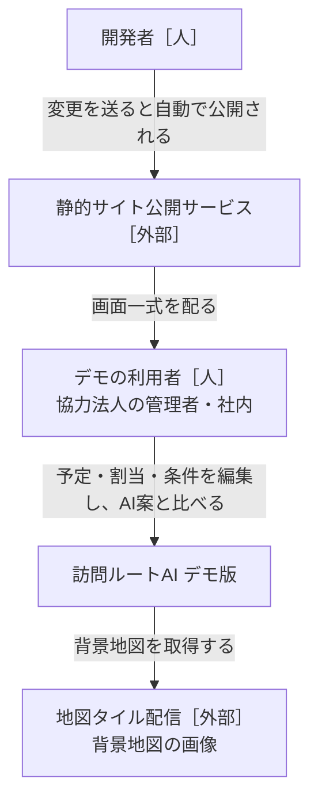
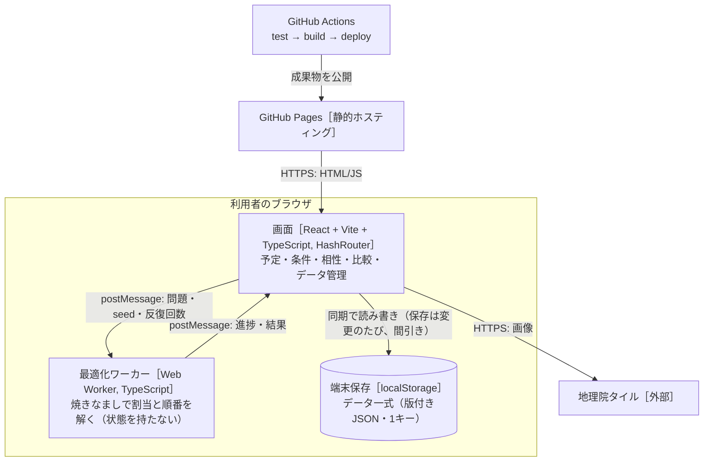
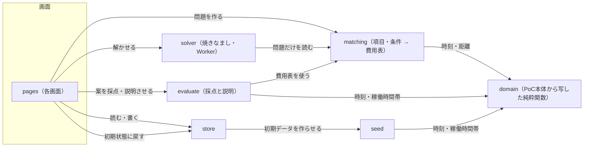

# 設計書：訪問ルートAI デモ版（ブラウザ完結）

- PRD：[docs/prd.md](prd.md)
- 作成者：松浦（草案：Claude）
- 更新日：2026-10-11
- 状態：合意済み（2026-10-11）

## 1. 背景と目的

PoC本体（`katahimo-dev/visit-route-poc`）の管理者画面（予定・手作業の割当・AI案との比較）を、サーバーなしでブラウザだけで動く静的サイトに移し、GitHub Pages で公開する。
データは localStorage に残し、JSON で書き出し・読み込みする。
最適化は Python（OR-Tools）の代わりに Web Worker 上の焼きなましで解き、ClassClassify のように**項目・条件・重み（0〜5）・必須**で、相性・スタッフの特性・顧客の希望を柔軟に足せるようにする。
目的は、協力法人に触ってもらって割当の考え方を集めるサイクルを速く回すこと（PRD §1）。

## 2. やらないこと

- ログイン・サーバー保存・事業所の分離・同時編集。外部送信は地図タイルの取得だけ
- Firebase・Cloud Functions・Python 最適化・Google Maps Platform。移動時間は直線距離からの概算（PoC本体 `estimateLeg`）だけ
- スタッフの記録・位置・ジオフェンス・勤怠・CSV・通知・PWA のオフライン対応
- 相性の学習。相性・特性・希望は人が入れる
- 月次シフトの一括作成。AI案は1日単位
- PoC本体へのコードの書き戻し。共通の純粋関数は**写して**使い、同期しない（ADR-0001）

## 3. 全体図

### L1 システムコンテキスト



### L2 コンテナ



### L3 コンポーネント



矢印は「読む・呼ぶ」。データを書き換えるのは store だけ（§4）。solver と evaluate は同じ費用表（matching の出力）を使い、AI案と手作業案を**同じ物差し**で採点する。

## 4. コンポーネントと責務

### store（データ一式の保存）
- 責務：データ一式（`DemoData`）の読み込み・保存・検査・版の移行、JSON の書き出し・読み込み、初期状態に戻す。画面へは React のフック（`useDemoData()`・`update(fn)`）で渡す。
- 持つデータ（持ち主）：`DemoData`＝`{ version, org, staff[], clients[], visits[], availability[], manualPlans{date→routes}, items[], rules[], compat{clientId→{staffId→-2..2}}, aiPlans{date→AiPlan}, seed }`。localStorage のキー `vrdemo:data:v1` に1つの JSON で置く。
- 提供するAPI：`load(): DemoData`、`save(data)`（300ms 間引き）、`reset(): DemoData`、`exportJson(data): Blob`、`importJson(text): DemoData | ImportError`、`migrate(raw): DemoData`。
- 依存するもの：seed（初期データ）、zod（検査）。
- 配置：`src/store/`
- 完了の条件：
  - [ ] 壊れた・古い版の JSON を読むと、移行するか、元のデータを残したまま利用者向けの日本語のエラーを返す（画面が真っ白にならない）
  - [ ] 書き出し → 読み込み で同じデータに戻る（テスト）
  - [ ] localStorage の容量超過で保存に失敗したら、書き出しを促す表示を出す

### seed（デモの初期データ）
- 責務：PoC本体 `scripts/seedDemo.ts` の生成ロジック（仙台・スタッフ8人・訪問先20か所・日ごとの予定・稼働時間帯の上書き・手作業らしい割当）を写し、本デモの項目・条件・相性の初期セットを足す。日付だけで同じ結果が決まる。
- 持つデータ（持ち主）：なし
- 提供するAPI：`createDemoData(today: string): DemoData`（今日から14日分）
- 依存するもの：domain
- 配置：`src/seed/`
- 完了の条件：
  - [ ] PoC本体の性別希望（c6・c18 女性、c11 男性）は「性別」項目＋訪問先の必要条件に、NG（c2→s2、c12→s7）は相性「×」になる
  - [ ] 初期の項目は 性別・資格（介護福祉士/看護師/保育士/なし の複数）・経験年数（数値）・得意（高齢/子ども/障害/家事 の複数）・ペット可（あり/なし）・喫煙者（あり/なし）。初期の条件は §5 の表の既定値
  - [ ] 同じ日付を渡すと同じデータになる（テスト）

### domain（PoC本体から写した純粋関数）
- 責務：時刻（`hhmmToMinutes` など）、距離と移動の概算（`distanceMeters`・`estimateLeg`）、稼働時間帯（`availabilityOf`・`shiftOf`・`withinSlots`）、ルート評価（`evaluateRoute`）、手作業の割当の補助（PoC本体 `web/src/features/admin/schedule/model.ts` の `reconcile`・`assign`・`timesOf`・`warningsOf`）。
- 持つデータ（持ち主）：なし
- 提供するAPI：PoC本体と同じ名前・同じ引数（写したときのコミットをファイル先頭のコメントに書く）
- 依存するもの：なし（zod のみ）
- 配置：`src/domain/`
- 完了の条件：
  - [ ] PoC本体の該当テストを一緒に写して通る

### matching（項目・条件 → 費用表）
- 責務：項目（`Item`）・スタッフの特性値・訪問先の必要条件と希望・相性・条件（`Rule`）を、solver が読む**問題（`Problem`）**に変換する。①訪問×スタッフの**可否**（必須の条件・相性×・稼働時間帯の外）②訪問×スタッフの**割当費用**（重み付きの条件の合計、分換算）③スタッフごとの負担の目標（均等の条件）④移動・待ちの行列と係数。同じ関数で、訪問×スタッフごとの**理由**（どの条件で何分ぶん）も返す。
- 持つデータ（持ち主）：なし
- 提供するAPI：`compile(data: DemoData, date: string): Problem`、`reasonsOf(problem, visitIdx, staffIdx): Reason[]`、`matches(cond: Condition, traits): boolean`
- 依存するもの：domain
- 配置：`src/matching/`
- 完了の条件：
  - [ ] 重み0の条件は費用にも理由にも出ない。必須の条件を満たさない組は可否で外れる（テスト）
  - [ ] 項目を消すと、それを参照する条件は「無効（項目がない）」になり、計算は止まらない
  - [ ] どの訪問にも担当の候補がいないとき、`Problem.infeasible` に訪問と原因の条件を入れる

### solver（最適化・Web Worker）
- 責務：`Problem` を受け取り、時間の約束・稼働時間帯・可否を破らずに、`移動分 + 待ち分×係数 + 割当費用 + 均等の費用 + 落とした訪問×10000` を最小にする割当と順番を返す。焼きなまし（ADR-0003）。決定的な乱数（seed）と**反復回数**で止める（時刻で止めない。D10）。
- 持つデータ（持ち主）：なし
- 提供するAPI：Worker メッセージ（§5）。純粋関数 `solve(problem, {seed, iterations}, onProgress?)` も公開し、テストは Worker なしで呼ぶ
- 依存するもの：matching の `Problem` 型のみ
- 配置：`src/solver/`
- 完了の条件：
  - [ ] 同じ問題・seed・反復回数で同じ結果（テスト）
  - [ ] 出た案は可否・時間の約束・稼働時間帯を必ず守る（evaluate で違反0。性質テスト）
  - [ ] 8人・20件で 3秒以内、30人・150件で 30秒以内（中位のノートPC）。計算中に「止める」を押すとそれまでの最良案を返す
  - [ ] 全条件の重み0・移動だけのとき、PoC本体の手作業案（seed）より総移動が短い

### evaluate（採点と説明）
- 責務：手作業案・AI案のどちらも同じ `Problem` で採点する。合計点、移動・待ち・距離、条件ごとの達成/違反の数、訪問ごとの理由（`相性◎` `希望○ 女性` `資格✓` `継続` `移動+12分`）、守れなかった必須の条件（手作業案は保存を止めず警告だけ）、前回のAI案との差（担当が変わった訪問数・移動の増減）。
- 持つデータ（持ち主）：なし
- 提供するAPI：`score(problem, routes): PlanScore`、`explain(problem, routes): VisitExplain[]`、`diff(a, b): PlanDiff`
- 依存するもの：matching、domain
- 配置：`src/evaluate/`
- 完了の条件：
  - [ ] solver の内部の費用と `score` の合計点が一致する（テスト）
  - [ ] 理由は分換算の大きい順に3つまで出す

### pages（画面）
- 責務：PoC本体の管理者画面（予定・AI案の比較・稼働時間帯・スタッフ・訪問先）を Firebase なしで動かす。追加の画面：項目、条件（重みのスライダー 0〜5・必須の切り替え。ClassClassify の Setup にならう）、相性の表（訪問先×スタッフ、クリックで ◎→○→空→△→× を回す）、データ（書き出し・読み込み・初期状態に戻す・実データを入れないでの注意書き）。スタッフの今日の順番を見る画面（D16、表示だけ）。
- 持つデータ（持ち主）：画面の一時状態のみ
- 提供するAPI：なし（ルートは `#/schedule` `#/plan` `#/rules` `#/items` `#/compat` `#/staff` `#/clients` `#/availability` `#/data` `#/staff-view/:staffId`）
- 依存するもの：store・matching・solver（Worker）・evaluate、Leaflet（PoC本体 `RouteMap.tsx` を写す）
- 配置：`src/pages/`、`src/components/`
- 完了の条件：
  - [ ] 条件の重みを変えて「AI案を作る」→ 10秒以内に左右比較と理由が出る
  - [ ] 予定画面のドラッグ割当・警告が PoC本体と同じに動く（必須の条件の違反も赤い枠）
  - [ ] 呼び方は `org.terms` から引き、「お客様」「シッター」を直書きしない。主ボタンはオレンジ1色・1画面1〜2個

### deploy（公開）
- 責務：main への push で `npm ci → npm test → npm run build → GitHub Pages へ公開`。
- 持つデータ（持ち主）：なし
- 提供するAPI：なし
- 依存するもの：GitHub Actions（`actions/upload-pages-artifact`・`actions/deploy-pages`）
- 配置：`.github/workflows/deploy.yml`、`vite.config.ts`（`base: './'`）
- 完了の条件：
  - [ ] push から5分以内に Pages の公開URL に反映される
  - [ ] サブパスで再読込しても 404 にならない（HashRouter）

## 5. API契約

サーバーの API はない。境界の契約は **TypeScript の型（`src/contracts/`）と Worker のメッセージ**。型の正は `src/contracts/`、ここには一覧と意味を書く。

| コンポーネント | メソッド | エンドポイント | 概要 |
|---|---|---|---|
| store | 関数 | `load / save / reset / exportJson / importJson` | データ一式の保存・入出力 |
| matching | 関数 | `compile(data, date) → Problem` | 項目・条件 → 可否・費用表 |
| solver | Worker | `{type:'solve', problem, seed, iterations}` → `{type:'progress', iter, best}` … `{type:'done', result}` | AI案を作る。`{type:'stop'}` で最良案を返して終わる |
| evaluate | 関数 | `score / explain / diff` | 採点・理由・前回との差 |

### 項目と条件のデータ（`src/contracts/rules.ts`）

```ts
type ItemKind = 'flag' | 'choice' | 'multi' | 'number'      // あり/なし・1つ・複数・数値
interface Item { id: string; name: string; kind: ItemKind; options: string[] }
type TraitValue = boolean | string | string[] | number | null
// staff[].traits: Record<itemId, TraitValue>

type Op = 'is' | 'in' | 'hasAny' | 'hasAll' | 'gte' | 'lte'
interface Condition { itemId: string; op: Op; value: TraitValue | string[] }
// clients[].requirements: Condition[]   … 必要条件（満たさないと違反）
// clients[].preferences:  Condition[]   … 希望（満たさないと違反、満たしても加点なし）
// clients[].usualStaffId: string | null … いつもの担当
// compat[clientId][staffId]: -2(×) | -1(△) | 1(○) | 2(◎)  未入力は0

type RuleType =
  | 'requirement'   // 訪問先の必要条件
  | 'preference'    // 訪問先の希望
  | 'compatibility' // 相性（×は weight にかかわらず必須で外す）
  | 'continuity'    // いつもの担当
  | 'balance'       // 負担の均等（稼働時間に比例した件数の帯から外れた件数）
  | 'wait'          // 待ち時間
interface Rule { id: string; type: RuleType; label: string; weight: number /*0..5, 0.5刻み*/; hard: boolean }
```

### 費用の物差し（分換算）

| 条件 | 既定 | 1件あたりの費用 |
|---|---|---|
| 移動時間 | 常に有効 | 移動1分＝1点（基準） |
| requirement | **必須** | 必須なら可否で外す。重みなら 違反1件＝重み×10点 |
| preference | 重み3 | 満たさない希望1つ＝重み×10点 |
| compatibility | 重み3 | ◎＝−重み×10、○＝−重み×5、空＝0、△＝＋重み×10、×＝必須で外す |
| continuity | 重み2 | いつもの担当でない＝重み×10点 |
| balance | 重み1 | 帯から外れた1件＝重み×10点 |
| wait | 重み3 | 待ち1分＝重み×0.1点（PoC本体の waitSeconds 0.3 と同じ） |
| 時間の約束・稼働時間帯 | 必須（固定） | 破らない |
| 落とした訪問 | 固定 | 1件＝10000点 |

（重み1＝移動10分ぶん。2026-10-11 決定）

### エラー方針
| コード | HTTP | 意味 | 呼び出し側の対応 |
|---|---|---|---|
| INVALID_ARGUMENT | — | 読み込んだ JSON が契約に合わない | 画面に日本語で原因（項目名）を出し、元のデータを残す |
| FAILED_PRECONDITION | — | その日の訪問・稼働中のスタッフがいない、どの担当も可にならない訪問がある | 原因の訪問と条件を出す。解ける訪問だけで解く |
| RESOURCE_EXHAUSTED | — | localStorage の容量超過 | 書き出しを促す |
| ABORTED | — | 利用者が計算を止めた | それまでの最良案を出す |

Worker 内の例外は `{type:'error', message}` で返し、内部の文言をそのまま画面に出さない。

### 冪等性・タイムアウト
- 同じ `Problem`・`seed`・`iterations` からは同じ結果（反復回数で止め、時刻・`Math.random` を使わない）
- 反復回数の既定は問題の大きさから決める（目安 3秒）。上限 30秒で `stop` を送り、最良案を採る
- 保存は上書きのみ（1キー）。読み込みは「置き換える前に確認」を出す

## 6. デプロイ構成
| コンテナ | 実行環境 | 台数・複製 | 理由 |
|---|---|---|---|
| 画面・最適化ワーカー | GitHub Pages（静的配信） | 1 | 無料・push で即公開・サーバーなし |
| ビルド | GitHub Actions（ubuntu-latest, Node 22） | push ごと | テストを通ったものだけ公開 |

- 秘密情報の置き場所：なし（キー不要の地理院タイルのみ。ビルド時の環境変数も使わない）
- バックアップ・停止の許容：データは利用者のブラウザだけ。消えても「初期状態に戻す」で再開できる。大事な設定は JSON に書き出す
- 費用の目安：0円

## 7. 代替案とトレードオフ
| 論点 | 採用 | 不採用の案 | 理由 |
|---|---|---|---|
| デモの置き場所 | 新リポジトリ・GitHub Pages（ADR-0001） | PoC本体の Firebase デモ環境（`katahimo-visit-route-demo.web.app`） | ログイン・関数・費用・デプロイ手順が不要で、push だけで回せる。代わりに記録・勤怠は見せられない |
| PoC本体のコード | 純粋関数・画面を**写す** | モノレポに `apps/demo` として同居、npm パッケージ化 | PoC本体の α版（10月末）を止めない。同期の手間は受け入れる（写した元のコミットを記録） |
| 保存 | localStorage（1キー JSON） | IndexedDB | 14日分×20件で数百KB。同期APIで単純。足りなくなったら移す |
| 最適化 | 焼きなまし（TS・Web Worker、ADR-0003） | OR-Tools の WebAssembly 版、Python を Pyodide で | 依存が軽い、ClassClassify で実績、任意の費用関数（相性・希望・均等）をそのまま入れられる。最適性の保証は失う |
| 条件の表し方 | 項目＋条件の型＋重み0〜5＋必須（ADR-0002） | 自由な式・スクリプト、固定の項目だけ | 管理者が自分で組める範囲に絞る。ClassClassify と同じ操作感 |
| 時間の約束 | 必須のまま（2026-10-11） | 重み付きの条件にして緩める | PoC本体と同じ前提で比べるため |

## 8. 未決事項
| 項目 | いつ・何をもとに決めるか |
|---|---|
| 時間の約束を緩める条件を足すか | 初回デモで「少し遅れてもよい」訪問の話が出たら |
| 項目の初期セット | 初回デモ前に、alca様・フォール様のヒアリング内容から |
| 写した純粋関数を PoC本体と揃え直す時期 | PoC本体の α版リリース後（11月） |
