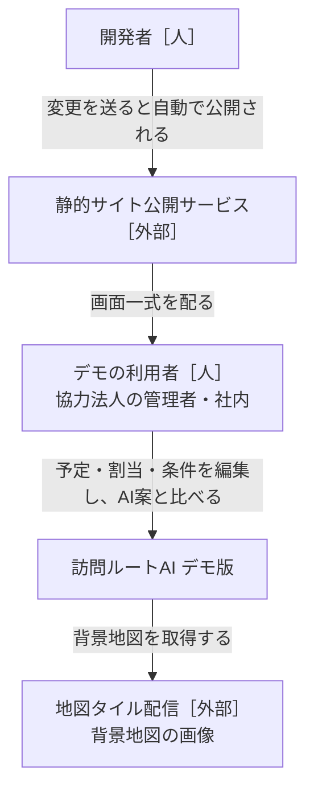
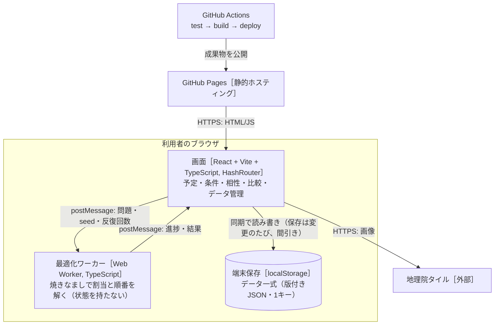
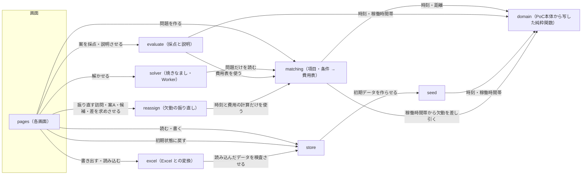

# 設計書：訪問ルートAI デモ版（ブラウザ完結）

- PRD：[docs/prd.md](prd.md)
- 作成者：松浦（草案：Claude）
- 更新日：2026-10-13（当日の急な欠勤の振り直し（ADR-0011。PRD D26〜D35）：欠勤を別の記録 `DemoData.absences` に持ち、domain の `withoutAbsences` で稼働時間帯から差し引く（compile・画面）。新しいコンポーネント reassign（`src/reassign/`）で、他の人の担当・順番・開始時刻を変えずに空き時間へ入れる案A・入らない訪問の候補・差を出す。結果は今の案（`AiPlan.reassign`）にして全部固定し、記録（`AiRun.reassign`）に残す。Excel に「欠勤」シート。1回目は案A、2回目は案B（変更の減点つき焼きなまし）・連絡の一覧）。2026-10-13（レビューの指摘：記録に計算に使った問題のキー `AiRun.inputKey` を残し、`reusableRun` はキーが一致する記録だけ使う（スタッフ・稼働時間・相性を変えたら計算する）。カードは使える記録を優先し、無ければ重みが一致する最新の記録に「データが変わったので押すと作り直します」。Worker の `bestRoutes` は最良が変わったときだけ。`useDayModel` の compile は compile が読むフィールドだけに依存。ADR-0010 追記）。2026-10-13（点数の物差しを点数の基準のプリセット（`DemoData.scorePresetId`。初期は標準）で固定。`useDayModel` に `scoreProblem`・`scoreScale`、Worker の進み具合に `bestRoutes`、Excel の「プリセット」シートに「点数の基準」の列。プリセットは予定の画面のカード全体を押して切り替え、同じ条件・同じデータの記録があれば計算しない（`reusableRun`）。右の欄のプリセットのボタンをやめる。ADR-0010）。2026-10-13（予定と AI案を1画面「予定」（`#/plan`）に統合し、手作業専用の列（開始時刻順・下書き・保存）をやめ「この割当で確定」に。担当ごとの順番・地図の部品を予定と比較で共通化し、列の最後に「自宅まで N分」。ADR-0009）。2026-10-13（点数を「100 −（費用 − 下限）÷ 訪問の件数」に（案A。1.6倍・上限160をやめ100点満点に戻す。素朴な案は点数の基準に使わない。ADR-0007 追記）。2026-10-13（レビューの指摘：素朴な案を「最も安い位置に挟む」に、solver の初期解に素朴な案、必須の違反がある案の点は「参考」、自動作成のあとは一番点の高い案を今の案に）。2026-10-13（点数を1.6倍に（100点を超えてよい。ADR-0007 追記）。プリセットをデータ `presets` に持たせ利用者が編集・追加・削除（最大6つ）、開いた日に全プリセットで自動作成、プリセットごとの案のカード、条件ごとの達成の件数、Excel の「プリセット」シート。ADR-0008）。2026-10-13（合計点を100点満点・高いほど良いで見せる。表示だけで探し方は変えない。ADR-0007）。2026-10-13（Excel の書き出し・読み込み、コンポーネント excel。ADR-0006）。2026-10-12（比較を「AI案の条件を変えた記録どうし」に変更、条件のプリセット3種、手作業の割当は seed に入れない。ADR-0005）。2026-10-11：負担の均等を2乗に・必須で上限、AI案の手直しと固定、比較は別画面（ADR-0004）
- 状態：合意済み（2026-10-11）

## 1. 背景と目的

PoC本体（`katahimo-dev/visit-route-poc`）の管理者画面（予定・手作業の割当・AI案との比較）を、サーバーなしでブラウザだけで動く静的サイトに移し、GitHub Pages で公開する。
データは localStorage に残し、JSON で書き出し・読み込みする。
最適化は Python（OR-Tools）の代わりに Web Worker 上の焼きなましで解き、ClassClassify のように**項目・条件・重み（0〜5）・必須**で、相性・スタッフの特性・顧客の希望を柔軟に足せるようにする。
目的は、協力法人に触ってもらって割当の考え方を集めるサイクルを速く回すこと（PRD §1）。

## 2. やらないこと

- ログイン・サーバー保存・事業所の分離・同時編集。外部送信は地図タイルの取得だけ
- Firebase・Cloud Functions・Python 最適化・Google Maps Platform。移動時間は直線距離からの概算（PoC本体 `estimateLeg`）だけ
- スタッフの記録・位置・ジオフェンス・勤怠・CSV・通知・PWA のオフライン対応
- 相性の学習。相性・特性・希望は人が入れる
- 月次シフトの一括作成。AI案は1日単位
- 欠勤まわり（ADR-0011）：本人からの欠勤連絡の受付、通知の自動送信（連絡文はコピーだけ。2回目）、複数日の欠勤の一括入力、勤怠・有給の管理、欠勤を入れただけで勝手に振り直すこと、訪問の中止・日時変更の自動提案
- PoC本体へのコードの書き戻し。共通の純粋関数は**写して**使い、同期しない（ADR-0001）

## 3. 全体図

### L1 システムコンテキスト



### L2 コンテナ



### L3 コンポーネント



矢印は「読む・呼ぶ」。データを書き換えるのは store だけ（§4）。solver と evaluate は同じ費用表（matching の出力）を使い、AI案と手作業案を**同じ物差し**で採点する。

## 4. コンポーネントと責務

### store（データ一式の保存）
- 責務：データ一式（`DemoData`）の読み込み・保存・検査・版の移行、JSON の書き出し・読み込み、初期状態に戻す。画面へは React のフック（`useDemoData()`・`update(fn)`）で渡す。
- 持つデータ（持ち主）：`DemoData`＝`{ version, org, staff[], clients[], visits[], availability[], absences[]（欠勤。ADR-0011）, manualPlans{date→routes}, items[], rules[], compat{clientId→{staffId→-2..2}}, aiPlans{date→AiPlan（routes＝手直し後、generated＝AIが出したまま、pins＝固定、runId＝元の記録）}, aiRuns{date→AiRun[]（記録。§5）}, presets[]（条件のプリセット。最大6つ。§5。ADR-0008）, scorePresetId?（点数の基準のプリセットの id。ADR-0010）, seed }`。`prevAiPlans`（前回のAI案）は廃止し、記録に置き換えた。localStorage のキー `vrdemo:data:v1` に1つの JSON で置く。
- 提供するAPI：`repair(data)`（契約は通るが中身が食い違うデータを直す：いない人・訪問を指す割当・相性・上書き・固定を除く、ID の重複は最初の1件。記録 `aiRuns` も同じに直し、いない人・訪問を指す記録の割当を除き、1日20件を超える分は古いものから捨てる。プリセット `presets` は id の重複を最初の1件に、6つを超える分は後ろを捨て、0件なら初期の3種、重みは 0〜5 に収めて 0.5 刻みに丸め、必須にできない型の必須は外す。点数の基準 `scorePresetId` は、無い・どのプリセットでもない id なら先頭のプリセットにする（ADR-0010）。`migrate` のあとに必ず通す）、`load(): DemoData`、`save(data)`（300ms 間引き）、`reset(): DemoData`、`exportJson(data): Blob`、`importJson(text): DemoData | ImportError`、`migrate(raw): DemoData`。版は1のまま。読み込み時、`prevAiPlans` は捨て、`aiRuns` が無い古いデータは `{}` で、`presets` が無い古いデータは初期の3種（seed の `INITIAL_PRESETS`）で補う（`migrate` の既定値。版は1のまま）。
- 欠勤（ADR-0011）：`DemoData.absences`（欠勤の記録。§5「欠勤と振り直し」）も持つ。無い古いデータは zod の既定値で `[]`（`aiRuns` と同じく版は1のまま）。`repair` は、いない人の欠勤を除き、ID の重複は最初の1件、同じ人・同じ日の欠勤は最後の1件にする（稼働時間の上書きと同じ）。今の案・記録の `reassign`（振り直しの元の案）の `baseRoutes`・`basePins` は `routes`・`pins` と同じ規則で直す（`absenceIds` は消された欠勤を指していてもそのまま。取り消しの表示に使う）
- 依存するもの：seed（初期データ）、zod（検査）。
- 配置：`src/store/`
- 完了の条件：
  - [ ] 壊れた・古い版の JSON を読むと、移行するか、元のデータを残したまま利用者向けの日本語のエラーを返す（画面が真っ白にならない）
  - [ ] 書き出し → 読み込み で同じデータに戻る（テスト）
  - [ ] localStorage の容量超過で保存に失敗したら、書き出しを促す表示を出す
  - [ ] （ADR-0011）`absences` の無い古いデータは `[]` で読める。いない人の欠勤は消え、同じ人・同じ日の欠勤は最後の1件になる。欠勤・`AiPlan.reassign`・`AiRun.reassign` を含むデータが 書き出し → 読み込み で同じに戻る（テスト）

### seed（デモの初期データ）
- 責務：PoC本体 `scripts/seedDemo.ts` の生成ロジック（仙台・スタッフ8人・訪問先20か所・日ごとの予定・稼働時間帯の上書き）を写し、本デモの項目・条件・相性の初期セットと、条件のプリセットの初期値3種（`src/seed/presets.ts` の `INITIAL_PRESETS`。データの `presets` に入る）を足す。手作業らしい割当は内部でだけ作り、データには入れない（`visits[].staffId` はすべて null、`manualPlans` は空 `{}`）。PoC本体の seed からのデモ独自の差分：スタッフの呼び方は「スタッフ」（業種 care の既定「ヘルパー」は `domain/terms.ts` に写したまま変えない。呼び方はデータの画面で変えられる）、項目「得意」に「料理」を足す。訪問の時間はすべて希望の時刻ちょうど（PoC本体の「幅」の訪問は、幅の始まりの時刻ちょうどに変えた。ただし c4 は日曜に担当が足りなくなるので幅の終わりの 10:30 にした。実際の業務では利用者さんごとの希望の時刻に訪問するため。2026-10-13）。画面・Excel で「幅」の訪問を入れることはできる。ただし訪問先の「いつもの担当」（`usualStaffId`）は、その割当で最も多く担当した人にする（継続の条件を試せるように）。日付だけで同じ結果が決まる。
- 持つデータ（持ち主）：なし
- 提供するAPI：`createDemoData(today: string): DemoData`（今日から14日分）
- 依存するもの：domain
- 配置：`src/seed/`
- 完了の条件：
  - [ ] PoC本体の性別希望（c6・c18 女性、c11 男性）は「性別」項目＋訪問先の必要条件に、NG（c2→s2、c12→s7）は相性「×」になる
  - [ ] 初期の項目は スタッフ側：性別・資格（介護福祉士/看護師/保育士/初任者研修 の複数）・経験年数（数値）・得意（高齢/子ども/障害/家事/話し相手 の複数）・喫煙者・ペット可。訪問先側：ペットあり・喫煙環境・対象（高齢/子ども/障害）。初期の条件は §5 の表の既定値
  - [ ] 同じ日付を渡すと同じデータになる（テスト）
  - [ ] 手作業の割当が入らない（全訪問の `staffId` が null、`manualPlans` が `{}`）。`usualStaffId` は入る（テスト）
  - [ ] 初期データに欠勤は入らない（`absences` が `[]`。ADR-0011）
  - [ ] プリセットの初期値は3種（標準・移動を短く・人の組み合わせ重視。id は `standard`・`travel`・`people`）。型ごとに重み・必須を決め、条件（rules）の型ごとに上書きする（§5 の表）。`applyPreset(rules, preset)`・`presetOf(rules, presets)`、点数の基準の `scorePresetOf(presets, id)`（無ければ先頭）・`scoreRulesOf(data)`（条件に基準のプリセットの重み・必須を当てたもの。プリセットが0件なら条件そのもの。ADR-0010）を持つ。初期データの `scorePresetId` は `standard`

### domain（PoC本体から写した純粋関数）
- 責務：時刻（`hhmmToMinutes` など）、距離と移動の概算（`distanceMeters`・`estimateLeg`）、稼働時間帯（`availabilityOf`・`shiftOf`・`withinSlots`）、ルート評価（`evaluateRoute`）、手作業の割当の補助（PoC本体 `web/src/features/admin/schedule/model.ts` の `reconcile`・`assign`・`timesOf`・`warningsOf`）。
- 持つデータ（持ち主）：なし
- 提供するAPI：PoC本体と同じ名前・同じ引数（写したときのコミットをファイル先頭のコメントに書く）。デモ独自に、稼働時間帯から欠勤を差し引く `withoutAbsences(slots, absences)`（`domain/availability.ts`。「その日に働ける時間帯」を決めるのはこのファイルだけ、の規則を保つ。デモ独自である旨をコメントに書く。ADR-0011）
- 依存するもの：なし（zod のみ）
- 配置：`src/domain/`
- 完了の条件：
  - [ ] PoC本体の該当テストを一緒に写して通る
  - [ ] `withoutAbsences`：終日（開始・終了とも無し）で空、9:00〜18:00 から 9:00〜12:00 を引くと 12:00〜18:00、15:00〜（早退）で 9:00〜15:00、〜11:00（遅刻）で 11:00〜18:00、12:00〜13:00 で 9:00〜12:00・13:00〜18:00、時間帯の外の欠勤では変わらない、複数の時間帯・複数の欠勤でも開始の順・重なりなしで返す（テスト）

### matching（項目・条件 → 費用表）
- 責務：項目（`Item`）・スタッフの特性値・訪問先の必要条件と希望・相性・条件（`Rule`）を、solver が読む**問題（`Problem`）**に変換する。①訪問×スタッフの**可否**（必須の条件・相性×・稼働時間帯の外）②訪問×スタッフの**割当費用**（重み付きの条件の合計、分換算）③スタッフごとの負担の目標（均等の条件）④移動・待ちの行列と係数。同じ関数で、訪問×スタッフごとの**理由**（どの条件で何分ぶん）も返す。
- 持つデータ（持ち主）：なし
- 提供するAPI：`compile(data: DemoData, date: string, pins?: 訪問ID→担当ID): Problem`（pins の訪問はその担当だけを可にする）、`matches`、`conditionText`、`scheduleRoute`、`bestInsertion(problem, routes, visitId, staffId)`（手直しで移した訪問を入れる位置：strict で最も費用が少ない位置、入らなければ開始時刻の順に lenient で入れ、違反として見せる）
- 欠勤（ADR-0011）：`CompileInput` に `absences` を足し、`compile` はその日のその人の欠勤を `withoutAbsences` で稼働時間帯から差し引く（`Problem` の形は変えない。`problemKey` は稼働時間帯を含むので欠勤で変わる）。欠勤で可にならない組の理由は `ruleId: 'slot'`、文は終日なら「欠勤（終日）」、欠勤が無ければ収まるなら「欠勤の時間と重なる」
- 依存するもの：domain
- 配置：`src/matching/`
- 完了の条件：
  - [ ] 重み0の条件は費用にも理由にも出ない。必須の条件を満たさない組は可否で外れる（テスト）
  - [ ] 項目を消すと、それを参照する条件は「無効（項目がない）」になり、計算は止まらない
  - [ ] どの訪問にも担当の候補がいないとき、`Problem.infeasible` に訪問と原因の条件を入れる
  - [ ] （ADR-0011）欠勤のある人の `slots` は欠勤を差し引いたもの。欠勤の時間と重なる訪問はその人に可にならず、理由が「欠勤の時間と重なる」（終日は「欠勤（終日）」）。欠勤の無い日・人の問題は今までと同じ（テスト）

### solver（最適化・Web Worker）
- 責務：`Problem` を受け取り、時間の約束・稼働時間帯・可否を破らずに、`移動分 + 待ち分×係数 + 割当費用 + 均等の費用 + 落とした訪問×10000` を最小にする割当と順番を返す。焼きなまし（ADR-0003）。決定的な乱数（seed）と**反復回数**で止める（時刻で止めない。D10）。
- 持つデータ（持ち主）：なし
- 提供するAPI：Worker メッセージ（§5）。純粋関数 `solve(problem, {seed, iterations}, onProgress?)` も公開し、テストは Worker なしで呼ぶ。初期解は、貪欲な初期解と素朴な案（matching の `naiveSeqs`）の費用の低い方（AI案の費用 ≤ 素朴な案。ADR-0007）
- 依存するもの：matching の `Problem` 型のみ
- 配置：`src/solver/`
- 完了の条件：
  - [ ] 同じ問題・seed・反復回数で同じ結果（テスト）
  - [ ] 出た案は可否・時間の約束・稼働時間帯を必ず守る（evaluate で違反0。性質テスト）
  - [ ] 8人・20件で 3秒以内、30人・150件で 30秒以内（中位のノートPC）。計算中に「止める」を押すとそれまでの最良案を返す
  - [ ] 全条件の重み0・移動だけのとき、PoC本体の手作業案（seed）より総移動が短い

### evaluate（採点と説明）
- 責務：AI案（記録・今の案・手作業案のどれも）を同じ `Problem` で採点する。合計点、移動・待ち・距離、条件ごとの達成/違反の数、訪問ごとの理由（`相性◎` `希望○ 女性` `資格✓` `継続` `移動+12分`）、守れなかった必須の条件（手作業案は保存を止めず警告だけ）、記録どうしの差（担当が変わった訪問数・移動の増減。比較画面では A・B ともいまの条件で採点し直す）。
- 持つデータ（持ち主）：なし
- 提供するAPI：`score(problem, routes): PlanScore`、`explain(problem, routes): VisitExplain[]`、`diff(a, b): PlanDiff`、点数の物差し `normalize(problem): ScoreScale`・`toHundred(cost, scale)`（100 −（費用 − 下限）÷ 訪問の件数）・`hundredBreakdown(score, scale, problem): HundredPart[]`・`naivePlan(problem)`（solver の初期解の候補。§5「点数」。ADR-0007）、条件ごとの達成の件数 `achievements(problem, routes): RuleAchievement[]`（§5。ADR-0008）
- 依存するもの：matching、domain
- 配置：`src/evaluate/`
- 完了の条件：
  - [ ] solver の内部の費用と `score` の合計点が一致する（テスト）
  - [ ] 理由は分換算の大きい順に3つまで出す
  - [ ] AI案の費用 ≤ 素朴な案・AI案の点 > 0（seed の14日・各プリセット）、素朴な案は件数の上限・必須の条件を守る（テスト）
  - [ ] 点数：費用が低いほど点が高い（単調）、0〜100 に収まる、下限は100点、1件あたり10分余計なら90点、訪問0件なら100点、同じ入力で同じ物差し、内訳の合計＝100−点数、下限 ≤ どの案（必須を守る案）の費用（テスト）
  - [ ] 達成の件数：分母はその条件の判定がある割当済みの訪問、分子はその条件の判定をすべて満たした訪問。相性は ◎・○・△・× の件数、負担の均等は目安の帯に収まった人数（テスト）

### reassign（欠勤の振り直し。ADR-0011）
- 責務：欠勤を差し引いた問題（`Problem`）と元の案（担当ごとの列）から、①振り直す訪問を決める（`targetsOf`）②他の人の担当・順番・開始時刻を変えずに、振り直す訪問を空き時間へ1件ずつ入れる（案A「空き時間に入れるだけ」。`reassign`）③入らない訪問の受けられる人の候補を出す（`candidatesFor`）・候補の人に入れる（`placeVisit`）④元の案と振り直した案の差を出す（`reassignDiff`）。どれも純粋関数で決定的（乱数・`Date.now` を使わない。いまの時刻は引数）。`DemoData` は読まない・書かない（問題と列だけを受け取り、新しい列を返す）。
- 振り直しの規則（1回目＝案A。受け入れ基準として守る）：
  - 始まった訪問（動かさない訪問）：時間の約束のいちばん早い開始がいまの時刻より前の訪問（earliest ＜ いまの時刻。始まっている訪問も終わった訪問も含む。2026-10-13 利用者が決定）。いまの時刻が無ければ無い。始まった訪問は誰のものも動かさない（欠勤の人の始まった訪問はその人の列に残り、欠勤と重なれば今までの必須の違反として赤い枠で出る）
  - 振り直す訪問：欠勤のある人（引数）の元の案の、始まっていない訪問のうち、(a) その人に可にならない訪問（理由が稼働時間帯＝`absence`、それ以外の必須の条件＝`notAllowed`）、(b) 残りを列の順に足していき、足すと strict で回れなくなる訪問（`unreachable`。欠勤明けに自宅から間に合わない等。この判定の列には始まった訪問を入れない）。それ以外はその人のまま残す
  - 入れられる位置：可・件数の上限（必須の負担の均等）を超えない・その列にすでにある訪問の開始時刻を変えずに strict で回れる・入れた訪問の開始がいまの時刻以降、のすべてを満たす位置。欠勤の人も欠勤でない時間なら入れられる人に含む
  - 入れる順：残りの振り直す訪問ごとに入れられる人（位置のある人）を数え、少ない訪問から。同じ数なら regret（最良と次善の増える費用の差。次善が無ければ最大）の大きい訪問、それも同じなら開始（earliest）の早い順・問題の訪問の順。1件入れるたびに数え直す
  - 位置の選び方：増える費用（その列の 移動＋待ち×係数＋割当費用 の増分 ＋ 負担の均等の点の増分）が最も少ない位置。同じなら問題の staff の順で先の人・前の位置
  - 入れられる人がいない訪問は `unplaced` に残す（欠勤の人の列には残さない）。元の案で入らなかった訪問は振り直さない
  - 問題にいない人の列・問題に無い訪問は触らずにそのまま返す
- 持つデータ（持ち主）：なし
- 提供するAPI：§5「欠勤と振り直し」の `targetsOf`・`reassign`・`candidatesFor`・`placeVisit`・`reassignDiff`
- 補足（実装で決めたこと。作業指示書に無く推測した箇所。2026-10-13）：
  - 始まった訪問の判定は時間の約束の **earliest**（幅の訪問は「いちばん早く始められる時刻」が過ぎたら動かさない）。元の案の予定の開始時刻は使わない（欠勤を差し引いた問題では元の時刻が出せないため）
  - 「登録して振り直す」の欠勤の人（`targetsOf` の `absentStaffIds`）は、その日に欠勤のある**全員**（元の案が確定した割当のとき、先に欠勤を入れた人の訪問も振り直す）。`absenceIds` もその日の欠勤すべて
  - 確定した割当を元の案にするとき、今の案のその人の列に無い訪問は、開始（earliest）がより遅い最初の訪問の前に挟む
  - 候補の「ずらせば入る」は、時刻に関わらない必須の原因（`slot`・`time` 以外）が無く、件数の上限を超えない人だけ探す。前後同じ分なら遅らせる方を先に試す
  - `placeVisit` が `bestInsertion` に落ちたとき（他の訪問の開始を変えないと入らない）、同じ列のあとの訪問の時刻がずれて「+N分」・必須の違反（赤い枠）になることがある（入れた訪問の時刻は変えない）
  - 候補の「この人に入れる」は件数の上限を超える人・必須の条件に合わない人にも押せる（手直しのドラッグと同じ。違反として見せる）
  - 欠勤の印で開始・終了が空のときは、その日の始業・終業の時刻で出す（「欠勤 8:30〜12:00」）。稼働時間の画面のセルは短く「欠勤」「欠 8:30-12」
- 依存するもの：contracts、matching（`scheduleRoute`・`routeCost`・`balancePoints` など時刻と費用の計算だけ）。solver・evaluate・store・画面には依存しない
- 配置：`src/reassign/`
- 2回目（案B・連絡の一覧）は §5「欠勤の振り直し：2回目の範囲」。1回目の作業指示書には入れない
- 完了の条件：
  - [ ] 欠勤の時間と重なる訪問がすべて `absence` で、欠勤明けの最初の訪問に自宅から間に合わない訪問が `unreachable` で振り直す訪問になる。始まった訪問（earliest ＜ いまの時刻）・欠勤と重ならず間に合う訪問はならない（テスト）
  - [ ] 他の人の訪問の担当・順番・開始時刻は変わらない：結果の各列から振り直した訪問を除くと元の案の列（欠勤の人は振り直す訪問を除いた列）と同じで、その訪問の開始時刻も同じ（性質テスト：seed の14日・各スタッフの終日・午前・午後の欠勤）
  - [ ] 振り直した訪問は可・strict・件数の上限を守り、開始がいまの時刻以降（`scheduleRoute` の strict が null でない。テスト）
  - [ ] 入れる順：入れられる人の少ない順、同じなら regret の大きい順（小さな問題でテスト）。同じ入力で同じ結果（テスト）
  - [ ] `pins` は結果で担当のいるすべての訪問（元の案のままの訪問と振り直した訪問）。`unplaced` の訪問はどの列にも無い（テスト）
  - [ ] 候補：可で strict に入る人が先で増える費用の小さい順、入らない人は「ずらせば入る」最小の分（5分刻み・前後120分まで）、必須で外れる理由・重みの違反の理由を返す。`placeVisit` は候補の「入る」と同じ位置に入れ、入らない人には `bestInsertion` と同じ規則で入れる（テスト）
  - [ ] 差：担当が変わった訪問・開始が変わった訪問（分）・入らない訪問・変わる人・移動の増減が出る（テスト）
  - [ ] 8人・20件で100ms以内、30人・150件で1秒以内（中位のノートPC）

### excel（Excel との変換。ADR-0006）
- 責務：`DemoData` ⇔ Excel のブック（シートごとの一覧。プリセットも入る）の変換。書き出しは見出し・列幅・プルダウン付きのテンプレートにする。読み込みは名前の参照を ID に直し、読めない値・同じ名前・いない人の参照を「シート名・行・列」付きの日本語のエラーで返す。データは書き換えない（変換した `DemoData` を返すだけ。画面が store の `migrate`→`replace` で入れる）。
- 持つデータ（持ち主）：なし
- 提供するAPI：`exportWorkbook(data) → Blob`、`importWorkbook(file: ArrayBuffer, base: DemoData) → DemoData | ImportError`（どちらも非同期）。`base` からは版・基準日など Excel に無いものだけを引き継ぎ、案（`manualPlans`・`aiPlans`・`aiRuns`）は空にする。「プリセット」シートが無い古いブックは、`base` のプリセット・点数の基準をそのまま使う。「欠勤」シート（ADR-0011。§5 の表）が無い古いブックは欠勤なし（`[]`。欠勤はその日の予定に付くもので、名前の参照が変わりうるため `base` から引き継がない）。
- 依存するもの：ExcelJS（画面から動的 import）、contracts、store（`migrate` で最後に検査）、matching（条件の表示文）
- 配置：`src/excel/`
- 完了の条件：
  - [ ] 書き出し → 読み込み で、案を除いて同じデータに戻る（テスト。ID・並び順も保つ）
  - [ ] ID 列が空の行は新しい人・訪問・項目・条件として足される。行を消すとその人・訪問は消える
  - [ ] 同じ名前・いない人の参照・読めない値・必須の列の欠けは、シート名と行番号付きのエラーで止め、いまのデータはそのまま
  - [ ] 外部への送信はしない
  - [ ] （ADR-0011）欠勤が書き出し → 読み込みで同じに戻る。「欠勤」シートが無いブックは欠勤なし。同じ人・同じ日の2行、30分単位でない時刻、終了 ≤ 開始、いない人の名前は、シート名と行番号付きで止める（テスト）

### pages（画面）
- 責務：PoC本体の管理者画面（予定・AI案の比較・稼働時間帯・スタッフ・訪問先）を Firebase なしで動かす。最初に開く画面は `#/plan`。追加の画面：項目、条件（重みのスライダー 0〜5・必須の切り替え。ClassClassify の Setup にならう）、相性の表（訪問先×スタッフ、クリックで ◎→○→空→△→× を回す）、データ（書き出し・読み込み・初期状態に戻す・実データを入れないでの注意書き）。スタッフの今日の順番を見る画面（D16、表示だけ）。
- 特性と条件の入力（`components/conditions.tsx`）：特性のあり/なしは「未確認・あり・なし」。条件は相手の項目ごとの1行のチェック表で、何も選ばない項目は問わない。あり/なしの条件の「なし」は `is false`（未確認の相手は満たさない＝安全側）で、`not` は画面からは作らない（前からある `not` は「そのほかの条件」に出して消せる）。保存の形は `Condition[]` のまま
- 持つデータ（持ち主）：画面の一時状態のみ
- 提供するAPI：なし（ルートは `#/plan`（「予定」。ADR-0009：その日の訪問の一覧（初期は畳む。時間・訪問先・所要・今の案での担当・注意・編集/取消。訪問を追加・前の同じ曜日からコピー（訪問が無い日だけ））と、AI案を作る・手直し（ドラッグ）・固定・組み直す・「この割当で確定」（`manualPlans[date]` と各訪問の `staffId` に写す。計算に入れた訪問の担当が `manualPlans[date]` と一致すれば「確定済み」、違えば「未確定の変更あり」）。開いた日にAI案がなければ、`data.presets` の順に1つずつ Worker で自動で作り、どれも記録に残す（2つ目以降も最新のデータで問題を作る。進み具合「10/13 の案：プリセット 2/3」を出し、「止める」で今の1つを途中の最良で残して残りはやめる。計算中は重み・プリセット・いまの重みを保存を押せない。途中は最初に作れた案を見せ、終わったら一番点の高い（王冠の。同点なら先のプリセット）案を今の案にする。その間に手直し・別の案にしていれば変えない）。その日の条件 `data.rules` は書き換えず、作った案の `rules` にプリセットの重みが残る。上部にプリセットごとの案のカード（下記。押すとそのプリセットに切り替える）。今の案の欄に条件ごとの達成の件数（D25）。右の重みの欄には「いまの重み：〈プリセット名〉」・「いまの重みをプリセットとして保存」・プリセットの編集へのリンク・重みのスライダー・「AI案を作り直す」（プリセットのボタンは置かない。ADR-0010）。作る・組み直すたびに記録へ1件足す。担当ごとの列の最後に「自宅まで N分」（最後の訪問先 → 自宅。帰りの移動は `problem.travel[訪問先の点][自宅の点]`）。古いリンクの `#/schedule` は `#/plan` へ移す） `#/compare`（AI案の記録どうしの比較、D19・D22。下記） `#/rules` `#/items` `#/compat` `#/staff` `#/clients` `#/availability` `#/data` `#/staff-view/:staffId`）
- `#/plan` のプリセットのカード（ADR-0008・ADR-0010）：プリセットごとに、その日の記録のうち計算し直さずに使える記録（`reusableRun`。いまのデータでそのプリセットを当てた問題のキーと一致）を優先し、無ければ固定なしで重み・必須がそのプリセットと一致する最新の記録を1枚のカードにする（名前・一言・点数・移動・入らない訪問・必須の違反・条件の達成の要約）。後者（記録のあとにデータが変わった）のカードには「データが変わったので、押すと作り直します」の小さな注記を出し、押すと計算する（押したあとの点はカードの点と違いうる）。各プリセットの問題のキーは compile が読むデータとプリセットだけに依存して作る（ドラッグ・固定では作り直さない）。カードの読み上げの名前は短く（「標準の案を今の案にする（72点）」・今の案なら「標準の案（今の案・72点）」）、内訳・達成・注記は `aria-describedby`。点数・必須の違反・達成はどれも点数の基準の物差し（見出しに「物差し：標準」）。一番点の高いカードに王冠（0点のカードには付けない）。カードの「今の案」は、今の案の元になった記録の id（`AiPlan.runId`。無い古いデータは経路の一致）で決める。**カード全体が1つのボタン**（中にボタンを入れ子にしない。hover・focus の見た目、今の案のカードはオレンジの枠・`aria-pressed`、計算中は押せない）。押すと（`runPreset`）：その日の条件をプリセットの重みにし、計算し直さずに使える記録（`lib/runs` の `reusableRun`。§5）があれば計算せずにその記録を今の案にする（トースト「保存してある〈プリセット名〉の案を今の案にしました（再計算なし）」）、無ければその条件で計算して今の案にする。今の案（手直しなし）のカードは押しても何もしない。手直し・固定がある今の案を捨てるときは確認する。記録の無いプリセットは「まだ作っていません・押して作る」で、「足りない案を作る」（通常のボタン）で順にも作れる
- `#/rules` のプリセットの節（ADR-0008）：プリセットごとに名前・一言・型ごとの重み（0〜5、0.5刻み）・必須を編集（変えるとすぐ保存）、消す（最後の1つは消せない）、「いまの重みをプリセットとして保存」（名前を入れて足す。6つまで）、「初期値に戻す」（初期の3種に戻す。点数の基準も標準に。確認を出す）。「点数の基準」のラジオでプリセットを1つ選ぶ（ADR-0010。基準のプリセットの見出しに「点数の基準」の印。基準のプリセットを消すと残りの先頭に移り、確認の文に出す）
- 担当ごとの順番と地図の共通部品（予定・比較。ADR-0009）：`lib/routeView.ts` に `buildRouteMap`（ルートの集まり（予定は1つ、比較は A 点線・B 実線）から地図の点・線を作る。線は担当の色。担当の絞り込み・選んだ訪問先・区間（来る移動と「自宅まで」の帰り）の強調）、`homeTravel`（最後の訪問先 → 自宅の分）、`useRouteSelection`（地図で見る担当・強調する区間・選んだ訪問。担当を変える・訪問や区間を押すとその人のものでない選択を外し、担当を移した訪問を選んでいたら絞り込みを新しい担当に合わせ、案が入れ替わったとき・比べる案を変えたとき・日付が変わったら外す）。`components/routeView.tsx` に `LegLine`（自宅から・移動・自宅まで N分と待ち。押すと区間を強調）、`VisitCard`（来る区間・時間・訪問先・押すと理由。ドラッグ・固定・違反・「→ Bでは（担当の名前）」は差し込む）、`StaffLegend`（地図の凡例から担当を選ぶ）。画面の外の地図は `components/MapDock.tsx` で右下に浮かせる
- `#/compare` の中身：その日の記録と「今の案（予定の画面の手直し後）」から任意の2つを A・B に選んで比べる。条件の差（重み・必須が違う条件の一覧）、合計点・移動・待ち・距離・入らなかった訪問・必須の違反、条件ごとの達成/違反（採点は A・B とも、点数の基準のプリセットの同じ物差し。見出しに「物差し：標準」。ADR-0010）、担当ごとの順番の左右比較、地図（A：点線、B：実線。線は担当の色。訪問・区間・担当を押すと予定の画面と同じに強調・絞り込み、画面の外なら MapDock）。記録の一覧から「予定の画面で開く」（その記録を今の案にする）・「この条件にする」（その日の条件の重み・必須を記録と同じにする）・「消す」ができる。A と B に同じ案を選ぶと入れ替える。確定した割当との比較はしない。
- `#/plan` の急な欠勤（ADR-0011。1回目＝PRD D26〜D32）：
  - 欠勤の欄：担当ごとの列の見出しに小さな「急な欠勤」ボタン（その日に欠勤があれば、見出しの下の稼働時間帯の横に「欠勤 9:00〜12:00」「欠勤（終日）」の印、メモは title。ボタンは「欠勤を直す」）。押すと右から欄（`components/ui.tsx` の `SidePanel`）：終日／時間帯のラジオ、時間帯は開始・終了（30分刻みの選択。空＝始業から・終業まで）と早道のボタン（午前だけ＝始業〜12:00、午後だけ＝12:00〜終業、〇時から（早退）＝開始だけ、〇時まで（遅刻）＝終了だけ）、メモ（100字まで）、いまの時刻（当日は現在時刻を5分単位に切り捨てた値が初期値、それ以外の日は空＝考えない）、見込み（入力のたびに `targetsOf` を呼び「振り直す訪問 N件（欠勤と重なる a件・間に合わない b件）」と訪問の一覧、始まっていて動かさない訪問の件数）。下の操作：主ボタン「登録して振り直す」・「欠勤だけ登録」・既存なら「欠勤を取り消す」・閉じる。その日の稼働時間帯がもともと無い人の列には出さない。時間帯が正しくない（終了 ≤ 開始）ときは欄に理由を出して押せない
  - 「登録して振り直す」：欠勤を足したデータで compile した問題、元の案（`lib/absences` の `baseOf`：`manualPlans[date]` があれば、各担当の訪問を今の案の列の順（無い訪問は earliest の順）に並べたもの。無ければ `aiPlans[date].routes`）、`targetsOf` → `reassign` で、結果を今の案にする（`applyReassign`：routes・generated＝結果、pins＝結果の pins、`reassign`＝元の案の情報（§5）、記録に `reassign` 付き・名前「欠勤の振り直し（〈名前〉さん）」で1件。欠勤の保存と合わせて1回の `update` で書く）。元の案が無ければ押せず「先にAI案を作ってください」（欠勤だけは登録できる）。元の案が確定した割当で今の案が「未確定の変更あり」なら、今の案の変更を捨てる確認を出す。計算中（Worker）は押せない
  - 差の欄（今の案に `reassign` があるとき、今の案の欄の上）：まとめ「変わる人 N人・振り直し N件・入らない N件・移動 +N分」、「元の案：確定した割当／今の案」「いまの時刻 10:30」、「元の案に戻す」（確認を出し、routes・generated・pins を元の案（`baseRoutes`・`basePins`）に戻し、`reassign`・`runId` を外す。`revertReassign`）、「比較の画面で見る」（A＝欠勤前、B＝今の案）。差は `reassignDiff`（before＝元の案を、振り直しに使った欠勤を除いたデータで compile した問題で、after＝今の案をいまの問題で）。振り直しに使った欠勤が取り消されていたら「欠勤は取り消されています。元の案に戻せます」と出す。今の案を手直し・組み直ししても差の欄は残る（元の案との差を出し直す）。「AI案を作る」・プリセットのカードで別の案にすると消える
  - 列とカード：差の欄があるとき、変わらない人の列は薄く（押せる）、振り直した訪問のカードに「代行」の印（元の担当の名前を title・読み上げに）、開始が変わった訪問に「+N分」（早まったら「−N分」）。地図は振り直した訪問へ来る区間を太くする（`lib/routeView` の `buildRouteMap` に強調する訪問の集まりを渡せるようにする）
  - 入らなかった訪問（振り直しで入らない訪問）：カードの「受けられる人」で候補（`candidatesFor`。先頭5人＋「すべて見る」）を開く。行ごとに 名前・移動 +N分・「時間の約束を守れる」／「N分ずらせば入る」／「入らない」・条件の違反（理由の文）・「件数の上限を超える」と「この人に入れる」（`placeVisit` で入れて固定。守れないときは今までの必須の違反の赤い枠）
  - 比較の画面：記録に `reassign` があれば、選べる案に「欠勤前（記録の名前）」を足す（記録の `reassign.baseRoutes`。いまの問題で採点するので、欠勤の人の訪問は必須の違反として出る）。記録の一覧に「欠勤の振り直し」の印。「予定の画面で開く」は `planOfRun`（記録の `reassign` も今の案に写す）
  - 稼働時間の画面：欠勤のある日のセルに「欠勤」の印（「欠勤（終日）」「欠勤 9:00〜12:00」。メモは title）。稼働時間の欄に同じ文と「欠勤の登録・取り消しは予定の画面で」を出す（セルの時間帯の文は上書き・基本のまま）
  - `useDayModel`：`compileInput` に `absences`、`slotsOf` は欠勤を差し引いた時間帯と、その日の欠勤（`absence`。無ければ null）を返す（スタッフの画面の時刻も欠勤を差し引く）
  - `lib/runs`：`addRun` に optional の `label`・`reassign` を足す（`reassign` 付きの記録は名前を `label` にする）。`findRun` は `reassign` の有無も比べる。`reusableRun` は `reassign` 付きの記録を使わない。`planOfRun` は記録の `reassign` を今の案に写す
  - `lib/absences.ts`（画面の純粋関数。テストあり）：`absencesOn(data, date)`・`saveAbsence(d, absence)`（同じ人・同じ日の欠勤はその1件を置き換える）・`removeAbsence(d, id)`（今の案は変えない）・`baseOf(data, date, problem)`（元の案と、その種類。無ければ null）・`applyReassign(d, date, x)`・`revertReassign(d, date, problem)`
- 依存するもの：store・matching・solver（Worker）・evaluate・reassign、Leaflet（PoC本体 `RouteMap.tsx` を写す）
- 配置：`src/pages/`、`src/components/`
- 完了の条件：
  - [ ] 条件の重みを変えて「AI案を作る」→ 10秒以内に点数と理由が出て、記録に1件増える。比較画面で任意の2つの記録を左右に比べられる
  - [ ] AI案がない日に `#/plan` を開くと、すべてのプリセットで順に自動で作られ、カードが並ぶ。同じ条件・種・固定・結果の記録は増えない
  - [ ] プリセットのカードを押しても、カードの点数は変わらない（点数の基準の物差し）。記録があるカードは進み具合を出さずにすぐ切り替わり、今の案の合計はそのカードの点と一致する。種・データを変えたあとは計算する。条件の画面で基準を替えると点が変わる（ADR-0010）
  - [ ] 予定の画面（`#/plan`）で、訪問の一覧が畳まれて出る。訪問を押すと理由だけが出る（担当の select は無い）。担当の列の最後に「自宅まで N分」があり、押すと地図でその区間が強調される。`#/schedule` は `#/plan` へ移る
  - [ ] 訪問を取り消すと今の案の列・点からその訪問が消え、足すと「入らなかった訪問」に出る。すべて取り消すと今の案の欄・列は出ず「この割当で確定」も押せない（`alignPlan` のテスト）
  - [ ] 担当の列の見出しの下にその日の稼働時間帯と「この日だけ変更」が出る。訪問を「入らなかった訪問」（ドラッグ中は0件でも出る）へドラッグすると未割当になり固定が外れる
  - [ ] 休み・休止中の人の列は出さない（今の案で訪問がある人を除く。ADR-0009 で落とした）。時間の約束・稼働時間帯の違反は、移したあとに必須の違反として赤い枠で出る（ドラッグ中の予告は必須の条件に合わないことだけ）
  - [ ] 「この割当で確定」で `manualPlans[date]` と各訪問の担当が今の案になり、「確定済み」が出る。手直しすると「未確定の変更あり」になる
  - [ ] 手直しで必須の条件に合わない担当にすると赤い枠と違反の印が出る
  - [ ] 比較の画面で、訪問・区間（A は点線、B は実線の側）・「自宅まで」・担当を押すと、予定の画面と同じに地図で強調・絞り込みされる
  - [ ] 呼び方は `org.terms` から引き、「お客様」「シッター」を直書きしない。主ボタンはオレンジ1色・1画面1〜2個
  - [ ] （ADR-0011）列の見出しの「急な欠勤」→ 午前だけ → 「登録して振り直す」で、その人の午前の訪問が他の人へ移り「代行」の印が付き、他の人の訪問の担当・順番・時刻は変わらず、まとめの件数が出る。変わらない人の列は薄い。地図で振り直した訪問へ来る区間が太い
  - [ ] 振り直したあとの今の案は全訪問が固定で、「固定を残して組み直す」をしても担当が変わらない。記録に「欠勤の振り直し」が1件増え、比較の画面で「欠勤前」と比べられる
  - [ ] 入らない訪問の「受けられる人」から「この人に入れる」を押すとその人の列に入り固定になる
  - [ ] 欠勤を取り消すと列の稼働時間帯は戻るが今の案はそのまま。差の欄の「元の案に戻す」で元の担当・固定に戻る
  - [ ] 「いまの時刻」より前に始まる訪問（始まっている訪問・終わった訪問）は動かない。当日以外の日は「いまの時刻」が空
  - [ ] 稼働時間の画面の欠勤のある日のセルに「欠勤」の印が出る
  - [ ] `lib/absences`・`lib/runs` の追加分のテストが通る（同じ人・同じ日の置き換え、元の案の並べ方、戻す）

### deploy（公開）
- 責務：main への push で `npm ci → npm test → npm run build → GitHub Pages へ公開`。
- 持つデータ（持ち主）：なし
- 提供するAPI：なし
- 依存するもの：GitHub Actions（`actions/upload-pages-artifact`・`actions/deploy-pages`）
- 配置：`.github/workflows/deploy.yml`、`vite.config.ts`（`base: './'`）
- 完了の条件：
  - [ ] push から5分以内に Pages の公開URL に反映される
  - [ ] サブパスで再読込しても 404 にならない（HashRouter）

## 5. API契約

サーバーの API はない。境界の契約は **TypeScript の型（`src/contracts/`）と Worker のメッセージ**。型の正は `src/contracts/`、ここには一覧と意味を書く。

| コンポーネント | メソッド | エンドポイント | 概要 |
|---|---|---|---|
| store | 関数 | `load / save / reset / exportJson / importJson` | データ一式の保存・入出力 |
| domain | 関数 | `withoutAbsences(slots, absences) → Slot[]` | 稼働時間帯から欠勤を差し引く（デモ独自。ADR-0011） |
| matching | 関数 | `compile(data, date) → Problem` | 項目・条件 → 可否・費用表（`data.absences` の欠勤を稼働時間帯から差し引く。ADR-0011） |
| solver | Worker | `{type:'solve', problem, seed, iterations}` → `{type:'progress', iteration, total, bestScore, bestRoutes?}` … `{type:'done', result}`（`bestRoutes` は画面が点数の基準の物差しで「いまの最良 N点」を付け直すため。`bestScore` が前の進捗と同じなら送らず、画面は前の点のまま。ADR-0010） | AI案を作る。`{type:'stop'}` で最良案を返して終わる |
| evaluate | 関数 | `score / explain / diff / normalize / toHundred / hundredBreakdown / achievements` | 採点・理由・記録どうしの差・点数（100点満点）・条件ごとの達成の件数 |
| excel | 関数 | `exportWorkbook / importWorkbook` | Excel のブックとの変換（ADR-0006。「欠勤」シート：ADR-0011） |
| reassign | 関数 | `targetsOf / reassign / candidatesFor / placeVisit / reassignDiff` | 欠勤の振り直し：振り直す訪問・案A・入らない訪問の候補・元の案との差（ADR-0011） |

### 項目と条件のデータ（`src/contracts/rules.ts`）

```ts
type ItemKind = 'flag' | 'choice' | 'multi' | 'number'      // あり/なし・1つ・複数・数値
interface Item { id: string; name: string; kind: ItemKind; options: string[] }
type TraitValue = boolean | string | string[] | number | null
// staff[].traits: Record<itemId, TraitValue>

type Op = 'is' | 'in' | 'hasAny' | 'hasAll' | 'gte' | 'lte'
interface Condition { itemId: string; op: Op; value: TraitValue | string[] }
// clients[].requirements: Condition[]   … 必要条件（満たさないと違反）
// clients[].preferences:  Condition[]   … 希望（満たさないと違反、満たしても加点なし）
// clients[].usualStaffId: string | null … いつもの担当
// compat[clientId][staffId]: -2(×) | -1(△) | 1(○) | 2(◎)  未入力は0

type RuleType =
  | 'requirement'   // 訪問先の必要条件
  | 'preference'    // 訪問先の希望
  | 'compatibility' // 相性（×は weight にかかわらず必須で外す）
  | 'continuity'    // いつもの担当
  | 'balance'       // 負担の均等（稼働時間に比例した件数の目安の帯から外れた件数の2乗。hard で上限＝帯の上＋1）
  | 'wait'          // 待ち時間
interface Rule { id: string; type: RuleType; label: string; weight: number /*0..5, 0.5刻み*/; hard: boolean }
```

### AI案の記録と条件のプリセット（`src/contracts/data.ts`・`src/contracts/rules.ts`、初期値は `src/seed/presets.ts`）

```ts
interface AiRun {
  id: string                 // `${date}#${no}@${createdAt}`（最新を消すと番号は使い回すため、時刻で別の記録と分ける）
  no: number                 // その日の通し番号
  date: string
  createdAt: number          // ミリ秒
  label: string              // プリセットと一致すればその名前、違えば「条件を変えた案」。組み直しは「…・固定n件で組み直し」
  presetId: string | null    // 一致したプリセット、無ければ null
  seed: number
  iterations: number
  rules: Rule[]              // 作ったときの条件
  pins: Record<visitId, staffId>
  routes: ...                // 結果（AiPlan.generated と同じ形）
  unassigned: ...
  score: ...
  stopped: boolean
  inputKey?: string          // 計算に使った Problem の中身のキー（lib/runs の problemKey。ADR-0010 追記）。無い古い記録は再計算を省くのに使わない
}
// DemoData.aiRuns: Record<date, AiRun[]>

interface Preset {            // src/contracts/rules.ts の presetSchema（ADR-0008）
  id: string                  // 初期の3種は 'standard'・'travel'・'people'。足したものは新しい ID
  name: string                // 1〜20字
  note: string                // 0〜60字（画面に出す一言）
  weights: Record<RuleType, { weight: number /*0..5, 0.5刻み*/; hard: boolean }>
}
// DemoData.presets: Preset[]（1〜6つ。MAX_PRESETS）。無い古いデータは migrate で INITIAL_PRESETS
// DemoData.scorePresetId?: string … 点数の基準のプリセット（ADR-0010）。無い・存在しない id は repair が先頭に。初期データは 'standard'

interface RuleAchievement {   // src/contracts/problem.ts（evaluate.achievements。ADR-0008）
  ruleId: string              // Rule.id。負担の均等は 'balance'
  unit: 'visit' | 'staff'     // 分母の単位（負担の均等だけ人）
  total: number               // その条件の判定がある割当済みの訪問（均等は人数）
  met: number                 // その条件の判定をすべて満たした（点が0以下の）訪問
  compat: { great: number; good: number; poor: number; ng: number } | null  // 相性だけ ◎・○・△・× の件数
}
// Reason.level?: 2 | 1 | -1 | -2 … 相性の理由にだけ付ける（◎・○・△・×）
```

- 記録は、AI案を作る・固定を残して組み直すたびに、その日の `aiRuns` に1件足す。同じ条件（rules）・seed・pins・結果の記録がすでにあれば足さない。1日20件まで、古いものから消す（localStorage の容量のため。ADR-0005）
- 比較画面は、記録の結果を**点数の基準の物差し**（`scoreRulesOf(data)` で作った `Problem`。ADR-0010）で採点し直して比べる。記録の `score` は作ったときの条件での費用で、比較には使わない
- 計算し直さずに使える記録（`lib/runs` の `reusableRun(runs, target, rules, seed, key?)`。ADR-0010）：その日の記録のうち、固定なし・途中で止めていない・`rules` が同じ（名前・ID・重み・必須まで）・乱数の種が同じ・`inputKey` がいまの条件で作った問題 `target` のキー（`problemKey(target)`）と同じ、の最新のもの。`inputKey` が無い古い記録は使わない。solver は決定的（反復の回数も問題から決まる）なので、作り直しても同じ案になる
- 問題のキー（`lib/runs` の `problemKey(problem)`）：日付・スタッフ（自宅の地点・稼働時間帯）・訪問（地点・時間の約束・作業時間）・移動と距離の行列・可否・割当費用・待ちの点・均等を決定的に JSON にし、FNV-1a（32bit、basis を変えて2回）と長さで短くしたもの（依存を増やさない）。理由（reasons・infeasible）は可否と費用から決まるので入れない。AI案を作る・組み直すとき（組み直しは固定を入れた問題）に `addRun` で記録へ入れる。同じ結果の記録がすでにあれば足さずに、その記録の `inputKey` を今回のものにする
- プリセットはデータ（`data.presets`）。初期値は `src/seed/presets.ts` の3種。型ごとに重み・必須を決め、条件（rules）の型ごとに上書きする。最大6つ、最後の1つは消せない。「いまの重みを保存」は型ごとの最初の条件の重み・必須を写す（その型の条件が無ければ重み0）
- 記録の `presetId`・名前は、作ったときの重みと一致したプリセット（同じ重みのプリセットが2つあれば先の方）

| 初期のプリセット | 訪問先の必要条件・スタッフの条件 | 訪問先の希望 | スタッフの希望 | 相性 | いつもの担当 | 負担の均等 | 待ち |
|---|---|---|---|---|---|---|---|
| standard「標準」（既定。初期の重み） | 必須 | 3 | 2 | 3 | 2 | 3 | 3 |
| travel「移動を短く」（移動・待ちを優先） | 必須 | 1 | 1 | 1 | 0.5 | 1 | 3 |
| people「人の組み合わせ重視」 | 必須 | 5 | 4 | 5 | 4 | 3 | 2 |

（列は条件の型：`clientRequirement`・`staffRequirement`・`clientPreference`・`staffPreference`・`compatibility`・`continuity`・`balance`・`wait`。型の正は `src/contracts/rules.ts`）

### 欠勤と振り直し（`src/contracts/documents.ts`・`src/contracts/data.ts`・`src/contracts/reassign.ts`。ADR-0011）

```ts
// documents.ts：欠勤（稼働時間の上書きとは別の記録）
const absenceSchema = z.object({
  id: idSchema,
  staffId: idSchema,
  date: dateSchema,
  from: hhmm30Schema.nullable(),   // 欠勤の始まり（30分単位）。null＝始業から
  to: hhmm30Schema.nullable(),     // 欠勤の終わり（30分単位）。null＝終業まで。両方 null＝終日
  note: z.string().max(100),       // メモ（例：病院の付き添い）
}) // superRefine：from・to が両方あれば from < to（「終了は開始より後にしてください」）
type Absence = z.infer<typeof absenceSchema>
// DemoData.absences: Absence[]（.max(2000).default([])。無い古いデータは []。DATA_VERSION は1のまま）
// 同じ人・同じ日は1件（画面は置き換え、store の repair は最後の1件、Excel は止める）

// data.ts：振り直しの情報（AiPlan・AiRun に optional で足す。無い＝ふつうの AI案）
const reassignInfoSchema = z.object({
  method: z.literal('insert'),          // 1回目は案A「空き時間に入れるだけ」だけ。2回目に 'anneal'（案B）を足す
  from: z.enum(['confirmed', 'plan']),  // 元の案：確定した割当（manualPlans[date]）か今の案（aiPlans[date].routes）
  baseRoutes: routesSchema,             // 元の案（staffId → 訪問IDの列）。差の基準・「元の案に戻す」・比較の「欠勤前」
  basePins: z.record(z.string(), z.string()), // 元の案の固定（元が確定した割当なら {}）
  absenceIds: z.array(idSchema),        // 振り直しに使った欠勤（取り消されても残す）
  now: hhmmSchema.nullable(),           // いまの時刻（考えないなら null）
})
// AiPlan.reassign?: ReassignInfo   … 今の案が振り直しの結果なら付く（差の欄を出す）
// AiRun.reassign?: ReassignInfo    … 記録が振り直しなら付く（比較の「欠勤前」、reusableRun の対象外）

// reassign.ts：reassign の入出力（時刻は0時からの分。Routes＝Record<staffId, visitId[]>）
type ReassignTarget = {
  visitId: string
  fromStaffId: string                                   // 元の案での担当（欠勤の人）
  reason: 'absence' | 'unreachable' | 'notAllowed'      // 欠勤と重なる・間に合わない・ほかの必須の条件で外れる
}
type ReassignOptions = { now: number | null }           // いまの時刻。null は考えない
type ReassignResult = {
  routes: Routes                                        // 振り直したあとの案
  placed: { visitId: string; staffId: string; addedCost: number; addedTravel: number }[] // 入れた順
  unplaced: string[]                                    // 入らなかった振り直す訪問
  unassigned: string[]                                  // 問題の訪問のうちどの列にも無いもの（unplaced と元から入らない訪問）
  pins: Record<string, string>                          // 担当のいるすべての訪問（訪問ID → 担当ID）
}
type ReassignCandidate = {
  staffId: string
  fits: boolean                    // 可で、他の訪問の開始時刻を変えずに strict で入り、件数の上限を超えない
  addedTravel: number | null       // fits のときの増える移動（分）
  addedCost: number | null         // fits のときの増える費用
  shiftMinutes: number | null      // fits でないとき、時間の約束を何分ずらせば strict で入るか（正＝遅く。5分刻み・前後120分まで。無ければ null）
  overCap: boolean                 // 件数の上限（必須の負担の均等）を超える
  violations: Reason[]             // 必須で外れる理由（points=Infinity）と重みの違反（points>0）
}
type ReassignDiff = {
  moved: { visitId: string; from: string | null; to: string | null }[] // 担当が変わった訪問（null＝未割当）
  shifted: { visitId: string; minutes: number }[]   // 担当が同じで開始が1分以上変わった訪問（正＝遅く。四捨五入）
  unplaced: string[]                                // 元は担当がいて、いまは入らない訪問
  changedStaff: string[]                            // 訪問の出入りか開始の変化がある人
  travelDelta: number                               // 全体の移動の増減（分）
}

function targetsOf(problem: Problem, baseRoutes: Routes, absentStaffIds: string[], now: number | null): ReassignTarget[]
function reassign(problem: Problem, baseRoutes: Routes, targets: ReassignTarget[], options: ReassignOptions): ReassignResult
function candidatesFor(problem: Problem, routes: Routes, visitId: string, options: ReassignOptions): ReassignCandidate[]
function placeVisit(problem: Problem, routes: Routes, visitId: string, staffId: string, options: ReassignOptions): Routes
function reassignDiff(before: { problem: Problem; routes: Routes }, after: { problem: Problem; routes: Routes }): ReassignDiff
```

- `problem` は欠勤を差し引いたデータで、いまの条件（`data.rules`）で compile したもの（solver と同じ。点数は今までどおり点数の基準の物差しで画面が付ける）
- 例外を投げない：問題に無い訪問・担当、元の案に無い振り直す訪問は無視する。`candidatesFor` は問題に無い訪問なら `[]`、問題のすべての人を返す（並び：fits の人が先で addedCost の小さい順、次に shiftMinutes の絶対値の小さい順（同じなら遅らせる方）、最後に入らない人。同じなら staff の順）
- `placeVisit`：候補の「入る」と同じ位置（他の訪問の開始を変えない strict の最良）に入れる。無ければ `bestInsertion` と同じ規則（strict の最良、無ければ開始の順に lenient）。どちらでも訪問を元の列から抜く
- `reassignDiff` の時刻は lenient の `scheduleRoute`（before と after で問題が違ってよい）

### 欠勤の振り直し：2回目の範囲（作業指示書に入れない）
- 案B「少し動かしてよい」（PRD D34）：`Problem` に optional の `stay`（訪問ごとの元の担当の添字と、担当を変えた訪問1件の減点。減点は小 10分・中 30分・大 60分ぶんから選ぶ）を足し、solver と evaluate の費用に同じ式で足す（合計点の一致を保つ）。初期解は案A の結果、固定は始まった訪問だけ。点数・必須の違反は今までどおり点数の基準の物差し（`stay` を入れない問題）で付ける。結果は `reassign.method: 'anneal'` で今の案・記録に残す
- 連絡の一覧（PRD D35）：`reassignDiff` と訪問先・スタッフから、担当が変わる利用者さん・時刻が変わる訪問・仕事が増えるスタッフの一覧と連絡文を作り、文をコピーする（送信しない）。契約は2回目の設計で決める

### Excel のブックの形（`src/excel/`。ADR-0006）
1行目が見出し、2行目からデータ。参照は名前で書く（〈スタッフ〉の名前・〈利用者さん〉の表示名は各シートで一意。項目の名前は対象ごとに一意で、対象が違えば同じ名前でよい。条件の名前はどこからも参照しないので重なってよい）。○＝はい、空＝いいえ。複数の値は「、」か改行で区切る（「・」「,」「，」は区切らない＝選択肢の名前に使える）。見出しは全角半角・コロンの揺れを許して比べる。呼び方（スタッフ・利用者さん）はシート名・見出しにも `org.terms` を使う。

| シート | 列 |
|---|---|
| 使い方 | 書き方の説明だけ（読み込みでは見ない） |
| 事業所 | 「項目」「値」の2列：事業所名・業種・呼び方（訪問する人）・呼び方（訪問先）・1kmあたりの運賃（円）・乱数の種 |
| 項目 | ID・対象（〈スタッフ〉／〈利用者さん〉）・名前・種類（あり/なし／選択肢から1つ／選択肢から複数／数値）・選択肢 |
| 条件 | ID・名前・種類（条件の型の名前）・重み（0〜5、0.5刻み）・必須（○） |
| プリセット | ID・名前・一言・重み：〈条件の型の名前〉…（型ごと。0〜5、0.5刻み。空は0）・必須（必須にする条件の型の名前を「、」区切り）・点数の基準（○ を1行だけ。列が無い・無印なら先頭、2行以上は止める。ADR-0010）。1〜6行。シートが無い古いブックは、いまのプリセット・点数の基準のまま |
| 〈スタッフ〉 | ID・名前・移動手段・勤務する曜日（例：月火水木金）・勤務開始・勤務終了・利用中・住所・緯度・経度・〈特性：項目名〉…・〈必要条件：項目名〉…・〈希望：項目名〉… |
| 〈利用者さん〉 | ID・表示名・色（1〜8）・利用中・住所・緯度・経度・いつもの担当・メモ・〈特性：項目名〉…・〈必要条件：項目名〉…・〈希望：項目名〉… |
| 相性 | 行＝〈利用者さん〉の表示名、列＝〈スタッフ〉の名前。セルは ◎・○・△・×・空 |
| 稼働時間 | 〈スタッフ〉・日付・時間帯（例：9:00-12:00、13:00-18:00。「休み」で休み）。その日だけの上書き |
| 欠勤 | ID・〈スタッフ〉・日付・開始・終了・メモ（開始の空＝始業から、終了の空＝終業まで、両方空＝終日。30分単位。同じ人・同じ日は1行。ADR-0011）。シートが無い古いブックは欠勤なし |
| 訪問 | ID・日付・〈利用者さん〉・時間の決め方（ちょうど／幅）・開始（早）・開始（遅）・所要（分）・担当・取り消し・メモ |

- 特性のセル：あり/なし＝「あり」「なし」、空＝未確認。選択肢から1つ＝選択肢そのもの。選択肢から複数＝「、」区切り（「（なし）」と書くと確認済みで1つもない）。数値＝数
- 選択肢の名前に「、」・改行・「（なし）」は使えない（項目の画面で弾く。書き出し時にあれば、場所を示して書き出しを止める）。セル（条件は1行）全体が1つの選択肢の名前と同じなら、印（「以外」「すべて：」など）より先にその選択肢として読む
- 条件のセル（相手の項目ごと。空＝問わない）：あり/なし＝「あり」「なし」「なし（未確認も可）」「あり（未確認も可）」（後ろ2つは `not`）。選択肢から1つ＝「A、B」（どれか）／「A以外」（`not`）。選択肢から複数＝「A、B」（どれかを含む）／「すべて：A、B」。数値＝「3以上」「5以下」「3〜5」「3」（等しい）／「3以外」
- 補足（実装で決めたこと）：業種は「ベビーシッター・介護・訪問看護・その他」で書く。同じ項目の条件が2つ以上でセルに書けないときは、セルの中で改行して1行に1つ（数値の以上と以下の2つは「3〜5」）。選択肢から1つの条件で値が1つだけなら `is` で読む（`in` の1つと意味は同じ）。読み込むと条件は項目の列の順に並ぶ
- 読み込みで止めるもの：必須の列が無い、項目のシートにある項目の「特性：」「必要条件：」「希望：」の列が無い・項目のシートにない項目の列がある、同じ名前（〈スタッフ〉・〈利用者さん〉・同じ対象の項目）、同じ ID、ID が `__proto__`・`constructor`・`prototype`、いない名前の参照、読めない値（時刻・日付・数・選択肢にない値。時刻の列の 1 以上の数・数式のエラー・結果の無い数式も）、20件を超える条件、contracts の長さの上限（ID・名前・メモ・住所・選択肢の数と長さ）を超える値、稼働時間で同じ人・同じ日の行が2つ、2つの呼び方が同じ。ファイルは 10MB・1シート 1万行まで。止めたときは、いまのデータを変えない
- 書き出す数は指数表記にしない。画面は先に読み込んで検査し、通ったら件数を見せて確かめてから置き換える

### 費用の物差し（分換算）

| 条件 | 既定 | 1件あたりの費用 |
|---|---|---|
| 移動時間 | 常に有効 | 移動1分＝1点（基準） |
| requirement | **必須** | 必須なら可否で外す。重みなら 違反1件＝重み×10点 |
| preference | 重み3 | 満たさない希望1つ＝重み×10点 |
| compatibility | 重み3 | ◎＝−重み×10、○＝−重み×5、空＝0、△＝＋重み×10、×＝必須で外す |
| continuity | 重み2 | いつもの担当でない＝重み×10点 |
| balance | 重み3 | スタッフごとに、目安の帯 [floor, ceil] から外れた件数 e について 重み×10×e² 点（1件外れ＝30点、2件＝120点、3件＝270点）。必須なら 件数 ≤ ceil＋1 |
| wait | 重み3 | 待ち1分＝重み×0.1点（PoC本体の waitSeconds 0.3 と同じ） |
| 時間の約束・稼働時間帯 | 必須（固定） | 破らない |
| 落とした訪問 | 固定 | 1件＝10000点 |
| 手直しの固定 | 必須（固定） | 固定した訪問は固定した担当だけを可にする（`compile` の `pins`） |

（重み1＝移動10分ぶん。2026-10-11 決定）

#### 点数（表示だけ。ADR-0007）
上の費用（低いほど良い。solver が最小化）はそのまま。画面の合計点だけを、費用の単調な変換で「高いほど良い」100点満点の点数にする。案の順位は（同じ日なら）点数の基準の物差しの費用と必ず一致する。物差しは、その日の条件に**点数の基準のプリセット**（`DemoData.scorePresetId`。初期は標準）の重み・必須を当てた条件（`scoreRulesOf`）で作った `Problem` から決まる（ADR-0010）。プリセットのカード・重みの欄で条件の重みを変えても物差しは変わらない（solver が最小にする費用・探索だけが変わる）。

- 物差しの問題・物差しは `useDayModel` の `scoreProblem`・`scoreScale`・`scoreRulerName`（基準のプリセットの名前。プリセットが無ければ「いまの条件」）。いまの条件と同じ重み・必須なら `problem` をそのまま使い、compile を二重にしない。`useDayModel` の compile は、compile が読むフィールド（`compileInput`＝org・items・rules・staff・clients・compat・visits・availability。matching の `CompileInput`）だけに依存し、案のドラッグ・固定・記録の更新では作り直さない。いまの条件の物差し（以前の `scale`）は使う画面が無いので公開しない。点数・内訳・必須の違反・条件ごとの達成・件数の偏りはこれで出す。訪問ごとの理由・入らなかった理由・ドラッグの可否の予告はいまの条件の `problem`（作り方の説明）

- 点数＝round(100 −（費用 − LB）÷ 訪問の件数)、0〜100 に収める。「1件あたり、理想より余計にかかった費用（分に換算）だけ減点」（1件あたり10分余計なら90点）。表示は「70点」（2026-10-13 案A。それまでの「素朴な案＝0点・1.6倍」は、素朴な案が最適に近い土日に幅が潰れたためやめた）
  - 訪問の件数＝その日の `Problem` の訪問の数（計算に入れた訪問。`ScoreScale.visits`）。0件なら100点
- 100点＝下限 LB（どの案の費用も LB 以上。現実にはまず届かない）＝割当の下限＋移動の下限（待ち0・負担の均等0）。担当の候補がいない訪問は落とした訪問の点（どの案でも避けられない）
  - 割当の下限：各訪問を、可否を満たす担当のうち割当費用が最小の人にした合計
  - 移動の下限：ルートの移動は「各訪問に来る移動の和＋帰り」＝「各訪問から出る移動の和＋行き」なので、max(Σ 来る移動の最小, Σ 出る移動の最小)。来る元＝その訪問を担当できる人の自宅か、前に置けうる訪問（u の earliest＋作業＋移動 ≤ v の latest で、両方を担当できる人がいる）。出る先＝担当できる人の自宅か、後に置けうる訪問。移動は分＝点（solver と同じ）
  - 1件ごとに割当＋移動の下限が落とした訪問の点（10000）を超えるなら 10000 にする（落とす案もあるので）
- 内訳：成分ごとの超過（移動−移動の下限・待ち×係数・担当の条件−下限の割当費用・負担の均等・(入らない訪問−候補のいない訪問)×10000）÷ 訪問の件数 を「−x点」で示す。合計は 100−点数（丸め・0〜100 に収めた分を除く）。0 未満の成分は画面に出さない
- 素朴な案（`matching/naive.ts` の `naiveSeqs`、evaluate の `naivePlan`）は solver の初期解の候補で、点数の基準には使わない：訪問を、担当できる人の少ない順・開始（earliest）の早い順に、可否・件数の上限を満たす担当それぞれの順番の中で、時間の約束・稼働時間帯（strict）を守って入る位置のうち増える移動（前→この訪問→次。空の列は行きと帰り）が最も少ない位置を探し、増える移動が最も少ない担当のその位置に挟む（同じなら staff の順で先の人・前の位置）。条件の点は見ない。それでも入らない訪問だけ落とす。乱数・時刻は使わない
- solver は初期解の候補に素朴な案を入れ、貪欲な初期解と費用の低い方から始める。よって AI案の費用 ≤ 素朴な案。決定的なまま
- 必須の違反がある案（手作業案・手直しで必須の条件に合わない担当にした案）の点には「参考」の印を付け、説明に「必須を守っていない案の点は比べられません」と出す（予定・比較の画面）
- 内部の費用は説明に「費用 543（内部の値）」として残す。`SolveResult.score`・`PlanScore.total` は費用のまま

### エラー方針
| コード | HTTP | 意味 | 呼び出し側の対応 |
|---|---|---|---|
| INVALID_ARGUMENT | — | 読み込んだ JSON が契約に合わない | 画面に日本語で原因（項目名）を出し、元のデータを残す |
| FAILED_PRECONDITION | — | その日の訪問・稼働中のスタッフがいない、どの担当も可にならない訪問がある | 原因の訪問と条件を出す。解ける訪問だけで解く |
| RESOURCE_EXHAUSTED | — | localStorage の容量超過 | 書き出しを促す |
| ABORTED | — | 利用者が計算を止めた | それまでの最良案を出す |
| INVALID_ARGUMENT | — | 欠勤の時間帯が正しくない（終了 ≤ 開始・30分単位でない）（ADR-0011） | 欠勤の欄に日本語で理由を出し、登録しない |
| FAILED_PRECONDITION | — | 振り直しの元の案が無い（確定した割当も今の案も無い）（ADR-0011） | 「先にAI案を作ってください」を出す。欠勤だけは登録できる |

Worker 内の例外は `{type:'error', message}` で返し、内部の文言をそのまま画面に出さない。

### 冪等性・タイムアウト
- 同じ `Problem`・`seed`・`iterations` からは同じ結果（反復回数で止め、時刻・`Math.random` を使わない）
- 反復回数の既定は問題の大きさから決める（目安 3秒）。上限 30秒で `stop` を送り、最良案を採る
- 保存は上書きのみ（1キー）。読み込みは「置き換える前に確認」を出す
- 振り直し（reassign）は同じ問題・元の案・振り直す訪問・いまの時刻から同じ結果。「登録して振り直す」を2回押すと、2回目は1回目の結果（今の案）を元の案にして振り直す（振り直す訪問が無ければ案は変わらない。記録は同じ結果なら足さない）

## 6. デプロイ構成
| コンテナ | 実行環境 | 台数・複製 | 理由 |
|---|---|---|---|
| 画面・最適化ワーカー | GitHub Pages（静的配信） | 1 | 無料・push で即公開・サーバーなし |
| ビルド | GitHub Actions（ubuntu-latest, Node 22） | push ごと | テストを通ったものだけ公開 |

- 秘密情報の置き場所：なし（キー不要の地理院タイルのみ。ビルド時の環境変数も使わない）
- バックアップ・停止の許容：データは利用者のブラウザだけ。消えても「初期状態に戻す」で再開できる。大事な設定は JSON に書き出す
- 費用の目安：0円

## 7. 代替案とトレードオフ
| 論点 | 採用 | 不採用の案 | 理由 |
|---|---|---|---|
| デモの置き場所 | 新リポジトリ・GitHub Pages（ADR-0001） | PoC本体の Firebase デモ環境（`katahimo-visit-route-demo.web.app`） | ログイン・関数・費用・デプロイ手順が不要で、push だけで回せる。代わりに記録・勤怠は見せられない |
| PoC本体のコード | 純粋関数・画面を**写す** | モノレポに `apps/demo` として同居、npm パッケージ化 | PoC本体の α版（10月末）を止めない。同期の手間は受け入れる（写した元のコミットを記録） |
| 保存 | localStorage（1キー JSON） | IndexedDB | 14日分×20件で数百KB。同期APIで単純。足りなくなったら移す |
| 最適化 | 焼きなまし（TS・Web Worker、ADR-0003） | OR-Tools の WebAssembly 版、Python を Pyodide で | 依存が軽い、ClassClassify で実績、任意の費用関数（相性・希望・均等）をそのまま入れられる。最適性の保証は失う |
| 条件の表し方 | 項目＋条件の型＋重み0〜5＋必須（ADR-0002） | 自由な式・スクリプト、固定の項目だけ | 管理者が自分で組める範囲に絞る。ClassClassify と同じ操作感 |
| 点数の見せ方 | 100 −（費用 − 届かない下限）÷ 訪問の件数（1件あたりの余計な分だけ減点。100点満点。ADR-0007 案A への変更） | 下限と素朴な案のあいだの一次変換（1.6倍。以前の方式）、記録の最良を100点 | 順位が費用と一致し、「1件あたり何分余計か」で説明できる。素朴な案が最適に近い日（土日）でも幅が潰れない。下限には届かないので満点は出ないこと、条件の重みが大きいと点が低く出やすいことは受け入れる |
| プリセット | データに持たせ利用者が編集・追加・削除（最大6つ）。開いた日に全プリセットで作り、カードで点数の基準のプリセットの同じ物差しで並べ、カードを押して切り替える（ADR-0008・ADR-0010） | 定数のまま、標準だけ自動、プリセットごとの物差し、いまの条件の物差し（押すたびに点が変わった） | 開いただけで選べる。事業所ごとの考え方を残せる。押しても点が変わらない。開いたときの計算は長くなる（止められる）。作った条件では良い案でも基準の物差しでは低く見えることは受け入れる |
| Excel の入出力 | マスタと予定だけ・名前で参照・ExcelJS（ADR-0006） | 案も入れる、ID で参照、SheetJS | テンプレートとして手で書き足しやすく、古い案との食い違いを避ける。ファイルの重さは動的 import で抑える |
| 予定と AI案の画面 | 1画面「予定」に統合（ADR-0009） | タブで切り替え、別の画面のまま | 訪問の編集と割当の手直しが重なっていた。地図の絞り込み・区間の強調を1か所で使う |
| 欠勤の持ち方 | 別の記録 `absences`（稼働時間帯から差し引く。ADR-0011） | 稼働時間の上書き（availability）に書く | 取り消せば元の稼働時間に戻る・メモと連絡に使える・稼働時間と予定の画面で「欠勤」と見せられる。差し引く処理が compile と画面に入る |
| 振り直し方（1回目） | 案A：空き時間に入れるだけ（決定的な挿入。ADR-0011） | 変更の減点つき焼きなまし（2回目の案B）、全部組み直し（いまの「AI案を作る」） | 他の人の予定が変わらないことを保証でき、理由が説明しやすく一瞬で出る。入らない訪問が残りやすい → 候補を出して手で入れる |
| 振り直しの置き場所 | 新しいコンポーネント reassign（`src/reassign/`） | matching に足す、solver に足す | matching は「条件 → 問題」、solver は焼きなましで、欠勤の運用の規則は別の理由で変わる。時刻・費用の計算は matching のものを呼ぶだけ |
| 振り直した案の扱い | 今の案（AiPlan）にして全部固定、記録に `reassign` を付ける | 別の「欠勤の案」を持つ | 手直し・組み直し・確定・比較をそのまま使える |
| 時間の約束 | 必須のまま（2026-10-11） | 重み付きの条件にして緩める | PoC本体と同じ前提で比べるため |

## 8. 未決事項
| 項目 | いつ・何をもとに決めるか |
|---|---|
| 時間の約束を緩める条件を足すか | 初回デモで「少し遅れてもよい」訪問の話が出たら |
| 項目の初期セット | 初回デモ前に、alca様・フォール様のヒアリング内容から |
| 写した純粋関数を PoC本体と揃え直す時期 | PoC本体の α版リリース後（11月） |
| 案B の減点の重み・連絡文のひな形 | 2回目の設計のとき、1回目のデモの反応から |

決めたこと（欠勤の細部。2026-10-13 利用者が推奨どおりに選んだ。ADR-0011）：
- 欠勤は1人1日1件（複数の時間帯は許さない。午前の付き添い＋早退のような日は時間帯を広げて1件で表す）
- 時刻は30分単位、「午前／午後」の境は 12:00（稼働時間の画面と同じ刻み）
- 30分単位でない時刻（10:15 の早退など）は30分に丸めて入れる（欄の選択肢が30分刻み。Excel の読み込みでは30分単位でない時刻は止める）
- 始まっている訪問（開始 ＜ いまの時刻 ＜ 終わり）も動かさない。動かさない訪問は「時間の約束のいちばん早い開始がいまの時刻より前」の訪問（§4 reassign）
- 候補の「この人に入れる」では訪問の時刻を変えない（入れるだけ。間に合わなければ時間の約束の違反として赤い枠。時刻は訪問の編集で直す）
- 振り直しで件数の上限（必須の負担の均等）は超えない（入らなければ候補から手で入れる）
- 確定した割当を元の案にするとき、今の案に未確定の変更があれば、捨てる確認を出してから振り直す
