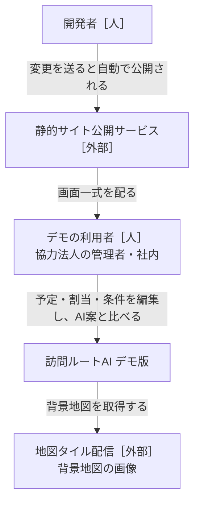
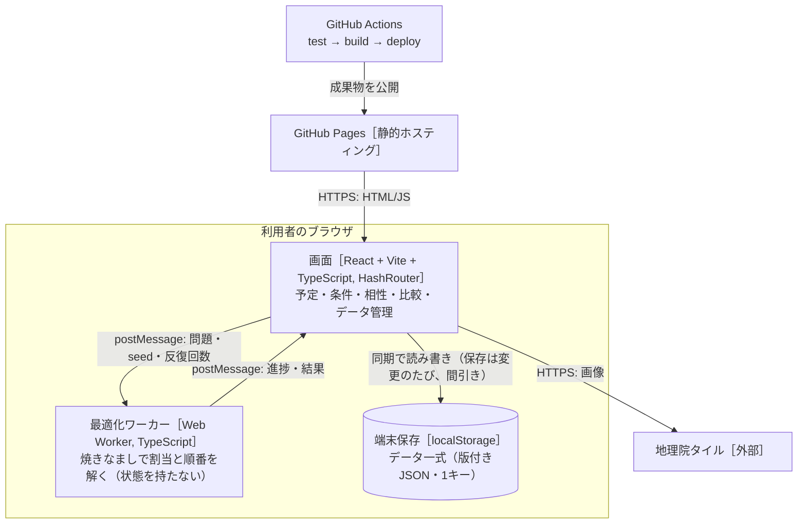
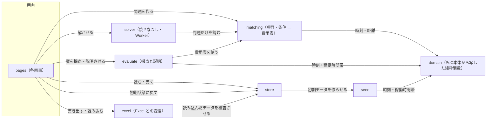

# 設計書：訪問ルートAI デモ版（ブラウザ完結）

- PRD：[docs/prd.md](prd.md)
- 作成者：松浦（草案：Claude）
- 更新日：2026-10-13（点数を1.6倍に（100点を超えてよい。ADR-0007 追記）。プリセットをデータ `presets` に持たせ利用者が編集・追加・削除（最大6つ）、開いた日に全プリセットで自動作成、プリセットごとの案のカード、条件ごとの達成の件数、Excel の「プリセット」シート。ADR-0008）。2026-10-13（合計点を100点満点・高いほど良いで見せる。表示だけで探し方は変えない。ADR-0007）。2026-10-13（Excel の書き出し・読み込み、コンポーネント excel。ADR-0006）。2026-10-12（比較を「AI案の条件を変えた記録どうし」に変更、条件のプリセット3種、手作業の割当は seed に入れない。ADR-0005）。2026-10-11：負担の均等を2乗に・必須で上限、AI案の手直しと固定、比較は別画面（ADR-0004）
- 状態：合意済み（2026-10-11）

## 1. 背景と目的

PoC本体（`katahimo-dev/visit-route-poc`）の管理者画面（予定・手作業の割当・AI案との比較）を、サーバーなしでブラウザだけで動く静的サイトに移し、GitHub Pages で公開する。
データは localStorage に残し、JSON で書き出し・読み込みする。
最適化は Python（OR-Tools）の代わりに Web Worker 上の焼きなましで解き、ClassClassify のように**項目・条件・重み（0〜5）・必須**で、相性・スタッフの特性・顧客の希望を柔軟に足せるようにする。
目的は、協力法人に触ってもらって割当の考え方を集めるサイクルを速く回すこと（PRD §1）。

## 2. やらないこと

- ログイン・サーバー保存・事業所の分離・同時編集。外部送信は地図タイルの取得だけ
- Firebase・Cloud Functions・Python 最適化・Google Maps Platform。移動時間は直線距離からの概算（PoC本体 `estimateLeg`）だけ
- スタッフの記録・位置・ジオフェンス・勤怠・CSV・通知・PWA のオフライン対応
- 相性の学習。相性・特性・希望は人が入れる
- 月次シフトの一括作成。AI案は1日単位
- PoC本体へのコードの書き戻し。共通の純粋関数は**写して**使い、同期しない（ADR-0001）

## 3. 全体図

### L1 システムコンテキスト



### L2 コンテナ



### L3 コンポーネント



矢印は「読む・呼ぶ」。データを書き換えるのは store だけ（§4）。solver と evaluate は同じ費用表（matching の出力）を使い、AI案と手作業案を**同じ物差し**で採点する。

## 4. コンポーネントと責務

### store（データ一式の保存）
- 責務：データ一式（`DemoData`）の読み込み・保存・検査・版の移行、JSON の書き出し・読み込み、初期状態に戻す。画面へは React のフック（`useDemoData()`・`update(fn)`）で渡す。
- 持つデータ（持ち主）：`DemoData`＝`{ version, org, staff[], clients[], visits[], availability[], manualPlans{date→routes}, items[], rules[], compat{clientId→{staffId→-2..2}}, aiPlans{date→AiPlan（routes＝手直し後、generated＝AIが出したまま、pins＝固定）}, aiRuns{date→AiRun[]（記録。§5）}, presets[]（条件のプリセット。最大6つ。§5。ADR-0008）, seed }`。`prevAiPlans`（前回のAI案）は廃止し、記録に置き換えた。localStorage のキー `vrdemo:data:v1` に1つの JSON で置く。
- 提供するAPI：`repair(data)`（契約は通るが中身が食い違うデータを直す：いない人・訪問を指す割当・相性・上書き・固定を除く、ID の重複は最初の1件。記録 `aiRuns` も同じに直し、いない人・訪問を指す記録の割当を除き、1日20件を超える分は古いものから捨てる。プリセット `presets` は id の重複を最初の1件に、6つを超える分は後ろを捨て、0件なら初期の3種、重みは 0〜5 に収めて 0.5 刻みに丸め、必須にできない型の必須は外す。`migrate` のあとに必ず通す）、`load(): DemoData`、`save(data)`（300ms 間引き）、`reset(): DemoData`、`exportJson(data): Blob`、`importJson(text): DemoData | ImportError`、`migrate(raw): DemoData`。版は1のまま。読み込み時、`prevAiPlans` は捨て、`aiRuns` が無い古いデータは `{}` で、`presets` が無い古いデータは初期の3種（seed の `INITIAL_PRESETS`）で補う（`migrate` の既定値。版は1のまま）。
- 依存するもの：seed（初期データ）、zod（検査）。
- 配置：`src/store/`
- 完了の条件：
  - [ ] 壊れた・古い版の JSON を読むと、移行するか、元のデータを残したまま利用者向けの日本語のエラーを返す（画面が真っ白にならない）
  - [ ] 書き出し → 読み込み で同じデータに戻る（テスト）
  - [ ] localStorage の容量超過で保存に失敗したら、書き出しを促す表示を出す

### seed（デモの初期データ）
- 責務：PoC本体 `scripts/seedDemo.ts` の生成ロジック（仙台・スタッフ8人・訪問先20か所・日ごとの予定・稼働時間帯の上書き）を写し、本デモの項目・条件・相性の初期セットと、条件のプリセットの初期値3種（`src/seed/presets.ts` の `INITIAL_PRESETS`。データの `presets` に入る）を足す。手作業らしい割当は内部でだけ作り、データには入れない（`visits[].staffId` はすべて null、`manualPlans` は空 `{}`）。PoC本体の seed からのデモ独自の差分：スタッフの呼び方は「スタッフ」（業種 care の既定「ヘルパー」は `domain/terms.ts` に写したまま変えない。呼び方はデータの画面で変えられる）、項目「得意」に「料理」を足す。ただし訪問先の「いつもの担当」（`usualStaffId`）は、その割当で最も多く担当した人にする（継続の条件を試せるように）。日付だけで同じ結果が決まる。
- 持つデータ（持ち主）：なし
- 提供するAPI：`createDemoData(today: string): DemoData`（今日から14日分）
- 依存するもの：domain
- 配置：`src/seed/`
- 完了の条件：
  - [ ] PoC本体の性別希望（c6・c18 女性、c11 男性）は「性別」項目＋訪問先の必要条件に、NG（c2→s2、c12→s7）は相性「×」になる
  - [ ] 初期の項目は スタッフ側：性別・資格（介護福祉士/看護師/保育士/初任者研修 の複数）・経験年数（数値）・得意（高齢/子ども/障害/家事/話し相手 の複数）・喫煙者・ペット可。訪問先側：ペットあり・喫煙環境・対象（高齢/子ども/障害）。初期の条件は §5 の表の既定値
  - [ ] 同じ日付を渡すと同じデータになる（テスト）
  - [ ] 手作業の割当が入らない（全訪問の `staffId` が null、`manualPlans` が `{}`）。`usualStaffId` は入る（テスト）
  - [ ] プリセットの初期値は3種（標準・移動を短く・人の組み合わせ重視。id は `standard`・`travel`・`people`）。型ごとに重み・必須を決め、条件（rules）の型ごとに上書きする（§5 の表）。`applyPreset(rules, preset)`・`presetOf(rules, presets)` を持つ

### domain（PoC本体から写した純粋関数）
- 責務：時刻（`hhmmToMinutes` など）、距離と移動の概算（`distanceMeters`・`estimateLeg`）、稼働時間帯（`availabilityOf`・`shiftOf`・`withinSlots`）、ルート評価（`evaluateRoute`）、手作業の割当の補助（PoC本体 `web/src/features/admin/schedule/model.ts` の `reconcile`・`assign`・`timesOf`・`warningsOf`）。
- 持つデータ（持ち主）：なし
- 提供するAPI：PoC本体と同じ名前・同じ引数（写したときのコミットをファイル先頭のコメントに書く）
- 依存するもの：なし（zod のみ）
- 配置：`src/domain/`
- 完了の条件：
  - [ ] PoC本体の該当テストを一緒に写して通る

### matching（項目・条件 → 費用表）
- 責務：項目（`Item`）・スタッフの特性値・訪問先の必要条件と希望・相性・条件（`Rule`）を、solver が読む**問題（`Problem`）**に変換する。①訪問×スタッフの**可否**（必須の条件・相性×・稼働時間帯の外）②訪問×スタッフの**割当費用**（重み付きの条件の合計、分換算）③スタッフごとの負担の目標（均等の条件）④移動・待ちの行列と係数。同じ関数で、訪問×スタッフごとの**理由**（どの条件で何分ぶん）も返す。
- 持つデータ（持ち主）：なし
- 提供するAPI：`compile(data: DemoData, date: string, pins?: 訪問ID→担当ID): Problem`（pins の訪問はその担当だけを可にする）、`matches`、`conditionText`、`scheduleRoute`、`bestInsertion(problem, routes, visitId, staffId)`（手直しで移した訪問を入れる位置：strict で最も費用が少ない位置、入らなければ開始時刻の順に lenient で入れ、違反として見せる）
- 依存するもの：domain
- 配置：`src/matching/`
- 完了の条件：
  - [ ] 重み0の条件は費用にも理由にも出ない。必須の条件を満たさない組は可否で外れる（テスト）
  - [ ] 項目を消すと、それを参照する条件は「無効（項目がない）」になり、計算は止まらない
  - [ ] どの訪問にも担当の候補がいないとき、`Problem.infeasible` に訪問と原因の条件を入れる

### solver（最適化・Web Worker）
- 責務：`Problem` を受け取り、時間の約束・稼働時間帯・可否を破らずに、`移動分 + 待ち分×係数 + 割当費用 + 均等の費用 + 落とした訪問×10000` を最小にする割当と順番を返す。焼きなまし（ADR-0003）。決定的な乱数（seed）と**反復回数**で止める（時刻で止めない。D10）。
- 持つデータ（持ち主）：なし
- 提供するAPI：Worker メッセージ（§5）。純粋関数 `solve(problem, {seed, iterations}, onProgress?)` も公開し、テストは Worker なしで呼ぶ
- 依存するもの：matching の `Problem` 型のみ
- 配置：`src/solver/`
- 完了の条件：
  - [ ] 同じ問題・seed・反復回数で同じ結果（テスト）
  - [ ] 出た案は可否・時間の約束・稼働時間帯を必ず守る（evaluate で違反0。性質テスト）
  - [ ] 8人・20件で 3秒以内、30人・150件で 30秒以内（中位のノートPC）。計算中に「止める」を押すとそれまでの最良案を返す
  - [ ] 全条件の重み0・移動だけのとき、PoC本体の手作業案（seed）より総移動が短い

### evaluate（採点と説明）
- 責務：AI案（記録・今の案・手作業案のどれも）を同じ `Problem` で採点する。合計点、移動・待ち・距離、条件ごとの達成/違反の数、訪問ごとの理由（`相性◎` `希望○ 女性` `資格✓` `継続` `移動+12分`）、守れなかった必須の条件（手作業案は保存を止めず警告だけ）、記録どうしの差（担当が変わった訪問数・移動の増減。比較画面では A・B ともいまの条件で採点し直す）。
- 持つデータ（持ち主）：なし
- 提供するAPI：`score(problem, routes): PlanScore`、`explain(problem, routes): VisitExplain[]`、`diff(a, b): PlanDiff`、点数の物差し `normalize(problem): ScoreScale`・`toHundred(cost, scale)`（1.6倍した点）・`hundredBreakdown(score, scale, problem): HundredPart[]`・`naivePlan(problem)`（§5「点数」。ADR-0007）、条件ごとの達成の件数 `achievements(problem, routes): RuleAchievement[]`（§5。ADR-0008）
- 依存するもの：matching、domain
- 配置：`src/evaluate/`
- 完了の条件：
  - [ ] solver の内部の費用と `score` の合計点が一致する（テスト）
  - [ ] 理由は分換算の大きい順に3つまで出す
  - [ ] 点数：費用が低いほど点が高い（単調）、0 で止まり上は 160 まで（100 を超えうる）、素朴な案自身は0点、下限は160点、同じ入力で同じ物差し、seed データで AI案が素朴な案より高い点、下限 ≤ どの案（必須を守る案）の費用（テスト）
  - [ ] 達成の件数：分母はその条件の判定がある割当済みの訪問、分子はその条件の判定をすべて満たした訪問。相性は ◎・○・△・× の件数、負担の均等は目安の帯に収まった人数（テスト）

### excel（Excel との変換。ADR-0006）
- 責務：`DemoData` ⇔ Excel のブック（シートごとの一覧。プリセットも入る）の変換。書き出しは見出し・列幅・プルダウン付きのテンプレートにする。読み込みは名前の参照を ID に直し、読めない値・同じ名前・いない人の参照を「シート名・行・列」付きの日本語のエラーで返す。データは書き換えない（変換した `DemoData` を返すだけ。画面が store の `migrate`→`replace` で入れる）。
- 持つデータ（持ち主）：なし
- 提供するAPI：`exportWorkbook(data) → Blob`、`importWorkbook(file: ArrayBuffer, base: DemoData) → DemoData | ImportError`（どちらも非同期）。`base` からは版・基準日など Excel に無いものだけを引き継ぎ、案（`manualPlans`・`aiPlans`・`aiRuns`）は空にする。「プリセット」シートが無い古いブックは、`base` のプリセットをそのまま使う。
- 依存するもの：ExcelJS（画面から動的 import）、contracts、store（`migrate` で最後に検査）、matching（条件の表示文）
- 配置：`src/excel/`
- 完了の条件：
  - [ ] 書き出し → 読み込み で、案を除いて同じデータに戻る（テスト。ID・並び順も保つ）
  - [ ] ID 列が空の行は新しい人・訪問・項目・条件として足される。行を消すとその人・訪問は消える
  - [ ] 同じ名前・いない人の参照・読めない値・必須の列の欠けは、シート名と行番号付きのエラーで止め、いまのデータはそのまま
  - [ ] 外部への送信はしない

### pages（画面）
- 責務：PoC本体の管理者画面（予定・AI案の比較・稼働時間帯・スタッフ・訪問先）を Firebase なしで動かす。最初に開く画面は `#/plan`。追加の画面：項目、条件（重みのスライダー 0〜5・必須の切り替え。ClassClassify の Setup にならう）、相性の表（訪問先×スタッフ、クリックで ◎→○→空→△→× を回す）、データ（書き出し・読み込み・初期状態に戻す・実データを入れないでの注意書き）。スタッフの今日の順番を見る画面（D16、表示だけ）。
- 特性と条件の入力（`components/conditions.tsx`）：特性のあり/なしは「未確認・あり・なし」。条件は相手の項目ごとの1行のチェック表で、何も選ばない項目は問わない。あり/なしの条件の「なし」は `is false`（未確認の相手は満たさない＝安全側）で、`not` は画面からは作らない（前からある `not` は「そのほかの条件」に出して消せる）。保存の形は `Condition[]` のまま
- 持つデータ（持ち主）：画面の一時状態のみ
- 提供するAPI：なし（ルートは `#/schedule`（訪問の編集と手作業の割当。AI案を「予定に採用」もここへ写る） `#/plan`（AI案を作る・手直し・固定・組み直す・予定に採用。開いた日にAI案がなければ、`data.presets` の順に1つずつ Worker で自動で作り、どれも記録に残す（進み具合「プリセット 2/3」を出し、「止める」で今の1つを途中の最良で残して残りはやめる。今の案は最初に作れた案）。その日の条件 `data.rules` は書き換えず、作った案の `rules` にプリセットの重みが残る。上部にプリセットごとの案のカード（下記）。今の案の欄に条件ごとの達成の件数（D25）。重みの欄にプリセットのボタン（最大6つ）と「いまの重みをプリセットとして保存」。押すとその日の条件をプリセットの重みにして、すぐAI案を作る。作る・組み直すたびに記録へ1件足す） `#/compare`（AI案の記録どうしの比較、D19・D22。下記） `#/rules` `#/items` `#/compat` `#/staff` `#/clients` `#/availability` `#/data` `#/staff-view/:staffId`）
- `#/plan` のプリセットのカード（ADR-0008）：プリセットごとに、その日の記録のうち固定なしで重み・必須がそのプリセットと一致する最新の記録を1枚のカードにする（名前・点数・移動・入らない訪問・必須の違反・条件の達成の要約）。点数はどれもいまの条件の同じ物差し。一番点の高いカードに王冠。カードの「この案にする」（通常のボタン）でその記録を今の案にする。記録の無いプリセットは「まだ作っていません」で、「足りない案を作る」（通常のボタン）で順に作る
- `#/rules` のプリセットの節（ADR-0008）：プリセットごとに名前・一言・型ごとの重み（0〜5、0.5刻み）・必須を編集（変えるとすぐ保存）、消す（最後の1つは消せない）、「いまの重みをプリセットとして保存」（名前を入れて足す。6つまで）、「初期値に戻す」（初期の3種に戻す。確認を出す）
- `#/compare` の中身：その日の記録と「今の案（AI案の画面の手直し後）」から任意の2つを A・B に選んで比べる。条件の差（重み・必須が違う条件の一覧）、合計点・移動・待ち・距離・入らなかった訪問・必須の違反、条件ごとの達成/違反（採点は A・B とも、いまの条件の同じ物差し）、担当ごとの順番の左右比較、地図（A：点線、B：実線）。記録の一覧から「AI案の画面で開く」（その記録を今の案にする）・「この条件にする」（その日の条件の重み・必須を記録と同じにする）・「消す」ができる。A と B に同じ案を選ぶと入れ替える。手作業案との比較はしない。
- 依存するもの：store・matching・solver（Worker）・evaluate、Leaflet（PoC本体 `RouteMap.tsx` を写す）
- 配置：`src/pages/`、`src/components/`
- 完了の条件：
  - [ ] 条件の重みを変えて「AI案を作る」→ 10秒以内に点数と理由が出て、記録に1件増える。比較画面で任意の2つの記録を左右に比べられる
  - [ ] AI案がない日に `#/plan` を開くと、すべてのプリセットで順に自動で作られ、カードが並ぶ。同じ条件・種・固定・結果の記録は増えない
  - [ ] 予定画面のドラッグ割当・警告が PoC本体と同じに動く（必須の条件の違反も赤い枠）
  - [ ] 呼び方は `org.terms` から引き、「お客様」「シッター」を直書きしない。主ボタンはオレンジ1色・1画面1〜2個

### deploy（公開）
- 責務：main への push で `npm ci → npm test → npm run build → GitHub Pages へ公開`。
- 持つデータ（持ち主）：なし
- 提供するAPI：なし
- 依存するもの：GitHub Actions（`actions/upload-pages-artifact`・`actions/deploy-pages`）
- 配置：`.github/workflows/deploy.yml`、`vite.config.ts`（`base: './'`）
- 完了の条件：
  - [ ] push から5分以内に Pages の公開URL に反映される
  - [ ] サブパスで再読込しても 404 にならない（HashRouter）

## 5. API契約

サーバーの API はない。境界の契約は **TypeScript の型（`src/contracts/`）と Worker のメッセージ**。型の正は `src/contracts/`、ここには一覧と意味を書く。

| コンポーネント | メソッド | エンドポイント | 概要 |
|---|---|---|---|
| store | 関数 | `load / save / reset / exportJson / importJson` | データ一式の保存・入出力 |
| matching | 関数 | `compile(data, date) → Problem` | 項目・条件 → 可否・費用表 |
| solver | Worker | `{type:'solve', problem, seed, iterations}` → `{type:'progress', iter, best}` … `{type:'done', result}` | AI案を作る。`{type:'stop'}` で最良案を返して終わる |
| evaluate | 関数 | `score / explain / diff / normalize / toHundred / hundredBreakdown / achievements` | 採点・理由・記録どうしの差・点数（1.6倍）・条件ごとの達成の件数 |
| excel | 関数 | `exportWorkbook / importWorkbook` | Excel のブックとの変換（ADR-0006） |

### 項目と条件のデータ（`src/contracts/rules.ts`）

```ts
type ItemKind = 'flag' | 'choice' | 'multi' | 'number'      // あり/なし・1つ・複数・数値
interface Item { id: string; name: string; kind: ItemKind; options: string[] }
type TraitValue = boolean | string | string[] | number | null
// staff[].traits: Record<itemId, TraitValue>

type Op = 'is' | 'in' | 'hasAny' | 'hasAll' | 'gte' | 'lte'
interface Condition { itemId: string; op: Op; value: TraitValue | string[] }
// clients[].requirements: Condition[]   … 必要条件（満たさないと違反）
// clients[].preferences:  Condition[]   … 希望（満たさないと違反、満たしても加点なし）
// clients[].usualStaffId: string | null … いつもの担当
// compat[clientId][staffId]: -2(×) | -1(△) | 1(○) | 2(◎)  未入力は0

type RuleType =
  | 'requirement'   // 訪問先の必要条件
  | 'preference'    // 訪問先の希望
  | 'compatibility' // 相性（×は weight にかかわらず必須で外す）
  | 'continuity'    // いつもの担当
  | 'balance'       // 負担の均等（稼働時間に比例した件数の目安の帯から外れた件数の2乗。hard で上限＝帯の上＋1）
  | 'wait'          // 待ち時間
interface Rule { id: string; type: RuleType; label: string; weight: number /*0..5, 0.5刻み*/; hard: boolean }
```

### AI案の記録と条件のプリセット（`src/contracts/data.ts`・`src/contracts/rules.ts`、初期値は `src/seed/presets.ts`）

```ts
interface AiRun {
  id: string                 // `${date}#${no}@${createdAt}`（最新を消すと番号は使い回すため、時刻で別の記録と分ける）
  no: number                 // その日の通し番号
  date: string
  createdAt: number          // ミリ秒
  label: string              // プリセットと一致すればその名前、違えば「条件を変えた案」。組み直しは「…・固定n件で組み直し」
  presetId: string | null    // 一致したプリセット、無ければ null
  seed: number
  iterations: number
  rules: Rule[]              // 作ったときの条件
  pins: Record<visitId, staffId>
  routes: ...                // 結果（AiPlan.generated と同じ形）
  unassigned: ...
  score: ...
  stopped: boolean
}
// DemoData.aiRuns: Record<date, AiRun[]>

interface Preset {            // src/contracts/rules.ts の presetSchema（ADR-0008）
  id: string                  // 初期の3種は 'standard'・'travel'・'people'。足したものは新しい ID
  name: string                // 1〜20字
  note: string                // 0〜60字（画面に出す一言）
  weights: Record<RuleType, { weight: number /*0..5, 0.5刻み*/; hard: boolean }>
}
// DemoData.presets: Preset[]（1〜6つ。MAX_PRESETS）。無い古いデータは migrate で INITIAL_PRESETS

interface RuleAchievement {   // src/contracts/problem.ts（evaluate.achievements。ADR-0008）
  ruleId: string              // Rule.id。負担の均等は 'balance'
  unit: 'visit' | 'staff'     // 分母の単位（負担の均等だけ人）
  total: number               // その条件の判定がある割当済みの訪問（均等は人数）
  met: number                 // その条件の判定をすべて満たした（点が0以下の）訪問
  compat: { great: number; good: number; poor: number; ng: number } | null  // 相性だけ ◎・○・△・× の件数
}
// Reason.level?: 2 | 1 | -1 | -2 … 相性の理由にだけ付ける（◎・○・△・×）
```

- 記録は、AI案を作る・固定を残して組み直すたびに、その日の `aiRuns` に1件足す。同じ条件（rules）・seed・pins・結果の記録がすでにあれば足さない。1日20件まで、古いものから消す（localStorage の容量のため。ADR-0005）
- 比較画面は、記録の結果を**いまの条件**（`data.rules`）で採点し直して比べる。記録の `score` は作ったときの条件での点数で、比較には使わない
- プリセットはデータ（`data.presets`）。初期値は `src/seed/presets.ts` の3種。型ごとに重み・必須を決め、条件（rules）の型ごとに上書きする。最大6つ、最後の1つは消せない。「いまの重みを保存」は型ごとの最初の条件の重み・必須を写す（その型の条件が無ければ重み0）
- 記録の `presetId`・名前は、作ったときの重みと一致したプリセット（同じ重みのプリセットが2つあれば先の方）

| 初期のプリセット | 訪問先の必要条件・スタッフの条件 | 訪問先の希望 | スタッフの希望 | 相性 | いつもの担当 | 負担の均等 | 待ち |
|---|---|---|---|---|---|---|---|
| standard「標準」（既定。初期の重み） | 必須 | 3 | 2 | 3 | 2 | 3 | 3 |
| travel「移動を短く」（移動・待ちを優先） | 必須 | 1 | 1 | 1 | 0.5 | 1 | 3 |
| people「人の組み合わせ重視」 | 必須 | 5 | 4 | 5 | 4 | 3 | 2 |

（列は条件の型：`clientRequirement`・`staffRequirement`・`clientPreference`・`staffPreference`・`compatibility`・`continuity`・`balance`・`wait`。型の正は `src/contracts/rules.ts`）

### Excel のブックの形（`src/excel/`。ADR-0006）
1行目が見出し、2行目からデータ。参照は名前で書く（〈スタッフ〉の名前・〈利用者さん〉の表示名は各シートで一意。項目の名前は対象ごとに一意で、対象が違えば同じ名前でよい。条件の名前はどこからも参照しないので重なってよい）。○＝はい、空＝いいえ。複数の値は「、」か改行で区切る（「・」「,」「，」は区切らない＝選択肢の名前に使える）。見出しは全角半角・コロンの揺れを許して比べる。呼び方（スタッフ・利用者さん）はシート名・見出しにも `org.terms` を使う。

| シート | 列 |
|---|---|
| 使い方 | 書き方の説明だけ（読み込みでは見ない） |
| 事業所 | 「項目」「値」の2列：事業所名・業種・呼び方（訪問する人）・呼び方（訪問先）・1kmあたりの運賃（円）・乱数の種 |
| 項目 | ID・対象（〈スタッフ〉／〈利用者さん〉）・名前・種類（あり/なし／選択肢から1つ／選択肢から複数／数値）・選択肢 |
| 条件 | ID・名前・種類（条件の型の名前）・重み（0〜5、0.5刻み）・必須（○） |
| プリセット | ID・名前・一言・重み：〈条件の型の名前〉…（型ごと。0〜5、0.5刻み。空は0）・必須（必須にする条件の型の名前を「、」区切り）。1〜6行。シートが無い古いブックは、いまのプリセットのまま |
| 〈スタッフ〉 | ID・名前・移動手段・勤務する曜日（例：月火水木金）・勤務開始・勤務終了・利用中・住所・緯度・経度・〈特性：項目名〉…・〈必要条件：項目名〉…・〈希望：項目名〉… |
| 〈利用者さん〉 | ID・表示名・色（1〜8）・利用中・住所・緯度・経度・いつもの担当・メモ・〈特性：項目名〉…・〈必要条件：項目名〉…・〈希望：項目名〉… |
| 相性 | 行＝〈利用者さん〉の表示名、列＝〈スタッフ〉の名前。セルは ◎・○・△・×・空 |
| 稼働時間 | 〈スタッフ〉・日付・時間帯（例：9:00-12:00、13:00-18:00。「休み」で休み）。その日だけの上書き |
| 訪問 | ID・日付・〈利用者さん〉・時間の決め方（ちょうど／幅）・開始（早）・開始（遅）・所要（分）・担当・取り消し・メモ |

- 特性のセル：あり/なし＝「あり」「なし」、空＝未確認。選択肢から1つ＝選択肢そのもの。選択肢から複数＝「、」区切り（「（なし）」と書くと確認済みで1つもない）。数値＝数
- 選択肢の名前に「、」・改行・「（なし）」は使えない（項目の画面で弾く。書き出し時にあれば、場所を示して書き出しを止める）。セル（条件は1行）全体が1つの選択肢の名前と同じなら、印（「以外」「すべて：」など）より先にその選択肢として読む
- 条件のセル（相手の項目ごと。空＝問わない）：あり/なし＝「あり」「なし」「なし（未確認も可）」「あり（未確認も可）」（後ろ2つは `not`）。選択肢から1つ＝「A、B」（どれか）／「A以外」（`not`）。選択肢から複数＝「A、B」（どれかを含む）／「すべて：A、B」。数値＝「3以上」「5以下」「3〜5」「3」（等しい）／「3以外」
- 補足（実装で決めたこと）：業種は「ベビーシッター・介護・訪問看護・その他」で書く。同じ項目の条件が2つ以上でセルに書けないときは、セルの中で改行して1行に1つ（数値の以上と以下の2つは「3〜5」）。選択肢から1つの条件で値が1つだけなら `is` で読む（`in` の1つと意味は同じ）。読み込むと条件は項目の列の順に並ぶ
- 読み込みで止めるもの：必須の列が無い、項目のシートにある項目の「特性：」「必要条件：」「希望：」の列が無い・項目のシートにない項目の列がある、同じ名前（〈スタッフ〉・〈利用者さん〉・同じ対象の項目）、同じ ID、ID が `__proto__`・`constructor`・`prototype`、いない名前の参照、読めない値（時刻・日付・数・選択肢にない値。時刻の列の 1 以上の数・数式のエラー・結果の無い数式も）、20件を超える条件、contracts の長さの上限（ID・名前・メモ・住所・選択肢の数と長さ）を超える値、稼働時間で同じ人・同じ日の行が2つ、2つの呼び方が同じ。ファイルは 10MB・1シート 1万行まで。止めたときは、いまのデータを変えない
- 書き出す数は指数表記にしない。画面は先に読み込んで検査し、通ったら件数を見せて確かめてから置き換える

### 費用の物差し（分換算）

| 条件 | 既定 | 1件あたりの費用 |
|---|---|---|
| 移動時間 | 常に有効 | 移動1分＝1点（基準） |
| requirement | **必須** | 必須なら可否で外す。重みなら 違反1件＝重み×10点 |
| preference | 重み3 | 満たさない希望1つ＝重み×10点 |
| compatibility | 重み3 | ◎＝−重み×10、○＝−重み×5、空＝0、△＝＋重み×10、×＝必須で外す |
| continuity | 重み2 | いつもの担当でない＝重み×10点 |
| balance | 重み3 | スタッフごとに、目安の帯 [floor, ceil] から外れた件数 e について 重み×10×e² 点（1件外れ＝30点、2件＝120点、3件＝270点）。必須なら 件数 ≤ ceil＋1 |
| wait | 重み3 | 待ち1分＝重み×0.1点（PoC本体の waitSeconds 0.3 と同じ） |
| 時間の約束・稼働時間帯 | 必須（固定） | 破らない |
| 落とした訪問 | 固定 | 1件＝10000点 |
| 手直しの固定 | 必須（固定） | 固定した訪問は固定した担当だけを可にする（`compile` の `pins`） |

（重み1＝移動10分ぶん。2026-10-11 決定）

#### 点数（表示だけ。ADR-0007）
上の費用（低いほど良い。solver が最小化）はそのまま。画面の合計点だけを、費用の一次変換（単調）で「高いほど良い」点数にする（下限＝100・素朴な案＝0 の点に 1.6 を掛ける。2026-10-13 追記）。案の順位は費用と必ず一致する。物差しはその日の `Problem`（いまの条件）から決まる。

- 100点＝下限 LB（どの案の費用も LB 以上。現実にはまず届かない）＝割当の下限＋移動の下限（待ち0・負担の均等0）。担当の候補がいない訪問は落とした訪問の点（どの案でも避けられない）
  - 割当の下限：各訪問を、可否を満たす担当のうち割当費用が最小の人にした合計
  - 移動の下限：ルートの移動は「各訪問に来る移動の和＋帰り」＝「各訪問から出る移動の和＋行き」なので、max(Σ 来る移動の最小, Σ 出る移動の最小)。来る元＝その訪問を担当できる人の自宅か、前に置けうる訪問（u の earliest＋作業＋移動 ≤ v の latest で、両方を担当できる人がいる）。出る先＝担当できる人の自宅か、後に置けうる訪問。移動は分＝点（solver と同じ）
  - 1件ごとに割当＋移動の下限が落とした訪問の点（10000）を超えるなら 10000 にする（落とす案もあるので）
- 0点＝素朴な案 N：訪問を開始（earliest）の早い順に、可否・件数の上限・時間の約束・稼働時間帯（strict）を満たす担当のうち、直前の場所（最後の訪問先、無ければ自宅）からの移動が最短の人の最後に足す（同じなら staff の順で先の人）。入れられない訪問は入らない。これを `score` で採点した費用。乱数・時刻は使わない
- 点数＝round(160 × (N − 費用) / (N − LB))（倍率 `SCORE_MULTIPLIER`＝1.6）。0 で止め、上は 160 まで（100 を超えてよい）。N ≤ LB なら 160。表示は「72点」（「/100」は付けない）
- 内訳：成分ごとの超過（移動−移動の下限・待ち×係数・担当の条件−下限の割当費用・負担の均等・(入らない訪問−候補のいない訪問)×10000）× 160/(N − LB) を「−x点」で示す。合計は 160−点数（丸め・0 で止めた分を除く）
- 内部の費用は説明に「費用 543（内部の値）」として残す。`SolveResult.score`・`PlanScore.total` は費用のまま

### エラー方針
| コード | HTTP | 意味 | 呼び出し側の対応 |
|---|---|---|---|
| INVALID_ARGUMENT | — | 読み込んだ JSON が契約に合わない | 画面に日本語で原因（項目名）を出し、元のデータを残す |
| FAILED_PRECONDITION | — | その日の訪問・稼働中のスタッフがいない、どの担当も可にならない訪問がある | 原因の訪問と条件を出す。解ける訪問だけで解く |
| RESOURCE_EXHAUSTED | — | localStorage の容量超過 | 書き出しを促す |
| ABORTED | — | 利用者が計算を止めた | それまでの最良案を出す |

Worker 内の例外は `{type:'error', message}` で返し、内部の文言をそのまま画面に出さない。

### 冪等性・タイムアウト
- 同じ `Problem`・`seed`・`iterations` からは同じ結果（反復回数で止め、時刻・`Math.random` を使わない）
- 反復回数の既定は問題の大きさから決める（目安 3秒）。上限 30秒で `stop` を送り、最良案を採る
- 保存は上書きのみ（1キー）。読み込みは「置き換える前に確認」を出す

## 6. デプロイ構成
| コンテナ | 実行環境 | 台数・複製 | 理由 |
|---|---|---|---|
| 画面・最適化ワーカー | GitHub Pages（静的配信） | 1 | 無料・push で即公開・サーバーなし |
| ビルド | GitHub Actions（ubuntu-latest, Node 22） | push ごと | テストを通ったものだけ公開 |

- 秘密情報の置き場所：なし（キー不要の地理院タイルのみ。ビルド時の環境変数も使わない）
- バックアップ・停止の許容：データは利用者のブラウザだけ。消えても「初期状態に戻す」で再開できる。大事な設定は JSON に書き出す
- 費用の目安：0円

## 7. 代替案とトレードオフ
| 論点 | 採用 | 不採用の案 | 理由 |
|---|---|---|---|
| デモの置き場所 | 新リポジトリ・GitHub Pages（ADR-0001） | PoC本体の Firebase デモ環境（`katahimo-visit-route-demo.web.app`） | ログイン・関数・費用・デプロイ手順が不要で、push だけで回せる。代わりに記録・勤怠は見せられない |
| PoC本体のコード | 純粋関数・画面を**写す** | モノレポに `apps/demo` として同居、npm パッケージ化 | PoC本体の α版（10月末）を止めない。同期の手間は受け入れる（写した元のコミットを記録） |
| 保存 | localStorage（1キー JSON） | IndexedDB | 14日分×20件で数百KB。同期APIで単純。足りなくなったら移す |
| 最適化 | 焼きなまし（TS・Web Worker、ADR-0003） | OR-Tools の WebAssembly 版、Python を Pyodide で | 依存が軽い、ClassClassify で実績、任意の費用関数（相性・希望・均等）をそのまま入れられる。最適性の保証は失う |
| 条件の表し方 | 項目＋条件の型＋重み0〜5＋必須（ADR-0002） | 自由な式・スクリプト、固定の項目だけ | 管理者が自分で組める範囲に絞る。ClassClassify と同じ操作感 |
| 点数の見せ方 | 届かない下限と素朴な案（0点）のあいだを一次変換し、1.6倍（下限＝160点。ADR-0007） | 減点方式、記録の最良を100点、倍率なし | 順位が費用と一致し、0点・下限の意味を説明できる。1.6倍で良い案が80点前後に見える。100点を超えることがあるのは受け入れる |
| プリセット | データに持たせ利用者が編集・追加・削除（最大6つ）。開いた日に全プリセットで作り、カードでいまの条件の同じ物差しで並べる（ADR-0008） | 定数のまま、標準だけ自動、プリセットごとの物差し | 開いただけで選べる。事業所ごとの考え方を残せる。開いたときの計算は長くなる（止められる） |
| Excel の入出力 | マスタと予定だけ・名前で参照・ExcelJS（ADR-0006） | 案も入れる、ID で参照、SheetJS | テンプレートとして手で書き足しやすく、古い案との食い違いを避ける。ファイルの重さは動的 import で抑える |
| 時間の約束 | 必須のまま（2026-10-11） | 重み付きの条件にして緩める | PoC本体と同じ前提で比べるため |

## 8. 未決事項
| 項目 | いつ・何をもとに決めるか |
|---|---|
| 時間の約束を緩める条件を足すか | 初回デモで「少し遅れてもよい」訪問の話が出たら |
| 項目の初期セット | 初回デモ前に、alca様・フォール様のヒアリング内容から |
| 写した純粋関数を PoC本体と揃え直す時期 | PoC本体の α版リリース後（11月） |
